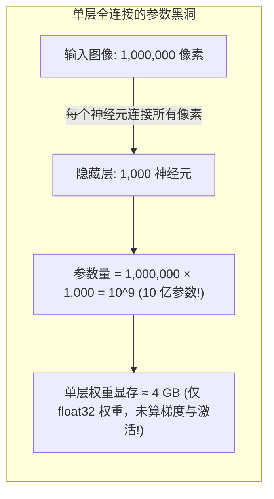
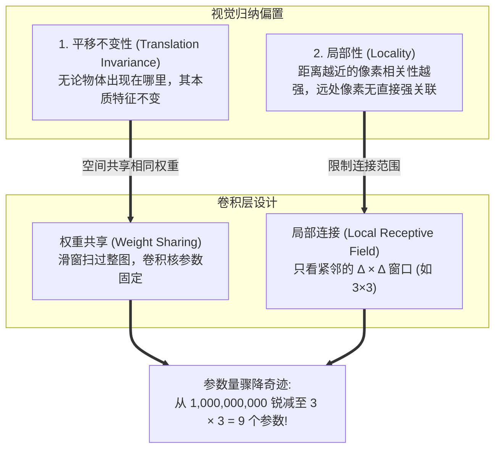
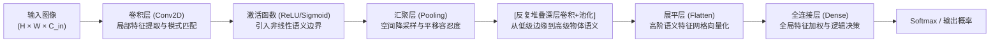

> 导航：[上一章: 第5章 深度学习计算](../深度学习计算/5.0%20章节全景与导读.md) | [[6.1 从全连接层到卷积| 下一节: 6.1 从全连接层到卷积]]

---

# 第6章 卷积神经网络（Convolutional Neural Networks, CNN）

在前五章中，我们已经掌握了深度学习的完整计算底座：从线性回归、Softmax 分类、多层感知机（MLP），到 PyTorch 的面向对象体系（`nn.Module`）、参数初始化、GPU 异构加速与张量存储流。

然而，当我们试图用之前学到的多层感知机去处理真实的视觉世界（如高分辨率照片、自动驾驶路况、医疗影像）时，会立刻遭遇一个**毁灭性的算力与参数墙**——**参数爆炸与空间结构遗失**。

第 6 章是现代深度学习史上的第一个真正意义上的“杀手级”架构篇章。我们将见证人工智能先驱们如何从生物视觉皮层中汲取灵感，通过引入**空间归纳偏置（Inductive Bias）**，将原本无从训练的数十亿全连接参数压缩为精巧的卷积核，开创长达十余年的计算机视觉统治时代。

---

## 知识图谱与三方映射总表

本章严格遵循双轨融合规范，将官方教材（`chapter_convolutional-neural-networks`）的严谨数学推导与配套讲义（`216`–`220` 系列课件）的直观工程图解深度缝合：

| 节号 | 官方教材 (`d2l-zh/pytorch`) | 配套讲义与工程洞察 (`notebooks/`) | 核心理论、机制与工程实操点 |
| :---: | :--- | :--- | :--- |
| **6.0** | `index.ipynb` | 全景架构 | **章节全景与导读**：MLP 的参数坍塌陷阱、空间归纳偏置（平移不变性与局部性）、CNN 演进全景树 |
| **6.1** | `why-conv.ipynb` | `216_卷积层.ipynb` (Part 1) | [[6.1 从全连接层到卷积\| 从全连接层到卷积]]：4D 权重张量收缩推导、相对坐标系转换、沃尔多（Waldo）实证、数学卷积 vs 互相关 |
| **6.2** | `conv-layer.ipynb` | `216_卷积层.ipynb` (Part 2-3) | [[6.2 图像卷积\| 图像卷积]]：二维互相关运算 `corr2d` 底层实现、自定义 `Conv2D` 模块、图像垂直边缘检测算子、梯度下降反向学习未知卷积核 |
| **6.3** | `padding-and-strides.ipynb` | `217_卷积层里的填充和步幅.ipynb` | [[6.3 填充和步幅\| 填充和步幅]]：特征图空间尺寸退化机制、Padding 边缘补偿公式、Stride 降采样与跨步压缩、感受野（Receptive Field）几何演化 |
| **6.4** | `channels.ipynb` | `218_卷积层里的多输入多输出通道.ipynb` | [[6.4 多输入多输出通道\| 多输入多输出通道]]：彩色多维感知、多输入通道张量累加、多输出通道特征探测器组、$1 \times 1$ 卷积的跨通道信息融合与逐像素 MLP 等价性 |
| **6.5** | `pooling.ipynb` | `219_池化层.ipynb` | [[6.5 汇聚层\| 汇聚层 (Pooling)]]：空间平移轻度容忍度（Robustness）、最大池化（Max Pooling）提取极值特征、平均池化（Avg Pooling）模糊降噪、零参数与通道隔离机制 |
| **6.6** | `lenet.ipynb` | `220_经典神经网络LeNet.ipynb` | [[6.6 卷积神经网络 LeNet\| 经典网络 LeNet]]：1998 年现代 CNN 开山之作、卷积特征抽取 + 全连接分类顶层、Sigmoid 激活与平均池化、Fashion-MNIST 完整 GPU 训练流水线 |

---

## 核心困境：多层感知机（MLP）为何在图像上失效？

想象我们要训练一个简单的分类网络，用于识别一张分辨率仅为 **100 万像素（$1000 \times 1000$ 像素）** 的单通道灰度图片中的猫和狗：

### 1. 参数爆炸与内存坍塌
* 若隐藏层仅仅设置极为克制的 **1,000 个神经元**，连接权重矩阵 $\mathbf{W}$ 的形状即为 $1000 \times 1,000,000$。
* 仅这一层的参数量便高达 **$10^9$（10 亿个标量参数）**！
* 以 32 位浮点数（float32，每个参数占 4 字节）计算，**光存放这一层权重就需要 4 GB 显存**；加上反向传播的梯度缓存与优化器状态（如 Adam 需要 2 倍动量缓存），仅单层就需要超过 **16 GB 显存**！
* 如果是常见的 1200 万像素手机照片和三通道 RGB 图像，参数量将直接突破数百亿，单张图片便会瞬间让现代顶级 GPU 爆显存（OOM）。

### 2. 空间拓扑结构被粗暴抹杀（Flatting Distortion）
* MLP 强制要求将二维矩阵展平成一维长向量：$\mathbf{X} \in \mathbb{R}^{H \times W} \to \mathbf{x} \in \mathbb{R}^{HW}$。
* 这种展平彻底切断了像素之间的**空间网格邻域关系**。在图像中，第 $(0, 0)$ 号像素和第 $(0, 1)$ 号像素原本紧密相连，但在长向量中，它们与第 $(999, 999)$ 号像素被一视同仁地平权对待。

---

## 破局之道：计算机视觉的两大“归纳偏置”（Inductive Biases）

为了打破全连接层的参数黑洞，人类必须向神经网络注入关于视觉物理世界的常识性先验约束，即**两大空间归纳偏置**：

1. **平移不变性（Translation Invariance）**：
   * 一只猫出现在照片的左上角，还是一只猫出现在照片的右下角，决定它是一只猫的特征模式（毛发、胡须、三角形耳朵）完全一样。
   * 因此，神经网络底层的特征检测器**不应该因空间位置的不同而重新学习一套参数**。
   * 对应工程实现：**权重共享（Weight Sharing）**。同一个滑动小窗口（卷积核）扫过整张图像的所有位置。

2. **局部性（Locality）**：
   * 图像中某个像素的语义，几乎完全由其周边紧邻的极小邻域（如 $3 \times 3$ 或 $5 \times 5$）决定。判断某处是否是一根猫胡子，根本无需同时参考屏幕对角线 1000 像素之外的草地。
   * 对应工程实现：**局部感受野（Local Receptive Field）**。隐藏层神经元只与局部小窗口内的输入像素发生连接。

---

## CNN 基础架构阶梯图

从局部滑窗到端到端分类，CNN 建立起一套严密的层次化分工：

1. **底层卷积**：提取低级视觉基元（边缘、明暗渐变、角点、色彩块）；
2. **中层卷积**：组合低级特征，形成部件纹理（车轮线条、动物眼睛、羽毛图案）；
3. **高层卷积**：形成整体语义实体（整只猫、汽车轮廓、人脸）；
4. **汇聚层（池化）**：压缩空间分辨率，扩大后层神经元的感受野，并赋予模型对空间轻微抖动的鲁棒性；
5. **顶层全连接**：综合所有局部高阶特征，完成最终的任务分类。

---

## 本章学习路线与实战指引

学习卷积神经网络绝不能只停留在“调用 `nn.Conv2d`”的 API 层面。建议跟随以下节次步步深入：

1. **第一步（思想与推导）**：研读 [[6.1 从全连接层到卷积]]，亲手推导 4D 权重张量是如何在平移不变性和局部性两个物理约束下，坍缩为一个紧凑的 2D 卷积核。
2. **第二步（手写算子与实验）**：研读 [[6.2 图像卷积]]，在 PyCharm 中手写 `corr2d` 互相关循环，并通过设计垂直边缘过滤器与梯度回传，亲自“炼”出一个能检测边界的卷积核。
3. **第三步（超参数几何调控）**：研读 [[6.3 填充和步幅]] 与 [[6.4 多输入多输出通道]]，彻底掌握特征图尺寸计算公式、多通道累加张量与 $1 \times 1$ 卷积的“跨通道全连接”本质。
4. **第四步（经典网络复刻）**：研读 [[6.5 汇聚层]] 与 [[6.6 卷积神经网络 LeNet]]，在本地 NVIDIA RTX 4050 GPU 上跑通人类历史上首个商业级卷积神经网络，对比它与多层感知机在精度与速度上的降维打击。
