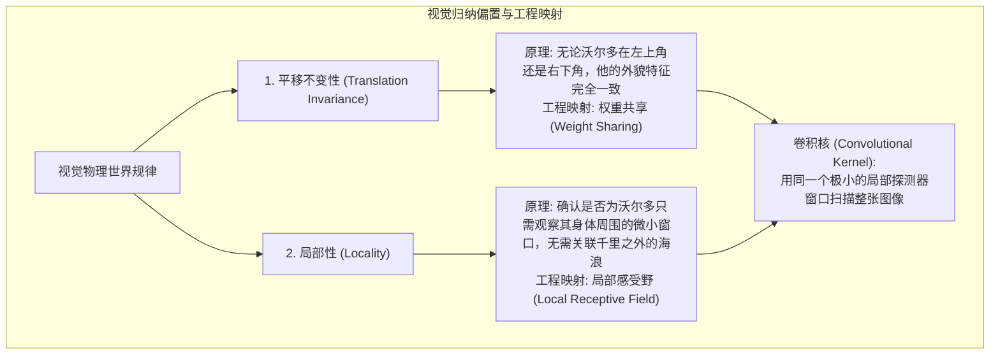

> 导航：[[6.0 章节全景与导读| 章节目录: 卷积神经网络]] | [[6.2 图像卷积| 下一节: 6.2 图像卷积]]

---

# 6.1 从全连接层到卷积（From Fully Connected Layers to Convolutions）

在前几章中，我们处理的多是经典的**表格数据（Tabular Data）**：每一行代表一个独立的样本，每一列代表一个特征属性。对于表格特征（例如房子的卧室数量、房龄、邮编），我们事先无法预判哪些特征之间存在固定的空间拓扑关联，因此让每个神经元与前一层所有输入发生全连接（Fully Connected, MLP）是最通用、最不偏不倚的选择。

然而，一旦我们将这种“无偏见的”多层感知机直接套用到**高维感知数据（如图像、音频、点云）**时，系统便会遭遇灾难性的**参数爆炸与结构失序**。

本节我们将追本溯源，探讨卷积神经网络（CNN）诞生的第一性原理：如何通过引入**平移不变性**与**局部性**两大空间归纳偏置，将原本高达十亿级的四阶权重张量，精炼压缩为一个仅有数个参数的小型卷积核。

---

## 一、多层感知机在图像中的困境：参数黑洞

假设我们需要处理一张最常见的高清照片，分辨率为 **100 万像素（$1000 \times 1000$ 像素）**，且暂时仅考虑单通道灰度图。

![[attachments/slide_mlp_param_explosion.png]]

如果我们构建一个最基础的单隐藏层多层感知机：
* **输入维度**：$1000 \times 1000 = 10^6$ 维；
* **隐藏层单元数**：若仅仅设置相对克制的 $1000$ 个神经元；
* **全连接层权重参数量**：
  $$\text{参数量} = 10^6 \times 10^3 = 10^9 \quad (\mathbf{10 \text{ 亿个参数}})$$
* **显存与算力开销**：
  * 单单存储该层的 float32 权重矩阵就需消耗 $10^9 \times 4 \text{ 字节} = 4\text{ GB}$ 显存。
  * 配合反向传播的梯度张量（4 GB）以及 Adam 优化器的二阶动量缓存（8 GB），**仅此一层前向与反向传播就需要耗尽 16 GB 显存**！
  * 想要拟合如此庞大的参数空间，不仅需要超乎常人的耐心与分布式集群，还会引发灾难性的**严重过拟合（Overfitting）**。

> [!important] 为什么人类能毫不费力地识别图像？
> 人类的大脑在看图时，绝对不是把整幅画面的每一个像素同时与记忆中的数十亿条神经通路做无差别的暴力全连接。自然图像本身存在极其丰富的**物理空间先验结构**：
> 1. 猫的特征（耳朵、眼睛、胡须）是紧密聚集在局部区域的；
> 2. 猫出现在图片的左上方还是右下方，它都依然是一只猫。

---

## 二、两大空间归纳偏置（Inductive Biases）

为了打破多层感知机的参数黑洞，我们从儿童益智游戏**“沃尔多在哪里？”（Where's Waldo? / Where's Wally?）**中汲取直观灵感。

![[attachments/waldo_circled.png]]

在充满上百个游人与遮阳伞的沙滩混乱场景中，沃尔多（红白条纹衫、戴眼镜、毛线帽）可能潜伏在任何一个角落。我们在寻找沃尔多时，大脑执行的核心逻辑正是两大归纳偏置：

### 1. 平移不变性（Translation Invariance）
* **物理直觉**：物体在图像中的空间移动，不应改变物体本身的视觉属性与特征响应。
* **工程映射**：神经网络前面几层的特征检测器，应该对出现在图像任何位置的相同局部模式产生完全相同的反应。因此，**扫描整张图像的检测器权重必须是共享的（Weight Sharing）**。

### 2. 局部性（Locality）
* **物理直觉**：在图像网格中，空间距离越近的像素之间的物理关联性与相关性极高；空间距离较远的像素几乎不存在直接的底层低阶相关性。
* **工程映射**：神经网络的前面几层神经元只需要关注输入图像中的**极小局部区域（如 $3 \times 3$ 或 $5 \times 5$ 的像素网格）**，而无需跨越整幅图去建立长程全连接。

---

## 三、数学推导：从 4D 权重张量到 2D 卷积核

现在，让我们用严格的代数语言，一步步推导两大归纳偏置是如何让全连接公式发生“降维坍缩”的。

![[attachments/slide_mlp_2d_formulation.png]]

### 步骤 1：全连接层的 2D 矩阵化表示

设输入图像为二维张量 $\mathbf{X} \in \mathbb{R}^{H \times W}$，隐藏层输出也是具有相同空间结构的二维张量 $\mathbf{H} \in \mathbb{R}^{H \times W}$。

在传统全连接层中，每一个隐藏单元 $[\mathbf{H}]_{i, j}$ 都必须接收输入图像中**所有位置 $(k, l)$** 的像素信息。因此，两层之间的连接权重不再是一个二维矩阵，而是一个**四阶张量（4th-order Tensor）** $\mathsf{W} \in \mathbb{R}^{H \times W \times H \times W}$：

$$[\mathbf{H}]_{i, j} = [\mathbf{U}]_{i, j} + \sum_{k} \sum_{l} [\mathsf{W}]_{i, j, k, l} [\mathbf{X}]_{k, l}$$

* 其中 $[\mathbf{U}]_{i, j}$ 为隐藏位置 $(i, j)$ 处的偏置参数。
* 物理含义：$[\mathsf{W}]_{i, j, k, l}$ 表示“输入图像中位置 $(k, l)$ 处的像素”对“隐藏层位置 $(i, j)$ 处神经元”的连接加权系数。
* **此时参数量量级**：若图像大小为 $1000 \times 1000$，该四阶张量的参数总数高达 $(10^6)^2 = 10^{12}$（**一万亿个参数**）！

---

### 步骤 2：重索引转换（绝对坐标 $\to$ 相对偏移坐标）

绝对坐标 $(k, l)$ 不利于表达“局部邻域”的概念。我们引入相对位置偏移 $(a, b)$，令：
$$k = i + a, \quad l = j + b$$

![[attachments/slide_reindexing_relative_coords.png]]

> [!tip] 认知突破：为什么绝对坐标 $(k, l)$ 无法直接表达“周边邻域”？
> * **GPS 经纬度（绝对坐标 $k, l$）**：孤立地看 $(100, 200)$ 这个位置，你根本无法判定它是“附近”还是“远方”——对于神经元 $(100, 200)$ 来说它是脚下，但对于神经元 $(800, 800)$ 来说它是十万八千里。因此，“邻域”不是绝对坐标的固有属性，而是相对于中心点的**相对关系**。
> * **身体相对方位（相对偏移 $a, b$）**：换元为 $a = k - i, b = l - j$ 后，“身边的 $3 \times 3$ 邻域”就能用绝对统一的规则表达：$a \in \{-1, 0, 1\}, b \in \{-1, 0, 1\}$。这个条件**完全脱离了 $i$ 和 $j$**，对整张图的每一个神经元普遍成立！

由于从 $(k, l)$ 到 $(a, b)$ 是一一映射的双射关系，我们定义新的四阶张量 $\mathsf{V}$：
$$[\mathsf{V}]_{i, j, a, b} = [\mathsf{W}]_{i, j, i+a, j+b}$$

全连接公式被等价改写为：
$$[\mathbf{H}]_{i, j} = [\mathbf{U}]_{i, j} + \sum_{a} \sum_{b} [\mathsf{V}]_{i, j, a, b} [\mathbf{X}]_{i+a, j+b}$$

* **坐标物理意义**：$(i, j)$ 是目标输出的中心锚点，$(a, b)$ 是围绕锚点的水平与垂直相对位移偏移量。

---

### 步骤 3：注入平移不变性 $\to$ 权重共享（Weight Sharing）

根据平移不变性，无论目标中心 $(i, j)$ 位于图像的中央还是四角，特征检测器对相对偏移为 $(a, b)$ 的周围像素所赋予的加权逻辑应该完全一致！

也就是说，**权重张量 $\mathsf{V}$ 的取值根本不应该依赖于绝对坐标 $(i, j)$**：
$$[\mathsf{V}]_{i, j, a, b} = [\mathbf{V}]_{a, b}$$
同时，偏置也成为一个与位置无关的全局标量：$[\mathbf{U}]_{i, j} = u$。

代入公式后，我们得到了具有权重共享的表示：
$$[\mathbf{H}]_{i, j} = u + \sum_{a} \sum_{b} [\mathbf{V}]_{a, b} [\mathbf{X}]_{i+a, j+b}$$

![[attachments/slide_translation_invariance_math.png]]

> [!tip] 认知突破 1：权重共享的震撼效果
> 原本四维张量中的前两个维度 $(i, j)$ 直接被**消除**！
> 权重从四阶张量 $\mathsf{V} \in \mathbb{R}^{H \times W \times H \times W}$ 骤降为一个二维矩阵 $\mathbf{V} \in \mathbb{R}^{H \times W}$。参数量立刻从 $10^{12}$ 缩减到了 $10^6$（缩减了百万倍）！

---

### 步骤 4：注入局部性 $\to$ 局部感受野（Locality）

虽然参数减少了百万倍，但当相对偏移 $(a, b)$ 很大时（例如 $a = 500, b = 500$），公式依然要求一个神经元去关注距离它 500 像素之外的远端输入。

根据局部性原理，图像中相距较远的像素之间不存在直接关联。因此，当相对偏移超过某个阈值 $\Delta$（例如 $\Delta = 1$ 对应 $3 \times 3$ 窗口）时，权重系数应严格为 0：
$$\text{当 } |a| > \Delta \text{ 或 } |b| > \Delta \text{ 时}，\quad [\mathbf{V}]_{a, b} = 0$$

代入公式后，求和区间的无限求和被截断为一个有限的小窗口：

$$[\mathbf{H}]_{i, j} = u + \sum_{a = -\Delta}^{\Delta} \sum_{b = -\Delta}^{\Delta} [\mathbf{V}]_{a, b} [\mathbf{X}]_{i+a, j+b}$$

![[attachments/slide_locality_math.png]]

> [!important] 认知突破 2：这就是标准的二维卷积层！
> 观察上述公式，这就是深度学习中常说的**二维卷积层（2D Convolutional Layer）**（严格来说是互相关）。
> 此时权重 $\mathbf{V}$ 不再是一个全图尺寸的矩阵，而是一个边长仅为 $k = 2\Delta + 1$ 的极小矩阵（即**卷积核 / 滤波器 Filter**）。
> * 若 $\Delta = 1$，卷积核尺寸为 $3 \times 3$，总共只有 **9 个权重参数**！
> * 无论输入图像是 $1000 \times 1000$ 还是 $4000 \times 3000$，**参数量永远恒定为 9**！

---

## 四、演进全景回顾与核心心智模型

> [!tip] 核心认知顿悟：两句话直击数学推导本质
> 整个从全连接层到卷积层的严密代数推导，剥去繁复的符号外衣，核心本质只有精辟的两步：
> 1. **第一步（解耦绝对坐标）：输入 = 输出 + 偏移（$k = i + a, l = j + b$）**。
>    将绝对位置换元为相对偏移，再借助“平移不变性”，让权重**只认“偏移”而不认“输出位置”**（即抹去下标 $i, j$，实现权重共享 $V_{a, b}$）。
> 2. **第二步（剪裁计算范围）：只取一个小范围（$|a| \le \Delta, |b| \le \Delta$）**。
>    借助“局部性”，把整幅图像尺寸的大权重矩阵剪裁为一个小巧的袖珍窗口（如 $3 \times 3$），这就是卷积核！

让我们对比从全连接到卷积的参数量暴跌全景：

![[attachments/slide_mlp_to_conv_summary.png]]

| 阶段 | 形式化表示 | 关键假设 / 引入偏置 | 权重张量维度 | $1000 \times 1000$ 图像参数量 |
| :--- | :--- | :--- | :--- | :--- |
| **1. 原始全连接层** | $[\mathbf{H}]_{i, j} = \sum_{k, l} [\mathsf{W}]_{i, j, k, l} [\mathbf{X}]_{k, l}$ | 无任何先验（平权全连接） | 4D 张量 $\mathbb{R}^{H \times W \times H \times W}$ | **$10^{12}$（一万亿）** |
| **2. 引入平移不变性** | $[\mathbf{H}]_{i, j} = \sum_{a, b} [\mathbf{V}]_{a, b} [\mathbf{X}]_{i+a, j+b}$ | 权重与绝对位置 $(i, j)$ 无关 | 2D 矩阵 $\mathbb{R}^{H \times W}$ | **$10^6$（一百万）** |
| **3. 引入局部性** | $[\mathbf{H}]_{i, j} = \sum_{a=-\Delta}^\Delta \sum_{b=-\Delta}^\Delta [\mathbf{V}]_{a, b} [\mathbf{X}]_{i+a, j+b}$ | 远离中心的权重全为 0 | 2D 局部小核 $\mathbb{R}^{(2\Delta+1) \times (2\Delta+1)}$ | **$9$（仅 9 个参数，$\Delta=1$）** |

> [!tip] 课堂金句提炼（来自讲义核心洞察）
> 1. **“卷积就是 Weight-Shared 的局部全连接”**：卷积层并没有抛弃加权求和，只是把连接范围限制在一个小框内，并且强制全图所有小框共享同一套权重。
> 2. **“卷积核就是一个特征探测器模板”**：卷积核在整张图片上不断滑动扫描。当扫描到的局部像素图案与卷积核自身的权重模板高度相似时，点积结果极大膨胀；当差异巨大时，输出被极度抑制。
> 3. **“卷积核越深，提取的特征语义越高级”**：浅层卷积核匹配局部边缘与明暗反差，深层卷积核响应眼睛、轮廓等复合语义。

---

## 五、深入辨析：数学严格卷积 vs 深度学习互相关

在数学与信号处理中，两个连续函数 $f$ 与 $g$ 的卷积定义为：
$$(f * g)(\mathbf{x}) = \int f(\mathbf{z}) g(\mathbf{x} - \mathbf{z}) d\mathbf{z}$$

离散二维卷积的严格定义为：
$$(f * g)(i, j) = \sum_{a} \sum_{b} f(a, b) g(i - a, j - b)$$

对比我们在深度学习中使用的公式：
$$H_{i, j} = \sum_{a} \sum_{b} V_{a, b} X_{i + a, j + b}$$

![[attachments/slide_cross_corr_vs_math_conv.png]]

* **差异所在**：数学严格卷积在求和时，输入信号的索引使用的是**差值 $(i - a, j - b)$**，这意味着在数学上，卷积核必须先进行**水平与垂直双向 180 度翻转（Flipping）**，然后再与输入进行滑窗滑动。而深度学习使用的实际上是**互相关运算（Cross-Correlation）**。
* **为什么深度学习不进行翻转？**
  * 在信号处理中，翻转是为了保证卷积运算满足**交换律（$f * g = g * f$）**与微分线性时不变系统的严密性质。
  * 但在深度学习中，卷积核的权重系数并非手工设计好的固定常数，而是由反向传播算法**从零开始随机初始化并自动学习出来的**！
  * 如果算法需要一个翻转后的核，反向传播自然会直接将其权重学习为翻转后的数值。因此，省略 180 度翻转既不会改变神经网络的表达能力，又简化了底层硬件指令（节省了内存重排翻转开销）。

---

## 六、进阶扩展：多通道（Channels）与四阶张量

真实的视觉数据并不是单通道的灰度图，而是包含红、绿、蓝三种颜色的 RGB 三通道图像：$\mathsf{X} \in \mathbb{R}^{H \times W \times C_{\text{in}}}$（其中 $C_{\text{in}} = 3$）。

同时，如果隐藏层只用一个卷积核去扫描图像，我们一次只能提取一种模式（例如只能提取 45 度斜边缘）。为了同时检测水平边缘、垂直边缘、圆形轮廓和特定颜色，隐藏层必须配备**一组（多个）特征检测器**。每个检测器输出一个二维网格，堆叠起来便形成了具有多个**输出通道（$C_{\text{out}}$）**的特征图（Feature Map）。

![[attachments/slide_1d_and_3d_conv.png]]

此时，卷积核权重从 2D 矩阵扩展为一个**四阶张量** $[\mathsf{V}]_{a, b, c, d}$：
* $a, b$：空间相对位移（例如 $3 \times 3$）；
* $c$：输入通道索引（$c \in \{1, \dots, C_{\text{in}}\}$）；
* $d$：输出通道索引（$d \in \{1, \dots, C_{\text{out}}\}$）。

多通道卷积的前向传播形式化表达为：
$$[\mathsf{H}]_{i, j, d} = u_d + \sum_{a=-\Delta}^\Delta \sum_{b=-\Delta}^\Delta \sum_{c=1}^{C_{\text{in}}} [\mathsf{V}]_{a, b, c, d} [\mathsf{X}]_{i+a, j+b, c}$$

* **参数量**：即便跨越多通道，参数量也仅仅为 $K_h \times K_w \times C_{\text{in}} \times C_{\text{out}}$。例如 $3 \times 3 \times 3 \times 16 = 432$ 个参数，依然远远小于全连接层的十亿规模！

---

## 七、课后练习全解与推导实证

### 练习 1：假设卷积层覆盖的局部区域 $\Delta = 0$。在这种情况下，证明卷积内核为每组通道独立地实现一个全连接层。

**证明**：
当 $\Delta = 0$ 时，相对位移 $a$ 和 $b$ 只能取唯一值 $0$。代入多通道卷积公式：
$$[\mathsf{H}]_{i, j, d} = u_d + \sum_{a=0}^0 \sum_{b=0}^0 \sum_{c=1}^{C_{\text{in}}} [\mathsf{V}]_{a, b, c, d} [\mathsf{X}]_{i+a, j+b, c} = u_d + \sum_{c=1}^{C_{\text{in}}} [\mathsf{V}]_{0, 0, c, d} [\mathsf{X}]_{i, j, c}$$

令权重矩阵 $\mathbf{W} \in \mathbb{R}^{C_{\text{out}} \times C_{\text{in}}}$，其中 $W_{d, c} = [\mathsf{V}]_{0, 0, c, d}$；令输入在空间点 $(i, j)$ 处的通道向量为 $\mathbf{x}_{i, j} \in \mathbb{R}^{C_{\text{in}}}$，输出通道向量为 $\mathbf{h}_{i, j} \in \mathbb{R}^{C_{\text{out}}}$。
上述公式可完全化简为标准的矩阵乘法：
$$\mathbf{h}_{i, j} = \mathbf{W} \mathbf{x}_{i, j} + \mathbf{u}$$

**结论**：
当 $\Delta = 0$ 时，卷积核的空间窗口大小退化为 $1 \times 1$。它不再跨空间邻域汇聚像素，而是针对每一个空间像素点 $(i, j)$，在通道维度独立执行一次输入维度为 $C_{\text{in}}$、输出维度为 $C_{\text{out}}$ 的**标准全连接操作**。这正是后续第 6.4 节中大放异彩的 **$1 \times 1$ 卷积（Network-in-Network / Inception 核心机制）**！

---

### 练习 2：为什么平移不变性可能也不是好主意呢？

**解答**：
平移不变性假设“相同的局部特征在图像的所有位置具有完全平权的语义意义”。但在许多具有**强全局空间绝对几何先验**的特定任务中，平移不变性反而会损害性能：
1. **人脸对齐与关键点检测**：人类的面部结构具有严格的拓扑顺序（眼睛必然在鼻子的上方，嘴巴必然在鼻子的下方）。如果模型具有完全的平移不变性，一张“嘴巴长在额头上、眼睛长在下巴上”的毕加索立体派面孔，依然会被模型错误地识别为正常人脸。
2. **医学影像（如胸部 X 光片与脑部 MRI）**：人体内脏器官具有严格的解剖学位置约束（心脏偏左，肝脏在右上腹）。左侧胸腔的阴影与右侧胸腔的阴影在病理诊断上具有完全不同的临床意义。
3. **自动驾驶车载感知**：相机图像的顶部几乎总是天空与路牌，底部几乎总是路面标线。检测地面红绿灯不仅毫无意义，还会引入误检。

在这些场景下，研究者往往会引入**坐标卷积（CoordConv）**，即将像素的绝对归一化坐标 $(x, y)$ 作为额外的附加通道拼接到特征图上，从而打破完全平移不变性。

---

### 练习 3：当从图像边界像素获取隐藏表示时，我们需要思考哪些问题？

**解答**：
当计算中心锚点 $(i, j)$ 位于图像的边缘或角落时，局部窗口 $[i-\Delta, i+\Delta] \times [j-\Delta, j+\Delta]$ 的部分坐标会溢出图像有效边界（即 $i+a < 0$ 或 $i+a \ge H$）。这引发以下工程与理论问题：
1. **特征图尺寸持续退化（Border Shrinkage）**：若只在有效区域计算，经过一层 $K \times K$ 卷积后，输出分辨率缩减为 $(H - K + 1) \times (W - K + 1)$。深层网络如果层数很深，特征图会迅速缩水至 $1 \times 1$ 乃至无法继续向下传播。
2. **边缘信息利用不充分（Under-representation）**：图像内部的像素会被卷积核重复扫描多次（一个 $3 \times 3$ 卷积核会扫描中心像素 9 次），而四角顶点的像素只会被扫描 1 次，导致边缘语义被严重弱化。
3. **边界填充（Padding）策略的选择**：需要思考采用何种填充策略弥补边界，常见的有：
   * 零填充（Zero-padding）：最常用，但可能引入人为的高频黑色边缘伪影；
   * 镜像反射填充（Reflection padding）：常用于图像生成与风格迁移，保持边缘纹理连续；
   * 复制边缘填充（Replication padding）：用最外层像素复制填充。

---

### 练习 4：描述一个类似的音频卷积层的架构。

**解答**：
音频是一维的时间序列波形信号（Raw Waveform）或由短时傅里叶变换生成的二维语谱图（Spectrogram）：
1. **一维时域卷积（1D Temporal Conv）**：
   * **输入**：$X \in \mathbb{R}^{L \times C_{\text{in}}}$（$L$ 为采样点时间长度，$C_{\text{in}}$ 为通道数，如单声道为 1，立体声为 2）；
   * **卷积核**：一维局部滑动窗口 $V \in \mathbb{R}^{K \times C_{\text{in}} \times C_{\text{out}}}$；
   * **归纳偏置**：**时间平移不变性（Temporal Invariance）**——一段吉他清脆的扫弦无论是发生在第 1 秒还是第 10 秒，其声波振动频率与泛音特征是一致的；**时域局部性**——某一时刻的音频主要与前后几十毫秒内的相邻采样点相关。
2. **因果卷积（Causal Convolution）**：
   * 在实时语音识别或生成任务中（如 WaveNet），还必须引入**时间因果约束**：$t$ 时刻的卷积输出只能依赖于 $t$ 及 $t$ 之前的历史音频，绝对不能包含未来时间戳的音频采样（即掩蔽未来信息）。

---

### 练习 5：卷积层也适合于文本数据吗？为什么？

**解答**：
**适合，但具备特定的适用边界**（如经典的 **TextCNN** 架构）：
1. **为什么适合？**
   * **输入形式**：句子由词嵌入向量（Word Embeddings）构成矩阵 $\mathbf{X} \in \mathbb{R}^{N \times D}$（$N$ 为词数，$D$ 为词向量维度）。
   * **n-gram 局部性与平移不变性**：文本中的固定短语或情感表达（如“非常优秀”、“服务极差”）往往具有很强的局部性（相邻 2~5 个词）。无论该短语出现在句首还是句尾，其传递的情感极性是一致的。
   * **运算方式**：采用宽度固定为 $D$、高度为 $k$（如 $k=3, 4, 5$）的一维卷积核，在词序列方向滑动，能以极高的并行度快速提取局部 n-gram 特征。
2. **为什么在现代 NLP 中被 Transformer 取代？**
   * **缺乏动态长程上下文建模能力**：卷积核感受野有限，处理长达数百词的长文档时，远距离从句指代必须堆叠很深的卷积层才能建立关联，且无法像自注意力机制（Self-Attention）那样直接让任意两个词建立无损的信息直连通道。

---

### 练习 6：证明在离散二维卷积定义式中，$f * g = g * f$（交换律）。

**严格证明**：
根据教材中二维离散严格卷积的定义式：
$$(f * g)(i, j) = \sum_{a=-\infty}^{+\infty} \sum_{b=-\infty}^{+\infty} f(a, b) \, g(i - a, j - b)$$

我们引入换元法（Variable Substitution）。定义新的求和下标变量：
$$u = i - a \implies a = i - u$$
$$v = j - b \implies b = j - v$$

当 $a$ 从 $-\infty$ 遍历到 $+\infty$ 时，$u = i - a$ 从 $+\infty$ 逆向遍历到 $-\infty$。在无限离散求和空间（假设 $f, g$ 满足平方可和或绝对收敛）中，求和顺序的倒序不改变最终级数之和。
代入求和式：
$$\begin{aligned}
(f * g)(i, j) &= \sum_{u=+\infty}^{-\infty} \sum_{v=+\infty}^{-\infty} f(i - u, j - v) \, g(u, v) \\
&= \sum_{u=-\infty}^{+\infty} \sum_{v=-\infty}^{+\infty} g(u, v) \, f(i - u, j - v)
\end{aligned}$$

观察右侧最终的表达式，根据卷积定义，这恰恰是函数 $g$ 与函数 $f$ 在位置 $(i, j)$ 处的卷积定义式 $(g * f)(i, j)$。

由此严格得证：
$$(f * g)(i, j) = (g * f)(i, j) \quad \implies \quad f * g = g * f$$
证毕。
