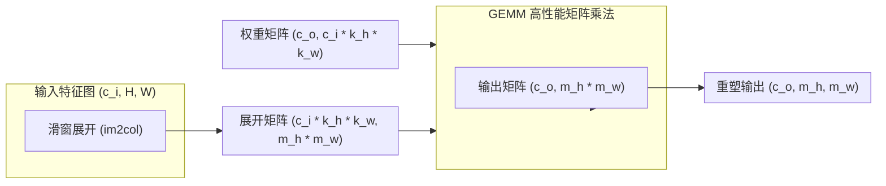

> ⬅️ [[6.3 填充和步幅| 上一节: 6.3 填充和步幅]] | 📑 [[6.0 章节全景与导读| 章节目录: 卷积神经网络]] | ➡️ [[6.5 汇聚层| 下一节: 6.5 汇聚层]]

---

# 6.4 多输入多输出通道（Channels）

在 6.2 与 6.3 节中，我们将输入图像、卷积核与输出特征图都视为**单通道的二维张量**（$H \times W$）。
然而，现实世界的视觉信息从来不是单通道的：
* **输入端**：彩色图像天然拥有 **RGB 3个颜色通道**，医学图像（如超声、MRI、高光谱）甚至拥有数十至上百个波段通道；
* **隐藏层内部**：随着网络层数加深，特征图的空间几何分辨率（$H, W$）不断降低，而**通道数（Channels）急剧扩张**（如 $64 \to 128 \to 256 \to 512$）。

**为什么必须引入通道维度？每个通道究竟在学什么？$1 \times 1$ 卷积为何被誉为深度学习中最神奇的结构设计？**
本节将彻底拆解多通道卷积的张量变换几何本质、数学公式推导、PyTorch底层实现机制与算力消耗模型。

---

## 一、多输入通道（Multiple Input Channels）

当输入图像具有多个通道（例如 $c_i = 3$ 的 RGB 图像）时，卷积核不能再是一个简单的二维矩阵，它必须拥有**与输入通道完全匹配的深度**。

![[attachments/slide_218_multi_input_channels_intro.png]]

### 1. 核心规则：通道数一一对应

> [!important] 多输入通道核心铁律
> **卷积核的输入通道数，必须严格等于输入张量的通道数**：
> $$\text{Kernel Channels } c_i \equiv \text{Input Channels } c_i$$
> 若输入有 $c_i$ 个通道，则单个卷积核内部包含 **$c_i$ 个二维卷积切片**，每个切片形状均为 $k_h \times k_w$。

![[attachments/slide_218_multi_input_kernel_slices.png]]

### 2. 计算机制：分通道互相关后沿通道求和

对于具有 $c_i$ 个输入通道的张量 $\mathbf{X} \in \mathbb{R}^{c_i \times h \times w}$ 与卷积核 $\mathbf{K} \in \mathbb{R}^{c_i \times k_h \times k_w}$：
1. **分通道互相关**：输入第 $c$ 个通道的二维矩阵 $\mathbf{X}[c, :, :]$ 与卷积核第 $c$ 个切片 $\mathbf{K}[c, :, :]$ 执行标准二维互相关运算，得到二维中间结果；
2. **跨通道累加（Channel Summation）**：将所有 $c_i$ 个通道计算出的二维结果**逐元素逐位置累加**，融合成**单一的二维特征图**。

$$\mathbf{Y} = \sum_{c=0}^{c_i - 1} \mathbf{X}[c, :, :] \star \mathbf{K}[c, :, :]$$

![[attachments/slide_218_multi_input_channel_sum.png]]

> [!note] 认知模型：多感官协同感知
> 想象输入是红、绿、蓝三个感光通道。
> * 红色通道切片专门捕获红色边缘；
> * 绿色通道切片专门捕获绿色边缘；
> * 蓝色通道切片专门捕获蓝色边缘；
> 最后的相加求和，正是将红绿蓝三个通道的响应**聚合成一个综合特征响应强度**。
> **无论输入通道数 $c_i$ 有多大，单个卷积核的输出永远只有 1 个通道！**

---

### 3. 数值演算实例

如下图所示，输入为 2 通道、尺寸 $3 \times 3$ 的张量，卷积核为 2 通道、尺寸 $2 \times 2$：

![[attachments/slide_218_multi_input_numerical_example.png]]

* **输入通道 0**：
  $$\begin{bmatrix} 0 & 1 & 2 \\ 3 & 4 & 5 \\ 6 & 7 & 8 \end{bmatrix} \star \begin{bmatrix} 0 & 1 \\ 2 & 3 \end{bmatrix} = \begin{bmatrix} 0\cdot 0 + 1\cdot 1 + 3\cdot 2 + 4\cdot 3 & \dots \\ \dots & \dots \end{bmatrix} = \begin{bmatrix} 19 & 25 \\ 37 & 43 \end{bmatrix}$$
* **输入通道 1**：
  $$\begin{bmatrix} 1 & 2 & 3 \\ 4 & 5 & 6 \\ 7 & 8 & 9 \end{bmatrix} \star \begin{bmatrix} 1 & 2 \\ 3 & 4 \end{bmatrix} = \begin{bmatrix} 1\cdot 1 + 2\cdot 2 + 4\cdot 3 + 5\cdot 4 & \dots \\ \dots & \dots \end{bmatrix} = \begin{bmatrix} 37 & 47 \\ 67 & 77 \end{bmatrix}$$
* **两通道逐元素相加（融合成单通道输出）**：
  $$\mathbf{Y} = \begin{bmatrix} 19 & 25 \\ 37 & 43 \end{bmatrix} + \begin{bmatrix} 37 & 47 \\ 67 & 77 \end{bmatrix} = \begin{bmatrix} 56 & 72 \\ 104 & 120 \end{bmatrix}$$
  其中第一个元素：$19 + 37 = 56$。

---

### 4. 代码实现：`corr2d_multi_in`

```python
import torch
from d2l import torch as d2l

def corr2d_multi_in(X, K):
    # 遍历 X 和 K 的第0个维度（通道维度），对每个通道做2D互相关，再用 sum 沿通道累加
    return sum(d2l.corr2d(x, k) for x, k in zip(X, K))

# 验证上面的数值例子
X = torch.tensor([[[0.0, 1.0, 2.0], [3.0, 4.0, 5.0], [6.0, 7.0, 8.0]],
                  [[1.0, 2.0, 3.0], [4.0, 5.0, 6.0], [7.0, 8.0, 9.0]]])
K = torch.tensor([[[0.0, 1.0], [2.0, 3.0]], 
                  [[1.0, 2.0], [3.0, 4.0]]])

print(corr2d_multi_in(X, K))
# 输出:
# tensor([[ 56.,  72.],
#         [104., 120.]])
```

---

## 二、多输出通道（Multiple Output Channels）

在上面的运算中，不论输入有多少通道，输出结果都只有**单一通道**。
然而，单通道特征图只能表达**某一种特定模式**（例如水平边缘）。如果我们要同时检测水平边缘、垂直边缘、对角线、斑点、色彩渐变等成百上千种模式，单通道输出显然无法满足需求！

![[attachments/slide_218_multi_output_channels_intro.png]]

### 1. 概念突破：每个输出通道 = 一个独立的模式探测器

> [!tip] 核心直觉：特征探测器阵列（Filter Bank）
> * **每个输出通道**：对应一个专门定制的特征探测器（Pattern Detector）；
> * **浅层通道**：分别响应不同方向的边缘、纹理、色块；
> * **深层通道**：响应更高级的组合语义（眼睛、鼻子、车轮、文字笔画）；
> * **组合模式识别**：多个通道的联合响应，构成了该空间位置物体的完整语义向量表达。

![[attachments/slide_218_multi_output_kernel_tensor.png]]

### 2. 4D 权重张量体系

为了生成 $c_o$ 个输出通道，我们需要准备 **$c_o$ 个独立的三维卷积核**。
将这 $c_o$ 个三维核沿着新的第 0 维叠放，卷积核就演化为标准的 **4维张量**：

$$\mathbf{K} \in \mathbb{R}^{c_o \times c_i \times k_h \times k_w}$$

四维形状各维度的物理意义极其严密：
1. **$c_o$（Out Channels）**：输出通道数（探测器的总数量，想要提取多少种不同的特征）；
2. **$c_i$（In Channels）**：输入通道数（匹配输入张量的深度）；
3. **$k_h$（Kernel Height）**：卷积核的空间高度；
4. **$k_w$（Kernel Width）**：卷积核的空间宽度。

输出张量 $\mathbf{Y}$ 的形状相应为：
$$\mathbf{Y} \in \mathbb{R}^{c_o \times m_h \times m_w}$$
其中第 $j$ 个输出通道：
$$\mathbf{Y}[j, :, :] = \sum_{c=0}^{c_i - 1} \mathbf{X}[c, :, :] \star \mathbf{K}[j, c, :, :]$$

---

### 3. 代码实现：`corr2d_multi_in_out`

```python
def corr2d_multi_in_out(X, K):
    # 遍历 K 的第0维度（每个输出通道对应的三维卷积核）
    # 每次都对完整输入 X 执行多输入通道互相关，最后用 torch.stack 在第0维拼成 3D 张量
    return torch.stack([corr2d_multi_in(X, k) for k in K], 0)

# 构造一个拥有 3 个输出通道的 4D 卷积核: K, K+1, K+2
K = torch.tensor([[[0.0, 1.0], [2.0, 3.0]], 
                  [[1.0, 2.0], [3.0, 4.0]]])
K_4d = torch.stack((K, K + 1, K + 2), 0)

print("K_4d shape:", K_4d.shape)
# 输出: torch.Size([3, 2, 2, 2]) -> (c_o=3, c_i=2, k_h=2, k_w=2)

Y = corr2d_multi_in_out(X, K_4d)
print("Y shape:", Y.shape)
print("Y:\n", Y)
# 输出:
# Y shape: torch.Size([3, 2, 2])
# Y:
# tensor([[[ 56.,  72.],
#          [104., 120.]],
#
#         [[104., 128.],
#          [176., 200.]],
#
#         [[152., 184.],
#          [248., 280.]]])
```

---

## 三、$1 \times 1$ 卷积层（Network in Network 核心基石）

初学者最容易产生的疑惑是：
> *“卷积的核心意义不就是利用邻域窗口（如 $3 \times 3, 5 \times 5$）提取局部空间相关性吗？如果窗口缩小到 $1 \times 1$，根本无法捕获任何相邻像素的关系，这还能叫卷积吗？它有什么用？”*

然而，在现代深度卷积神经网络（如 GoogLeNet Inception、ResNet Bottleneck、MobileNet）中，**$1 \times 1$ 卷积的使用频率和重要性甚至超越了 $3 \times 3$ 卷积**！

![[attachments/slide_218_1x1_conv_layer.png]]

### 1. 本质揭秘：跨通道的全连接层（Per-Pixel MLP）

当 $k_h = 1, k_w = 1$ 时：
* **在空间维度上（$H \times W$）**：每个像素只与自己相乘，**完全不发生跨像素的空间聚合**（输出的 $H, W$ 保持不变）；
* **在通道维度上（$C_{in} \to C_{out}$）**：在空间每一个坐标位置 $(i, j)$，输入在该位置具有长度为 $c_i$ 的通道向量 $\mathbf{x} = \mathbf{X}[:, i, j] \in \mathbb{R}^{c_i}$。
  $1 \times 1$ 卷积的权重矩阵为 $\mathbf{W} \in \mathbb{R}^{c_o \times c_i}$，它在该位置执行矩阵乘法：
  $$\mathbf{y} = \mathbf{W}\mathbf{x} + \mathbf{b} \in \mathbb{R}^{c_o}$$

> [!important] 核心认知等价性
> **$1 \times 1$ 卷积层，完全等价于对空间中每一个像素点分别独立应用同一个全连接层（Dense/Linear Layer）！**
> * 输入特征数：$c_i$
> * 输出特征数：$c_o$
> * 样本数量：$H \times W$（每个像素位置被视为一个独立样本）
> * 权重共享：所有 $H \times W$ 个像素共享同一套变换权重 $\mathbf{W} \in \mathbb{R}^{c_o \times c_i}$。

```
输入张量 (c_i, H, W)
      │
      ▼ 空间展平为 (c_i, H*W)
[ 矩阵乘法 Y = W @ X ]   <── W 形状为 (c_o, c_i)
      │
      ▼ 恢复形状为 (c_o, H, W)
输出张量 (c_o, H, W)
```

### 2. $1 \times 1$ 卷积的三大杀手级功用

1. **灵活升维与降维（Channel Dimensionality Control）**：
   * 在深层网络中，特征图通道数可能高达 1024 甚至 2048。如果直接接一个 $3 \times 3$ 卷积，参数量和计算量将直接爆炸。
   * **瓶颈结构（Bottleneck）**：先用 $1 \times 1$ 卷积将通道数从 1024 压减到 256（降维 4 倍），再执行 $3 \times 3$ 卷积，最后再用 $1 \times 1$ 卷积升回 1024。计算量可骤降 **90%** 以上！
2. **跨通道信息融合（Cross-Channel Information Fusion）**：
   * 普通卷积往往在空间邻域内聚合信息，而 $1 \times 1$ 卷积让各个通道的特征进行线性组合与信息交互。
3. **低成本引入非线性能力（Non-linearity Injection）**：
   * 在 $1 \times 1$ 卷积后紧跟 ReLU 激活函数，在完全不改变空间几何分辨率的情况下，大幅增加了模型的非线性表征深度。

---

### 3. 代码验证：矩阵乘法与互相关运算的完全等价

```python
def corr2d_multi_in_out_1x1(X, K):
    c_i, h, w = X.shape
    c_o = K.shape[0]
    # 将空间维度打平为 h * w 列，每一列为一个像素点的 c_i 维特征向量
    X_mat = X.reshape((c_i, h * w))
    # 将卷积核展平为 (c_o, c_i) 的权重矩阵
    K_mat = K.reshape((c_o, c_i))
    # 全连接层矩阵乘法: (c_o, c_i) @ (c_i, h*w) -> (c_o, h*w)
    Y = torch.matmul(K_mat, X_mat)
    # 重塑为 3D 输出特征图 (c_o, h, w)
    return Y.reshape((c_o, h, w))

# 随机生成测试张量
torch.manual_seed(42)
X = torch.normal(0, 1, (3, 3, 3))
K = torch.normal(0, 1, (2, 3, 1, 1))

# 方法1: 矩阵乘法实现
Y1 = corr2d_multi_in_out_1x1(X, K)
# 方法2: 标准多通道互相关运算
Y2 = corr2d_multi_in_out(X, K)

# 验证两者在浮点精度误差内完全一致
diff = float(torch.abs(Y1 - Y2).sum())
print("Y1 与 Y2 的绝对误差总和:", diff)
assert diff < 1e-6
print("验证通过! 1x1卷积与全连接矩阵乘法严格等价。")
```

---

## 四、二维卷积层的张量维度与算力消耗全景

![[attachments/slide_218_conv2d_dimensions_and_complexity.png]]

设输入张量 $\mathbf{X} \in \mathbb{R}^{c_i \times h \times w}$，卷积核大小 $k_h \times k_w$，填充 $(p_h, p_w)$，步幅 $(s_h, s_w)$，输出通道数 $c_o$。

### 1. 形状映射字典

| 对象 | 张量形状（单样本） | PyTorch Batch 形状 | 说明 |
| :--- | :--- | :--- | :--- |
| **输入 $\mathbf{X}$** | $(c_i, h, w)$ | $(B, c_i, h, w)$ | $c_i$ 为输入通道数 |
| **卷积核权重 $\mathbf{W}$** | $(c_o, c_i, k_h, k_w)$ | $(c_o, c_i, k_h, k_w)$ | 4D 参数张量 |
| **偏置 $\mathbf{b}$** | $(c_o, 1, 1)$ 或 $(c_o,)$ | $(c_o,)$ | 每个输出通道对应一个标量偏置 |
| **输出 $\mathbf{Y}$** | $(c_o, m_h, m_w)$ | $(B, c_o, m_h, m_w)$ | $m = \lfloor \frac{n - k + p + s}{s} \rfloor$ |

---

### 2. 参数量（Parameter Count）

$$\mathbf{Params} = c_o \times c_i \times k_h \times k_w + c_o \quad (\text{权重} + \text{偏置})$$

> [!important] 关键物理性质
> **卷积层的参数量与输入的空间尺寸 $(h, w)$ 彻底解耦，完全无关！**
> 无论输入是一张 $28 \times 28$ 的小图，还是一张 $4000 \times 3000$ 的超清大图，卷积核内部的权重参数数量完全恒定。参数量只取决于通道数与核窗口大小。

---

### 3. 计算复杂度（FLOPs / MACs）

每个输出像素点由 $c_i \times k_h \times k_w$ 次乘法与加法计算生成，输出总共有 $c_o \times m_h \times m_w$ 个像素点。
因此，单张图像单次前向传播的乘加操作数（MACs, Multiply-Accumulate operations）：

$$\mathbf{MACs} = c_o \times c_i \times k_h \times k_w \times m_h \times m_w$$

浮点运算次数（FLOPs，一次乘法+一次加法计为 2 FLOPs）：
$$\mathbf{FLOPs} \approx 2 \times c_i \times c_o \times k_h \times k_w \times m_h \times m_w$$

> [!warning] 算力爆炸预警
> * 计算量同时与**输入通道数 $c_i$** 和 **输出通道数 $c_o$** 成正比！
> * 若将输入通道和输出通道同时翻倍（$c_i \to 2c_i, c_o \to 2c_o$），**计算量将暴增 4 倍（二次方增长）**！
> * 这正是为什么深层网络必须严格控制大尺寸卷积核（如 $5 \times 5, 7 \times 7$）在高通道层的使用，广泛采用 $1 \times 1$ 卷积降维。

---

## 五、本节总结

![[attachments/slide_218_summary.png]]

1. **输入通道维度**：卷积核通道数必须与输入通道数相等；各通道执行 2D 卷积后**相加累加**，融合成单通道输出；
2. **输出通道维度**：通过堆叠 $c_o$ 个独立的三维卷积核构成 4D 权重张量；每个输出通道充当一个专属特征模式探测器；
3. **$1 \times 1$ 卷积**：空间上不聚合相邻信息，但跨通道执行线性加权与信息交互，等价于**每像素全连接层**，是控制网络计算复杂度与构建瓶颈层的核心利器；
4. **计算量四次方模型**：$O(c_i \cdot c_o \cdot k_h \cdot k_w \cdot m_h \cdot m_w)$，通道数设计是卷积网络性能调优的核心命脉。

---

## 六、课后练习全解（深度推导与机制解析）

### 练习 1：两层无激活函数的卷积级联等效性

> **题目**：假设我们有两个卷积核，大小分别为 $k_1$ 和 $k_2$（中间没有非线性激活函数）。
> 1. 证明运算可以用单次卷积来表示。
> 2. 这个等效的单个卷积核的维数是多少呢？
> 3. 反之亦然吗？

#### 1. 证明可以用单次卷积表示
**数学证明**：
设输入信号为 $\mathbf{X}$，第一层卷积核为 $\mathbf{K}_1$，第二层卷积核为 $\mathbf{K}_2$。
由于中间没有非线性激活函数，第二层的输出为：
$$\mathbf{Y} = (\mathbf{X} \star \mathbf{K}_1) \star \mathbf{K}_2$$
根据离散互相关与卷积的**结合律（Associativity）**：
$$(\mathbf{X} \star \mathbf{K}_1) \star \mathbf{K}_2 = \mathbf{X} \star (\mathbf{K}_1 \star \mathbf{K}_2)$$
令 $\mathbf{K}_{\text{equiv}} = \mathbf{K}_1 \star \mathbf{K}_2$。
因此，两层连续线性卷积完全等价于以 $\mathbf{K}_{\text{equiv}}$ 为核的单次卷积：
$$\mathbf{Y} = \mathbf{X} \star \mathbf{K}_{\text{equiv}}$$
证毕。

#### 2. 等效卷积核的维数（尺寸）
* **空间尺寸**：
  若 $\mathbf{K}_1$ 空间尺寸为 $k_1 \times k_1$，$\mathbf{K}_2$ 空间尺寸为 $k_2 \times k_2$（步幅为 1），
  由离散卷积支持域可知，两核卷积后的空间支持域尺寸为：
  $$k_{\text{equiv}} = k_1 + k_2 - 1$$
  例如：两个 $3 \times 3$ 卷积连续级联，等效核尺寸为 $3 + 3 - 1 = 5 \times 5$！这与感受野增长公式完全吻合。
* **张量通道维数**：
  设输入通道为 $c_0$，中间隐藏通道为 $c_1$，最终输出通道为 $c_2$：
  * $\mathbf{K}_1 \in \mathbb{R}^{c_1 \times c_0 \times k_1 \times k_1}$
  * $\mathbf{K}_2 \in \mathbb{R}^{c_2 \times c_1 \times k_2 \times k_2}$
  * 等效卷积核 $\mathbf{K}_{\text{equiv}} \in \mathbb{R}^{c_2 \times c_0 \times (k_1 + k_2 - 1) \times (k_1 + k_2 - 1)}$。

#### 3. 反之亦然吗？（任意大卷积核是否都能拆分成两个小卷积核的级联？）
**答案：否定（Not Always）**。
* **自由度（参数量）分析**：
  以单通道空间尺寸为例：
  * 单个 $5 \times 5$ 卷积核拥有 $5 \times 5 = 25$ 个独立自由参数；
  * 两个 $3 \times 3$ 卷积核仅拥有 $3^2 + 3^2 = 9 + 9 = 18$ 个独立自由参数。
  $18 < 25$，说明两个 $3 \times 3$ 卷积级联所能覆盖的函数空间，仅仅是所有 $5 \times 5$ 卷积核组成的全空间的一个**低维代数子流形（Low-rank Subspace）**！
* 只有当一个大卷积核满足特定的**低秩可分离条件（Separability / Factorizability）**时，才能严格无损分解为两个小核的卷积。对于空间中的任意随机大卷积核，无法进行无损分解。

---

### 练习 2：计算成本与内存占用全解析

> **题目**：假设输入为 $c_i \times h \times w$，卷积核大小为 $c_o \times c_i \times k_h \times k_w$，填充为 $(p_h, p_w)$，步幅为 $(s_h, s_w)$。
> 1. 前向传播的计算成本（乘法和加法）是多少？
> 2. 内存占用是多少？
> 3. 反向传播的内存占用是多少？
> 4. 反向传播的计算成本是多少？

设输出尺寸为：
$$m_h = \left\lfloor \frac{h - k_h + p_h + s_h}{s_h} \right\rfloor, \qquad m_w = \left\lfloor \frac{w - k_w + p_w + s_w}{s_w} \right\rfloor$$

#### 1. 前向传播计算成本
* **乘法次数**：每个输出像素需要计算 $c_i \cdot k_h \cdot k_w$ 次乘法。总输出像素为 $c_o \cdot m_h \cdot m_w$。
  $$\text{Multiplications} = c_o \cdot m_h \cdot m_w \cdot c_i \cdot k_h \cdot k_w$$
* **加法次数**：每个输出像素需累加 $c_i \cdot k_h \cdot k_w$ 个乘积项（需要 $c_i k_h k_w - 1$ 次加法），若加偏置项再加 1，总计为：
  $$\text{Additions} \approx c_o \cdot m_h \cdot m_w \cdot c_i \cdot k_h \cdot k_w$$
* **总 FLOPs**：$\approx 2 \cdot c_o \cdot c_i \cdot k_h \cdot k_w \cdot m_h \cdot m_w$。

#### 2. 前向传播内存占用
前向传播占用内存包含三部分：
1. **模型参数（Weights & Biases）**：$(c_o \cdot c_i \cdot k_h \cdot k_w + c_o) \times \text{sizeof(float)}$；
2. **输入特征图（Inputs）**：$(c_i \cdot h \cdot w) \times \text{sizeof(float)}$；
3. **输出激活值（Outputs / Cached Activations）**：$(c_o \cdot m_h \cdot m_w) \times \text{sizeof(float)}$。
> [!note] 训练期缓存
> 若处于训练模式（Training），前向传播必须将输入 $\mathbf{X}$ 驻留显存（Activation Stash），以供反向传播计算梯度时使用。

#### 3. 反向传播内存占用
反向传播执行时，需要显存存储所有张量的导数（Gradients）：
1. **输出上游梯度 $\frac{\partial L}{\partial \mathbf{Y}}$**：$c_o \cdot m_h \cdot m_w$ 个浮点数；
2. **权重梯度 $\frac{\partial L}{\partial \mathbf{W}}$**：$c_o \cdot c_i \cdot k_h \cdot k_w$ 个浮点数；
3. **偏置梯度 $\frac{\partial L}{\partial \mathbf{b}}$**：$c_o$ 个浮点数；
4. **传递给下层的输入梯度 $\frac{\partial L}{\partial \mathbf{X}}$**：$c_i \cdot h \cdot w$ 个浮点数。
此外，还需要常驻前向传播保存的输入激活值 $\mathbf{X}$。

#### 4. 反向传播计算成本
在反向传播中，基于链式法则需要完成两项大运算：
1. **计算权重梯度 $\frac{\partial L}{\partial \mathbf{W}} = \mathbf{X} \star \frac{\partial L}{\partial \mathbf{Y}}$**：
   相当于输入与上游梯度的卷积，其计算量与前向传播相当：
   $$\text{FLOPs}_W \approx 2 \cdot c_o \cdot c_i \cdot k_h \cdot k_w \cdot m_h \cdot m_w$$
2. **计算对输入的下游梯度 $\frac{\partial L}{\partial \mathbf{X}} = \frac{\partial L}{\partial \mathbf{Y}} \star \text{rot}_{180}(\mathbf{W})$**：
   相当于上游梯度与转置翻转卷积核的转置卷积运算，其计算量同样与前向传播相当：
   $$\text{FLOPs}_X \approx 2 \cdot c_o \cdot c_i \cdot k_h \cdot k_w \cdot m_h \cdot m_w$$
**结论**：反向传播的计算开销约为**前向传播的 2 倍**：
$$\text{FLOPs}_{\text{backward}} \approx 2 \times \text{FLOPs}_{\text{forward}} \approx 4 \cdot c_o \cdot c_i \cdot k_h \cdot k_w \cdot m_h \cdot m_w$$

---

### 练习 3：通道数与填充加倍的影响

> **题目**：如果我们将输入通道 $c_i$ 和输出通道 $c_o$ 的数量加倍，计算数量会增加多少？如果我们把填充数量翻一番会怎么样？

1. **通道数加倍（$c_i \to 2c_i, c_o \to 2c_o$）**：
   * 计算复杂度公式为 $\mathbf{FLOPs} \propto c_i \cdot c_o$。
   * 当两者同时加倍：
     $$\text{FLOPs}_{\text{new}} \propto (2c_i) \cdot (2c_o) = 4 \times (c_i \cdot c_o)$$
   * **计算量激增为原来的 4 倍（暴增 300%）**！权重参数量同样暴增为原来的 4 倍。
2. **填充翻一番（$p_h \to 2p_h, p_w \to 2p_w$）**：
   * 填充翻倍只会略微增大输出空间尺寸 $m_h, m_w$：
     $$m_h' \approx \frac{h - k_h + 2p_h}{s_h} + 1$$
   * **若输入尺寸很大（$h, w \gg p$）**：填充增加几个像素对于几十甚至几百的图像面积来说微不足道，**计算量仅略微增加百分之几**；
   * **若特征图本身极小（如深层的 $3 \times 3$ 或 $7 \times 7$）**：填充从 1 增加到 2，输出面积将从 $7 \times 7=49$ 扩大为 $9 \times 9=81$，**计算量可能出现 50%~60% 的显著上升**。

---

### 练习 4：$1 \times 1$ 卷积前向传播计算复杂度

> **题目**：如果卷积核的高度和宽度是 $k_h=k_w=1$，前向传播的计算复杂度是多少？

设 $k_h = k_w = 1$，步幅 $s = 1$，无填充 $p = 0$，此时输出尺寸与输入相同：$m_h = h, m_w = w$。
代入计算复杂度公式：
$$\mathbf{FLOPs} = 2 \cdot c_o \cdot c_i \cdot (1 \cdot 1) \cdot h \cdot w = 2 \cdot c_o \cdot c_i \cdot h \cdot w$$
大 $O$ 复杂度为：
$$\mathcal{O}(c_i \cdot c_o \cdot h \cdot w)$$
**本质解读**：这正是大小为 $(c_o, c_i)$ 的矩阵与大小为 $(c_i, hw)$ 的矩阵执行矩阵乘法的标准理论算力消耗！

---

### 练习 5：`Y1` 与 `Y2` 是否完全相同？

> **题目**：本节最后一个示例中的变量 `Y1`（矩阵乘法版）和 `Y2`（互相关遍历版）是否完全相同？为什么？

* **数学理论上**：两者**完全一致**。它们在代数上表述的是完全相同的乘加求和：
  $$Y[c_o, i, j] = \sum_{c_i} K[c_o, c_i, 0, 0] \cdot X[c_i, i, j]$$
* **计算硬件与浮点精度上**：两者**不保证逐位（Bitwise）完全精确相同**。
  * `Y1` 调用的是底层经过高度优化的 BLAS 库（如 OpenBLAS / MKL / cuBLAS）的 `torch.matmul`（GEMM 分块矩阵乘法），其乘法与累加求和顺序是按照缓存分块重排的；
  * `Y2` 是通过 Python 循环和 `sum(...)` 顺序进行逐通道累加。
  * 根据 IEEE 754 浮点数规范，浮点数加法**不满足结合律**：$(a + b) + c \neq a + (b + c)$（存在浮点舍入截断误差）。
  * 因此，代码中使用容忍阈值 `assert float(torch.abs(Y1 - Y2).sum()) < 1e-6`，而不是使用判等操作 `torch.equal(Y1, Y2)`。

---

### 练习 6：当窗口不是 $1 \times 1$ 时，如何使用矩阵乘法实现卷积？

> **题目**：当卷积窗口不是 $1\times 1$ 时，如何使用矩阵乘法实现卷积？

这是现代高性能深度学习框架（如 cuDNN、PyTorch、TensorFlow）计算卷积的核心工业级解法：**`im2col`（Image-to-Column）算法**。



#### 算法三步曲：
1. **输入重排（`im2col`）**：
   将输入张量中每一个大小为 $c_i \times k_h \times k_w$ 的滑动窗口区域，展开成一列长向量，向量长度为 $c_i \cdot k_h \cdot k_w$。
   整个特征图一共有 $m_h \times m_w$ 个滑动窗口位置，因此展开后得到一个大矩阵：
   $$\mathbf{X}_{\text{col}} \in \mathbb{R}^{(c_i \cdot k_h \cdot k_w) \times (m_h \cdot m_w)}$$
2. **权重重排（Reshape Kernel）**：
   将形状为 $(c_o, c_i, k_h, k_w)$ 的 4D 卷积核展平为一个二维权重矩阵：
   $$\mathbf{W}_{\text{row}} \in \mathbb{R}^{c_o \times (c_i \cdot k_h \cdot k_w)}$$
3. **单次 GEMM 乘法与还原**：
   直接执行通用矩阵乘法（GEMM）：
   $$\mathbf{Y}_{\text{col}} = \mathbf{W}_{\text{row}} \times \mathbf{X}_{\text{col}} \in \mathbb{R}^{c_o \times (m_h \cdot m_w)}$$
   最后将 $\mathbf{Y}_{\text{col}}$ 重塑还原为 $(c_o, m_h, m_w)$ 的特征图。

> [!tip] 工业级实现
> PyTorch 官方底层提供了 `torch.nn.functional.unfold`（即 `im2col`）与 `torch.nn.functional.fold`（即 `col2im`），使得任意形状的卷积均可转化为 GPU 计算吞吐极高的通用矩阵乘法（GEMM）执行！
