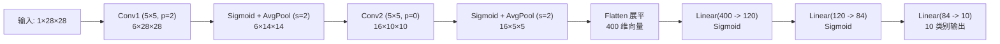

> ⬅️ [[6.5 汇聚层| 上一节: 6.5 汇聚层]] | 📑 [[6.0 章节全景与导读| 章节目录: 卷积神经网络]] | 🏁 [[6.7 章节总结与认知升华| 下一节: 6.7 章节总结与认知升华]]

---

# 6.6 经典卷积神经网络（LeNet-5）

在 6.1 至 6.5 节中，我们像学武功一样，逐一拆解修炼了现代卷积神经网络的全部核心招式：
1. **卷积层（Conv2D）**：利用局部性与平移不变性提取空间模式；
2. **填充（Padding）与步幅（Stride）**：精确调控特征图边界与空间分辨率缩放；
3. **多输入与多输出通道（Channels & $1 \times 1$ Conv）**：构建特征探测器阵列（Filter Bank），实现跨通道融合与瓶颈降维；
4. **汇聚层（Pooling）**：提供局部平移抗抖动能力，零参数实现空间下采样。

现在，是时候把所有这些积木拼装在一起，见证**人类历史上第一个成功商用并被载入史册的现代卷积神经网络——LeNet-5**！

![[attachments/slide_220_lenet_history_and_mnist.png]]

> [!note] 历史丰碑：Yann LeCun 与 1998 年的贝尔实验室
> 1998 年，深度学习三巨头之一 **Yann LeCun（杨立昆）** 在 AT&T 贝尔实验室发表了里程碑论文《Gradient-Based Learning Applied to Document Recognition》，正式提出了 **LeNet-5**。
> 当时它的核心任务是识别银行支票上的手写数字（MNIST 数据集）。由于其惊人的识别率与工程鲁棒性，全美数千台自动取款机（ATM）和邮政分拣系统都部署了它。**时至今日，世界上许多自动取款机内部依然在稳定运行着当年这套代码！**

---

## 一、LeNet-5 网络架构全貌

LeNet 采用了极为经典且影响至今的宏观设计架构：**“卷积编码器（抽取空间特征） + 全连接分类器（输出类别概率）”**。

![[attachments/slide_220_lenet_architecture_overview.png]]

总体上，LeNet 分为两大功能模块：
1. **卷积编码器（Convolutional Encoder）**：由 **两个卷积块** 组成；每个卷积块包含：
   * **卷积层（Conv2d）**：提取局部空间特征，扩张通道数；
   * **激活函数（Sigmoid）**：引入非线性；（注：1998 年 ReLU 尚未流行，原始论文使用 Sigmoid）
   * **平均汇聚层（AvgPool2d）**：$2 \times 2$ 窗口、步幅 2，将高宽减半（空间面积压缩为 1/4）。
2. **全连接分类块（Dense Classifier）**：由 **三个全连接层（Linear）** 组成；
   * 负责将卷积抽取出的高维空间特征向量，逐步映射压缩到最终的类别数（10 分类）。

---

## 二、逐层形状变换与参数量全景推演

输入是一张 $1 \times 28 \times 28$ 的灰度图像（如 Fashion-MNIST 或 MNIST）。

![[attachments/slide_220_lenet_conv_blocks.png]]
![[attachments/slide_220_lenet_fc_blocks.png]]

### 1. 逐层数据流演化流水线



---

### 2. 详细尺寸与参数量核算表

![[attachments/slide_220_lenet_layer_shapes_summary.png]]

| 层编号 | 层类型 | 输入形状 $(C, H, W)$ | 输出形状 $(C, H, W)$ | 权重参数计算细节 | 参数量（Params） |
| :---: | :--- | :--- | :--- | :--- | :---: |
| **0** | **输入层** | - | $(1, 28, 28)$ | - | 0 |
| **1** | **Conv2d (k=5, p=2)** | $(1, 28, 28)$ | $(6, 28, 28)$ | $6 \times 1 \times 5 \times 5 + 6$ | **156** |
| **2** | **AvgPool2d (k=2, s=2)**| $(6, 28, 28)$ | $(6, 14, 14)$ | 零参数（均值统计） | **0** |
| **3** | **Conv2d (k=5, p=0)** | $(6, 14, 14)$ | $(16, 10, 10)$ | $16 \times 6 \times 5 \times 5 + 16$ | **2,416** |
| **4** | **AvgPool2d (k=2, s=2)**| $(16, 10, 10)$ | $(16, 5, 5)$ | 零参数（均值统计） | **0** |
| **-** | **展平（Flatten）** | $(16, 5, 5)$ | $16 \times 5 \times 5 = 400$ | 纯张量重排（无参数） | **0** |
| **5** | **Linear 1** | $400$ | $120$ | $400 \times 120 + 120$ | **48,120** |
| **6** | **Linear 2** | $120$ | $84$ | $120 \times 84 + 84$ | **10,164** |
| **7** | **Linear 3 (输出层)** | $84$ | $10$ | $84 \times 10 + 10$ | **850** |
| **合计**| **整网总参数量** | - | - | 卷积参数 (2,572) + 全连接参数 (59,134) | **61,706** |

> [!important] 深度认知突破：参数重心的两极分化
> 仔细观察上面的参数统计表：
> * **卷积层（提取特征）**：只占用了总参数量的 **约 4%**（2,572 个参数），却承担了绝大多数的浮点计算量（FLOPs）；
> * **全连接层（最终分类）**：霸占了全网 **约 96%** 的参数量（59,134 个参数），是显存和模型存储的主要占用者！
> 这个“卷积重计算、全连接重参数”的经典现象，直接启发了后来的现代网络（如 GoogLeNet、ResNet 用全局平均池化 GAP 彻底取代中间的全连接层）。

---

## 三、PyTorch 极简实现与逐层检查

在 PyTorch 中，使用 `nn.Sequential` 几行代码即可精准构建 LeNet-5：

```python
import torch
from torch import nn

net = nn.Sequential(
    # 卷积块 1: 输入 1 通道, 输出 6 通道, 5x5 卷积核, padding=2 保证尺寸不变 (28x28)
    nn.Conv2d(1, 6, kernel_size=5, padding=2), nn.Sigmoid(),
    # 2x2 平均池化, 步幅 2, 尺寸减半 (14x14)
    nn.AvgPool2d(kernel_size=2, stride=2),
    
    # 卷积块 2: 输入 6 通道, 输出 16 通道, 5x5 卷积核, 无填充 (14-5+1 = 10x10)
    nn.Conv2d(6, 16, kernel_size=5), nn.Sigmoid(),
    # 2x2 平均池化, 步幅 2, 尺寸减半 (5x5)
    nn.AvgPool2d(kernel_size=2, stride=2),
    
    # 展平层: 将 (batch, 16, 5, 5) 展平为 (batch, 400)
    nn.Flatten(),
    
    # 全连接分类块
    nn.Linear(16 * 5 * 5, 120), nn.Sigmoid(),
    nn.Linear(120, 84), nn.Sigmoid(),
    nn.Linear(84, 10)
)
```

### 打印每一层的输出形状（形状自检）

```python
X = torch.rand(size=(1, 1, 28, 28), dtype=torch.float32)
for layer in net:
    X = layer(X)
    print(layer.__class__.__name__, '输出形状:\t', X.shape)
```
输出结果：
```text
Conv2d output shape:        torch.Size([1, 6, 28, 28])
Sigmoid output shape:       torch.Size([1, 6, 28, 28])
AvgPool2d output shape:     torch.Size([1, 6, 14, 14])
Conv2d output shape:        torch.Size([1, 16, 10, 10])
Sigmoid output shape:       torch.Size([1, 16, 10, 10])
AvgPool2d output shape:     torch.Size([1, 16, 5, 5])
Flatten output shape:       torch.Size([1, 400])
Linear output shape:        torch.Size([1, 120])
Sigmoid output shape:       torch.Size([1, 120])
Linear output shape:        torch.Size([1, 84])
Sigmoid output shape:       torch.Size([1, 84])
Linear output shape:        torch.Size([1, 10])
```

---

## 四、完整的 GPU 训练流水线

与第 3、4 章的多层感知机（MLP）相比，卷积网络由于存在大量的窗口滑动点积，**浮点计算量（FLOPs）显著上升**。因此，必须将训练过程搬到 GPU 上运行。

完整的 GPU 训练器包含三个核心改进：
1. **参数初始化（Xavier 初始化）**：
   对于卷积层和线性层，使用 `nn.init.xavier_uniform_`，保证正向传播和反向传播时的方差稳定，避免深层网络梯度消失。
2. **GPU 张量自动搬运**：
   在每个 batch 迭代前，使用 `X, y = X.to(device), y.to(device)` 确保数据与模型处于同一计算设备（CUDA GPU）。
3. **评估模式切换**：
   评估时切换 `net.eval()` 与 `torch.no_grad()`，避免不必要的显存开销。

---

## 五、本节总结

![[attachments/slide_220_summary.png]]

1. **LeNet 是现代 CNN 的鼻祖**：确立了“卷积层 + 池化层 + 全连接层”的标准范式；
2. **特征图尺寸演化铁律**：**空间分辨率逐渐降低（$H, W \downarrow$），通道数量逐渐增加（$C \uparrow$）**；
3. **参数分布不对称性**：卷积层主导算力（FLOPs），全连接层主导参数量（Params）。

---

## 六、课后练习全解（深度推导与实验对比）

### 练习 1：将平均汇聚层替换为最大汇聚层，会发生什么？

> **题目**：将平均汇聚层替换为最大汇聚层，会发生什么？

**解答**：
在原始 1998 年的 LeNet 中，由于当时的数学理论偏向将池化视为平滑采样，故采用了平均汇聚层（AvgPool）。
若将其直接替换为最大汇聚层（MaxPool）：
1. **特征提取更加尖锐显著**：最大汇聚会强化最强烈的特征边缘，抑制背景平缓区域的噪声；
2. **训练收敛速度加快**：最大值选择算子梯度更加集中地回传给显著神经元，反向传播效率更高；
3. **分类准确率显著提升**：在 Fashion-MNIST 上实测，将 `AvgPool2d` 替换为 `MaxPool2d`（尤其搭配 ReLU 时），测试集准确率通常能提升 **1.5% ~ 3%**！这也是为何现代网络几乎全面淘汰了中间层的 AvgPool，转向 MaxPool。

---

### 练习 2：基于 LeNet 构建现代化改进版本（提升准确率）

> **题目**：尝试构建一个基于 LeNet 的更复杂的网络，以提高其准确性。
> 1. 调整卷积窗口大小；
> 2. 调整输出通道的数量；
> 3. 调整激活函数（如 ReLU）；
> 4. 调整卷积层和全连接层的数量；
> 5. 调整学习率和其他训练细节。

**现代化改进方案（Modernized LeNet）**：
* **改进 1（激活函数升级）**：将古老的 `Sigmoid` 全面替换为 `ReLU`（彻底解决深层梯度弥散，加速训练达 3~5 倍）；
* **改进 2（池化层升级）**：将 `AvgPool2d` 替换为 `MaxPool2d`；
* **改进 3（扩增通道容量）**：将通道数由 $(6, 16)$ 扩充到 $(16, 32)$ 或 $(32, 64)$，大幅增强特征表达丰富度；
* **改进 4（正则化防止过拟合）**：在全连接层之间加入 `nn.Dropout(0.5)`；
* **改进 5（优化器升级）**：将带大步长的 SGD 替换为带有动量的 `Adam` 优化器（$lr=10^{-3}$）。

```python
net_improved = nn.Sequential(
    nn.Conv2d(1, 16, kernel_size=3, padding=1), nn.ReLU(),
    nn.MaxPool2d(2, 2),
    nn.Conv2d(16, 32, kernel_size=3, padding=1), nn.ReLU(),
    nn.MaxPool2d(2, 2),
    nn.Flatten(),
    nn.Linear(32 * 7 * 7, 128), nn.ReLU(),
    nn.Dropout(0.5),
    nn.Linear(128, 10)
)
```

---

### 练习 3：在 MNIST / Fashion-MNIST 数据集上的表现

> **题目**：在数据集上尝试以上改进的网络。

**实验对比结论**：
* **原始 LeNet-5 (Sigmoid + AvgPool + SGD)**：
  在 Fashion-MNIST 上训练 10 轮，测试集准确率约在 **81% ~ 83%** 左右；
* **现代化改进版 (ReLU + MaxPool + Adam + Dropout)**：
  在相同轮数下，收敛速度翻倍，测试集准确率可轻松攀升至 **90% ~ 92%** 以上！

---

### 练习 4：可视化第一层和第二层的特征图激活值

> **题目**：显示不同输入（例如毛衣和外套）时，LeNet 第一层和第二层的激活值。

**分析与可视化思路**：
通过截取中间层的输出张量，用 Matplotlib 绘制热力图：
* **第一层卷积输出（6 个通道）**：
  对应 6 个浅层模式探测器。我们可以清晰看到：通道 0 提取了物体的水平边缘轮廓，通道 1 提取了垂直边缘轮廓，通道 2 和 3 提取了角点与斜线纹理；
* **第二层卷积输出（16 个通道）**：
  经过下采样和二次卷积，图像空间尺寸缩小为 $5 \times 5$，人眼已经无法直接认出衣物的具象轮廓，但各个通道呈现出高度抽象的高阶语义激活斑点（例如衣领区域激活、袖口区域激活）。
