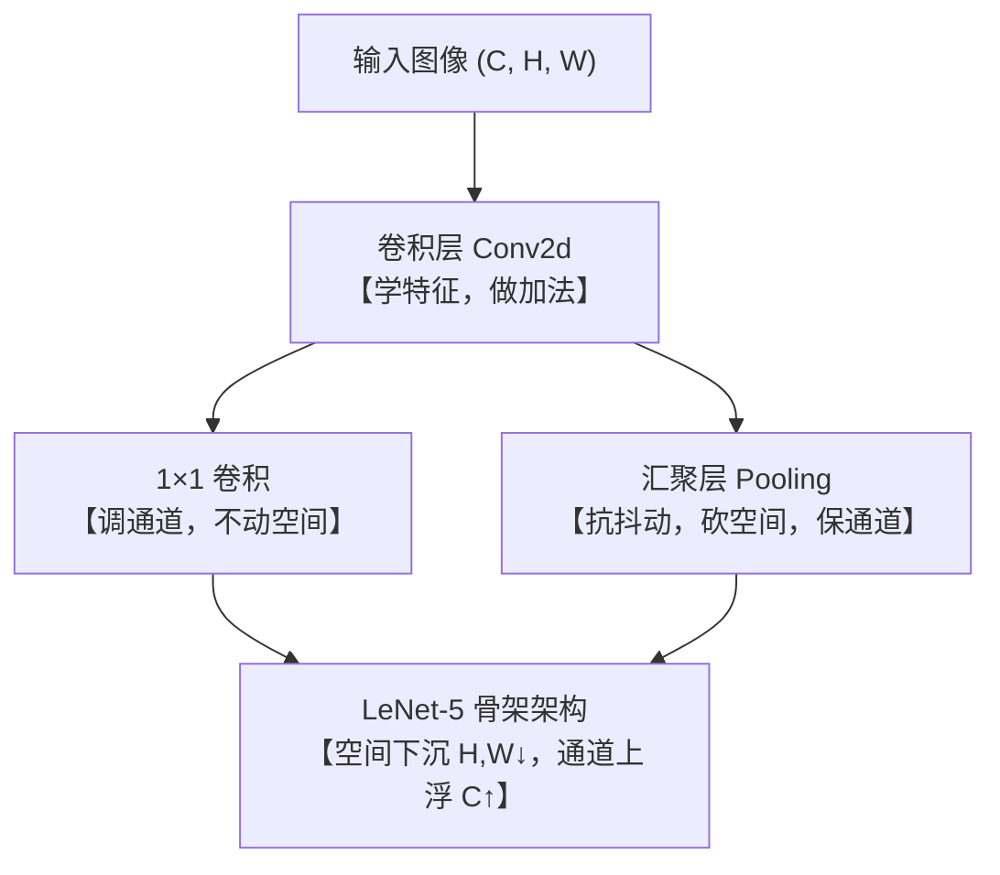

> ⬅️ [[6.6 经典卷积神经网络 LeNet| 上一节: 6.6 经典卷积神经网络 LeNet]] | 📑 [[6.0 章节全景与导读| 章节目录: 卷积神经网络]] | 🚀 [[../现代卷积神经网络/7.0 章节全景与导读| 下一章: 第7章 现代卷积神经网络]]

---

# 6.7 第6章 章节总结与认知升华

> [!important] 学习方法论宣言（第一性原理与不变性）
> **“在学习的过程中，我们要弄清楚『是什么』、『为什么』、『怎么做』；代码细节与繁琐推导或许会随时间遗忘，但底层的物理动机、核心性质与守恒定律（Invariants），才是能够融入血液、受用终生的技术直觉！”**

在本章中，我们完成了从“平铺直叙的多层感知机（MLP）”向“二维空间结构感知网络（CNN）”的伟大跨越。
本篇作为第 6 章的**收官封顶之作**，我们将跳出繁杂的代码细节，全面梳理本章沉淀出的**核心性质图谱、易混概念镜面对照表、算力模型与通往现代 CNN 的演化大动脉**。

---

## 一、核心构件的“性质与守恒铁律”全景清单



### 1. 卷积层（Convolution Layer）
* **为什么（Why）**：解决全连接层面对高分辨率图像时**参数爆炸（$10^9$ 级）**以及**破坏二维邻域空间几何结构**的致命死穴。
* **是什么（What）**：基于**平移不变性（Translation Invariance）**与**局部性（Locality）**的局部加权求和算子。
* **核心性质（Invariants）**：
  * **参数与空间尺寸解耦**：无论输入图像是一张 $28 \times 28$ 还是 $4000 \times 3000$ 的大图，卷积核参数量恒定不变（**权重共享**）。
  * **深度必须匹配输入，数量决定输出**：输入通道为 $c_i$，单个核的切片深度必须是 $c_i$；要生成 $c_o$ 个输出通道，就必须准备 $c_o$ 个独立的 3D 核，整体组合成 **4D 权重张量** $\mathbb{R}^{c_o \times c_i \times k_h \times k_w}$。
  * **单核输出永远只有单通道**：无论输入通道数多大，单个 3D 核分通道互相关后**沿通道累加求和**，融合成 1 个二维特征图。

---

### 2. $1 \times 1$ 卷积层（Network in Network 灵魂基石）
* **为什么（Why）**：深层网络通道数激增（如 512、1024），直接做 $3 \times 3$ 卷积计算量暴增；急需在不改变空间图像轮廓的前提下对通道进行降维压缩与信息融合。
* **是什么（What）**：**每个像素点上的全连接层（Per-Pixel MLP）**。
* **核心性质（Invariants）**：
  * **“动通道，不动空间”**：空间长宽（$H, W$）严格不变，感受野为 1；通道深度（$C$）任意升维、降维。
  * **穿羊肉串模型**：每个像素位置是由 $c_i$ 个数垂直叠在一起的向量，全图所有像素位置共享同一个全连接变换矩阵 $\mathbf{W} \in \mathbb{R}^{c_o \times c_i}$。
  * **瓶颈设计降本 90%**：先用 $1 \times 1$ 卷积将通道数从 1024 压减到 256（降维 4 倍），再做 $3 \times 3$ 卷积，最后再用 $1 \times 1$ 升维，计算量锐减 80%~90%（ResNet 核心秘诀）。

---

### 3. 汇聚层 / 池化层（Pooling Layer）
* **为什么（Why）**：卷积层对空间位置极度超敏（快门轻微震动 1 像素，边缘坐标即发生跳跃），且网络需要逐层下采样以扩大后层神经元的感受野。
* **是什么（What）**：滑动窗口内的固定数学统计摘要（最大值 Max 或平均值 Avg）。
* **核心性质（Invariants）**：
  * **“动空间，不动通道”**：通道数绝对守恒（输入多少通道，输出严格保持多少通道，通道间严格隔离绝不串扰）；空间长宽按步幅砍半。
  * **绝对零参数（0 Params）**：纯确定性数学算子，内部没有任何需要梯度下降更新的权重和偏置。
  * **局部平移抗抖动**：局部窗口内只要出现过该模式，最大值即被激活，提供强大的位移鲁棒性。

---

## 二、极易混淆概念的“镜面对称大比拼”

### 1. $1 \times 1$ 卷积 vs 池化层（镜面双子星）

初学者最容易将二者的尺寸变化搞混，二者在功能上恰恰是一对**完美的互补镜面**：

| 构件 | 空间长宽（图像尺寸 $H, W$） | 通道深度（特征通道数 $C$） | 可学习参数 | 形象记忆法 |
| :--- | :---: | :---: | :---: | :--- |
| **$1 \times 1$ 卷积** | **绝对不变！** | **自由改变！**（降维/升维） | 有参数矩阵 $\mathbf{W}$ | **“换装不改身材”**（动通道，不动长宽） |
| **池化层（Pooling）** | **必须改变！**（通常直接腰斩） | **绝对不变！**（通道严格守恒） | 绝对零参数（0） | **“身材缩小衣服不变”**（动长宽，不动通道） |

---

### 2. 卷积层 vs 池化层（外勤侦探 vs 内勤秘书）

| 对比维度 | 卷积层（Convolution） | 汇聚层 / 池化层（Pooling） |
| :--- | :--- | :--- |
| **团队分工** | **外勤侦探**（从无到有发现特征，做加法） | **内勤秘书**（去粗取精压缩尺寸，做减法） |
| **数学机制** | 线性加权求和（点积）：$\sum W \cdot X + b$ | 确定性非参数极值：$\max(X)$ 或 $\text{mean}(X)$ |
| **参数消耗** | 拥有 4D 权重矩阵，随反向传播学习 | **0 参数**，无任何可学习变量 |
| **通道处理** | 多通道输入加权求和融合成单通道 | 各通道完全隔离独立下采样，通道数守恒 |
| **位置敏感** | 极度敏感（物体挪 1 像素，特征图挪 1 像素） | 平移抗抖（局部微调不影响输出极值） |
| **算力负担** | 极重（承担整网 90% 以上乘加计算 FLOPs） | 极轻（仅需底层单周期比大小或加法） |

---

## 三、参数与算力的两大经典定律

### 1. 通道翻倍的“二次方爆炸陷阱”
计算量 $\mathbf{FLOPs} \propto c_i \times c_o$。
因为上一层的输出通道正是下一层的输入通道，当通道数翻倍时：
$$(2c_i) \times (2c_o) = 4 \times (c_i \cdot c_o)$$
**算力与参数量将同步暴增 4 倍（300% 增幅）！**

### 2. 经典 CNN 的“算力天平平衡术”
现代卷积骨干网络在跨越不同阶段（Stage）时，普遍遵循：
$$\underbrace{\text{长宽各砍半（面积变 } \frac{1}{4} \text{）}}_{\text{池化层 / 步幅2}} \times \underbrace{\text{通道数翻一倍（代价变 } 4 \times \text{）}}_{\text{卷积核数量扩增}} \approx \mathbf{1 \quad (\text{整层总算力维持恒定！})}$$
这种优雅的守恒设计，成功实现了在不引爆显卡的前提下，将“低层大分辨率几何特征”逐步转换为“深层高维抽象语义特征”。

---

## 四、LeNet-5 留下的参数悖论与现代演化伏笔

在对 LeNet-5 的参数剖析中，我们揭露了早期神经网络最著名的**参数倒挂悖论**：

```text
LeNet-5 参数分布实测：
├── 卷积编码块 (Conv):  2,572 个参数   (仅占全网  4.17% !) ──> 承担 90% 以上算力
└── 全连接密集块 (FC):   59,134 个参数  (竟占全网 95.83% !) ──> 占满显存与权重存储
```

这一矛盾直接启示了深度学习后续十余年的进化方向：
1. **如何干掉沉重的全连接层？**
   $\to$ 诞生了 **NiN（网络中的网络）** 与 **全局平均池化（GAP）**，全连接层被彻底革除；
2. **如何构建更深、更强、感受野更大的网络？**
   $\to$ 诞生了 **AlexNet（2012）**、**VGG（2014）**、**GoogLeNet（2014）** 与 **ResNet（2015）**！

---

## 五、通往第 7 章：现代卷积神经网络（Modern CNNs）

第 6 章传授给我们的，是所有现代视觉模型的**基础力学定律**。
而在接下来的第 7 章中，我们将亲历深度学习历史上最惊心动魄的**“黄金大爆发时代”**：

* **7.1 AlexNet**：2012 年 ImageNet 夺冠，以一己之力引爆当代深度学习革命的原子弹；
* **7.2 VGG**：小卷积核（$3 \times 3$）级联的极致美学；
* **7.3 NiN**：$1 \times 1$ 卷积与全局平均池化的破局之作；
* **7.4 GoogLeNet**：多尺度 Inception 结构与多路特征并行；
* **7.5 ResNet**：何恺明残差连接（Residual Connection），彻底攻克千层网络梯度爆炸，登顶当代视觉之巅！

带着第 6 章烙印在脑海里的不变性质，我们整装待发，向现代深度视觉巅峰迈进！
