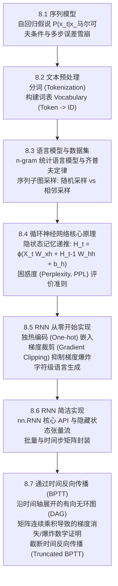

> 导航：[上一章: 第7章 现代卷积神经网络](../现代卷积神经网络/7.0%20章节全景与导读.md) | [下一节: 8.1 序列模型](./8.1%20序列模型.md)

---

# 第8章 循环神经网络（Recurrent Neural Networks, RNN）

在前面的章节中，我们深入研究了多层感知机（MLP）与各种现代卷积神经网络（CNN）。这些架构在处理**网格化结构数据（如空间二维图像）**时展现出了卓越的性能。然而，它们都隐含着一个基本的假设：**所有输入样本都是独立同分布（i.i.d.）的，且输入与输出具有固定的静态空间维度**。

然而，在人类现实世界与自然智能中，大量极其重要的数据本质上是**不可分割的时间序列与连续符号序列**：
* **自然语言文本**：“小明 喜欢 踢 足球”与“足球 喜欢 踢 小明”词汇完全相同，但时序语序的颠倒导致语义完全相反；
* **语音音频与声学波形**：连续高采样率的时间信号；
* **金融市场价格、气象监测与传感器流**：当前状态与历史演进轨迹强因果相关。

对于这类**变长（Variable-length）、具强序贯因果依赖（Temporal Sequential Dependency）**的数据，传统前馈网络与卷积网络面临难以调和的结构性困难。为了捕捉时间动力学与历史信息记忆，**循环神经网络（Recurrent Neural Networks, RNN）** 应运而生。

---

## 循环神经网络架构演进全景图

---

## 章节核心理论与实战映射表

| 节号 | 核心主题 | 官方源码文件 | 核心数学理论与工程攻坚点 |
| :---: | :--- | :--- | :--- |
| **8.1** | **序列模型** | [sequence.ipynb](file:///E:/Jupyter%20Notebook%20code/d2l-zh-pytorch/chapter_recurrent-neural-networks/sequence.ipynb) | **自回归统计建模**：联合概率链式分解、$\tau$ 阶马尔可夫假设；**多步自回归预测的误差雪崩效应（Compounding Error）**数学推演。 |
| **8.2** | **文本预处理** | [text-preprocessing.ipynb](file:///E:/Jupyter%20Notebook%20code/d2l-zh-pytorch/chapter_recurrent-neural-networks/text-preprocessing.ipynb) | **符号离散化管线**：文本清洗、字符级与词级分词（Tokenization）、词频统计过滤、双向映射词表（`Vocab` 类）实现。 |
| **8.3** | **语言模型与数据集** | [language-models-and-dataset.ipynb](file:///E:/Jupyter%20Notebook%20code/d2l-zh-pytorch/chapter_recurrent-neural-networks/language-models-and-dataset.ipynb) | **序列统计规律与采样策略**：$n$-gram 统计建模、词频长尾齐普夫定律（Zipf's law）；小批量数据读取机制：**随机采样（Random Sampling）** vs **相邻采样（Sequential Partitioning）**。 |
| **8.4** | **循环神经网络理论** | [rnn.ipynb](file:///E:/Jupyter%20Notebook%20code/d2l-zh-pytorch/chapter_recurrent-neural-networks/rnn.ipynb) | **隐状态（Hidden State）机制**：具有时间递推反馈的神经元；参数跨时间步共享权重 $W_{hh}, W_{xh}, W_{hq}$；语言模型评价指标：**困惑度（Perplexity, PPL）**推导。 |
| **8.5** | **RNN 从零开始实现** | [rnn-scratch.ipynb](file:///E:/Jupyter%20Notebook%20code/d2l-zh-pytorch/chapter_recurrent-neural-networks/rnn-scratch.ipynb) | **端到端手写闭环**：初始化 $W_{xh}, W_{hh}, b_h, W_{hq}, b_q$；手写 `rnn` 前向循环算子；**梯度裁剪（Gradient Clipping）**数学防御机制；字符级序列续写采样。 |
| **8.6** | **RNN 简洁实现** | [rnn-concise.ipynb](file:///E:/Jupyter%20Notebook%20code/d2l-zh-pytorch/chapter_recurrent-neural-networks/rnn-concise.ipynb) | **工业级封装与张量对齐**：PyTorch 原生 `nn.RNN` 模块用法；输出张量与隐藏状态 `(num_layers, batch_size, hidden_size)` 的交互接口与前向传播优化。 |
| **8.7** | **通过时间反向传播 (BPTT)** | [bptt.ipynb](file:///E:/Jupyter%20Notebook%20code/d2l-zh-pytorch/chapter_recurrent-neural-networks/bptt.ipynb) | **时序反向传播理论**：计算图时间轴展开；矩阵雅可比连乘项 $\prod_{j=t+1}^T \frac{\partial \mathbf{h}_j}{\partial \mathbf{h}_{j-1}}$ 的特征值谱分析；长程记忆失效的本质与**截断 BPTT（Truncated BPTT）**。 |

---

## 核心设计哲学跃迁：从“静态空间”到“动态时间状态机”

1. **突破固定维度输入**：
   前馈网络与 CNN 必须预设固定尺寸的输入张量（如 $224\times224$）。而循环网络通过时间步循环循环读取输入，天然支持处理**任意任意长度**的输入序列。
2. **权重的跨时间共享（Weight Sharing across Time）**：
   类似于卷积核在空间不同位置共享权重以实现平移不变性，循环神经网络在所有时间步 $t \in [1, T]$ 上复用完全相同的参数矩阵（$W_{xh}, W_{hh}, W_{hq}$），使得模型参数量与序列长度 $T$ 完全解耦。
3. **隐状态记忆载体（Hidden State as Working Memory）**：
   网络在 $t$ 时刻的隐状态 $\mathbf{h}_t$ 充当了一个内部动态记忆容器，实时整合并压缩了历史序列从 $x_1$ 到 $x_t$ 的全部语境信息，并在时间轴上向未来一步步传递。
