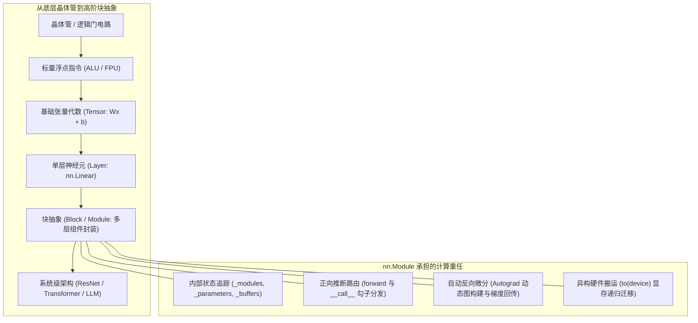

> 导航：[上一章: 第4章 多层感知机](../多层感知机/4.0%20章节全景与导读.md) | [[5.1 层和块| 下一节: 5.1 层和块]]

---

# 第5章 深度学习计算（Deep Learning Computation）

在前面的章节中，我们系统探讨了线性回归、Softmax 回归以及多层感知机（MLP）的数学原理，并从零开始实现了参数优化、反向传播与正则化算法。

然而，在面对现代深度学习系统（如数千层的 ResNet、数百亿参数的 Transformer 或混合专家网络 MoE）时，如果仅仅停留在“定义几个权重矩阵并手动调用矩阵乘法”的层次，工程复杂度将呈指数级爆炸。深度学习之所以能在过去十年迎来工业化爆发，离不开以 **PyTorch** 为代表的现代深度学习框架所提供的**高阶计算抽象与异构硬件调度系统**。

本章不引入新的网络拓扑或数据集，而是聚焦于**深度学习系统的计算基石与工程实现哲学**。我们将剖析神经网络的模块化面向对象抽象、树状参数生命周期管理、参数初始化策略、自定义算子扩展、状态字典（State Dict）序列化，以及张量与模型在 CPU/GPU 异构硬件之间的流动机制，完成从**“算法调包侠/基础用户”向“深度学习高级工程师/架构师”**的认知跨越。

---

## 知识图谱与双轨对应映射表

本章将官方教材（`chapter_deep-learning-computation`）的严密规范与配套讲义（`214_PyTorch神经网络基础.ipynb`、`215_使用购买GPU.ipynb` 及硬件讲义 `227`）的工程洞察深度融合，知识体系如下表所示：

| 节号 | 官方教材 (`d2l-zh/pytorch`) | 配套讲义与工程洞察 | 核心理论、机制与工程攻坚点 |
| :---: | :--- | :--- | :--- |
| **5.0** | `index.ipynb` | 全景架构 | **章节全景与导读**：从算法数学公式到工程软件抽象的范式转移 |
| **5.1** | `model-construction.ipynb` | `214` (Part 1-5) | **层和块（`nn.Module`）**：组合模式（Composite Pattern）、`__init__` 与 `forward` 契约、`_modules` 有序字典注册机制、前向传播动态控制流 |
| **5.2** | `parameters.ipynb` | `214` (Part 6-10) | **参数管理与初始化**：树状命名空间访问、`nn.Parameter` 数据与梯度封装、`apply` 高阶函数递归初始化、参数绑定与权重共享 |
| **5.3** | `deferred-init.ipynb` | 动态图架构对比 | **延后初始化（Deferred Initialization）**：形状推断流水线（Shape Inference）、解耦网络拓扑与输入维度、`nn.LazyLinear` 机制与生产陷阱 |
| **5.4** | `custom-layer.ipynb` | `214` (Part 11) | **自定义层开发**：无参数层 vs 带参数层、`nn.Parameter` 与 `register_buffer` 的本质差异、自动求导支持边界 |
| **5.5** | `read-write.ipynb` | `214` (Part 12) | **读写文件与模型持久化**：张量序列化、`state_dict` 机制与解耦设计哲学、检查点恢复（Checkpointing）与子模块权重移植 |
| **5.6** | `use-gpu.ipynb` | `215` / `227` | **GPU 算子加速与显存机制**：CPU vs GPU 微架构（低延迟 vs 高吞吐）、设备管理、张量存储与跨总线搬运（PCIe 瓶颈）、计算图设备一致性铁律 |

---

## 核心认知跨越：从算法公式到软件工程抽象

### 为什么需要“块（Block）”的概念？

在半导体工业中，工程师从设计单颗晶体管，演进到设计门电路、ALU，再到设计多核处理器核心与系统级芯片（SoC）。深度学习软件框架的发展完全遵循了相同的**抽象阶梯**：

1. **单层视角（Layer-wise）**：输入 $\mathbf{x} \to$ 线性变换 $\mathbf{W}\mathbf{x} + \mathbf{b} \to$ 激活函数 $\sigma(\cdot)$；
2. **复合块视角（Block-wise）**：一个“块”对外表现为一个独立的运算单元（有输入张量和输出张量），对内可以封装数十层网络、残差分支甚至是循环迭代。
3. **分形自相似性（Fractal Self-similarity）**：在 PyTorch 中，无论是一个简单的全连接层（`nn.Linear`），还是由数十个残差块组成的骨干网络（`ResNet-152`），亦或是整个端到端大模型（`Llama-3`），在软件结构上都统一继承自同一个基类——`nn.Module`。

通过本章的学习，读者将彻底建立对 PyTorch 底层机制的清晰认知，为后续复杂卷积骨干网络、注意力机制与大规模分布式训练扫清工程障碍。

---

> 导航：[上一章: 第4章 多层感知机](../多层感知机/4.0%20章节全景与导读.md) | [[5.1 层和块| 下一节: 5.1 层和块]]
