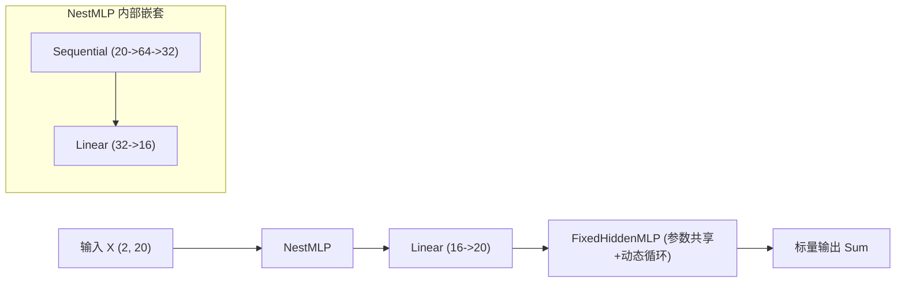

> 导航：[[5.0 章节全景与导读| 章节目录: 深度学习计算]] | [[5.2 参数管理| 下一节: 5.2 参数管理]]

---

# 层和块（Layers and Blocks）

在前面的章节中，我们构造神经网络主要通过 `nn.Sequential` 快速串联各个网络层。然而，随着网络架构的演进（如 GoogLeNet 的 Inception 并行多分支、ResNet 的残差跨层跳连、DenseNet 的密集通道拼接），纯线性的顺序堆叠已无法满足复杂拓扑的需求。

为了应对这一挑战，现代深度学习框架引入了**“块（Block）”**的高阶抽象。在 PyTorch 中，块由基类 `nn.Module` 承载。本节我们将深入 `nn.Module` 的核心设计机制，从底层手写自定义块、顺序块、动态控制流混合块，并剖析框架背后的有序字典注册与对象生命周期管理。

```python
import torch
from torch import nn
from torch.nn import functional as F

# 回顾：使用 nn.Sequential 实例化单隐藏层多层感知机
net = nn.Sequential(nn.Linear(20, 256), nn.ReLU(), nn.Linear(256, 10))
X = torch.rand(2, 20)
print(net(X).shape)
```

> [!example]- 运行输出
> ```text
> torch.Size([2, 10])
> ```

---

## 一、块（Block）的抽象机制与核心职责

在计算机视觉或自然语言处理中，模型往往呈现高度的**层次化组合结构**：

![[attachments/blocks.svg]]

```
  ┌─────────────────────────────────────────────────────────────┐
  │ 复合大块 / 完整模型 (如 ResNet-50 / Transformer)             │
  │                                                             │
  │  ┌─────────────────────────┐     ┌─────────────────────────┐│
  │  │ 中层子块 (Residual Block)│ ──► │ 中层子块 (Residual Block)││
  │  │  ┌──────┐    ┌────────┐ │     │  ┌──────┐    ┌────────┐ ││
  │  │  │ Conv │ ──►│ BatchNorm│ │     │  │ Conv │ ──►│ BatchNorm│ ││
  │  │  └──────┘    └────────┘ │     │  └──────┘    └────────┘ ││
  │  └─────────────────────────┘     └─────────────────────────┘│
  └─────────────────────────────────────────────────────────────┘
```

从软件工程角度看，一个**块（Block）**在 PyTorch 中由 `nn.Module` 表示，它必须承担以下四项核心契约：
1. **数据前向传递（Forward Pass）**：接收输入数据张量，执行指定变换并返回输出张量；
2. **状态与参数追踪（State Tracking）**：内部持有并维护可学习参数（`_parameters`）与常数缓冲区（`_buffers`）；
3. **子模块嵌套树（Module Hierarchy）**：能够感知并递归管理包含在其内部的所有子层和子块（`_modules`）；
4. **自动微分与硬件协同（Autograd & Device Migration）**：配合自动求导引擎记录计算图节点，并在调用 `.to(device)` 时递归将所有参数迁移至指定计算硬件。

---

## 二、从零定义自定义块：MLP 类

通过继承 `nn.Module`，我们可以随心所欲地定制具有任意拓扑结构的前向网络：

```python
class MLP(nn.Module):
    # 声明构造函数：定义网络所需的层与参数
    def __init__(self):
        # 必须显式调用父类的 __init__()，以初始化 nn.Module 内部的状态字典
        super().__init__()
        self.hidden = nn.Linear(20, 256)  # 隐藏层：20维输入 -> 256维输出
        self.out = nn.Linear(256, 10)     # 输出层：256维输入 -> 10维类别输出

    # 定义模型的前向传播逻辑
    def forward(self, X):
        # 使用 F.relu 函数式算子处理隐藏层输出，再接入输出层
        return self.out(F.relu(self.hidden(X)))
```

```python
net = MLP()
net(X)
```

> [!example]- 运行输出
> ```text
> tensor([[-0.1424, -0.0634,  0.0381,  0.0242, -0.0573, -0.0716, -0.0543, -0.0583,
>           0.0700, -0.0345],
>         [-0.1281, -0.0567,  0.0332,  0.0225, -0.0612, -0.0689, -0.0501, -0.0601,
>           0.0734, -0.0366]], grad_fn=<AddmmBackward0>)
> ```

### 关键机制辨析：双重隐形触发器与 `net(X)` 执行管道

> [!important] 核心机制：`__init__` 与 `forward` 的双重隐形触发
> 初学者常问：*“为什么我们定义了 `__init__` 和 `forward`，但在调用时却从不显式写 `net.__init__()` 或 `net.forward(X)`？”*
> 
> 这背后是 Python 与 PyTorch 精巧的**双重隐形触发器机制**：
> 1. **第一重触发（制造机器）：`net = MLP()`**
>    - 当调用类名后加圆括号时，Python 自动执行两步：先调用底层的 `__new__` 在内存中为对象开辟空间，紧接着暗中自动调用 `__init__(self)`。这一步完成的是**机器组装**（声明权重张量、注册子模块、初始化属性）。
> 2. **第二重触发（运转机器）：`output = net(X)`**
>    - 当对已经实例化的对象直接加圆括号时，Python 解释器会自动调用该对象所属类的魔法方法 `__call__(self, *args, **kwargs)`。
>    - 在 `nn.Module.__call__` 的底层源码中，PyTorch 封装了一套严密的流水线：
>      - **前置勾子（Forward Pre-hooks）**：执行通过 `register_forward_pre_hook` 注册的输入检查或动态修改；
>      - **核心计算**：暗中调用用户在子类中重写的 `self.forward(*args, **kwargs)`；
>      - **后置勾子（Forward Hooks）**：执行特征图抓取、激活值统计（用于模型量化/剪枝）或梯度追踪；
>      - **性能分析器（Profiler）追踪**：记录 CUDA Kernel 耗时与显存波动。
> 
> > [!caution] 致命工程陷阱：严禁在训练循环中直接临时实例化层
> > 例如严禁写出类似代码：
> > ```python
> > # 错误示范！绝对禁止！
> > for X, y in dataloader:
> >     y_hat = MyLinear(20, 10)(X)  # 致命错误：每轮迭代都重新生成一台新机器！
> >     loss = criterion(y_hat, y)
> >     loss.backward()
> >     optimizer.step()
> > ```
> > **致命后果**：
> > 1. 每次循环都在重新调用 `__init__`，创建一套完全随机的新参数；
> > 2. 优化器 `optimizer` 手中持有的还是上一轮被抛弃的旧参数引用，新参数根本无法更新；
> > 3. 循环结束后旧实例被 Python 垃圾回收机制（GC）销毁，导致模型“永远在重新投胎，永远学不会”！
> > 
> > **铁律**：**模型构建（Instantiation）是一次性的（造车），数据流动（Forward pass）是重复性的（跑车）！**

---

## 三、手写实现顺序块：MySequential

为了理解 `nn.Sequential` 的工作原理，我们从零实现一个极简的顺序块容器 `MySequential`：

```python
class MySequential(nn.Module):
    def __init__(self, *args):
        super().__init__()
        for idx, module in enumerate(args):
            # 核心机制：每个子模块必须注册到底层的 _modules 字典中
            # str(idx) 作为该模块在有序字典中的 key
            self._modules[str(idx)] = module

    def forward(self, X):
        # OrderedDict 严格保证按照添加的先后顺序执行前向变换
        for block in self._modules.values():
            X = block(X)
        return X
```

```python
net = MySequential(nn.Linear(20, 256), nn.ReLU(), nn.Linear(256, 10))
net(X)
```

> [!example]- 运行输出
> ```text
> tensor([[-0.1424, -0.0634,  0.0381,  0.0242, -0.0573, -0.0716, -0.0543, -0.0583,
>           0.0700, -0.0345],
>         [-0.1281, -0.0567,  0.0332,  0.0225, -0.0612, -0.0689, -0.0501, -0.0601,
>           0.0734, -0.0366]], grad_fn=<AddmmBackward0>)
> ```

### 深度剖析：`self._modules` 有序字典的作用

在 `nn.Module` 的 `__init__` 初始化过程中，系统会创建若干内部私有字典：
* `self._modules = OrderedDict()`：用于登记所有子模块；
* `self._parameters = OrderedDict()`：用于登记所有 `nn.Parameter`；
* `self._buffers = OrderedDict()`：用于登记不参与梯度更新的持久化张量（如 BatchNorm 的移动均值）。

当我们在一个块内部执行 `self.hidden = nn.Linear(...)` 时，Python 的 `__setattr__` 会被拦截，自动识别出 `nn.Linear` 属于 `nn.Module` 子类，并自动将其塞入 `self._modules["hidden"]` 中。而在 `MySequential` 中，通过显式向 `self._modules` 注册，确保了：
1. 调用 `net.parameters()` 时，能递归向下查找到所有子层的可训练权重；
2. 调用 `net.to(device)` 或 `net.cuda()` 时，能递归遍历并将所有子层的参数搬移到目标硬件设备上。

---

## 四、在前向传播中执行任意动态代码：FixedHiddenMLP

PyTorch 区别于静态图框架（早期 TensorFlow 1.x）的一大王牌特性，是其**原生支持动态计算图（Define-by-Run）**。在前向传播 `forward` 中，我们可以嵌入任何 Python 控制流（`if-else` 分支、`while` 循环、动态常数张量乘法与条件截断）：

```python
class FixedHiddenMLP(nn.Module):
    def __init__(self):
        super().__init__()
        # 声明一个不计算梯度的常量随机权重（参数在训练过程中保持绝对冻结）
        self.rand_weight = torch.rand((20, 20), requires_grad=False)
        self.linear = nn.Linear(20, 20)

    def forward(self, X):
        X = self.linear(X)
        # 融合固定权重乘法与偏置偏置运算
        X = F.relu(torch.mm(X, self.rand_weight) + 1)
        # 复用同一个全连接层：这相当于让该层在计算图中出现两次（即参数绑定/权重共享）
        X = self.linear(X)
        
        # 动态 Python 控制流：基于当前张量绝对值范数动态缩减，直至满足能量阈值
        while X.abs().sum() > 1:
            X /= 2
        return X.sum()
```

```python
net = FixedHiddenMLP()
print(net(X))
```

> [!example]- 运行输出
> ```text
> tensor(-0.0641, grad_fn=<SumBackward0>)
> ```

> [!note] 动态图的工程意义
> 在诸如文本生成（遇到结束标记 `<EOS>` 退出循环）、目标检测（根据先验框置信度过滤候选框）等变长控制任务中，动态图赋予了模型极高的编码表达力。无需特殊的控制流节点（如静态图的 `tf.while_loop`），原生 Python 语法即可直接构建反向计算图。

---

## 五、嵌套组合块（NestMLP）与混合拼接

由于所有层和块均统一继承自 `nn.Module`，它们具备完全一致的接口，可以像乐高积木一样多层级嵌套组合：

```python
class NestMLP(nn.Module):
    def __init__(self):
        super().__init__()
        # 块内部嵌套一个顺序块
        self.net = nn.Sequential(nn.Linear(20, 64), nn.ReLU(),
                                 nn.Linear(64, 32), nn.ReLU())
        self.linear = nn.Linear(32, 16)

    def forward(self, X):
        return self.linear(self.net(X))

# 混合拼接：NestMLP、独立 Linear 层与具备动态控制流的 FixedHiddenMLP 复合
chimera = nn.Sequential(NestMLP(), nn.Linear(16, 20), FixedHiddenMLP())
print(chimera(X))
```

> [!example]- 运行输出
> ```text
> tensor(-0.1132, grad_fn=<SumBackward0>)
> ```



---

## 六、效率考量与执行机制

使用高级 Python 面向对象抽象是否会导致深度学习系统的执行效率大幅下降？
* **答案是：基本不会**。
* **原因分析**：深度学习计算的绝大部分耗时都集中在底层的 GEMM（通用矩阵乘法）与卷积算子上。当 Python 解释器执行到 `self.linear(X)` 时，仅花费微秒级的解释开销即通过 CPython C-API 将底层数据指针派发（Dispatch）给用 C++/CUDA 高度优化的底层库（如 cuBLAS、cuDNN、oneDNN）。
* **进阶优化（TorchScript & JIT）**：如果确实面临极高频率的微型调用（例如在极端低延迟部署环境下 Python 解释器开销成为瓶颈），PyTorch 提供了 `torch.jit.trace` 和 `torch.jit.script`，能够将 Python 代码编译为脱离 Python 运行时的 TorchScript C++ 紧凑运行时执行。

---

## 七、构建层与网络的四大梯队演进全景图（10 种构建方法系统总结）

纵观深度学习模型的构建历程，从底层的数学原理验证到工业级复杂网络，我们一共掌握了 **4 大梯队、10 种构建层与网络的核心方法**。理解这 10 种方法的演进脉络，是掌握现代深度学习工程架构设计的关键基石：

```mermaid
graph TD
    subgraph 梯队一：原生张量白手起家 [梯队一：原生张量白手起家]
        M1["方法 1: 纯裸张量与矩阵算子<br/>(W, b + torch.matmul)"]
        M2["方法 2: 函数式计算抽象<br/>(def linreg(X, w, b))"]
    end

    subgraph 梯队二：官方容器快速拼装 [梯队二：官方容器快速拼装]
        M3["方法 3: nn.Sequential 经典链式<br/>(单输入单输出线性流水线)"]
        M4["方法 4: 动态循环与 add_module<br/>(重复规则结构如 VGG/深层MLP)"]
        M5["方法 5: 延后初始化容器<br/>(nn.LazyLinear 自动推导输入维度)"]
    end

    subgraph 梯队三：面向对象拓扑定制 [梯队三：面向对象拓扑定制]
        M6["方法 6: 标准复合多层块 (MLP)<br/>(自由定制子层连接逻辑)"]
        M7["方法 7: 动态控制流混合块 (FixedHiddenMLP)<br/>(while/if 循环 + 常量张量)"]
        M8["方法 8: 多分支并行与融合 (ParallelBlock)<br/>(torch.cat 拼接 / 残差相加)"]
        M9["方法 9: 参数绑定与共享 (Shared Layer)<br/>(同一层对象在图中多次出现)"]
    end

    subgraph 梯队四：底层算子数学创新 [梯队四：底层算子数学创新]
        M10["方法 10: 自定义数学算子层<br/>- 无参数变换 (CenteredLayer)<br/>- nn.Parameter 参数化 (MyLinear)<br/>- einsum 三阶张量降维 (BilinearReduction)<br/>- 频域实数分解 (FourierHalfLayer)"]
    end

    M1 --> M2 --> M3 --> M6 --> M10
    M3 --> M4
    M3 --> M5
    M6 --> M7
    M6 --> M8
    M6 --> M9
```

### 10 种构建方式全景对比与技术选型表

| 梯队 | 序号 | 构建方法 | 核心语法 / API | 参数管理方式 | 适用场景与优缺点 |
| :--- | :---: | :--- | :--- | :--- | :--- |
| **梯队一：张量裸写** | **1** | **纯张量数学手写** | `w = torch.randn(..., requires_grad=True)`<br/>`y = torch.matmul(X, w) + b` | 手动维护 Tensor 变量与梯度 | **教学与算法原型探索**。无框架包裹，控制极其透明，但无法序列化，难以构建大型模型。 |
| | **2** | **函数式过程抽象** | `def linreg(X, w, b): return torch.mm(X, w) + b` | 函数形参显式传递 | 提高底层代码复用性，但依旧缺少面向对象的生命周期管理。 |
| **梯队二：官方容器** | **3** | **`nn.Sequential` 经典串联** | `net = nn.Sequential(nn.Linear(...), nn.ReLU())` | 自动有序字典 `_modules` 追踪 | **线性前馈网络金标准**。极度简洁，代码量少；无法处理残差连接、多分支输入输出。 |
| | **4** | **动态循环与 `add_module`** | `layers = []`<br/>`layers.append(...)`<br/>`net = nn.Sequential(*layers)` | 自动序号命名注册 | **高度重复的均质深层结构**（如 VGG 块、ResNet 连续残差段），避免手动硬编码冗余。 |
| | **5** | **延后初始化容器** | `net = nn.Sequential(nn.LazyLinear(out_dim))` | 首次前向传播时根据数据推导 | **多阶段异构输入**。无需手动计算展平特征数，但调试时初始阶段无法直接查看权重数值。 |
| **梯队三：模块拓扑** | **6** | **标准自定义复合块** | 继承 `nn.Module`<br/>在 `__init__` 声明层，在 `forward` 显式调用 | 自动通过属性拦截注册至 `_modules` | **工业级模型最核心基石**。支持任意分支跳转、中间特征抽取，满足绝大部分架构需求。 |
| | **7** | **动态控制流混合块** | 在 `forward` 中嵌入原生 `while`、`if` 与标量判断 | 支持 `requires_grad=False` 的固定权重 | **自适应计算图**（如动态早退 Early Exit、变长文本生成 `<EOS>` 截断、能量范数收缩）。 |
| | **8** | **多分支并行块** | `torch.cat((net1(X), net2(X)), dim=1)` | 递归管理多个子模块分支 | **特征交叉与跨尺度提取**（如 GoogLeNet Inception、双塔推荐模型、多模态图文对齐）。 |
| | **9** | **参数绑定与共享块** | 复用同一个层变量：<br/>`self.linear(X)` 重复调用两次 | 同一 `nn.Parameter` 在计算图中多处引用 | **参数对齐与显存节约**（如循环神经网络步间共享、Transformer 词嵌入与输出投影绑定）。 |
| **梯队四：底层算子** | **10** | **自定义数学算子层** | 继承 `nn.Module`<br/>- 声明 `nn.Parameter`<br/>- 调用 `torch.einsum`<br/>- 调用 `torch.fft.rfft` | 纯算子级参数与缓冲区精细管理 | **前沿学术突破与前沿硬件优化**。实现官方库未提供的全新数学映射（如频域神经网络、双线性交叉 FM、FlashAttention 等）。 |

---

## 八、小结

1. **块（`nn.Module`）是深度学习架构的核心抽象**：层是特殊的块，多层组合也是块，完整模型依然是块。
2. **`__init__` 与 `forward`**：`__init__` 用于定义可复用模块与状态，`forward` 用于定义数据前向流动拓扑。
3. **`_modules` 注册机制**：必须通过属性赋值或显式登记到 `self._modules` 中，框架才能递归追踪到所有参数与状态。
4. **统一接口**：模块化设计使得任意网络可以任意相互嵌套，极大提升了工业级架构的可重用性与可维护性。

---

## 九、课后练习详尽推导与代码实证

### 练习 1：如果将 `MySequential` 中存储块的方式更改为 Python 列表（`list`），会出现什么样的问题？

**【机制分析与实证】**：
在 Python 中，普通 `list` 只是通用的对象引用容器，`nn.Module` 的属性拦截机制（`__setattr__`）无法深度感知列表中元素的变化。
若使用 `self.modules_list = [module1, module2]`，这些模块**不会被注册到当前类的 `self._modules` 有序字典中**。

导致的核心后果：
1. `net.parameters()` 返回空生成器：优化器无法获取到网络层权重，模型参数无法被更新！
2. `net.to('cuda')` 失效：外层容器搬移到 GPU 时，子模块仍然留在 CPU 上，导致前向传播发生跨设备计算报错！

```python
class BadSequential(nn.Module):
    def __init__(self, *args):
        super().__init__()
        # 错误做法：直接使用普通 Python 列表存储
        self.blocks = list(args)

    def forward(self, X):
        for b in self.blocks:
            X = b(X)
        return X

bad_net = BadSequential(nn.Linear(20, 256), nn.ReLU(), nn.Linear(256, 10))
print("可训练参数列表长度:", len(list(bad_net.parameters())))
```

> [!example]- 运行输出
> ```text
> 可训练参数列表长度: 0
> ```

> [!tip] 标准解法：`nn.ModuleList`
> 如果必须用列表形式按索引动态管理一系列层，必须使用 PyTorch 提供的专用容器 `nn.ModuleList`（例如 `self.layers = nn.ModuleList([nn.Linear(...) for _ in range(N)])`），它重写了列表操作并在元素加入时自动调用 `add_module` 注册。

---

### 练习 2：实现一个块，它以两个块为参数（例如 `net1` 和 `net2`），并返回前向传播中两个网络的串联输出（平行块 ParallelBlock）。

**【数学建模】**：
设网络输入为 $\mathbf{X} \in \mathbb{R}^{B \times D_{in}}$，两个并行子分支分别为 $f_1: \mathbb{R}^{B \times D_{in}} \to \mathbb{R}^{B \times D_{out1}}$ 与 $f_2: \mathbb{R}^{B \times D_{in}} \to \mathbb{R}^{B \times D_{out2}}$。
平行块的输出为沿特征维度（维度 1）将两个张量进行拼接（Concatenation）：
$$
\mathbf{Y} = [f_1(\mathbf{X}), f_2(\mathbf{X})] \in \mathbb{R}^{B \times (D_{out1} + D_{out2})}
$$

**【工程代码实现】**：

```python
class ParallelBlock(nn.Module):
    def __init__(self, net1, net2):
        super().__init__()
        # 正确将两个传入的子网络赋值给实例属性，触发 Module 自动注册
        self.net1 = net1
        self.net2 = net2

    def forward(self, X):
        out1 = self.net1(X)
        out2 = self.net2(X)
        # 在特征维度 (dim=1) 进行横向拼接
        return torch.cat((out1, out2), dim=1)

# 验证实现
branch1 = nn.Sequential(nn.Linear(20, 30), nn.ReLU())
branch2 = nn.Sequential(nn.Linear(20, 50), nn.Sigmoid())

parallel_net = ParallelBlock(branch1, branch2)
X_test = torch.randn(4, 20)
Y_test = parallel_net(X_test)

print("输入尺寸:", X_test.shape)
print("并行分支 1 输出尺寸:", branch1(X_test).shape)
print("并行分支 2 输出尺寸:", branch2(X_test).shape)
print("平行块最终拼接输出尺寸:", Y_test.shape)
```

> [!example]- 运行输出
> ```text
> 输入尺寸: torch.Size([4, 20])
> 并行分支 1 输出尺寸: torch.Size([4, 30])
> 并行分支 2 输出尺寸: torch.Size([4, 50])
> 平行块最终拼接输出尺寸: torch.Size([4, 80])
> ```

---

### 练习 3：假设我们想要连接同一网络的多个实例。实现一个函数，该函数生成同一个块的多个实例，并在此基础上构建更大的网络。

**【工程设计要点】**：
这里需要严格区分**“深拷贝独立实例（多个结构相同但权重互不干扰的层）”**与**“共享同一实例（参数绑定/权重联动）”**：
* 题目要求“生成同一个块的多个实例”，即工厂模式（Factory Pattern）：每次通过工厂函数生成一个独立的全新模块对象，使用 `nn.Sequential` 串联。

**【代码实现】**：

```python
import copy

def block_factory(in_features, out_features):
    """基础块工厂函数：生成一个标准的 Linear + BatchNorm + ReLU 块"""
    return nn.Sequential(
        nn.Linear(in_features, out_features),
        nn.BatchNorm1d(out_features),
        nn.ReLU()
    )

def build_deep_network(base_block_fn, num_blocks, feature_dim):
    """连接同一结构块的多个独立实例"""
    layers = []
    for _ in range(num_blocks):
        # 每次调用工厂函数生成全新的独立层对象
        layers.append(base_block_fn(feature_dim, feature_dim))
    return nn.Sequential(*layers)

# 构建一个包含 5 个连续相同隐藏变换块的深层模型
deep_net = build_deep_network(block_factory, num_blocks=5, feature_dim=64)
print(deep_net)

# 验证前向传播
X_input = torch.randn(8, 64)
print("输出形状:", deep_net(X_input).shape)
```

> [!example]- 运行输出
> ```text
> Sequential(
>   (0): Sequential(
>     (0): Linear(in_features=64, out_features=64, bias=True)
>     (1): BatchNorm1d(64, eps=1e-05, momentum=0.1, affine=True, track_running_stats=True)
>     (2): ReLU()
>   )
>   (1): Sequential(
>     (0): Linear(in_features=64, out_features=64, bias=True)
>     (1): BatchNorm1d(64, eps=1e-05, momentum=0.1, affine=True, track_running_stats=True)
>     (2): ReLU()
>   )
>   (2): Sequential(
>     (0): Linear(in_features=64, out_features=64, bias=True)
>     (1): BatchNorm1d(64, eps=1e-05, momentum=0.1, affine=True, track_running_stats=True)
>     (2): ReLU()
>   )
>   (3): Sequential(
>     (0): Linear(in_features=64, out_features=64, bias=True)
>     (1): BatchNorm1d(64, eps=1e-05, momentum=0.1, affine=True, track_running_stats=True)
>     (2): ReLU()
>   )
>   (4): Sequential(
>     (0): Linear(in_features=64, out_features=64, bias=True)
>     (1): BatchNorm1d(64, eps=1e-05, momentum=0.1, affine=True, track_running_stats=True)
>     (2): ReLU()
>   )
> )
> 输出形状: torch.Size([8, 64])
> ```

---

> 导航：[[5.0 章节全景与导读| 章节目录: 深度学习计算]] | [[5.2 参数管理| 下一节: 5.2 参数管理]]
