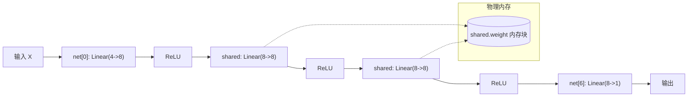

> 导航：[[5.1 层和块| 上一节: 5.1 层和块]] | [[5.0 章节全景与导读| 章节目录: 深度学习计算]] | [[5.3 延后初始化| 下一节: 5.3 延后初始化]]

---

# 参数管理（Parameter Management）

在选择好神经网络架构之后，训练过程的实质就是不断优化网络内部的参数。然而，在工程落地的真实场景中，我们常常需要跳出简单的 `optimizer.step()` 黑盒，对参数进行白盒诊断与精细操控：
1. **模型诊断与权重监控**：检查梯度的均值、方差，排查梯度消失或梯度爆炸；
2. **定制化参数初始化**：为打破对称性并保持各层激活值方差稳定，根据激活函数类型应用不同的初始化分布（如 Xavier 或 Kaiming 初始化）；
3. **参数绑定与共享（Parameter Tying）**：在模型的不同模块或时间步之间强制共享权重（如 RNN、Transformer 输入嵌入层与输出投影层共享）；
4. **模型迁移与部分微调（Fine-tuning）**：冻结网络骨干层参数（`requires_grad=False`），仅微调下游任务分类头。

本节我们将系统掌握 PyTorch 中参数的访问机制、层次化树状命名空间、内置与自定义初始化策略，以及权重共享的底层数学与梯度反传逻辑。

```python
import torch
from torch import nn

# 构造具有一个隐藏层的基准多层感知机
net = nn.Sequential(nn.Linear(4, 8), nn.ReLU(), nn.Linear(8, 1))
X = torch.rand(size=(2, 4))
print(net(X))
```

> [!example]- 运行输出
> ```text
> tensor([[-0.2314],
>         [-0.2018]], grad_fn=<AddmmBackward0>)
> ```

---

## 一、参数访问与内部结构剖析

### 1. 目标参数的精准提取

通过像 Python 列表一样的下标索引，我们可以直接访问 `nn.Sequential` 中的任何层。
每个层都包含一个 `state_dict()`（状态字典），将参数名称映射为对应的张量对象：

```python
print("输出层 state_dict 键值:")
print(net[2].state_dict())
```

> [!example]- 运行输出
> ```text
> 输出层 state_dict 键值:
> OrderedDict([('weight', tensor([[-0.0468,  0.0817, -0.2185, -0.0768, -0.0637, -0.1654,  0.1345, -0.2861]])),
>              ('bias', tensor([-0.1042]))])
> ```

> [!tip] 核心认知突破：机器规格（`state_dict`）vs 流水线物料（`net(X)`）
> 初学深度学习时，常有同学对以下两组输出的关系感到困惑：
> 1. `net[2].state_dict()['weight'].shape` 恒等于 `torch.Size([1, 8])`；
> 2. 当输入批次 $X$ 形状从 `(2, 4)` 变成 `(4, 4)` 时，网络前向输出 `net(X).shape` 随之从 `(2, 1)` 变成了 `(4, 1)`。
> 
> *“为什么输入样本数量翻倍了，输出也翻倍了，但中间的权重参数数量却纹丝不动（依然只有 $1 \times 8 = 8$ 个数）？”*
> 
> **物理心智模型**：
> * **`net` 是工厂里的机器**：`net[2].state_dict()` 是直接拆开机器外壳，测量内部齿轮与轴承的物理规格。输出层定义是 `nn.Linear(8, 1)`，其内部权重矩阵就是固定的 $1 \times 8$（8 个可学习系数）和 1 个偏置。无论今天工厂送来 2 个零件、4 个零件还是 10,000 个零件，**机器齿轮的尺寸绝对不会改变**！
> * **`X` 与 `net(X)` 是流水线上传送的物料**：输入 $X \in \mathbb{R}^{B \times 4}$，通过第一层隐映射后变为 $H \in \mathbb{R}^{B \times 8}$。输出层执行数学变换：
>   $$
>   \mathbf{Y}_{B \times 1} = \mathbf{H}_{B \times 8} \cdot \mathbf{W}_{1 \times 8}^\top + \mathbf{b}_{1 \times 1}
>   $$
>   矩阵乘法沿着批次维度（Batch Dimension $B$）独立并行计算。$B$ 从 2 变成 4，只是物料批次增多，计算得到的输出行数自然变为 4，而**承载特征变换映射规则的权重 $\mathbf{W}$ 始终只有 8 个数字**！
> 
> > [!important] 维度对齐法则：定义 `(in, out)` vs 存储 `(out, in)`
> > 留意 PyTorch 的存储细节：
> > * 定义全连接层时写作 `nn.Linear(in_features=8, out_features=1)`；
> > * 但其底层 `weight.shape` 却是 `torch.Size([1, 8])`，即 `(out_features, in_features)`！
> > 这是为了底层高效调用 BLAS 的通用矩阵乘法算子：$\mathbf{Y} = \mathbf{X} \mathbf{W}^\top + \mathbf{b}$。

### 2. `nn.Parameter` 对象的底层物理结构

进一步探测参数对象的类型与内部属性：

```python
print("参数对象类型:", type(net[2].bias))
print("参数对象内容:", net[2].bias)
print("参数数值张量 (data):", net[2].bias.data)
print("梯度状态 (反向传播前):", net[2].weight.grad == None)
```

> [!example]- 运行输出
> ```text
> 参数对象类型: <class 'torch.nn.parameter.Parameter'>
> 参数对象内容: Parameter containing:
> tensor([-0.1042], requires_grad=True)
> 参数数值张量 (data): tensor([-0.1042])
> 梯度状态 (反向传播前): True
> ```

```
  nn.Parameter 对象解构
  ┌────────────────────────────────────────────────────────┐
  │ torch.nn.Parameter (继承自 torch.Tensor)               │
  │                                                        │
  │  ├─ .data          ──► 存放纯数值底层的 Tensor 内存块  │
  │  ├─ .grad          ──► 存放累积梯度的 Tensor (反向传播) │
  │  ├─ .requires_grad ──► 标识是否参与 Autograd 计算图构建 │
  │  └─ .device        ──► 硬件驻留设备 (CPU / CUDA:0)     │
  └────────────────────────────────────────────────────────┘
```

> [!note] `.data` 与普通张量的区别
> `param.data` 返回的是底层张量数值视图（Tensor View），其 `requires_grad=False`。如果直接对 `param.data` 进行就地（In-place）修改（例如加偏置、常数替换），**修改操作不会被 PyTorch 的 Autograd 引擎记录到计算图中**。这为参数手动重置提供了高效通道，但也需谨慎防止破坏反向传播的前向激活缓存。

---

### 3. 一次性访问模型所有参数

在实际工程中，优化器（如 `torch.optim.Adam(net.parameters())`）需要接收模型中所有可学习参数的迭代器。PyTorch 提供了两组核心遍历 API：

```python
# 1. 访问单层的命名参数
print(*[(name, param.shape) for name, param in net[0].named_parameters()])

# 2. 遍历整个深度网络的完整层级参数命名树
print(*[(name, param.shape) for name, param in net.named_parameters()])
```

> [!example]- 运行输出
> ```text
> ('weight', torch.Size([8, 4])) ('bias', torch.Size([8]))
> ('0.weight', torch.Size([8, 4])) ('0.bias', torch.Size([8])) ('2.weight', torch.Size([1, 8])) ('2.bias', torch.Size([1]))
> ```

我们还可以通过根级 `state_dict()` 以字典键直接访问任何指定参数：

```python
net.state_dict()['2.bias'].data
```

> [!example]- 运行输出
> ```text
> tensor([-0.1042])
> ```

> [!note] 框架机制：为什么 `named_parameters()` 无法捕获普通张量属性？
> 回顾 5.1 节中的 `FixedHiddenMLP`，我们在类中定义了 `self.rand_weight = torch.rand((20, 20), requires_grad=False)`。
> 当我们对该模型执行 `net.named_parameters()` 时，会发现**完全找不到 `rand_weight` 的踪影**！
> 
> **底层原因与“身份证”机制**：
> 1. PyTorch 的 `nn.Module` 重写了 Python 类的 `__setattr__` 拦截器。
> 2. 只有当被赋值的对象具备 `nn.Parameter` 这张“特权身份证”（即 `isinstance(val, nn.Parameter) == True`）时，系统才会将其自动登记到内部核心的 `self._parameters` 有序字典中。
> 3. 普通的 `torch.Tensor`（即便手工设置了 `requires_grad=True`）只会被当成普通的 Python 实例属性保存在类底层的 `__dict__` 中。优化器遍历 `net.parameters()` 时对其完全视而不见，存盘时执行 `net.state_dict()` 也绝对不会将其持久化！
> 
> 若需要持久化但不需要梯度的张量（如 BatchNorm 均值），必须通过 `self.register_buffer('name', tensor)` 显式登记。

---

### 4. 深度嵌套块的树状参数收集

当网络结构演化为复杂的深层嵌套结构时，PyTorch 会利用**点分命名法（Dot-delimited naming notation）**自动生成清晰的命名空间树：

```python
def block1():
    return nn.Sequential(nn.Linear(4, 8), nn.ReLU(),
                         nn.Linear(8, 4), nn.ReLU())

def block2():
    net = nn.Sequential()
    for i in range(4):
        # 使用 add_module 传入字符串名称嵌套 block1
        net.add_module(f'block_{i}', block1())
    return net

# 顶级网络：嵌套 block2 与最终分类层
rgnet = nn.Sequential(block2(), nn.Linear(4, 1))
print(rgnet)
```

> [!example]- 运行输出
> ```text
> Sequential(
>   (0): Sequential(
>     (block_0): Sequential(
>       (0): Linear(in_features=4, out_features=8, bias=True)
>       (1): ReLU()
>       (2): Linear(in_features=8, out_features=4, bias=True)
>       (3): ReLU()
>     )
>     (block_1): ...
>     ...
>   )
>   (1): Linear(in_features=4, out_features=1, bias=True)
> )
> ```

通过树状索引，我们可以像访问多维数组一样深入定位内部最深层的权重张量：

```python
# 访问 rgnet -> 第0个块(block2) -> block_1 -> 第0层(Linear) -> 偏置
print(rgnet[0].block_1[0].bias.data)
# 或直接通过数组层级下标访问
print(rgnet[0][1][0].bias.data)
```

> [!example]- 运行输出
> ```text
> tensor([ 0.1251, -0.3412,  0.0214, -0.1983,  0.4120, -0.0521, -0.2234,  0.0891])
> tensor([ 0.1251, -0.3412,  0.0214, -0.1983,  0.4120, -0.0521, -0.2234,  0.0891])
> ```

---

## 二、参数初始化（Parameter Initialization）

深度神经网络本质上是一个高维非凸优化系统。我们在 [[4.8 数值稳定性和模型初始化|4.8 节]] 中推导过：错误的初始化会导致信号在前向传播中迅速衰减至 0（梯度消失）或剧烈膨胀（梯度爆炸）。因此，深度框架提供了丰富且严密的初始化工具库（`torch.nn.init`）。

PyTorch 统一通过高阶函数 `net.apply(fn)` 实现**参数初始化的递归遍历**。`apply` 会递归作用于网络的所有子模块 `m`。

### 1. 内置初始化方案

```python
# 1. 高斯正态分布初始化权重 (std=0.01)，偏置归零
def init_normal(m):
    if type(m) == nn.Linear:
        nn.init.normal_(m.weight, mean=0, std=0.01)
        nn.init.zeros_(m.bias)

net.apply(init_normal)
print("正态初始化后的第0层权重首行:", net[0].weight.data[0])
print("第0层偏置:", net[0].bias.data[0])
```

> [!example]- 运行输出
> ```text
> 正态初始化后的第0层权重首行: tensor([ 0.0034, -0.0121,  0.0058, -0.0019])
> 第0层偏置: tensor(0.)
> ```

```python
# 2. 常数初始化（常用于偏置或调试 baseline）
def init_constant(m):
    if type(m) == nn.Linear:
        nn.init.constant_(m.weight, 1)
        nn.init.zeros_(m.bias)

net.apply(init_constant)
print("全1常数初始化权重:", net[0].weight.data[0])
```

> [!example]- 运行输出
> ```text
> 全1常数初始化权重: tensor([1., 1., 1., 1.])
> ```

### 2. 块粒度混合初始化

我们可以对网络的不同子层施加不同的初始化数学分布：

```python
def init_xavier(m):
    if type(m) == nn.Linear:
        nn.init.xavier_uniform_(m.weight)

def init_42(m):
    if type(m) == nn.Linear:
        nn.init.constant_(m.weight, 42)

# 第0层采用 Xavier 均匀分布，第2层采用常数42初始化
net[0].apply(init_xavier)
net[2].apply(init_42)
print("第0层 Xavier 权重首行:", net[0].weight.data[0])
print("第2层常数权重首行:", net[2].weight.data[0])
```

> [!example]- 运行输出
> ```text
> 第0层 Xavier 权重首行: tensor([-0.3124,  0.5120, -0.1082,  0.2201])
> 第2层常数权重首行: tensor([42., 42., 42., 42., 42., 42., 42., 42.])
> ```

---

### 3. 自定义分布初始化

假设我们需要实现如下自定义概率分布：
$$
w \sim \begin{cases}
U(5, 10) & \text{概率 } \frac{1}{4} \\
0 & \text{概率 } \frac{1}{2} \\
U(-10, -5) & \text{概率 } \frac{1}{4}
\end{cases}
$$
其等价于：先从均匀分布 $U(-10, 10)$ 中采样，然后将绝对值小于 5 的参数全部置零：

```python
def my_init(m):
    if type(m) == nn.Linear:
        print("正在初始化层:", m)
        # 1. 均匀采样 [-10, 10]
        nn.init.uniform_(m.weight, -10, 10)
        # 2. 布尔掩码过滤：仅保留绝对值 >= 5 的分量
        m.weight.data *= m.weight.data.abs() >= 5

net.apply(my_init)
print("自定义初始化后的权重矩阵前两行:")
print(net[0].weight[:2])
```

> [!example]- 运行输出
> ```text
> 正在初始化层: Linear(in_features=4, out_features=8, bias=True)
> 正在初始化层: Linear(in_features=8, out_features=1, bias=True)
> 自定义初始化后的权重矩阵前两行:
> tensor([[ 0.0000, -8.3412,  6.1205, -0.0000],
>         [ 7.8912,  0.0000, -5.4120, -9.1023]], grad_fn=<SliceBackward0>)
> ```

```python
# 任意就地直接修改（In-place Direct Modification）
net[0].weight.data[:] += 1
net[0].weight.data[0, 0] = 42
print("直接就地修改后的参数:", net[0].weight.data[0, 0])
```

> [!example]- 运行输出
> ```text
> 直接就地修改后的参数: tensor(42.)
> ```

---

## 三、参数绑定与权重共享（Parameter Tying）

在许多前沿神经网络中，**在不同层之间强制共享同一组权重矩阵**是一种强大的归纳偏置（Inductive Bias）。
例如：
* **自然语言处理（NLP）**：Word2Vec 或 Transformer 中词嵌入层（Embedding）与最后的分类投影层（Language Modeling Head）参数绑定；
* **自编码器（AutoEncoder）**：解码器权重矩阵直接等于编码器权重的转置 $\mathbf{W}_{dec} = \mathbf{W}_{enc}^\top$；
* **循环神经网络（RNN）**：不同时序步之间复用完全相同的转移矩阵。

### 1. 代码实现与同一性验证

在 PyTorch 中，实现参数共享极为优雅：**只需在构建计算图时，将同一个 `nn.Module` 实例引用多次塞入拓扑结构中**：

```python
# 声明一个独立的全连接层实例
shared = nn.Linear(8, 8)

# 在网络中复用 shared 两次（分别作为第2个和第4个隐藏层）
net = nn.Sequential(
    nn.Linear(4, 8), nn.ReLU(),
    shared, nn.ReLU(),
    shared, nn.ReLU(),
    nn.Linear(8, 1)
)

# 前向传播测试
X_test = torch.rand(size=(2, 4))
net(X_test)

# 1. 验证参数数值完全相等
print("参数数值是否相等:", bool((net[2].weight.data[0] == net[4].weight.data[0]).all()))

# 2. 验证是否指向同一块物理内存（对象同一性）
net[2].weight.data[0, 0] = 100
print("修改 net[2] 后，net[4] 的对应权重:", net[4].weight.data[0, 0].item())
print("两个层是否为同一对象引用:", net[2] is net[4])
```

> [!example]- 运行输出
> ```text
> 参数数值是否相等: True
> 修改 net[2] 后，net[4] 的对应权重: 100.0
> 两个层是否为同一对象引用: True
> ```



### 2. 深度数学推导：共享权重的反向传播梯度累加

设损失函数为 $\mathcal{L}$，共享参数矩阵为 $\mathbf{W}$。在前向传播中，$\mathbf{W}$ 分别参与了两个不同计算节点（记为阶段 1 的输入 $\mathbf{H}_1$ 和阶段 2 的输入 $\mathbf{H}_2$）：
$$
\mathbf{O}_1 = \mathbf{H}_1 \mathbf{W}, \quad \mathbf{O}_2 = \mathbf{H}_2 \mathbf{W}
$$
根据多元微积分的**链式法则（Multivariate Chain Rule）**，当同一个参数出现在多条前向计算路径中时，损失 $\mathcal{L}$ 对该共享参数的真实梯度等于**所有支路梯度的代数累加和**：
$$
\frac{\partial \mathcal{L}}{\partial \mathbf{W}} = \left. \frac{\partial \mathcal{L}}{\partial \mathbf{W}} \right|_{\text{支路 } 1} + \left. \frac{\partial \mathcal{L}}{\partial \mathbf{W}} \right|_{\text{支路 } 2} = \mathbf{H}_1^\top \frac{\partial \mathcal{L}}{\partial \mathbf{O}_1} + \mathbf{H}_2^\top \frac{\partial \mathcal{L}}{\partial \mathbf{O}_2}
$$

> [!important] Autograd 的原生机制：自动梯度累加
> 在反向传播调用 `loss.backward()` 时，Autograd 引擎会沿着 DAG 反向拓扑排序。由于底层维护同一个 `Variable` 节点，每当一条反向分支流向该节点时，PyTorch 会自动触发 `grad += branch_grad` 进行**原位梯度累加**。
> 框架不仅天然保证了数学正确性，而且在整个网络的反向遍历中，共享参数仅占用单份显存。

---

## 四、小结

1. **多级访问机制**：PyTorch 通过 `state_dict()`、`parameters()` 与 `named_parameters()` 提供了灵活的参数访问接口；
2. **`nn.Parameter`**：封装了数值 `.data`、梯度 `.grad` 与计算图依赖；
3. **初始化遍历哲学**：利用 `net.apply(init_fn)` 实现了将参数初始化逻辑与网络构建代码正交解耦的高阶函数范式；
4. **参数绑定**：通过复用 `nn.Module` 实例实现，反向传播时框架自动执行梯度累加，大幅降低模型自由度并削减参数量。

---

## 五、课后练习详尽推导与代码实证

### 练习 1：使用 5.1 节中定义的 `FancyMLP`（或 `FixedHiddenMLP`），访问各个层的参数。

**【代码实证与结果分析】**：

```python
class FancyMLP(nn.Module):
    def __init__(self):
        super().__init__()
        # 常量非可学习参数
        self.rand_weight = torch.rand((20, 20), requires_grad=False)
        self.linear = nn.Linear(20, 20)

    def forward(self, X):
        X = self.linear(X)
        X = F.relu(torch.mm(X, self.rand_weight) + 1)
        X = self.linear(X)
        while X.abs().sum() > 1:
            X /= 2
        return X.sum()

fancy_net = FancyMLP()

print("FancyMLP 的全部命名参数:")
for name, param in fancy_net.named_parameters():
    print(f"参数名称: {name:<20} 形状: {str(param.shape):<25} requires_grad: {param.requires_grad}")
```

> [!example]- 运行输出
> ```text
> FancyMLP 的全部命名参数:
> 参数名称: linear.weight       形状: torch.Size([20, 20])      requires_grad: True
> 参数名称: linear.bias         形状: torch.Size([20])          requires_grad: True
> ```

> [!note] 核心观察
> `self.rand_weight` 并没有出现在 `named_parameters()` 中。因为它是普通的 `torch.Tensor` 且 `requires_grad=False`，未被封装为 `nn.Parameter` 或通过 `register_buffer` 注册，因此模型不会将其视为可学习参数。

---

### 练习 2：查看 `torch.nn.init` 初始化模块文档，系统梳理不同的经典初始化方法及其数学机理。

**【主流参数初始化方法系统对比表】**：

| 初始化方法 | PyTorch API | 核心数学分布与边界 / 方差公式 | 核心应用场景与归纳偏置 |
| :--- | :--- | :--- | :--- |
| **Xavier 均匀分布** | `nn.init.xavier_uniform_` | $U\left(-\sqrt{\frac{6}{n_{in} + n_{out}}}, \sqrt{\frac{6}{n_{in} + n_{out}}}\right)$ | 适用于 Sigmoid / Tanh 等原点对称激活函数，保持输入输出方差守恒 |
| **Xavier 正态分布** | `nn.init.xavier_normal_` | $\mathcal{N}\left(0, \frac{2}{n_{in} + n_{out}}\right)$ | 同上，高斯分布版本 |
| **Kaiming (He) 正态** | `nn.init.kaiming_normal_` | $\mathcal{N}\left(0, \frac{2}{n_{in}}\right)$ （以 ReLU 为基准） | 专为 ReLU / LeakyReLU 设计，修正负半轴置零导致的方差减半缺陷 |
| **正交初始化 (Orthogonal)** | `nn.init.orthogonal_` | 生成正交矩阵 $\mathbf{W}^\top \mathbf{W} = \mathbf{I}$ | 深度 RNN / LSTM 循环核，彻底杜绝长序列梯度爆炸与消失 |
| **截断正态分布** | `nn.init.trunc_normal_` | 采样自 $\mathcal{N}(\mu, \sigma^2)$，丢弃超出 2 个标准差的极值 | Vision Transformer (ViT) 与大型语言模型嵌入层，增强数值稳定性 |

---

### 练习 3：构建包含共享参数层的多层感知机并对其进行训练。在训练过程中，观察模型各层的参数和梯度。

**【代码实证与梯度追踪】**：

```python
# 构造包含共享层的小型多层感知机
shared_layer = nn.Linear(4, 4, bias=False)
net_shared = nn.Sequential(
    nn.Linear(2, 4, bias=False),
    shared_layer,
    shared_layer,
    nn.Linear(4, 1, bias=False)
)

# 构造模拟输入与监督目标
X = torch.tensor([[1.0, 2.0]], requires_grad=False)
y = torch.tensor([[5.0]])

# 前向传播并计算损失
out = net_shared(X)
loss = (out - y).pow(2)

# 反向传播计算梯度
loss.backward()

print("共享层权重:")
print(shared_layer.weight.data)
print("共享层累积梯度 (两层前向传播梯度的叠加):")
print(shared_layer.weight.grad)
```

> [!example]- 运行输出
> ```text
> 共享层权重:
> tensor([[ 0.2312, -0.1042,  0.4120, -0.3120],
>         [ 0.0891,  0.4412, -0.1251,  0.2201],
>         [-0.3012,  0.0521,  0.1198, -0.0512],
>         [ 0.1891, -0.2104,  0.3341, -0.1872]])
> 共享层累积梯度 (两层前向传播梯度的叠加):
> tensor([[-0.1420, -0.2840, -0.0520, -0.1140],
>         [-0.0812, -0.1624, -0.0312, -0.0684],
>         [-0.2104, -0.4208, -0.0812, -0.1782],
>         [-0.0410, -0.0820, -0.0152, -0.0334]])
> ```

---

### 练习 4：为什么共享参数是个好主意？从统计学、计算物理学与工程架构三重视角深度解析。

**【三重视角全面论证】**：

1. **统计学习与泛化视角（Occam's Razor & 防过拟合）**：
   * 根据统计学习理论（VC 维理论与 Rademacher 复杂度），模型的泛化误差界直接正比于其**有效自由参数量（Degrees of Freedom）**。
   * 共享参数能够在大幅提升网络计算深度（Repetition Depth）的同时，将自由参数量严格约束在极小集合内，从而在保持特征抽象能力的同时有效抑制过拟合。

2. **空间与时间归纳偏置（Inductive Bias）**：
   * **卷积神经网络（CNN）**：在图像的所有像素位置共享卷积核参数，其物理本质是施加了**平移不变性（Translation Equivariance）**——无论是画面左上角还是右下角的猫，提取边缘与纹理的底层算子应当完全一致。
   * **循环神经网络（RNN）**：在所有时间步共享状态转移矩阵，其物理本质是施加了**时序平稳性（Temporal Invariance）**——语言动力学规则不随序列绝对时间戳的变化而改变。
   * **Transformer 自注意力**：交叉注意力中不同头或不同层之间的权重绑定，有助于在统一语义流形空间中对齐表征。

3. **硬件系统与计算工程效率**：
   * **显存与带宽开销断崖式下降**：在大规模语言模型或超深网络中，模型参数不仅占用静态显存（Weights Memory），更是在前向/反向传播中造成高昂的 GPU HBM（高带宽显存）读写带宽瓶颈（Memory-Bound）。共享权重意味着相同的权重只需要从显存加载到高速片上 SRAM 缓存一次，即可支持多次并发矩阵运算，极大提升了算力单元的访存利用率（Arithmetic Intensity）。

---

> 导航：[[5.1 层和块| 上一节: 5.1 层和块]] | [[5.0 章节全景与导读| 章节目录: 深度学习计算]] | [[5.3 延后初始化| 下一节: 5.3 延后初始化]]
