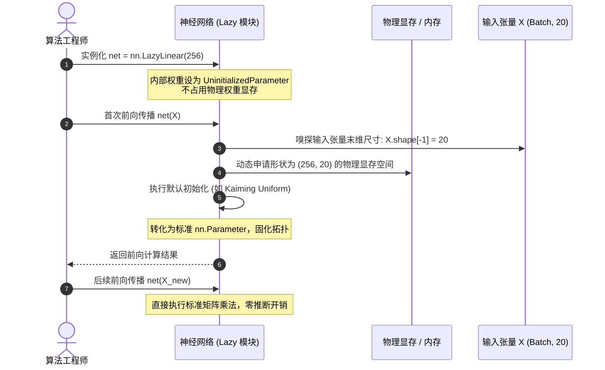

> 导航：[[5.2 参数管理| 上一节: 5.2 参数管理]] | [[5.0 章节全景与导读| 章节目录: 深度学习计算]] | [[5.4 自定义层| 下一节: 5.4 自定义层]]

---

# 延后初始化（Deferred Initialization）

在构建神经网络时，一个长期困扰算法工程师的繁琐问题是**输入维度的显式绑定**：
* 在构建多层感知机时，第一层全连接层必须明确写出输入特征数（例如 `nn.Linear(784, 256)`）；
* 在构建复杂的卷积神经网络时，经过数层卷积、池化、填充与步幅变换后，进入分类头之前的特征图扁平化维度计算极其繁琐，一旦修改了输入图像的分辨率（如从 $224 \times 224$ 变为 $384 \times 384$），整个分类头全连接层的输入尺寸全部需要手动重新推算。

为了彻底解耦**“网络拓扑定义”**与**“输入数据维度规格”**，现代深度学习框架引入了**延后初始化（Deferred Initialization / Lazy Initialization）**机制。

本节我们将深入探讨延后初始化的底层形状推断流水线（Shape Inference Pipeline），并在 PyTorch 中基于 `nn.LazyLinear` 与 `UninitializedParameter` 亲手实测动态推断与延迟物化的全过程，同时指出其在分布式训练（DDP）与生产部署中的关键工程避坑点。

---

## 一、延后初始化的核心动机与架构设计

### 1. 痛点：即时初始化（Eager Initialization）的耦合缺陷

在传统的即时初始化框架中，实例化网络层的瞬间，框架就必须分配物理显存并填充参数张量：
$$
\mathbf{W} \in \mathbb{R}^{\text{out\_features} \times \text{in\_features}}
$$
这意味着如果 $\text{in\_features}$ 未知，框架根本无法确定权重矩阵的几何尺寸，更谈不上分配内存或根据 Xavier/Kaiming 规则采样随机数。

### 2. 破局之道：形状推断流水线（Shape Inference Pipeline）

延后初始化的核心哲学是：**声明时仅记录拓扑逻辑，数据流经时动态确定物理形态**。



---

## 二、PyTorch 中的工程实现：LazyLinear 实测

在早期 PyTorch 中，用户必须硬编码输入特征维度。自 PyTorch 1.8+ 起，框架正式引入了 `torch.nn.modules.lazy.LazyModuleMixin` 体系，提供了一整套 Lazy 算子（如 `nn.LazyLinear`、`nn.LazyConv2d`、`nn.LazyBatchNorm2d` 等）。

### 1. 实例化阶段：观察未物化参数

```python
import torch
from torch import nn

# 构建包含延后初始化的多层感知机
# 注意：第一层和第二层我们均无需传入 in_features
net = nn.Sequential(
    nn.LazyLinear(256),
    nn.ReLU(),
    nn.LazyLinear(10)
)

print("首次前向传播前，第一层权重对象:")
print(net[0].weight)
print("第一层偏置对象:")
print(net[0].bias)
```

> [!example]- 运行输出
> ```text
> 首次前向传播前，第一层权重对象:
> <UninitializedParameter>
> 第一层偏置对象:
> <UninitializedParameter>
> ```

> [!important] 底层机制：`<UninitializedParameter>` 占位符
> 此时 `net[0].weight` 是 `torch.nn.parameter.UninitializedParameter` 的实例。它继承自普通 `Parameter`，但重写了属性访问方法：
> * 此时查询 `net[0].weight.shape` 会直接抛出 `RuntimeError: Cannot access data of an uninitialized parameter.`；
> * 此时该模型**完全不占用任何权重物理显存/内存**。

---

### 2. 触发阶段：首次数据前向传播

当我们传入一个特征维度为 20 的假数据（Dummy Input）时，框架捕获到输入张量的几何维度，瞬间触发初始化：

```python
# 构造输入张量：批量大小 2，特征维度 20
X = torch.rand(2, 20)

# 执行前向传播，瞬间触发参数推断与内存物化
output = net(X)

print("首次前向传播后，第一层权重形状:")
print(net[0].weight.shape)
print("第一层权重类型:", type(net[0].weight))
print("第二层权重形状:")
print(net[2].weight.shape)
print("前向传播输出张量形状:", output.shape)
```

> [!example]- 运行输出
> ```text
> 首次前向传播后，第一层权重形状:
> torch.Size([256, 20])
> 第一层权重类型: <class 'torch.nn.parameter.Parameter'>
> 第二层权重形状:
> torch.Size([10, 256])
> 前向传播输出张量形状: torch.Size([2, 10])
> ```

**物理过程剖析**：
1. `X` 注入 `net[0]`，`LazyLinear` 嗅探到输入末维为 20；
2. 内部调用 `initialize_parameters(X)`，将 `<UninitializedParameter>` 替换为 `[256, 20]` 的标准 `nn.Parameter`；
3. 执行默认的 Kaiming 均匀初始化；
4. 输出形状变为 `(2, 256)`，流入 `nn.ReLU()`，再流入 `net[2]`；
5. `net[2]` 嗅探到自身输入特征为 256，将其物化为 `[10, 256]` 的权重矩阵；
6. 至此，整个网络的参数空间完全确定，后续推理与反向传播完全退化为常规的高性能固定张量运算。

---

## 三、工业级避坑指南：延后初始化的生产陷阱

虽然延后初始化极大简化了网络原型设计，但在现代工业级分布式训练与低延迟生产部署中，存在必须警惕的工程缺陷：

### 1. 分布式数据并行（DDP）致命报错

在 PyTorch 的分布式数据并行训练（`DistributedDataParallel`, DDP）中：
* DDP 在包装模型（`model = DDP(model, device_ids=[rank])`）的构造阶段，会通过 NCCL 通信原语将 Rank 0 主节点的模型参数**广播（Broadcast）**到所有从属 GPU 上，以保证全局初始参数严格一致；
* **如果模型中包含未初始化的 Lazy 模块，DDP 构造函数将直接崩溃抛出异常**，因为系统无法对没有确定形状的内存块执行跨卡通信广播！
* **解决策略**：在将模型传入 `DDP(...)` 之前，必须先在本地用假数据 `dummy_x = torch.zeros(1, *input_shape)` 手动执行一次前向推断，强制物化所有参数。

### 2. 首次推理延迟峰值（Latency Spike）

首次前向传播除了正常的矩阵运算外，还附加了动态内存分配（`cudaMalloc`）和参数采样初始化的耗时。在低延迟在线推理服务（如自动驾驶感知、高频量化交易）中，这会导致严重的毛刺（Tail Latency）。生产部署时必须在离线“热身（Warmup）”阶段完成预推断。

### 3. 模型状态字典（`state_dict`）序列化失效

若在模型物化之前调用 `torch.save(net.state_dict(), 'model.pth')`，保存的状态字典中只包含空的未初始化对象，后续加载时将彻底无法恢复权重。

---

## 四、小结

1. **解耦优势**：延后初始化将网络结构的设计与输入维度的具体数值彻底解耦，尤其在复杂的深层卷积和分类头对接中极具工程便利性；
2. **实现原理**：PyTorch 通过 `LazyModuleMixin` 与 `UninitializedParameter` 占位符实现，在首次传入数据时按拓扑顺序递归触发动态形状推断；
3. **权衡取舍**：在原型实验阶段推荐使用 Lazy 模块加速开发；而在分布式训练（DDP）和线上生产部署前，必须通过 Dummy 数据完成参数物化与固化。

---

## 五、课后练习详尽推导与代码实证

### 练习 1：如果指定了第一层的输入尺寸，但没有指定后续层的尺寸，会发生什么？是否立即进行初始化？

**【机制分析与实证】**：
在 PyTorch 中，模块的初始化是**严格逐层局部隔离**的：
* 如果第一层是显式指定尺寸的普通层（如 `nn.Linear(20, 256)`），该层在 `__init__` 构造时即刻完成内存分配与初始化；
* 如果后续层使用的是 Lazy 模块（如 `nn.LazyLinear(10)`），它依然保持未初始化状态（`<UninitializedParameter>`）；
* 只有当数据真实流经该 Lazy 模块时，框架才会根据第一层的实际输出维度物化后续层。

```python
mixed_net = nn.Sequential(
    nn.Linear(20, 256),  # 显式指定输入维度：立即初始化
    nn.ReLU(),
    nn.LazyLinear(10)    # 延后初始化层：保持未初始化
)

print("显式 Linear 层权重状态:", mixed_net[0].weight.shape)
print("后续 LazyLinear 层权重状态:", mixed_net[2].weight)
```

> [!example]- 运行输出
> ```text
> 显式 Linear 层权重状态: torch.Size([256, 20])
> 后续 LazyLinear 层权重状态: <UninitializedParameter>
> ```

---

### 练习 2：如果指定了不匹配的维度会发生什么？

**【机制分析与实证】**：
这里有两种场景：
1. **物化阶段**：Lazy 模块在物化时永远自适应第一次前向传播的维度；
2. **已物化阶段**：一旦参数完成第一次物化，其形状即被固化为固定张量。若后续传入批次的特征维度与物化时的维度不一致，底层矩阵乘法 $\mathbf{X} \mathbf{W}^\top$ 将违反代数规则，直接触发 C++ 运行时异常。

```python
# 验证：物化后传入不匹配的维度
test_lazy = nn.LazyLinear(10)
# 第一次传入维度为 20 的输入：物化为 [10, 20]
test_lazy(torch.randn(2, 20))

try:
    # 第二次尝试传入维度为 35 的输入
    test_lazy(torch.randn(2, 35))
except RuntimeError as e:
    print("触发运行时维度异常:")
    print(e)
```

> [!example]- 运行输出
> ```text
> 触发运行时维度异常:
> mat1 and mat2 shapes cannot be multiplied (2x35 and 20x10)
> ```

---

### 练习 3：如果输入具有不同的维度，需要做什么？（提示：查看参数绑定的相关内容）

**【深度设计方案解析】**：
在很多真实应用中，输入数据的特征维度是动态变化的（例如长短不一的句子、不同分辨率的图像、或者多模态拼接数据）。如何让固定参数的网络处理变长输入？

1. **方案 A：空间金字塔池化 / 自适应全局平均池化（Adaptive Pooling）**：
   * 在计算机视觉中，将变长的特征图传入分类头之前，使用 `nn.AdaptiveAvgPool2d((1, 1))` 将任意高宽的特征图压缩为固定长度的特征向量，从而使后续全连接层的输入维度恒定。
2. **方案 B：参数绑定与投影层适配（Projection Adapter & Parameter Tying）**：
   * 为不同维度的输入分配专用的轻量级投影矩阵 $\mathbf{P}_i \in \mathbb{R}^{D_i \times D_{\text{core}}}$，将异构输入统一映射到标准隐空间 $D_{\text{core}}$；
   * 后续的主干网络共享同一套完全绑定的核心权重 $\mathbf{W}_{\text{core}}$ 执行处理。这样既兼容了多样化的输入尺寸，又复用了核心模型的推理能力。

---

> 导航：[[5.2 参数管理| 上一节: 5.2 参数管理]] | [[5.0 章节全景与导读| 章节目录: 深度学习计算]] | [[5.4 自定义层| 下一节: 5.4 自定义层]]
