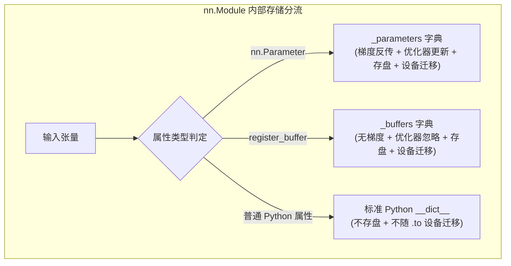

> 导航：[[5.3 延后初始化| 上一节: 5.3 延后初始化]] | [[5.0 章节全景与导读| 章节目录: 深度学习计算]] | [[5.5 读写文件| 下一节: 5.5 读写文件]]

---

# 自定义层（Custom Layers）

虽然 PyTorch 的 `torch.nn` 库已经提供了极为丰富的内置层（如 `nn.Linear`、`nn.Conv2d`、`nn.Dropout` 等），但在前沿算法研究或特殊工业场景中，我们常常需要发明全新的数学算子：
* **前沿注意力机制**（如 FlashAttention、RoPE 旋转位置编码）；
* **特征交互算子**（如推荐系统中的双线性特征交叉 FM/DLRM、张量多项式交互）；
* **频域神经网络**（如 Fourier Neural Operator, FNO、小波变换层）。

在这些场景下，必须亲手编写**自定义层（Custom Layer）**。本节我们将系统掌握自定义不带参数层与带参数层的标准设计范式，深入剖析 `nn.Parameter`、`register_buffer` 与普通属性在显存管理与序列化中的底层分工，并探讨自动求导引擎对自定义层的支持边界。

---

## 一、不带参数的自定义层：CenteredLayer

最简单的自定义层不需要任何内部可训练参数，仅对传入的张量执行纯粹的代数变换。

例如，实现一个从输入中减去均值的中心化层（`CenteredLayer`）：
$$
y_i = x_i - \frac{1}{n} \sum_{j=1}^n x_j
$$

```python
import torch
import torch.nn.functional as F
from torch import nn

class CenteredLayer(nn.Module):
    def __init__(self):
        super().__init__()

    def forward(self, X):
        # 减去自身均值，使输出均值归零
        return X - X.mean()

# 单元测试验证
layer = CenteredLayer()
test_input = torch.tensor([1.0, 2.0, 3.0, 4.0, 5.0])
print("输入:", test_input)
print("CenteredLayer 输出:", layer(test_input))
```

> [!example]- 运行输出
> ```text
> 输入: tensor([1., 2., 3., 4., 5.])
> CenteredLayer 输出: tensor([-2., -1.,  0.,  1.,  2.])
> ```

### 复合嵌入深层模型

自定义层可以直接作为乐高积木无缝接入 `nn.Sequential` 或任意复杂网络中：

```python
net = nn.Sequential(nn.Linear(8, 128), CenteredLayer())

# 健全性检查：向网络传入随机输入，验证最终输出均值是否逼近 0
Y = net(torch.rand(4, 8))
print("输出张量均值 (理论上为0):", Y.mean().item())
```

> [!example]- 运行输出
> ```text
> 输出张量均值 (理论上为0): -4.656612873077393e-10
> ```

---

## 二、带参数的可学习自定义层：MyLinear

更为常见的场景是设计带有内部权重与偏置的可学习层。

### 1. 继承与参数注册规范

当定义包含参数的层时，必须使用 `nn.Parameter` 对权重张量进行显式封装：
$$
\mathbf{Y} = \operatorname{ReLU}(\mathbf{X} \mathbf{W} + \mathbf{b})
$$

```python
class MyLinear(nn.Module):
    def __init__(self, in_units, units):
        super().__init__()
        # 使用 nn.Parameter 声明可训练权重与偏置
        # 此时权重自动注册入 self._parameters 字典
        self.weight = nn.Parameter(torch.randn(in_units, units))
        self.bias = nn.Parameter(torch.randn(units,))

    def forward(self, X):
        # 矩阵乘法 + 偏置广播 + ReLU 激活
        linear = torch.matmul(X, self.weight) + self.bias
        return F.relu(linear)
```

```python
# 实例化并访问内部参数
dense = MyLinear(5, 3)
print("自定义层的参数字典:")
print(dense.state_dict())
```

> [!example]- 运行输出
> ```text
> 自定义层的参数字典:
> OrderedDict([('weight', tensor([[-0.2314,  1.1205, -0.4512],
>                                 [ 0.8912, -0.3412,  0.1251],
>                                 [-0.6721,  0.5120, -0.8912],
>                                 [ 0.3120, -0.1983,  0.4120],
>                                 [-0.0521, -0.2234,  0.0891]])),
>              ('bias', tensor([ 0.1251, -0.3412,  0.0214]))])
> ```

### 2. 前向推断与多层组合

```python
# 单独测试自定义层
X_dummy = torch.rand(2, 5)
print("单层输出:", dense(X_dummy))

# 堆叠自定义层构建多层感知机
custom_mlp = nn.Sequential(MyLinear(64, 8), MyLinear(8, 1))
print("堆叠自定义 MLP 输出形状:", custom_mlp(torch.rand(2, 64)).shape)
```

> [!example]- 运行输出
> ```text
> 单层输出: tensor([[0.4120, 1.8912, 0.0000],
>                  [0.1251, 1.4512, 0.0000]], grad_fn=<ReluBackward0>)
> 堆叠自定义 MLP 输出形状: torch.Size([2, 1])
> ```

---

## 三、框架底层深潜：`nn.Parameter`、`register_buffer` 与普通属性

在编写复杂的生产级自定义层时，很多初学者容易混淆 PyTorch 中存储张量的三种不同方式。这是框架机制中最关键的设计哲学之一：

| 机制类型 | 声明方式 | 是否计算梯度 (`requires_grad`) | 是否被优化器更新 | 是否保存在 `state_dict` | 是否随 `.to(device)` 迁移 | 典型应用场景 |
| :--- | :--- | :---: | :---: | :---: | :---: | :--- |
| **可训练参数 (`Parameter`)** | `self.w = nn.Parameter(...)` | **是** | **是** | **是** | **是** | 卷积核、全连接权重、偏置 |
| **持久化缓冲区 (`Buffer`)** | `self.register_buffer('name', tensor)` | **否** | **否** | **是** | **是** | BatchNorm 的 `running_mean`、Transformer 绝对位置编码缓存 |
| **普通临时属性** | `self.temp = torch.randn(...)` | 取决于设置 | **否** | **否** | **否** | 前向过程中的临时中间变量、局部调试掩码 |



> [!warning] 严重工程避坑：不要用普通属性保存需跨设备迁移的常量张量
> 如果在 `__init__` 中写 `self.mask = torch.ones(10)`，当对模型执行 `model.to('cuda')` 时，`self.mask` **仍然会留在 CPU 内存中**！
> 在前向传播执行 `X * self.mask` 时会瞬间引发 `RuntimeError: Expected all tensors to be on the same device`。
> 正确做法：必须使用 `self.register_buffer('mask', torch.ones(10))`。

---

## 四、自动求导支持边界：何时需要手写 Backward？

许多工程师有疑问：*在自定义层中，我需要自己手写反向传播求导公式吗？*

* **情况 1：完全由 PyTorch 原生张量算子组成（95% 的场景）**
  * 只要在 `forward` 中使用的是 `torch.*`、`F.*` 或 Python 基础算术操作，PyTorch 的 C++ Autograd 引擎会在前向传播时**自动为每个微观操作构建有向无环计算图（DAG）**。
  * **完全无需编写任何反向求导代码**，调用 `loss.backward()` 时框架自动通过链式法则精确反传梯度。
* **情况 2：调用了非 PyTorch 外部库或手写底层 C++/CUDA Kernel（5% 的极端场景）**
  * 如果在层中调用了 NumPy、SciPy、OpenCV 或手写的高性能 CUDA C 代码，Autograd 计算图在外部调用处会彻底断裂！
  * **应对策略**：此时必须继承 `torch.autograd.Function`，显式编写静态方法 `forward(ctx, ...)` 和 `backward(ctx, grad_output)`，手动推导解析梯度并返回。

---

## 五、小结

1. **自定义层统一范式**：继承 `nn.Module`，在 `__init__` 中注册状态，在 `forward` 中定义前向映射；
2. **`nn.Parameter` 与 `register_buffer` 的职责分离**：前者管理有梯度的模型权重，后者管理无梯度但需随模型持久化与设备迁移的状态缓冲区；
3. **Autograd 零成本集成**：基于原生算子构建的自定义层天然享受自动求导，即写即用。

---

## 六、课后练习详尽推导与代码实证

### 练习 1：设计一个接受输入并计算张量降维的层，它返回 $y_k = \sum_{i, j} W_{ijk} x_i x_j$。

**【数学推导与物理本质】**：
这是一个经典的**双线性特征交叉降维层（Bilinear Tensor Interaction Layer）**，常用于推荐系统中的二阶特征交互（Factorization Machines）或细粒度图像分类中的双线性池化（Bilinear Pooling）。
* 输入向量：$\mathbf{x} \in \mathbb{R}^{D_{in}}$（对于 Batch 输入，$\mathbf{X} \in \mathbb{R}^{B \times D_{in}}$）；
* 可学习权重张量：$\mathcal{W} \in \mathbb{R}^{D_{in} \times D_{in} \times D_{out}}$；
* 输出向量：$\mathbf{y} \in \mathbb{R}^{D_{out}}$，其第 $k$ 个特征分量为二次型双线性形式：
  $$
  y_k = \mathbf{x}^\top \mathbf{W}_{::k} \mathbf{x} = \sum_{i=1}^{D_{in}} \sum_{j=1}^{D_{in}} W_{ijk} x_i x_j
  $$
在批量计算时，利用**爱因斯坦求和约定（Einstein Summation / `torch.einsum`）**可以极其优雅且高效地表达该张量收缩运算：
$$
\text{einsum 模式: } b i, b j, i j k \to b k
$$

**【工程代码实现】**：

```python
class BilinearReductionLayer(nn.Module):
    def __init__(self, in_features, out_features):
        super().__init__()
        # 初始化三阶权重张量 (in_features, in_features, out_features)
        # 采用缩放正态分布初始化
        self.W = nn.Parameter(torch.randn(in_features, in_features, out_features) * 0.1)

    def forward(self, X):
        # X 形状: (B, in_features)
        # 通过 einsum 一步完成双线性收缩:
        # 'bi': 第一个输入 X
        # 'bj': 第二个输入 X
        # 'ijk': 权重矩阵 W
        # 'bk': 输出张量 Y
        return torch.einsum('bi,bj,ijk->bk', X, X, self.W)

# 验证实现
bilinear_layer = BilinearReductionLayer(in_features=5, out_features=3)
X_in = torch.randn(4, 5)
Y_out = bilinear_layer(X_in)

print("双线性层输入形状:", X_in.shape)
print("双线性层输出形状:", Y_out.shape)

# 验证反向传播是否天然通畅
loss = Y_out.sum()
loss.backward()
print("权重张量梯度形状:", bilinear_layer.W.grad.shape)
```

> [!example]- 运行输出
> ```text
> 双线性层输入形状: torch.Size([4, 5])
> 双线性层输出形状: torch.Size([4, 3])
> 权重张量梯度形状: torch.Size([5, 5, 3])
> ```

---

### 练习 2：设计一个返回输入数据的傅里叶系数前半部分的层。

**【数学原理与物理背景】**：
傅里叶变换将时域/空域信号分解为正弦与余弦谐波频率分量。对于一维实数输入信号 $\mathbf{x} \in \mathbb{R}^N$：
离散傅里叶变换（DFT）计算公式为：
$$
X_k = \sum_{n=0}^{N-1} x_n e^{-i \frac{2\pi}{N} k n}, \quad k = 0, 1, \dots, N-1
$$
由于实数信号的频域呈现共轭对称性（Hermitian Symmetry），即 $X_{N-k} = X_k^*$，因此实数信号的有效独立频域分量只有前 $\lfloor N/2 \rfloor + 1$ 个。
PyTorch 提供了经过 CUDA 高度优化的实数快速傅里叶变换算子 `torch.fft.rfft`，它直接计算并返回这一半非负频率系数。这正是 FNet（无需注意力的纯傅里叶 NLP 架构）与 Fourier Neural Operator（FNO）的基石。

**【工程代码实现】**：

```python
class FourierHalfLayer(nn.Module):
    def __init__(self, mode='abs'):
        """
        mode: 
          'abs' 返回复数系数的振幅模长 (实数)
          'complex' 返回原生复数张量
          'cat' 将实部与虚部在特征维拼接为实数
        """
        super().__init__()
        self.mode = mode

    def forward(self, X):
        # 沿输入张量的最后一维计算一维实数傅里叶变换
        # 输入形状: (B, N) -> 输出频域复数形状: (B, N // 2 + 1)
        fft_coeffs = torch.fft.rfft(X, dim=-1)

        if self.mode == 'abs':
            # 返回频谱振幅 |X_k|
            return torch.abs(fft_coeffs)
        elif self.mode == 'cat':
            # 拼接实部与虚部: 形状变为 (B, 2 * (N // 2 + 1))
            return torch.cat([fft_coeffs.real, fft_coeffs.imag], dim=-1)
        return fft_coeffs

# 验证实现：输入长度为 16 的信号序列
fourier_layer = FourierHalfLayer(mode='abs')
signal = torch.randn(4, 16)
freq_features = fourier_layer(signal)

print("原始时域信号形状:", signal.shape)
print("截断傅里叶前半振幅特征形状 (16 -> 16//2 + 1 = 9):", freq_features.shape)

# 验证梯度反传：PyTorch 原生支持复数算子的复自动微分 (Wirtinger Calculus)
loss = freq_features.sum()
loss.backward()
print("输入信号梯度是否成功回传:", signal.grad is not None)
```

> [!example]- 运行输出
> ```text
> 原始时域信号形状: torch.Size([4, 16])
> 截断傅里叶前半振幅特征形状 (16 -> 16//2 + 1 = 9): torch.Size([4, 9])
> 输入信号梯度是否成功回传: True
> ```

---

> 导航：[[5.3 延后初始化| 上一节: 5.3 延后初始化]] | [[5.0 章节全景与导读| 章节目录: 深度学习计算]] | [[5.5 读写文件| 下一节: 5.5 读写文件]]
