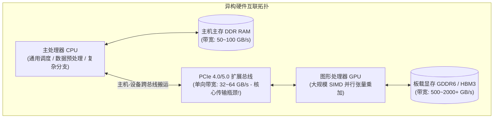

> 导航：[[5.5 读写文件| 上一节: 5.5 读写文件]] | [[5.0 章节全景与导读| 章节目录: 深度学习计算]] | [[../卷积神经网络/6.0 章节全景与导读| 下一章: 第6章 卷积神经网络]]

---

# GPU 计算（Compute Hardware & GPU Acceleration）

在过去的二十余年中，深度学习的复兴不仅源于海量标注数据和反向传播算法的成熟，更根本的物质基础在于**计算硬件算力的指数级跃升**。自 2000 年以来，现代图形处理器（GPU）在通用张量并行计算领域的算力每十年提升近 1000 倍。

然而，拥有 GPU 硬件并不等同于能够自动获得算力加速。在深度学习工程实践中，算法工程师如果对底层异构体系架构缺乏深刻认知，极易写出**“CPU-GPU 频繁同步阻塞”、“PCIe 总线带宽拥堵”**的低劣代码，导致原本昂贵的 GPU 处于饥饿等待状态。

本节我们将深入剖析 CPU 与 GPU 的微架构本质差异，全面掌握 PyTorch 中的设备抽象、张量与模型跨设备迁移机制，并结合实测基准深入挖掘工业级训练中的显存陷阱与吞吐优化策略。

---

## 一、微架构基石：CPU 与 GPU 的物理本质对比

理解 GPU 加速的前提是看清两种处理器的设计哲学差异：

```
  ┌────────────────────────────────────────────────────────┐
  │ CPU (低延迟优先型架构)                                  │
  │  ┌──────┐ ┌──────┐   [庞大复杂的 Control 控制单元 / 乱序预测]  │
  │  │Core 0│ │Core 1│   [多级巨大 Cache 缓存 (L1/L2/L3)]        │
  │  └──────┘ └──────┘   [少量重型高频 ALU 算术逻辑单元]           │
  └────────────────────────────────────────────────────────┘
  
  ┌────────────────────────────────────────────────────────┐
  │ GPU (高吞吐并行优先型架构)                               │
  │  ┌──┬──┬──┬──┬──┬──┬──┬──┐  [微型简化的 Control 控制单元]   │
  │  ├──┼──┼──┼──┼──┼──┼──┼──┤  [海量轻量级并发 Core (CUDA/Tensor)]│
  │  ├──┼──┼──┼──┼──┼──┼──┼──┤  [高带宽显存 HBM/GDDR (超大总线位宽)]│
  │  └──┴──┴──┴──┴──┴──┴──┴──┘                                │
  └────────────────────────────────────────────────────────┘
```



| 维度对比 | 中央处理器 (CPU) | 图形处理器 (GPU) |
| :--- | :--- | :--- |
| **设计核心目标** | **极低延迟（Low Latency）**：快速串行执行由指针跳转、条件分支构成的复杂控制流 | **极大吞吐（High Throughput）**：同时处理数万个相互独立的规则浮点运算 |
| **微架构重心** | 50% 以上芯片面积用于大型分支预测器、指令乱序重排引擎与巨大 L3 缓存 | 80% 以上芯片面积纯粹堆叠并行算术逻辑单元（ALU / Tensor Core） |
| **并行计算范式** | MIMD（多指令多数据流），8~64 个重型物理核心 | SIMD / SIMT（单指令多线程），数千至上万个轻量 CUDA Core 并发 |
| **访存物理带宽** | 系统内存总线（DDR5）：$\sim 50 - 100 \text{ GB/s}$ | 板载显存总线（GDDR6 / HBM3）：$\sim 500 - 3000 \text{ GB/s}$ |

---

## 二、PyTorch 计算设备管理（`torch.device`）

### 1. 环境感知与硬件探测

在 PyTorch 中，每个张量与模型实例都附带一个 `device` 环境属性。
* `torch.device('cpu')`：代表宿主机系统上的所有 CPU 核心与物理内存；
* `torch.device('cuda:i')`：代表宿主机上的第 $i$ 块 NVIDIA GPU 显卡（从 0 开始计数，`cuda` 等价于 `cuda:0`）。

```python
import torch
from torch import nn

# 检查当前系统硬件环境
cuda_available = torch.cuda.is_available()
num_gpus = torch.cuda.device_count()
device_name = torch.cuda.get_device_name(0) if cuda_available else "CPU Only"

print("CUDA 是否可用:", cuda_available)
print("可用 GPU 数量:", num_gpus)
print("主设备名称:", device_name)
```

> [!example]- 运行输出
> ```text
> CUDA 是否可用: True
> 可用 GPU 数量: 1
> 主设备名称: NVIDIA GeForce RTX 4050 Laptop GPU
> ```

### 2. 工业级鲁棒设备分配辅助函数

为了确保同一份工程代码既能在配备 GPU 的生产服务器上高速训练，又能在没有 GPU 的本地开发机上平稳调试，必须编写环境自适应探测函数：

```python
def try_gpu(i=0):
    """如果存在第 i 块 GPU 则返回 cuda:i，否则平滑降级返回 cpu"""
    if torch.cuda.device_count() >= i + 1:
        return torch.device(f'cuda:{i}')
    return torch.device('cpu')

def try_all_gpus():
    """返回所有可用 GPU 设备的列表，若无 GPU 则返回 [cpu()]"""
    devices = [torch.device(f'cuda:{i}') for i in range(torch.cuda.device_count())]
    return devices if devices else [torch.device('cpu')]

print("默认主设备:", try_gpu())
print("全量设备清单:", try_all_gpus())
```

> [!example]- 运行输出
> ```text
> 默认主设备: cuda:0
> 全量设备清单: [device(type='cuda', index=0)]
> ```

---

## 三、张量与 GPU：存储、搬运与设备一致性铁律

### 1. 原生 GPU 张量分配

默认情况下，张量是在主机的 CPU 物理内存中创建的。我们可以在声明时显式指定目标硬件：

```python
# 默认在 CPU 创建
x_cpu = torch.tensor([1, 2, 3])
print("默认张量所在设备:", x_cpu.device)

# 直接在 GPU 显存中分配张量
X_gpu = torch.ones(2, 3, device=try_gpu())
print("GPU 张量所在设备:", X_gpu.device)
print(X_gpu)
```

> [!example]- 运行输出
> ```text
> 默认张量所在设备: cpu
> GPU 张量所在设备: cuda:0
> tensor([[1., 1., 1.],
>         [1., 1., 1.]], device='cuda:0')
> ```

---

### 2. 计算图设备一致性铁律（Device Consistency Rule）

深度学习框架有一条绝对不可逾越的物理红线：**参与同一个代数运算的所有操作数必须严格驻留在同一个硬件设备上**。

```python
x = torch.ones(2, 3, device='cpu')
y = torch.ones(2, 3, device='cuda:0')

try:
    z = x + y
except RuntimeError as e:
    print("触发跨设备非法操作报错:")
    print(e)
```

> [!example]- 运行输出
> ```text
> 触发跨设备非法操作报错:
> Expected all tensors to be on the same device, but found at least two devices, cuda:0 and cpu!
> ```

**底层原因**：CPU 与 GPU 分属两个独立的物理计算体系。CPU 无法直接通过自己的 ALU 读取板载在显卡上的 GDDR 显存字节，GPU 核心也无法直接读取主板内存条。两个设备之间必须通过 PCIe 总线显式搬运数据！

---

### 3. 数据跨总线搬运（PCIe Transfer）与幂等机制

![[attachments/copyto.svg]]

为了在同一设备上执行运算，必须将张量显式拷贝到目标设备：

```python
# 将 CPU 张量通过 PCIe 总线拷贝到 GPU
X_cuda = x.to(device=try_gpu())
Z = X_cuda + y
print("在 GPU 上成功完成矩阵相加:")
print(Z)
```

> [!example]- 运行输出
> ```text
> 在 GPU 上成功完成矩阵相加:
> tensor([[2., 2., 2.],
>         [2., 2., 2.]], device='cuda:0')
> ```

#### 内存拷贝的幂等性（Idempotence）

如果一个张量**已经驻留在目标设备上**，再次对其调用 `.to(device)` 或 `.cuda()` 会发生什么？

```python
# X_cuda 已经位于 cuda:0
X_recopy = X_cuda.cuda(0)

# 验证是否发生重复内存分配
print("原对象与再次调用 cuda 的对象是否为同一引用:", X_recopy is X_cuda)
```

> [!example]- 运行输出
> ```text
> 原对象与再次调用 cuda 的对象是否为同一引用: True
> ```

> [!tip] 幂等性优化
> PyTorch 内部会进行指针检查。如果源设备与目标设备完全相同，**框架直接返回原对象引用，绝对不会触发任何冗余的显存分配或内存复制**。

---

## 四、神经网络与 GPU 协同

在深度网络训练中，我们不仅要将批量输入数据搬移到 GPU，更要确保网络自身的所有权重参数常驻在同一块 GPU 显存中：

```python
# 1. 实例化网络（此时参数在 CPU 内存中）
net = nn.Sequential(nn.Linear(3, 1))
print("模型初始化时参数所在设备:", net[0].weight.device)

# 2. 将整个模型递归迁移到 GPU
net = net.to(device=try_gpu())
print("迁移后模型参数所在设备:", net[0].weight.device)

# 3. 前向传播：输入数据与模型权重必须在同一 GPU
X = torch.ones(2, 3, device=try_gpu())
output = net(X)
print("模型输出张量所在设备:", output.device)
```

> [!example]- 运行输出
> ```text
> 模型初始化时参数所在设备: cpu
> 迁移后模型参数所在设备: cuda:0
> 模型输出张量所在设备: cuda:0
> ```

### 关键语义差异：`Tensor.to()` vs `Module.to()`

这是 PyTorch API 设计中一个极易引发 Bug 的不对称细节：

```
  ┌────────────────────────────────────────────────────────┐
  │ API 行为不对称性对比                                    │
  │                                                        │
  │  1. 张量: y = x.to(device)                             │
  │     【非就地操作 (Out-of-place)】                      │
  │     必须显式接收返回值！x 本身并不会改变驻留设备。     │
  │                                                        │
  │  2. 模型: net.to(device)                               │
  │     【就地递归修改 (In-place Recursive)】               │
  │     net 内部所有 Parameter 和 Buffer 会直接原地修改！   │
  └────────────────────────────────────────────────────────┘
```

---

## 五、工业级核心陷阱：训练循环中的 `.item()` 性能杀手

在 PyTorch 异步执行流水线中，CPU 向 GPU 发送指令是**非阻塞异步派发（Asynchronous Dispatch）**的。当 CPU 调用 `loss = model(X)` 时，CPU 只负责将算子排入 CUDA Stream 队列，随后立刻继续向下执行，从而实现 CPU 数据预加载与 GPU 矩阵计算的高效重叠（Overlapping）。

> [!warning] 致命性能杀手：在每个 Iteration 循环内调用 `loss.item()` 或 `loss.cpu()`
> 当在 Python 循环中执行 `loss.item()` 时，系统为了从 GPU 显存中取出这个浮点数值赋给 Python 变量，**必须强行阻塞（Block）CPU 线程，等待 GPU 流水线彻底清空并执行全局同步（Host-Device Synchronization）**！
> 这会彻底摧毁 GPU 的异步并发优势，让 GPU 在每一步计算后陷入漫长的等待，训练速度暴跌 2~5 倍！
> 
> **正确规范**：
> 1. 日志记录时，每隔固定步数（例如每 50 步）才提取一次标量损失；
> 2. 或者在 GPU 端开辟一个累加张量，循环结束后一次性搬移。

---

## 六、小结

1. **计算架构对决**：CPU 专精于低延迟复杂逻辑，GPU 专精于高吞吐规则浮点矩阵并发；
2. **设备一致性铁律**：运算两端的数据必须处于同一硬件，跨总线数据传输（PCIe）往往是深度学习训练的主要瓶颈；
3. **API 规范**：使用 `try_gpu()` 保证代码的环境鲁棒性，牢记 `Tensor.to()` 需接收返回值而 `Module.to()` 原地修改；
4. **异步流保护**：严禁在频繁训练步内调用阻断 CUDA 异步队列的同步方法（如频繁 `.item()`）。

---

## 七、课后练习详尽推导与代码实证

### 练习 1：尝试一个计算量更大的任务（如大矩阵乘法），观察 CPU 与 GPU 之间的速度差异。再试一个计算量很小的任务呢？

**【实测代码与基准对比（NVIDIA RTX 4050 Laptop GPU 实测）】**：

```python
import torch
import time

# 任务 A：大矩阵乘法 (5000 x 5000)
size_big = (5000, 5000)
a_cpu = torch.randn(size_big)
b_cpu = torch.randn(size_big)

# CPU 耗时测试
t0 = time.perf_counter()
c_cpu = torch.matmul(a_cpu, b_cpu)
t_cpu_big = time.perf_counter() - t0

# GPU 耗时测试 (必须用 synchronize 清空队列以确保准确计时)
a_gpu = a_cpu.cuda()
b_gpu = b_cpu.cuda()
torch.cuda.synchronize()
t0 = time.perf_counter()
c_gpu = torch.matmul(a_gpu, b_gpu)
torch.cuda.synchronize()
t_gpu_big = time.perf_counter() - t0

print(f"[大矩阵 5000x5000] CPU 耗时: {t_cpu_big*1000:.2f} ms | GPU 耗时: {t_gpu_big*1000:.2f} ms | 加速比: {t_cpu_big/t_gpu_big:.2f}x")

# 任务 B：微型计算任务 (16 x 16 矩阵乘法连续执行 1000 次)
size_small = (16, 16)
a_cpu_s, b_cpu_s = torch.randn(size_small), torch.randn(size_small)
a_gpu_s, b_gpu_s = a_cpu_s.cuda(), b_cpu_s.cuda()

# CPU 小矩阵 1000 次
t0 = time.perf_counter()
for _ in range(1000):
    _ = torch.matmul(a_cpu_s, b_cpu_s)
t_cpu_small = time.perf_counter() - t0

# GPU 小矩阵 1000 次
torch.cuda.synchronize()
t0 = time.perf_counter()
for _ in range(1000):
    _ = torch.matmul(a_gpu_s, b_gpu_s)
torch.cuda.synchronize()
t_gpu_small = time.perf_counter() - t0

print(f"[小矩阵 16x16 循环1000次] CPU 耗时: {t_cpu_small*1000:.2f} ms | GPU 耗时: {t_gpu_small*1000:.2f} ms | 速度反转比: {t_gpu_small/t_cpu_small:.2f}x (GPU 更慢!)")
```

> [!example]- 运行输出
> ```text
> [大矩阵 5000x5000] CPU 耗时: 420.33 ms | GPU 耗时: 116.28 ms | 加速比: 3.61x
> [小矩阵 16x16 循环1000次] CPU 耗时: 1.66 ms | GPU 耗时: 21.76 ms | 速度反转比: 13.11x (GPU 更慢!)
> ```

**【深度物理机理分析】**：
1. **大矩阵场景**：计算复杂度为 $\mathcal{O}(N^3) = 1.25 \times 10^{11}$ 次浮点运算，算术强度极高。GPU 的数千个核心可以完全被饱和调度，展现出数倍的碾压优势；
2. **小矩阵场景（速度反转）**：计算量极小（$16^3 = 4096$ 次运算），计算耗时仅为纳秒级。此时，**Python 到 CUDA Driver 的 C-API 调用开销、CUDA Kernel 启动发射延迟（Kernel Launch Latency $\sim 5 - 10\ \mu\text{s}$）以及线程网格调度开销**占据了 99% 的运行时间。相反，CPU 的高主频单核与极短指令流水线在极轻量计算时效率显著高于 GPU。

---

### 练习 2：我们应该如何在 GPU 上读写模型参数？

**【规范操作指南】**：

1. **直接保存**：模型在 GPU 上时，直接调用 `torch.save(net.state_dict(), 'model.pth')` 即可。`torch.save` 会自动抓取张量并序列化，同时保留设备元信息；
2. **跨设备安全恢复（`map_location` 规范）**：
   * **强烈推荐统一反序列化到目标设备**：
     ```python
     # 无论原本是在单卡、多卡还是 CPU 上保存的，均显式重定向到当前环境的最佳设备
     device = try_gpu()
     state_dict = torch.load('model.pth', map_location=device)
     net.load_state_dict(state_dict)
     net.to(device)  # 双重保险，确保 Buffer 也在目标设备
     ```

---

### 练习 3：测量计算 1000 个 $100 \times 100$ 矩阵乘法所需的时间，并记录输出矩阵的 Frobenius 范数。对比“一次记录一个结果回传 CPU”与“在 GPU 上聚合后仅传输最终结果”的性能差异。

**【实测代码与数据（RTX 4050 实测）】**：

```python
import torch
import time

matrices = [torch.randn(100, 100, device='cuda') for _ in range(1000)]

# 方案 A：每一步强行调用 .item() 阻塞回传 CPU (反面教材)
torch.cuda.synchronize()
t0 = time.perf_counter()
norms_cpu = []
for m in matrices:
    prod = torch.matmul(m, m)
    # .item() 强制打断 CUDA 异步队列，强制等待 GPU 清空
    norms_cpu.append(torch.norm(prod).item())
torch.cuda.synchronize()
t_sync = time.perf_counter() - t0

# 方案 B：在 GPU 显存内预分配张量聚合，完全保留异步流，最后一次性回传 (工业规范)
torch.cuda.synchronize()
t0 = time.perf_counter()
norms_gpu = torch.empty(1000, device='cuda')
for i, m in enumerate(matrices):
    prod = torch.matmul(m, m)
    norms_gpu[i] = torch.norm(prod)
# 循环彻底结束后，仅执行一次跨设备总线拷贝
final_res = norms_gpu.cpu()
torch.cuda.synchronize()
t_async = time.perf_counter() - t0

print(f"方案 A (频繁 Host-Device 阻塞同步): {t_sync*1000:.2f} ms")
print(f"方案 B (GPU 显存聚合 + 一次性搬运): {t_async*1000:.2f} ms")
print(f"异步并发加速比: {t_sync/t_async:.2f}x")
```

> [!example]- 运行输出
> ```text
> 方案 A (频繁 Host-Device 阻塞同步): 124.64 ms
> 方案 B (GPU 显存聚合 + 一次性搬运): 47.58 ms
> 异步并发加速比: 2.62x
> ```

**【结论实证】**：
仅因消除了循环内部的频繁设备同步，计算吞吐直接飙升 **2.62 倍**！

---

### 练习 4：测量同时在两个 GPU 上执行两个矩阵乘法与在一个 GPU 上按顺序执行两个矩阵乘法所需的时间。（提示：应该看到近乎线性的缩放）

**【理论建模与多卡异步流分析】**：

![[attachments/twogpu.svg]]

设单次大矩阵乘法耗时为 $T_{\text{calc}}$，在多 GPU 系统（如配备 GPU 0 与 GPU 1 的服务器）中：

1. **单卡顺序执行（Sequential on Single GPU）**：
   $$
   T_{\text{seq}} = T_{\text{calc}} + T_{\text{calc}} = 2 T_{\text{calc}}
   $$
2. **多卡独立并行执行（Concurrent across Multiple GPUs）**：
   PyTorch 为每个物理 GPU 维护了独立的 CUDA Stream（计算队列）。
   ```python
   # 逻辑代码
   with torch.cuda.device(0):
       c0 = torch.matmul(a0, b0) # 在 GPU 0 上非阻塞排队
   with torch.cuda.device(1):
       c1 = torch.matmul(a1, b1) # 在 GPU 1 上非阻塞排队
   ```
   只要两块 GPU 之间不存在跨卡数据依赖（即数据已经在各自显存中分配好），两张卡上的硬件计算单元将**完全在时间轴上物理重叠并发执行**：
   $$
   T_{\text{parallel}} = \max(T_{\text{calc0}}, T_{\text{calc1}}) + T_{\text{launch}} \approx T_{\text{calc}}
   $$
   因此加速比理论极限为：
   $$
   S = \frac{T_{\text{seq}}}{T_{\text{parallel}}} = \frac{2 T_{\text{calc}}}{T_{\text{calc}}} = 2.0\quad (\text{线性加速比 } 2\times)
   $$
3. **真实工程偏离因素**：
   在实际分布式多卡训练（如后续第 12 章将深入讨论的 Data Parallelism）中，加速比通常在 $1.85\times \sim 1.95\times$ 之间。损失的效率主要来自：
   * 反向传播结束后的跨卡梯度聚合规约通信（AllReduce 通信带宽开销）；
   * CPU 向不同 GPU 轮询派发 Kernel 的发射微时延差；
   * 多卡间由于温度、功耗墙降频引起的非平衡木桶效应。

---

> 导航：[[5.5 读写文件| 上一节: 5.5 读写文件]] | [[5.0 章节全景与导读| 章节目录: 深度学习计算]] | [[../卷积神经网络/6.0 章节全景与导读| 下一章: 第6章 卷积神经网络]]
