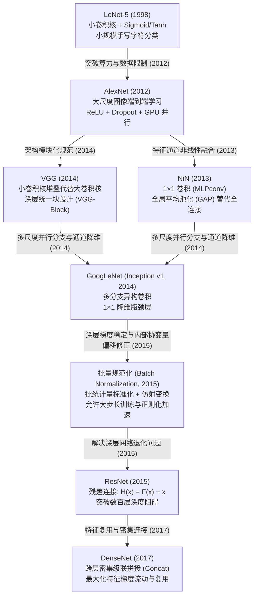

> 导航：[上一章: 第6章 卷积神经网络](../卷积神经网络/6.0%20章节全景与导读.md) | [下一节: 7.1 深度卷积神经网络（AlexNet）](./7.1%20深度卷积神经网络（AlexNet）.md)

---

# 第7章 现代卷积神经网络（Modern Convolutional Neural Networks）

在第 6 章中，我们系统学习了卷积神经网络（CNN）的底层数学机制与基础单元：从二维互相关运算、填充与步幅控制，到多输入输出通道设计、汇聚（池化）层，直至最早的经典卷积架构——LeNet-5。

然而，LeNet 主要是为了识别低分辨率（$28\times28$ 或 $32\times32$）的手写数字设计的。面对高分辨率、复杂真实世界的大规模视觉场景（如 ImageNet），小卷积网络受限于模型容量与优化机制，一度被基于人工特征工程（SIFT、SURF、HOG）的传统机器学习方法（SVM、核方法）超越。

**本章是深度学习视觉领域的发展里程碑**。从 2012 年 AlexNet 的横空出世开始，计算机视觉正式进入以深层卷积神经网络为主导的新纪元。本章将循着现代卷积网络架构演进的脉络，系统剖析七大里程碑级技术突破：

---

## 现代卷积神经网络演进全景图

---

## 章节核心突破与技术演进映射表

| 节号 | 核心网络 / 模块 | 官方源码文件 | 核心架构创新与工程突破 |
| :---: | :--- | :--- | :--- |
| **7.1** | **AlexNet** | [alexnet.ipynb](file:///E:/Jupyter%20Notebook%20code/d2l-zh-pytorch/chapter_convolutional-modern/alexnet.ipynb) | **端到端深度视觉突破**：GPU 并行加速、ReLU 解决正区间梯度饱和、Dropout 约束 4096 维密集层、数据增强抗过拟合。 |
| **7.2** | **VGG** | [vgg.ipynb](file:///E:/Jupyter%20Notebook%20code/d2l-zh-pytorch/chapter_convolutional-modern/vgg.ipynb) | **模块化与小卷积核堆叠**：证明两个 $3\times3$ 等效于单个 $5\times5$（三个 $3\times3$ 等效于 $7\times7$），大幅削减参数量并增加非线性表达深度。 |
| **7.3** | **NiN (Network in Network)** | [nin.ipynb](file:///E:/Jupyter%20Notebook%20code/d2l-zh-pytorch/chapter_convolutional-modern/nin.ipynb) | **$1\times1$ 卷积与全局平均池化 (GAP)**：利用 $1\times1$ 卷积实现跨通道非线性特征融合；用 GAP 彻底废除全连接层，削减 90% 以上冗余参数。 |
| **7.4** | **GoogLeNet (Inception)** | [googlenet.ipynb](file:///E:/Jupyter%20Notebook%20code/d2l-zh-pytorch/chapter_convolutional-modern/googlenet.ipynb) | **多尺度并行感受野**：Inception 块并行抽取 $1\times1, 3\times3, 5\times5$ 特征；通过 $1\times1$ 卷积执行“瓶颈降维”，在保持宽度的同时严格控制计算复杂度。 |
| **7.5** | **批量规范化 (Batch Normalization)** | [batch-norm.ipynb](file:///E:/Jupyter%20Notebook%20code/d2l-zh-pytorch/chapter_convolutional-modern/batch-norm.ipynb) | **内部激活分布规范化**：推导小批量均值与方差标准化；训练阶段动态批统计量更新 vs 测试阶段移动平均（Moving Average）持久化；平滑损失地形。 |
| **7.6** | **ResNet (残差网络)** | [resnet.ipynb](file:///E:/Jupyter%20Notebook%20code/d2l-zh-pytorch/chapter_convolutional-modern/resnet.ipynb) | **残差连接打破退化壁垒**：恒等映射 $\mathcal{H}(\mathbf{x}) = \mathcal{F}(\mathbf{x}) + \mathbf{x}$；保证深层梯度反向传播畅通无阻，使网络深度首次拓展至 100 层以上。 |
| **7.7** | **DenseNet (稠密连接网络)** | [densenet.ipynb](file:///E:/Jupyter%20Notebook%20code/d2l-zh-pytorch/chapter_convolutional-modern/densenet.ipynb) | **全连接特征级联复用**：每一层与后续所有层通过通道拼接（Channel Concatenation）相连，极低增长率（Growth Rate）下实现极高参数利用率。 |

---

## 核心设计哲学跃迁

回顾整个现代卷积神经网络的发展历程，存在四条清晰的演化主线：

1. **从手工特征到表征学习（Representation Learning）**：
   从依靠算法设计者手工定义高阶特征（SIFT/HOG），转为让深层多层网络通过端到端梯度下降自动从原始像素中抽象出分层语义特征（边缘 $\to$ 纹理 $\to$ 部件 $\to$ 语义物体）。
2. **从异构堆叠到高度模块化（Modularity & Block Design）**：
   从 AlexNet 每层不同卷积核尺寸的粗放结构，演进为 VGG 的统一卷积块、GoogLeNet 的 Inception 块以及 ResNet 的残差块，使超深网络的设计可以通过参数化循环自动生成。
3. **从重参数全连接到轻量化空间池化（FC to GAP）**：
   早期卷积网络（AlexNet、VGG）中 80%~90% 以上的参数堆积在最后两层全连接层；NiN 引入的全局平均池化（GAP）将空间特征图直接压缩为标量，大幅压缩了模型存储与带宽瓶颈。
4. **从单纯加深到解决优化阻碍（Degradation & Gradient Flow）**：
   随着深度增加，网络面临的不再仅仅是过拟合，而是模型退化（网络加深反而训练误差升高）。通过引入 Batch Normalization 规范激活分布，以及 ResNet 的残差短路机制，使得数千层的网络优化成为可能。
