> 导航：[[7.0 章节全景与导读| 章节目录: 现代卷积神经网络]] | [[7.2 使用块的网络（VGG）| 下一节: 7.2 使用块的网络（VGG）]]

---

# 深度卷积神经网络（AlexNet）

在 1998 年 LeNet-5 提出后的十余年间，神经网络在计算机视觉领域长期被基于人工特征工程的传统算法（如 SIFT + SVM、HOG + 随机森林）所压制。直至 2012 年，Alex Krizhevsky、Ilya Sutskever 与 Geoffrey Hinton 提出了 **AlexNet**，在 ImageNet 挑战赛（ILSVRC-2012）上将 Top-5 错误率从 26% 骤降至 15.3%，以断崖式领先确立了深度学习在计算机视觉领域的绝对统治地位。

本节系统解析 AlexNet 的历史拐点成因、网络拓扑结构推导、四大关键创新机制以及 PyTorch 完整实现。

---

## 1. 范式革命：从人工特征工程到端到端表征学习

在 AlexNet 之前，经典的计算机视觉识别管线是完全**分步割裂**的：

```
[原始图像输入] ──► [手工特征提取] ──► [特征编码/聚合] ──► [标准分类器] ──► [预测类别]
                      (SIFT / HOG)        (BoVW / FV)       (SVM / 随机森林)
```

* **传统视觉流派的认知困境**：传统方法假设人类专家凭借光学、几何学启发设计的低阶特征（如梯度方向直方图）能够充分概括视觉世界，机器学习算法只需训练一个凸优化分类器（如支持向量机）。
* **表征学习（Representation Learning）的突破**：AlexNet 证明，**特征提取器本身应当与分类器共同联合训练**。网络从像素级底层出发，通过多层空间卷积与非线性激活，自动逐级抽象出：
  * **底层（Layer 1~2）**：方向边缘、高频纹理、基础色块；
  * **中层（Layer 3~4）**：角点、部件组合、轮廓雏形；
  * **高层（Layer 5 及全连接）**：完整物体形态、高度抽象的语义概念。

### 促成这一历史跨越的两大客观支柱
1. **海量标注数据（ImageNet）**：由李飞飞团队于 2009 年发布的 ImageNet，提供了覆盖 1000 类的 120 万张高分辨率真实图像，首次为高容量深度网络提供了抗过拟合的数据滋养。
2. **大规模并行算力（GPGPU）**：英伟达 GTX 580 显卡（虽然当时仅 3GB 显存）提供了高吞吐量的张量并行计算矩阵乘法，配合 Alex 编写的底层高效 CUDA 卷积算子（cuda-convnet），使得在数天内完成百万级图像深度训练成为可能。

---

## 2. AlexNet 架构与各层张量形状推导

为适配单通道输入（如 Fashion-MNIST $224\times224$ 分辨率）并兼顾现代单 GPU 环境，教材去除了 2012 年原版跨双 GPU 通信的设计，给出了单卡统一实现。

### 2.1 整体网络拓扑

```mermaid
flowchart LR
    In["输入<br/>1×224×224"] --> C1["Conv1 (11×11, s4, p1)<br/>96通道 54×54"]
    C1 --> P1["MaxPool1 (3×3, s2)<br/>96通道 26×26"]
    P1 --> C2["Conv2 (5×5, s1, p2)<br/>256通道 26×26"]
    C2 --> P2["MaxPool2 (3×3, s2)<br/>256通道 12×12"]
    P2 --> C3["Conv3 (3×3, s1, p1)<br/>384通道 12×12"]
    C3 --> C4["Conv4 (3×3, s1, p1)<br/>384通道 12×12"]
    C4 --> C5["Conv5 (3×3, s1, p1)<br/>256通道 12×12"]
    C5 --> P3["MaxPool3 (3×3, s2)<br/>256通道 5×5"]
    P3 --> F["Flatten<br/>6400 维"]
    F --> FC1["Linear + ReLU + Dropout<br/>4096 维"]
    FC1 --> FC2["Linear + ReLU + Dropout<br/>4096 维"]
    FC2 --> Out["Linear (输出层)<br/>10 维"]
```



### 2.2 特征图尺寸演进严格推导

设输入高度为 $H_{in}$，宽度为 $W_{in}$，卷积核为 $K$，填充为 $P$，步幅为 $S$，输出空间尺寸公式为：
$$
H_{out} = \left\lfloor \frac{H_{in} - K + 2P + S}{S} \right\rfloor
$$

1. **输入张量**：$(B, 1, 224, 224)$
2. **Conv1**：$K=11, S=4, P=1, C_{out}=96$
   $$H_{out} = \lfloor \frac{224 - 11 + 2(1) + 4}{4} \rfloor = \lfloor \frac{219}{4} \rfloor = 54 \implies (B, 96, 54, 54)$$
3. **MaxPool1**：$K=3, S=2, P=0$
   $$H_{out} = \lfloor \frac{54 - 3 + 0 + 2}{2} \rfloor = \lfloor \frac{53}{2} \rfloor = 26 \implies (B, 96, 26, 26)$$
4. **Conv2**：$K=5, S=1, P=2, C_{out}=256$
   $$H_{out} = \lfloor \frac{26 - 5 + 4 + 1}{1} \rfloor = 26 \implies (B, 256, 26, 26)$$
5. **MaxPool2**：$K=3, S=2, P=0$
   $$H_{out} = \lfloor \frac{26 - 3 + 2}{2} \rfloor = 12 \implies (B, 256, 12, 12)$$
6. **Conv3**：$K=3, S=1, P=1, C_{out}=384 \implies (B, 384, 12, 12)$
7. **Conv4**：$K=3, S=1, P=1, C_{out}=384 \implies (B, 384, 12, 12)$
8. **Conv5**：$K=3, S=1, P=1, C_{out}=256 \implies (B, 256, 12, 12)$
9. **MaxPool3**：$K=3, S=2, P=0$
   $$H_{out} = \lfloor \frac{12 - 3 + 2}{2} \rfloor = 5 \implies (B, 256, 5, 5)$$
10. **Flatten**：展开维度为 $256 \times 5 \times 5 = 6400$
11. **FC1 / FC2 / FC3**：
    * $\text{FC1}: 6400 \to 4096$
    * $\text{FC2}: 4096 \to 4096$
    * $\text{FC3}: 4096 \to 10$（在原始 ImageNet 中为 1000）

---

## 3. AlexNet 的四大技术创新

### 3.1 激活函数变革：以 ReLU 替换 Sigmoid
* **计算效率极高**：$\text{ReLU}(x) = \max(0, x)$，不含指数幂与除法，仅需单条 CPU/GPU 阈值判断指令；
* **根治正区间梯度消失**：
  * 对于 Sigmoid，导数 $\sigma'(x) = \sigma(x)(1 - \sigma(x)) \le 0.25$。多层连续连乘导致深层梯度呈指数级衰减（$0.25^L \to 0$）；
  * 对于 ReLU，当 $x > 0$ 时导数恒为 1，有效克服了多层反向传播过程中的弥散现象，收敛速度相较 Tanh 提升近 6 倍。

### 3.2 强正则化：在全连接层应用暂退法（Dropout）
AlexNet 的后三个全连接层拥有超过 5000 万个浮点参数，极易发生参数共适应过拟合。
AlexNet 在 FC1 与 FC2 之后引入 $p=0.5$ 的 Dropout：
* 训练期间随机将 50% 的隐藏单元置零，打破神经元间的复杂共线性；
* 测试期间关闭 Dropout，利用全量网络推断，相当于近似融合了大量子网络的集成预测。

### 3.3 重叠汇聚（Overlapping Pooling）
LeNet 采用步幅等于池化窗口尺寸的非重叠池化（如窗口 $2\times2$，步幅 2）。AlexNet 采用了窗口 $3\times3$、步幅为 2 的重叠最大池化。论文实测表明，重叠汇聚不仅保留了更丰富的局部最大响应，还将 Top-1 与 Top-5 错误率分别额外削减了 0.4% 和 0.3%，有效减轻了特征模糊化。

### 3.4 大规模数据增强（Data Augmentation）
针对 GPU 计算时的高吞吐，采用 CPU 异步流水线生成增强样本：
1. **几何变换**：从 $256\times256$ 图像中随机裁剪 $224\times224$ 子图并随机水平翻转（增加 $32 \times 32 \times 2 = 2048$ 倍数据多样性）；
2. **光照/色彩抖动**：通过对 RGB 像素执行主成分分析（PCA），添加与特征值成比例的高斯扰动。

---

## 4. 参数量与显存分布分析

在 AlexNet 中，参数量的分布呈现出极不均衡的特征：

| 层类型 | 权重形状 | 参数量计算 | 参数量 | 占比 |
| :--- | :--- | :--- | :---: | :---: |
| **Conv1** | $(96, 1, 11, 11)$ | $96 \times 1 \times 121 + 96$ | 11,712 | 0.02% |
| **Conv2** | $(256, 96, 5, 5)$ | $256 \times 96 \times 25 + 256$ | 614,656 | 1.0% |
| **Conv3** | $(384, 256, 3, 3)$ | $384 \times 256 \times 9 + 384$ | 885,120 | 1.4% |
| **Conv4** | $(384, 384, 3, 3)$ | $384 \times 384 \times 9 + 384$ | 1,327,488 | 2.2% |
| **Conv5** | $(256, 384, 3, 3)$ | $256 \times 384 \times 9 + 256$ | 884,992 | 1.4% |
| **FC1** | $(4096, 6400)$ | $4096 \times 6400 + 4096$ | **26,218,496** | **43.3%** |
| **FC2** | $(4096, 4096)$ | $4096 \times 4096 + 4096$ | **16,781,312** | **27.7%** |
| **FC3 (10类)** | $(10, 4096)$ | $10 \times 4096 + 10$ | 40,970 | 0.07% |
| **总计** | - | - | **~46.76 M** | **100%** |

> [!important] 架构启示
> 可以清晰看到：**前 5 个卷积层的参数量总和不足 400 万（占总量的约 6%），却承担了超过 90% 的浮点运算（FLOPs）；而后两个全连接层占用了全网超过 70% 的参数量，却仅承担极少量的计算**。这一显著的“参数/计算倒挂”现象直接催生了后续现代网络（如 NiN、GoogLeNet）用空间池化替代全连接层的重要变革。

---

## 5. PyTorch 完整代码实现与维度打印

```python
import torch
from torch import nn
from d2l import torch as d2l

net = nn.Sequential(
    # Conv1: 11x11 大核，步幅为 4 快速下采样
    nn.Conv2d(1, 96, kernel_size=11, stride=4, padding=1), nn.ReLU(),
    nn.MaxPool2d(kernel_size=3, stride=2),
    # Conv2: 5x5 核，保持高宽，通道翻倍
    nn.Conv2d(96, 256, kernel_size=5, padding=2), nn.ReLU(),
    nn.MaxPool2d(kernel_size=3, stride=2),
    # Conv3 ~ Conv5: 连续 3 个小核 3x3 卷积，捕捉深层抽象语义
    nn.Conv2d(256, 384, kernel_size=3, padding=1), nn.ReLU(),
    nn.Conv2d(384, 384, kernel_size=3, padding=1), nn.ReLU(),
    nn.Conv2d(384, 256, kernel_size=3, padding=1), nn.ReLU(),
    nn.MaxPool2d(kernel_size=3, stride=2),
    nn.Flatten(),
    # 密集全连接层与 Dropout
    nn.Linear(6400, 4096), nn.ReLU(),
    nn.Dropout(p=0.5),
    nn.Linear(4096, 4096), nn.ReLU(),
    nn.Dropout(p=0.5),
    nn.Linear(4096, 10)
)

# 验证前向传播输出形状
if __name__ == '__main__':
    X = torch.randn(1, 1, 224, 224)
    for layer in net:
        X = layer(X)
        print(f"{layer.__class__.__name__:<10} 输出形状: \t {X.shape}")
```
