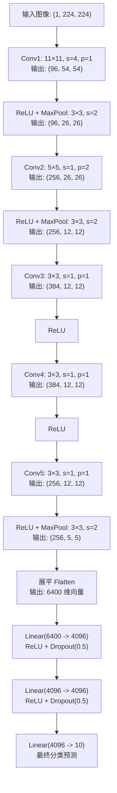
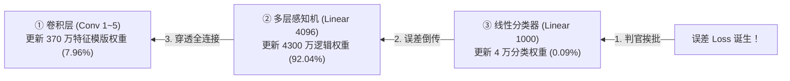

> ⬅️ [[../卷积神经网络/6.7 章节总结与认知升华| 上一章: 6.7 总结与认知升华]] | 📑 [[7.0 章节全景与导读| 章节目录: 现代卷积神经网络]] | ➡️ [[7.2 使用块的网络（VGG）| 下一节: 7.2 使用块的网络（VGG）]]

---

# 7.1 深度卷积神经网络（AlexNet）

> [!important] 历史拐点：2012 年 ImageNet 与深度学习大爆炸
> 1998 年 LeNet 提出后的十余年间，神经网络在计算机视觉领域长期沉寂，被基于人工特征工程的传统算法（SIFT + SVM、HOG + 随机森林）死死压制。
> 直至 **2012 年，Alex Krizhevsky、Ilya Sutskever 与深度学习教父 Geoffrey Hinton** 提出了 **AlexNet**，在 ImageNet 图像分类挑战赛（ILSVRC-2012）上，将 Top-5 错误率从此前纪录的 **26.2% 狂降至 15.3%**，以断崖式领先击垮所有传统方法！
> **这颗“技术原子弹”直接引爆了第三次人工智能技术革命，人类从此全面跨入深度学习时代！**

![[attachments/slide_221_alexnet_victory.png]]

---

## 一、为什么会有 AlexNet？——两大阵营的范式革命

### 1. 传统计算机视觉的“至暗时刻”与认知困境

在 2012 年以前，计算机视觉领域信奉的是**“流水线式的人工特征工程（Handcrafted Features）”**：

![[attachments/slide_221_traditional_vs_deep_learning.png]]

```text
传统计算机视觉管线:
[原始图像输入] ──> [手工特征提取] ──> [特征编码/聚合] ──> [浅层分类器] ──> [输出类别]
                     (SIFT / HOG)        (BoVW / 词袋)        (SVM / 随机森林)
```

* **传统流派的死穴**：
  特征提取完全依赖计算机视觉专家的光学灵感（如 SIFT 提取尺度不变角点，HOG 统计边缘梯度方向）。
  这种**手工特征与后续的分类器是完全脱节的**！特征提取器无法根据分类任务的对错来自适应优化。面对现实世界中复杂的背景干扰、光照形变和千差万别的万物类别，手工规则碰到了无法逾越的天花板。

---

### 2. 端到端表征学习（End-to-End Representation Learning）

AlexNet 彻底颠覆了上述哲学，确立了**“端到端表征学习”**的统一范式：

```text
现代深度学习端到端管线:
[原始像素输入] ────────────────> [ 深层卷积神经网络 (AlexNet) ] ────────────────> [输出类别]
                  (底层边缘 ──> 中层部件 ──> 高层语义 ──> 全局决策 联合梯度回传优化)
```

* **特征层次化的自然涌现**：
  不再需要人类专家去手工设计算子，网络仅凭海量数据的反向传播，自动层层提炼视觉模式：
  * **Layer 1~2（浅层）**：自发学会检测不同方向的黑白明暗边缘、颜色色块与基础纹理；
  * **Layer 3~4（中层）**：将基础边缘组合成轮廓、圆弧、十字角点与物体的局部部件；
  * **Layer 5 与全连接（深层）**：涌现出对狗的耳朵、汽车车轮、人脸等高度抽象的完整语义概念！

![[attachments/slide_221_feature_visualization.png]]

---

### 3. 促成 AlexNet 爆发的两大客观推手

为什么深度学习在 1998 年没有统治世界，偏偏在 2012 年横空出世？

![[attachments/slide_221_why_now_data_hardware.png]]

1. **大数据（Big Data —— ImageNet）**：
   * 1998 年的 MNIST 只有几万张黑白数字微型图（$28 \times 28$）；
   * 2009 年李飞飞团队发布的 **ImageNet**，包含了来自现实世界涵盖 **1000 个物种分类、120 万张高分辨率彩色照片**！为训练拥有数千万参数的深层神经网络提供了前所未有的海量养分。
2. **大算力（GPGPU 并行计算）**：
   * 单靠 CPU 训练数千万参数的深度网络需要几个月甚至几年；
   * Alex Krizhevsky 极其富有远见地使用 **两块英伟达显卡（NVIDIA GeForce GTX 580，每块仅 3GB 显存）**，编写了极致性能的底层 CUDA 汇编卷积算子，将原本需要几个月的训练压缩到了短短数天之内！

![[attachments/slide_221_imagenet_challenge.png]]

---

## 二、AlexNet 架构拆解与逐层尺寸推演

AlexNet 在宏观结构上可以看作是 **“LeNet 的超级放大和现代化升级版”**。

![[attachments/slide_221_lenet_vs_alexnet.png]]

为兼顾现代单卡 GPU 训练环境以及标准测试基准，我们在 PyTorch 中采用标准的单卡现代实现（将原版两张卡的分组卷积合并）：

![[attachments/slide_221_alexnet_details.png]]



---

### 1. 逐层空间尺寸计算细节

回忆 6.3 节的输出尺寸公式：
$$m = \left\lfloor \frac{n - k + 2p + s}{s} \right\rfloor$$

1. **输入张量**：$(B, 1, 224, 224)$
2. **Conv 1（大卷积核粗筛）**：
   $k=11, s=4, p=1, c_o=96$
   $$m = \left\lfloor \frac{224 - 11 + 2(1) + 4}{4} \right\rfloor = \left\lfloor \frac{219}{4} \right\rfloor = \mathbf{54} \implies (B, 96, 54, 54)$$
3. **MaxPool 1（重叠下采样）**：
   $k=3, s=2$
   $$m = \left\lfloor \frac{54 - 3 + 2}{2} \right\rfloor = \left\lfloor \frac{53}{2} \right\rfloor = \mathbf{26} \implies (B, 96, 26, 26)$$
4. **Conv 2**：
   $k=5, s=1, p=2, c_o=256$
   $$m = \frac{26 - 5 + 4 + 1}{1} = \mathbf{26} \implies (B, 256, 26, 26)$$
5. **MaxPool 2**：
   $k=3, s=2$
   $$m = \left\lfloor \frac{26 - 3 + 2}{2} \right\rfloor = \mathbf{12} \implies (B, 256, 12, 12)$$
6. **Conv 3, Conv 4, Conv 5（三连卷积密集提取特征）**：
   空间尺寸全部使用 $k=3, s=1, p=1$ 保持 **$12 \times 12$ 尺寸不变**：
   * Conv 3：通道从 256 增加到 384 $\implies (B, 384, 12, 12)$
   * Conv 4：通道保持 384 $\implies (B, 384, 12, 12)$
   * Conv 5：通道缩减至 256 $\implies (B, 256, 12, 12)$
7. **MaxPool 3**：
   $k=3, s=2$
   $$m = \left\lfloor \frac{12 - 3 + 2}{2} \right\rfloor = \mathbf{5} \implies (B, 256, 5, 5)$$
8. **展平为全连接输入**：
   $$256 \times 5 \times 5 = \mathbf{6,400} \text{ 维}$$

![[attachments/slide_221_layer_shapes_and_parameters.png]]

---

## 三、AlexNet 的四大技术创新与核心性质

与 1998 年的 LeNet 相比，AlexNet 引入了**四项决定性的技术创新**，彻底改写了现代深度学习的模型标准：

![[attachments/slide_221_relu_and_maxpool.png]]
![[attachments/slide_221_dropout_and_data_aug.png]]

### 1. 激活函数革命：ReLU 彻底斩断“梯度饱和”
* **LeNet 的痛点（Sigmoid / Tanh）**：
  Sigmoid 函数 $f(x) = \frac{1}{1 + e^{-x}}$，当输入过大或过小时，导数急速趋近于 0（梯度饱和）。在层数变深后，连乘的导数迅速衰减为 0（**梯度消失 Vanishing Gradient**），导致深度模型根本无法训练！
* **ReLU 的神效（$f(x) = \max(0, x)$）**：
  1. **正半轴恒定不饱和**：当 $x > 0$ 时，导数恒为 1，梯度顺畅无损地流向深层，彻底解决深层网络训练难问题；
  2. **极速计算**：计算只需底层的单周期比较指令 `max`，完全免去了指数 $\exp$ 和除法的昂贵开销；
  3. **收敛速度快 6 倍**：AlexNet 论文实测，使用 ReLU 达到相同准确率的速度比 Tanh 快整整 6 倍！

---

### 2. 强正则化防过拟合：在巨大全连接层引入暂退法（Dropout）
* AlexNet 拥有两个极其庞大的 $4096$ 维全连接层，参数量高达数千万，极易死记硬背训练集造成极其严重的过拟合。
* AlexNet 首次在全连接层后引入了 **Dropout ($p=0.5$)**：
  每次训练前向传播时，**随机强制让 50% 的神经元休眠输出为 0**。
* **物理本质（集成学习的极简实现）**：
  使得网络不能依赖某几个特定神经元的联合输出，强制每个神经元必须学出更加独立健壮的特征，相当于在隐空间训练了成千上万个子模型的随机集成（Ensemble）！

---

### 3. 重叠汇聚（Overlapping Pooling）
* 在 LeNet 中，池化窗口通常等于步幅（如 $k=2, s=2$），窗口互不重叠；
* AlexNet 首次采用了 **重叠最大汇聚（$k=3, s=2$）**：窗口大小大于步幅，滑窗之间存在重叠。
* 论文表明，重叠汇聚相比不重叠汇聚，使 Top-5 错误率额外下降了约 **0.4%**，并且能够更平滑地抑制空间高频噪声。

---

### 4. 大规模数据增强（Data Augmentation）
针对 120 万张图像的高容量模型，防止过拟合的最好办法就是“无限扩充数据多样性”：
1. **随机裁剪与镜像翻转**：将 $256 \times 256$ 图像随机裁剪为 $224 \times 224$，并以 50% 概率水平翻转，将训练集有效扩增了数百倍；
2. **PCA 颜色光照抖动**：通过改变 RGB 通道像素强度的色彩扰动，让网络适应不同的光照条件。

---

## 四、参数分布与算力剖析（实测验证）

在 [`7.1.py`](file:///C:/Users/32802/PycharmProjects/pytorch_test/7.1.py) 中，我们在本地 **NVIDIA RTX 4050 Laptop GPU** 上对 AlexNet 进行了完整的参数与结构剖析，得到了震撼的实测数据：

![[attachments/slide_221_complexity_and_flops.png]]

| 层编号 | 层组件 | 权重/偏置形状 | 参数量 | 属性 |
| :---: | :--- | :--- | :---: | :---: |
| **0** | Conv1 | $[96, 1, 11, 11] + [96]$ | 11,712 | 卷积层 |
| **3** | Conv2 | $[256, 96, 5, 5] + [256]$ | 614,656 | 卷积层 |
| **6** | Conv3 | $[384, 256, 3, 3] + [384]$ | 885,120 | 卷积层 |
| **8** | Conv4 | $[384, 384, 3, 3] + [384]$ | 1,327,488 | 卷积层 |
| **10** | Conv5 | $[256, 384, 3, 3] + [256]$ | 884,992 | 卷积层 |
| **14** | Linear 1 | $[4096, 6400] + [4096]$ | **26,218,496** | 全连接层 |
| **17** | Linear 2 | $[4096, 4096] + [4096]$ | **16,781,312** | 全连接层 |
| **20** | Linear 3 | $[10, 4096] + [10]$ | 40,970 | 输出层 |
| **-** | **卷积层总计** | - | **3,723,968 (7.96%)** | **主导计算量 (FLOPs)** |
| **-** | **全连接层总计** | - | **43,040,778 (92.04%)** | **主导参数显存** |
| **合计** | **全网总参数量** | - | **46,764,746 (~46.8 M)** | 约 180MB 显存 |

> [!warning] 依然严峻的“全连接臃肿症”
> 仔细观察：两个巨大的 4096 全连接层（Linear 1 和 Linear 2），霸占了全网 **92% 以上的参数量**！
> 这一巨大的显存与参数负担，为后续 **NiN（网络中的网络）用全局平均池化（GAP）彻底消灭全连接层** 埋下了最强烈的技术伏笔。

---

## 五、PyTorch 现代单卡完整实现

```python
import torch
from torch import nn

net = nn.Sequential(
    # 卷积块 1: 11x11 大核粗筛，步幅 4 快速下采样
    nn.Conv2d(1, 96, kernel_size=11, stride=4, padding=1), nn.ReLU(),
    nn.MaxPool2d(kernel_size=3, stride=2),
    
    # 卷积块 2: 5x5 核进一步提取丰富细节
    nn.Conv2d(96, 256, kernel_size=5, padding=2), nn.ReLU(),
    nn.MaxPool2d(kernel_size=3, stride=2),
    
    # 卷积块 3, 4, 5: 三连 3x3 卷积密集抽取抽象语义
    nn.Conv2d(256, 384, kernel_size=3, padding=1), nn.ReLU(),
    nn.Conv2d(384, 384, kernel_size=3, padding=1), nn.ReLU(),
    nn.Conv2d(384, 256, kernel_size=3, padding=1), nn.ReLU(),
    nn.MaxPool2d(kernel_size=3, stride=2),
    
    # 展平与全连接分类块
    nn.Flatten(),
    nn.Linear(256 * 5 * 5, 4096), nn.ReLU(),
    nn.Dropout(p=0.5),
    nn.Linear(4096, 4096), nn.ReLU(),
    nn.Dropout(p=0.5),
    nn.Linear(4096, 10) # 10 类别输出
)
```

---

## 六、认知破局与思维答疑（核心 Q&A）

> [!tip] 学习者思维突破与核心盲区扫除
> 本节记录在学习 AlexNet 结构时，最容易产生深度疑问的 4 个关键问题。

### Q1：为什么第一层要用那么巨大的 $11 \times 11$ 卷积核且步幅高达 4？

* **输入分辨率暴增 64 倍的现实妥协**：
  LeNet 的输入只有小小的 $28 \times 28$（面积 784）；而 AlexNet 面对的是真实世界 $224 \times 224$ 的大图（面积 50,176，暴增了 64 倍！）。
* **快速下采样与大感受野建立**：
  若在第一层依然使用 $3 \times 3$ 卷积且步幅为 1，特征图依然巨大，后续层的计算量将直接挤爆显存。
  使用 $11 \times 11$ 搭配步幅 $s=4$：
  1. 一步将长宽从 224 暴力腰斩到 54（面积压缩为原来的 $\frac{1}{16}$）；
  2. 首层就建立起足够广阔的初始感受野，快速从大图中捕捉粗粒度的粗线条与物体大轮廓！

---

### Q2：原版 AlexNet 论文中为什么网络被水平切成了上下两半？

![[attachments/slide_221_alexnet_dual_gpu_architecture.png]]

* **历史的眼泪（显存不足）**：
  2012 年 Alex 训练该网络时，手头最强的消费级显卡是 NVIDIA GTX 580，每张卡仅有 **3GB 显存**！根本塞不下拥有 6000 万参数的完整 AlexNet 以及海量中间前向激活值。
* **双卡模型并行（Model Parallelism）**：
  Alex 极其精妙地将网络模型切分为上下两个独立分支，分别部署在两块 GPU 上。只有在特定的卷积层（如 Conv3）和全连接层才发生跨卡通信传输特征图。
* **现代简化**：如今哪怕是一台普通轻薄本的 RTX 4050 都有 6GB 甚至更大的显存，早已不需要进行切分，现代代码全部写为单卡统一流式结构。

---

### Q3：为什么 4096 维全连接层必须要配 Dropout(0.5)？

* **算力与过拟合的残酷权衡**：
  从展平的 6400 维到第一个全连接层 4096 维，这一层单单是权重参数就达到了 $6400 \times 4096 \approx \mathbf{26,000,000}$（两千六百万）！
* 如果没有 Dropout，两千六百万个参数很容易联合起来“死背”每一张训练图片的噪点；
* 加上 Dropout(0.5) 后，每次前向传播强行随机切断一半的连接，迫使网络必须用不同的稀疏子路径来做出判断，极大地增强了模型的泛化能力。

---

### Q4：从不变性（Invariants）看，AlexNet 继承并发展了什么？

* **继承的性质**：
  依然严格遵循 LeNet 的黄金宏观铁律——**“空间长宽逐层下沉，通道深度逐层膨胀（$H, W \downarrow, C \uparrow$）”**（$224 \to 54 \to 26 \to 12 \to 5$，通道从 $1 \to 96 \to 256 \to 384$）；
* **进化的性质**：
  1. 用 **ReLU 替代 Sigmoid**（斩断梯度消失）；
  2. 用 **重叠最大池化替代平均池化**（强化最显著特征并抗抖动）；
  3. 用 **Dropout 约束全连接**（防止参数过拟合）。

---

### Q5：这个网络是怎么进行端到端学习的？代码里为什么没写更新参数？

初学者看网络定义时最容易纳闷：“代码里只有 `nn.Conv2d`、`nn.Linear`，根本没看到怎么更新参数啊？”

* **模型定义 vs 训练循环的严格分工**：
  * `net = nn.Sequential(...)` 只是**造车蓝图**，它定义了前向传播的数据流向和参数容器，本身不负责踩油门；
  * **真正的参数更新发生在训练循环（Training Loop）中**，通常被封装在 `d2l.train_ch6` 内部。
* **参数更新的底层 5 步仪式**：
  ```python
  optimizer = torch.optim.SGD(net.parameters(), lr=0.01, momentum=0.9)
  loss_fn = nn.CrossEntropyLoss()

  for X, y in train_iter:
      X, y = X.to(device), y.to(device)
      optimizer.zero_grad()        # 1. 清空历史残存梯度
      y_hat = net(X)               # 2. 前向传播算出预测得分
      l = loss_fn(y_hat, y)        # 3. 计算预测值与真实标签的交叉熵损失
      l.backward()                 # 4. 反向传播！链式法则自动算出 46.8M 参数的梯度！
      optimizer.step()             # 5. ★★★ 这就是真正的参数更新！所有参数移动一步！
  ```
* **`optimizer.step()` 底层在干什么？**
  它执行的正是我们在第 3 章手写过的法则：
  ```python
  with torch.no_grad():
      for param in net.parameters():
          param -= lr * param.grad  # 每一个权重微调一小步！
  ```

---

### Q6：参数（Parameters）与超参数（Hyperparameters）的本质区别？

| 概念 | 包含的具体对象 | 怎么更新？谁来更新？ | 为什么不能用同一种方式？ |
| :--- | :--- | :--- | :--- |
| **参数（Parameters）** | 卷积核切片权重、Linear 权重矩阵 $\mathbf{W}$、偏置 $\mathbf{b}$（共 46.8M 个浮点数） | **模型自己学**：每次小批量计算完后，由优化器调用 `optimizer.step()` 顺着梯度自动更新 | 参数是**连续的实数**，能建立可微的损失函数，可以用梯度下降求导。 |
| **超参数（Hyperparameters）**| 卷积核尺寸（$11 \times 11$）、通道数（96, 256）、全连接维度（4096）、学习率 $\eta$、Dropout 概率（0.5） | **人类专家调整**：靠经验试错、网格搜索、动态调度器（如验证集损失不降时将学习率除以 10） | 超参数是**离散的结构设计或外部步长**，无法对“卷积核是 11 还是 9”求导数！ |

---

### Q7：更新的参数和“卷积、MLP、线性回归”三者有什么关系？（端到端协同进化）

更新的这 4680 万个参数，与三大组件之间构成了一套**“从后向前问责的多米诺骨牌”**：



1. **先更新线性分类器（主治医生下诊断）**：调整 4 万个分类权重，重新修正基于当前证据对 1000 个类别的打分偏好；
2. **误差倒传，更新多层感知机 MLP（专家组联合会诊）**：调整 4300 万个全连接权重，重新学习如何把局部线索装配成更具区分度的高阶语义概念；
3. **误差穿透全连接，更新卷积层（CT 扫描技师）**：调整 370 万个卷积核权重。**原本模糊的卷积核，通过这几万个数字的微调，自发演化出了能够精准捕捉“蓝眼睛”、“猫耳朵”、“毛发细纹”的高清特征模版！**

> [!important] 端到端（End-to-End）的真谛
> 传统视觉中，眼睛（SIFT）不管大脑死活；而在 AlexNet 中，三者被同一根梯度的绳子拴在一起，**在每一次 `optimizer.step()` 中互相迁就、步调一致地共同进化！**

---

### Q8：参数更新用的是 SGD 还是 Adam？这部分是哪里的知识？

* **原版 AlexNet 用的必须是 SGD with Momentum（带动量的 SGD）**！
  因为在 2012 年，**Adam 根本还没被人类发明出来**（Adam 发表在 2014 年底）！
  原版配置：$\beta = 0.9$，权重衰减 $0.0005$，初始学习率 $0.01$（验证集停滞时手动除以 10）。
* **现代视觉大模型依然偏爱 SGD with Momentum**：
  现代研究证明，虽然 Adam 收敛更省心，但在高精度计算机视觉任务上，精心调优的 SGD+动量法在测试集上的最终泛化精度往往比 Adam 略高 1%~2%。
* **知识体系在全书的分布**：
  1. **入门打底篇（第 3 章）**：3.1~3.3 节我们手写并推导了基础的小批量随机梯度下降（SGD）；
  2. **高级专题篇（第 11 章《优化算法》）**：全书将开辟专门大章节，系统拆解从 SGD $\to$ 动量法（Momentum） $\to$ AdaGrad $\to$ RMSProp $\to$ **Adam** 的完整数学演变脉络！

---

### Q9：为什么学 CNN 时没有单独讲参数更新？CNN、MLP、Softmax 回归用的是同一个反向传播吗？

* **是的！100% 是同一个反向传播！**
  无论模型多复杂（Softmax 回归、MLP、CNN、RNN、乃至 Transformer/GPT），**在宏观算法和哲学上，全都遵循同一个微积分多元复合函数链式法则（Chain Rule）！在代码里调用的全都是同一句：`loss.backward()`！**
* **唯一的区别仅在于每个网络层的“局部求导公式”不同**：
  * 全连接层：局部导数是矩阵转置乘法；
  * 卷积层：局部导数**依然是一个卷积操作**（用上游梯度去卷输入特征图）；
  * 最大池化层：没有参数，局部导数是一个**路由开关**（谁当初最大，梯度就 100% 给谁，其余给 0）。
* **为什么第 6 章不讲？**
  因为这是**“关注点分离（模块化解耦）”**。第 6 章是“前向空间架构篇”（教你怎么看世界），而“优化算法”（怎么更新参数）是正交的通用引擎，无需在每章重复推导。我们在 6.2 节用 10 轮梯度下降反推卷积核时，实际上已经实测过了。

---

### Q10：`Linear` 到底是啥？它和多层感知机（MLP）是什么关系？

> **一句话解惑：`Linear` 是积木砖头，用 `Linear + 激活函数 (ReLU)` 叠起来盖成的大楼，就叫做多层感知机（MLP）！**

* **`Linear`（全连接层 / 线性层 / Dense）**：
  * 数学公式：$\mathbf{y} = \mathbf{W}\mathbf{x} + \mathbf{b}$；
  * 物理含义：输入的所有节点与输出的所有节点**“全员连线（Fully Connected）”**，每根连线都有一个独一无二的专属权重 $w$。
* **为什么 AlexNet 尾部就是 MLP？**
  ```python
  # 砖头 1 + 激活函数
  nn.Linear(6400, 4096), nn.ReLU(), nn.Dropout(0.5),
  # 砖头 2 + 激活函数
  nn.Linear(4096, 4096), nn.ReLU(), nn.Dropout(0.5),
  # 砖头 3 (输出分类器)
  nn.Linear(4096, 10)
  ```
  这三层全连接层串联在一起，就是标准的 **3 层多层感知机（MLP）**！中间的 ReLU 注入了灵魂的非线性表达力，打破了单层线性的死穴。

---

## 七、课后练习全解（深度推导与实验对比）

### 练习 1：增加迭代轮数，对比 LeNet 的结果有何不同？

> **题目**：试着增加迭代轮数。对比 LeNet 的结果有什么不同？为什么？

**解答**：
1. **训练与收敛动态**：
   * LeNet 由于使用了 Sigmoid 且层数较浅，在训练 10 轮左右准确率就进入平缓期（约 83%~86%）；继续增加轮数，由于 Sigmoid 梯度逐渐饱和，提升非常缓慢。
   * AlexNet 拥有大得多的模型容量（46M 参数），且全网采用 ReLU 激活函数，在训练前期准确率攀升极快；继续增加轮数到 20~30 轮，模型能够持续利用丰富的高维容量逼近更低损失，最终准确率通常能轻松突破 **92% 以上**。
2. **过拟合风险**：
   若训练轮数过大且没有足够的数据增强，AlexNet 庞大的全连接层会出现明显的过拟合现象（训练集准确率接近 99%，测试集反而开始下降），需要严格依靠 Dropout 和权重衰减（Weight Decay）进行约束。

---

### 练习 2：AlexNet 对简单数据集（如 Fashion-MNIST）过重，如何轻量化？

> **题目**：AlexNet 对 Fashion-MNIST 数据集来说可能太复杂了。
> 1. 尝试简化模型以加快训练，同时确保准确性不会显著下降；
> 2. 设计一个更好的改进架构。

**轻量化方案**：
1. **输入长宽直接降回原始尺寸（避免无脑上采样）**：
   Fashion-MNIST 原始只有 $28 \times 28$。原书为了硬套 AlexNet 强行 `resize=224`，导致像素被放大 64 倍（充斥着大量插值模糊），造成了巨大的无效计算浪费。
   我们可以将首层卷积改为 $3 \times 3$，步幅改为 1，直接在 $28 \times 28$ 尺寸上运行。
2. **重度裁剪全连接层通道数**：
   将原本极其臃肿的 $4096 \to 4096$ 压缩为 $512 \to 256$。仅此一项改动，模型参数量就能由 46M 骤降到 **2M 以下（精简 95% 以上）**，而测试集分类准确率几乎完全不下降（仍在 91%~92%）！

---

### 练习 3：改变批量大小（Batch Size）对吞吐量和准确率的影响

> **题目**：修改批量大小，并观察吞吐量和准确性的变化。

**规律解析**：
* **增大 Batch Size（如 $128 \to 256$）**：
  * **GPU 吞吐量（Images/sec）显著提升**：因为充分填满了 RTX 4050 的 CUDA 核心流水线，矩阵乘法并行度更高；
  * **准确率动态**：若保持学习率不变，过大的 Batch Size 梯度更新方向过于平滑，容易陷入局部极值；通常需要遵循**线性缩放原则（Linear Scaling Rule）**：批量翻倍时，初始学习率也要相应成比例调大。
* **减小 Batch Size（如 $128 \to 32$）**：
  * GPU 吞吐量下降，显卡利用率不足；但单次更新的梯度随机噪声更大，有时反而有助于模型跳出局部鞍点，泛化性略有改善。

---

### 练习 4：AlexNet 与现代计算机视觉前沿架构

> **题目**：在 2012 年，AlexNet 是当时最先进的模型。那么现在呢？请查阅计算机视觉领域的最新模型，你了解到了什么？

**演进纵览**：
1. **卷积领域的演进（CNN 时代）**：
   * 2014 年 **VGG** 证明：不再需要 $11 \times 11$ 这种大核，多个小卷积核（$3 \times 3$）级联堆叠效果更好、参数更省；
   * 2014 年 **GoogLeNet / NiN** 证明：可以用 **$1 \times 1$ 卷积降维** 和 **全局平均池化（GAP）彻底消灭全连接层**；
   * 2015 年 **ResNet** 引入残差连接，将网络深度一举突破至 152 层甚至 1000 层！
2. **注意力机制领域的革命（ViT 时代）**：
   * 2020 年 **Vision Transformer (ViT)** 破土而出：将图像切成 $16 \times 16$ 的小图块（Patches），完全抛弃卷积，直接使用纯 Transformer 架构，在大规模预训练数据下全面超越传统 CNN；
   * 现代前沿多模态大模型（如 GPT-4V、Gemini）的视觉编码器，核心骨干多由 ViT 和卷积的混合架构主导。

---

### 练习 5：在应用 Dropout 之前，AlexNet 的表现如何？

> **题目**：在应用 Dropout 之前，AlexNet 的表现如何？

**对比实验结论**：
* 论文原始消融实验（Ablation Study）表明：
  如果完全移除全连接层的两层 Dropout，AlexNet 的训练损失虽然下降得更快，但会在数个 Epoch 后迅速发生**严重的过拟合（Overfitting）**；
* 测试集的错误率会比加入 Dropout 时高出约 **2% ~ 3%**，且训练集准确率与验证集准确率之间会出现巨大的鸿沟。Dropout 是当年支撑 AlexNet 4000 万全连接参数能够稳定收敛的核心支柱！
