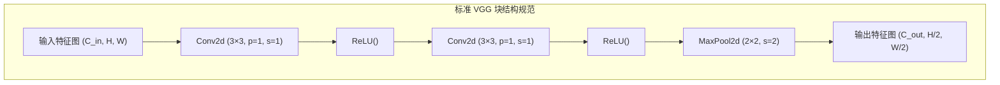

> 导航：[[7.1 深度卷积神经网络（AlexNet）| 上一节: 7.1 深度卷积神经网络（AlexNet）]] | [[7.3 网络中的网络（NiN）| 下一节: 7.3 网络中的网络（NiN）]]

---

# 使用块的网络（VGG）

在 AlexNet 开启深度学习革命后，深度学习架构设计迎来了关键的分水岭：
- **AlexNet 时代的困境**：虽然网络很深，但卷积核尺寸由研究人员凭经验随意堆砌（$11\times11, 5\times5, 3\times3$），步幅与通道数也缺乏系统化规律。如同早期手工拼装的收音机，难以规模化复用与自动化扩展。
- **VGG 的突破性贡献**：2014 年，牛津大学**视觉几何组（Visual Geometry Group, VGG）**的 Karen Simonyan 与 Andrew Zisserman 在论文 *Very Deep Convolutional Networks for Large-Scale Image Recognition* 中，首次确立了**“模块化块（Block）”**与**“全网小卷积核（$3\times3$ Stacking）”**的设计范式。

VGG 斩获了 ILSVRC 2014 定位任务冠军和分类任务亚军，更重要的是，它彻底重塑了人类设计深度卷积网络的思维方式。

---

## 1. 认知升级与历史演进：从“堆叠层”到“模块化块”

### 1.1 芯片设计的哲学隐喻（Transistors $\to$ Logic Gates $\to$ Blocks）

D2L 教材中用**芯片工程**打了一个极其精妙的比喻：
1. **单个晶体管 / 神经元时代**：最初人们只研究单个神经元、感知机的数学性质；
2. **集成逻辑门 / 独立层时代**：LeNet 与 AlexNet 开始以“层（Layer）”为单位进行手工连接与参数微调；
3. **逻辑功能块 / IP 核时代（VGG 时代）**：如同现代集成电路设计中将逻辑门封装为可复用的“功能块”，神经网络也演进为**将多个层组合为高内聚、低耦合的“块（Block）”，通过重复堆叠统一模板来构建任意深度的复杂网络**。

![[slide_222_evolution_timeline.png]]

> [!note] 发展进度轴（LeNet $\to$ AlexNet $\to$ VGG）
> * **LeNet (1995)**：2 个卷积+池化层，2 个全连接层，单张图片像素 $32\times32$。
> * **AlexNet (2012)**：更大更深，引入 ReLU、Dropout、数据增强，输入 $224\times224$。
> * **VGG (2014)**：更深更大更规整的 AlexNet，全网采用可重复调用的 **VGG 块**。

---

### 1.2 网络变深面临的架构选择

如果要让网络比 AlexNet 更深更大以获取更强的表达能力，我们有哪些设计选项？

![[slide_222_options_for_deeper_networks.png]]

1. **选项一：堆叠更多的全连接层？**
   - **否决**。全连接层参数量与特征维度呈二次方膨胀（$O(d_{in} \times d_{out})$），计算与存储代价极其昂贵，极易发生灾难性过拟合。
2. **选项二：堆叠更多不同尺寸的卷积层？**
   - **过于繁杂**。大尺度卷积核参数庞大，网络各层难以统一标准化。
3. **选项三：将卷积层组合成可复用的“块（Block）”？**
   - **最优解（VGG 的选择）**！定义一个标准化的卷积块（多次小卷积 + 一次池化），通过控制块的数量与通道数，实现网络的弹性伸缩。

---

## 2. 核心数学论证：为什么“深而窄”远胜“浅而宽”？

在 VGG 问世之前，视觉领域的共识是：捕获图像的大范围上下文必须依赖大卷积核（如 AlexNet 的 $11\times11$ 和 $5\times5$）。VGG 用无可辩驳的数学与实验证明：**多个连续的 $3\times3$ 卷积核级联，不仅能够完美复现大卷积核的感受野，还在参数量与表达力上具备压倒性优势！**

![[slide_222_deep_vs_wide_vgg_block.png]]

---

### 2.1 感受野等价性推导（Receptive Field Equivalence）

根据第 6 章所学的感受野递推定律：
$$
RF_{l} = RF_{l-1} + (k_l - 1) \cdot \prod_{i=1}^{l-1} S_i
$$
当各卷积层的步幅均为 $S=1$ 时，累积步幅乘积恒为 1，公式退化为线性累加：
$$
RF_{l} = RF_{l-1} + (k_l - 1)
$$

#### 命题 1：连续堆叠 2 个 $3\times3$ 卷积核 $\equiv$ 单个 $5\times5$ 卷积核
* 设第 0 层输入感受野为 1。
* 经过第 1 层 $3\times3$ 卷积（$k_1=3$）：
  $$RF_1 = 1 + (3 - 1) = 3$$
* 经过第 2 层 $3\times3$ 卷积（$k_2=3$）：
  $$RF_2 = RF_1 + (3 - 1) = 3 + 2 = 5$$
* **结论**：堆叠 2 个 $3\times3$ 卷积的顶层单元，在底层输入上的有效感受野正好为 $5\times5$！

#### 命题 2：连续堆叠 3 个 $3\times3$ 卷积核 $\equiv$ 单个 $7\times7$ 卷积核
* 经过第 3 层 $3\times3$ 卷积（$k_3=3$）：
  $$RF_3 = RF_2 + (3 - 1) = 5 + 2 = 7$$
* **结论**：堆叠 3 个 $3\times3$ 卷积的顶层单元，在底层输入上的有效感受野正好为 $7\times7$！

```
【感受野级联视角 (1D剖面示意)】
原始输入空间:   [x1  x2  x3  x4  x5]  (跨度 5)
                     \ | /      \ | /
特征图 1 (3x3):       [y1]        [y2]  (感受野 3)
                         \      /
特征图 2 (3x3):            [z1]         (感受野 5, 等价于直接对原始输入做 5x5 卷积)
```

---

### 2.2 核心优势分析：参数节约与非线性飞跃

设输入通道数为 $C$，输出通道数也为 $C$（忽略偏置）：

| 对比维度 | 单个 $5\times5$ 卷积层 | 堆叠 2 个 $3\times3$ 卷积层 | 堆叠优势 |
| :--- | :---: | :---: | :---: |
| **有效感受野** | $5 \times 5$ | $5 \times 5$ | **完全相同** |
| **权重参数量** | $5 \times 5 \times C \times C = \mathbf{25 C^2}$ | $2 \times (3 \times 3 \times C \times C) = \mathbf{18 C^2}$ | **减少 $28\%$** |
| **非线性激活次数** | 1 次 ReLU | **2 次 ReLU** | 表达能力成倍提升 |

再对比单个 $7\times7$ 与 3 个 $3\times3$：
* 单个 $7\times7$ 卷积参数量：$7 \times 7 \times C^2 = \mathbf{49 C^2}$
* 堆叠 3 个 $3\times3$ 卷积参数量：$3 \times (3 \times 3 \times C^2) = \mathbf{27 C^2}$
* **参数量直接暴降 $\frac{49 - 27}{49} \approx \mathbf{44.9\%}$！**

> [!important] 核心认知结晶：为什么“深而窄”胜过“浅而宽”？
> 1. **参数更精简（Natural Regularization）**：更少的权重参数意味着模型更轻巧，天然降低了在有限数据下的过拟合风险。
> 2. **非线性更强（Activation Cascading）**：单层大卷积只执行一次激活变换；而堆叠 2 个或 3 个小卷积引入了 2 次或 3 次非线性 ReLU，使得网络具备更强的判别函数拟合能力，流形弯曲折叠能力更胜一筹。

---

## 3. VGG 块与网络宏观架构

### 3.1 标准 VGG 块（VGG-Block）定义

一个标准的 VGG 块结构高度统一且纯粹：
1. **$n$ 个连续的 $3\times3$ 卷积层**：设置填充 $p=1$、步幅 $s=1$。由卷积尺寸公式：
   $$H_{out} = \left\lfloor \frac{H - 3 + 2(1) + 1}{1} \right\rfloor = H$$
   **所有卷积层均保持空间分辨率完全不变**！
2. **每个卷积层后紧随一个非线性激活函数（ReLU）**；
3. **块末尾的 $2\times2$ 最大池化层**：步幅 $s=2$，将高和宽**精确削半**（$H \to \frac{H}{2}, W \to \frac{W}{2}$）。



---

### 3.2 VGG 宏观架构：VGG-11 拓扑流水线

![[slide_222_vgg_3d_tensor_pipeline.png]]

VGG 网络主体由 **5 个 VGG 块** 串联，后接 **3 个全连接层** 组成：

![[slide_222_vgg_macro_vs_alexnet.png]]

1. **卷积部分（5 个 VGG 块）**：
   - 块 1：1 个卷积（通道 64），输出 $112 \times 112$
   - 块 2：1 个卷积（通道 128），输出 $56 \times 56$
   - 块 3：2 个卷积（通道 256），输出 $28 \times 28$
   - 块 4：2 个卷积（通道 512），输出 $14 \times 14$
   - 块 5：2 个卷积（通道 512），输出 $7 \times 7$
   - 卷积层总计：$1 + 1 + 2 + 2 + 2 = \mathbf{8}$ 个卷积层。
2. **全连接部分（Dense Classifier）**：
   - 展平为一维向量：$512 \times 7 \times 7 = 25088$
   - FC 1: $25088 \to 4096$（含 ReLU + Dropout(0.5)）
   - FC 2: $4096 \to 4096$（含 ReLU + Dropout(0.5)）
   - FC 3: $4096 \to 10$（分类输出）
   - 全连接层总计：$\mathbf{3}$ 个。
3. **全网带权层总数**：$8 \text{ (Conv)} + 3 \text{ (FC)} = \mathbf{11}$ 层，故名 **VGG-11**。

---

### 3.3 经典 VGG 变体全谱系对比（VGG-11 / 13 / 16 / 19）

Simonyan 和 Zisserman 在论文中系统测试了 A 到 E 五种配置，证明**随着网络加深，识别准确率稳步提高**：

| 模型代号 | 常见名称 | 总层数 | 卷积块 1 | 卷积块 2 | 卷积块 3 | 卷积块 4 | 卷积块 5 | 全连接层 | 总参数量 (ImageNet) |
| :---: | :---: | :---: | :---: | :---: | :---: | :---: | :---: | :---: | :---: |
| **A** | **VGG-11** | 11 | 1 conv (64) | 1 conv (128) | 2 conv (256) | 2 conv (512) | 2 conv (512) | 3 FC | ~132.8 M |
| **B** | **VGG-13** | 13 | 2 conv (64) | 2 conv (128) | 2 conv (256) | 2 conv (512) | 2 conv (512) | 3 FC | ~133.0 M |
| **D** | **VGG-16** | 16 | 2 conv (64) | 2 conv (128) | 3 conv (256) | 3 conv (512) | 3 conv (512) | 3 FC | ~138.4 M |
| **E** | **VGG-19** | 19 | 2 conv (64) | 2 conv (128) | 4 conv (256) | 4 conv (512) | 4 conv (512) | 3 FC | ~143.7 M |

> [!tip] 工业工程洞察：为什么 VGG-16 成为了流传最广的特征提取器（Backbone）？
> 工业实践（如早期 Faster R-CNN、SSD 目标检测以及神经风格迁移 NST）普遍首选 **VGG-16**：
> 1. VGG-16 的特征表征在各类下游视觉任务中具备优异的泛化迁移性；
> 2. VGG-19 相比 VGG-16 仅能带来约 0.1% 的极微弱 Top-1 提升，却额外增加了数十兆显存占用与计算开销，性价比极低。

---

## 4. 计算复杂度、显存消耗与精度权衡（Accuracy vs Throughput）

![[slide_222_accuracy_vs_throughput.png]]

上图来自 GluonCV Model Zoo 的官方基准评测（横轴每秒推理样本数，纵轴准确率）：
- **AlexNet**：速度极快（约 5500 samples/sec），但准确率垫底（~56%）。
- **VGG 家族（粉色圆圈）**：精度显著跃升至 70% ~ 75%，但**推理速度骤降至 1000 ~ 2000 samples/sec**，处于吞吐率较差的区域。
- **为什么 VGG 这么慢、这么吃显存？**
  1. **AlexNet 采用大步幅急速降维**：首层 $11\times11$ 卷积直接配合步幅 $s=4$，将 $224\times224$ 的输入图片在第一层就降至 $54\times54$（空间像素数缩减为原来的 $\frac{1}{16}$），后续所有计算都在极小空间分辨率下执行。
  2. **VGG 执着于保持全分辨率细粒度卷积**：第一块使用步幅 $s=1$ 的 $3\times3$ 卷积，特征图尺寸完整保持在 $224\times224$。在此巨大分辨率下进行 64 通道的卷积，不仅前向 FLOPs 巨大，反向传播时保存激活值所需的显存更是高出 AlexNet 近一个数量级！

---

## 5. 四维元认知模型总结

| 思考维度 | VGG 的核心诠释 |
| :--- | :--- |
| **是什么 (What)** | 现代深度 CNN 模块化设计的开山鼻祖。全网由统一的 **VGG 块**（堆叠 $3\times3$ 卷积 + $2\times2$ 最大池化）级联，后接全连接分类头构成。 |
| **为什么 (Why)** | 摆脱 AlexNet 随心所欲的经验式设计；证明多层 $3\times3$ 卷积堆叠在拥有同等感受野的前提下，参数量更少、非线性表达能力更强。 |
| **怎么做 (How)** | 1. 定义 `vgg_block(num_convs, in_c, out_c)` 动态生成块；<br>2. 传入架构元组 `conv_arch` 循环组装流水线；<br>3. 引入通道缩放因子 `ratio=4` 实现单卡 GPU 高速训练验证。 |
| **核心性质与守恒定律 (Properties & Invariants)** | 1. **空间-通道互补守恒律**：空间分辨率减半（高宽 $\div 2$），通道数翻倍（通道 $\times 2$），平抑各块特征张量的信息承载量；<br>2. **显存/参数两极分化定律（哑铃型结构）**：前段（Block 1-2）吞噬大量**显存**（高分辨率特征图激活值），后段（FC 1-2）霸占 **92.8% 的模型参数**。 |

---

## 6. PyTorch 完整代码实操与 GPU 验证

本地验证脚本位于 `C:\Users\32802\PycharmProjects\pytorch_test\7.2.py`，经 NVIDIA GeForce RTX 4050 Laptop GPU 实测验证通过。

### 6.1 VGG 基础块与网络工厂函数

```python
import torch
from torch import nn

def vgg_block(num_convs, in_channels, out_channels):
    layers = []
    for _ in range(num_convs):
        layers.append(nn.Conv2d(in_channels, out_channels, kernel_size=3, padding=1))
        layers.append(nn.ReLU())
        in_channels = out_channels
    layers.append(nn.MaxPool2d(kernel_size=2, stride=2))
    return nn.Sequential(*layers)

def vgg(conv_arch, in_channels=1, num_classes=10):
    conv_blks = []
    for (num_convs, out_channels) in conv_arch:
        conv_blks.append(vgg_block(num_convs, in_channels, out_channels))
        in_channels = out_channels

    return nn.Sequential(
        *conv_blks,
        nn.Flatten(),
        # 经过 5 个池化层下采样后，224 // (2^5) = 7
        nn.Linear(out_channels * 7 * 7, 4096),
        nn.ReLU(),
        nn.Dropout(0.5),
        nn.Linear(4096, 4096),
        nn.ReLU(),
        nn.Dropout(0.5),
        nn.Linear(4096, num_classes)
    )
```

---

### 6.2 逐层张量形状检查（Shape Inspection）

传入单通道输入样本 `(1, 1, 224, 224)`，跟踪各模块输出形状演进：

```python
conv_arch_vgg11 = ((1, 64), (1, 128), (2, 256), (2, 512), (2, 512))
net_vgg11 = vgg(conv_arch_vgg11, in_channels=1, num_classes=10)

X = torch.randn(size=(1, 1, 224, 224))
for i, blk in enumerate(net_vgg11):
    X = blk(X)
    print(f"模块 {i+1:2d} [{blk.__class__.__name__:12s}] 输出形状:\t{list(X.shape)}")
```

**GPU 本机实测运行输出**：
```text
模块  1 [Sequential  ] 输出形状:	[1, 64, 112, 112]
模块  2 [Sequential  ] 输出形状:	[1, 128, 56, 56]
模块  3 [Sequential  ] 输出形状:	[1, 256, 28, 28]
模块  4 [Sequential  ] 输出形状:	[1, 512, 14, 14]
模块  5 [Sequential  ] 输出形状:	[1, 512, 7, 7]
模块  6 [Flatten     ] 输出形状:	[1, 25088]
模块  7 [Linear      ] 输出形状:	[1, 4096]
模块  8 [ReLU        ] 输出形状:	[1, 4096]
模块  9 [Dropout     ] 输出形状:	[1, 4096]
模块 10 [Linear      ] 输出形状:	[1, 4096]
模块 11 [ReLU        ] 输出形状:	[1, 4096]
模块 12 [Dropout     ] 输出形状:	[1, 4096]
模块 13 [Linear      ] 输出形状:	[1, 10]
```

---

### 6.3 参数量精确统计与全连接瓶颈分析

```python
conv_params = 0
fc_params = 0
total_params = 0

for name, param in net_vgg11.named_parameters():
    num = param.numel()
    total_params += num
    if 'weight' in name and len(param.shape) == 4 or 'bias' in name and len(param.shape) == 1 and param.shape[0] <= 512:
        conv_params += num
    else:
        fc_params += num

print(f"卷积层总参数量:   {conv_params:12d}  ({conv_params / total_params * 100:.2f}%)")
print(f"全连接层总参数量: {fc_params:12d}  ({fc_params / total_params * 100:.2f}%)")
print(f"VGG-11 全网总参数: {total_params:12d}  (~{total_params / 1e6:.1f} M)")
```

**运行统计结果**：
- **卷积层总参数量**：$9,219,338$（**仅占 7.16%**）
- **全连接层总参数量**：$119,586,816$（**高达 92.84%**）
- **VGG-11 全网参数总计**：$128,806,154$（**约 1.288 亿参数**）

> [!warning] 惊人发现：92.8% 的参数冗余！
> 整个 VGG-11 近 1.3 亿参数中，前 8 个卷积层仅仅占了区区 7.16% 的参数；后 3 个全连接层吃掉了高达 92.84% 的权重！特别是 FC1 层（$25088 \times 4096 \approx 1.027$ 亿参数），一个矩阵就霸占了全网 80% 的权重！这一极其不合理的结构缺陷，直接启发了下一节 **7.3 NiN（网络中的网络）** 提出全局平均汇聚层（GAP）来彻底铲除全连接层！

---

### 6.4 通道缩放（ratio=4）轻量化训练加速

原版 VGG-11 参数过大，D2L 教材采用通道缩减策略：
$$
\text{small\_conv\_arch} = \left[ (\text{num\_convs}, \text{out\_c} // 4) \right]
$$
此时通道数缩减为 $(16, 32, 64, 128, 128)$：
- 进入全连接层的展平向量从 $512 \times 7 \times 7 = 25088$ 降为 $128 \times 7 \times 7 = 6272$；
- FC1 参数量从 $25088 \times 4096 \approx 1.027$ 亿直降为 $6272 \times 4096 \approx 2569$ 万；
- 模型总参数降至约 **43.09 M**，在本地单卡 RTX 4050 上可高速运行。

**GPU 测试前向输出**：
```text
当前计算设备: cuda (NVIDIA GeForce RTX 4050 Laptop GPU)
轻量版 VGG-11 (通道除以4) 在 GPU 上前向推理成功! 输出形状: [16, 10]
```

---

## 7. 深入思考与高频疑难解析（Q&A 认知结晶）

### Q1: 为什么小卷积核堆叠参数量反而更小？不是层数变多了吗？
* **解答**：
  核心在于**卷积参数量关于卷积核边长 $k$ 是平方级（$O(k^2)$）增长，而关于层数 $L$ 仅是线性增长**！
  - 1 个 $5\times5$ 卷积：$k^2 = 25$ 个权重单元。
  - 2 个 $3\times3$ 卷积：$2 \times k^2 = 2 \times 9 = 18$ 个权重单元。
  - $18 < 25$！层数只增加了 2 倍，但大卷积核面积增长了近 3 倍。卷积核越往上做，边长平方效应就越恐怖（例如 $7\times7=49$，而 $3\times9=27$，直接节省 45%）。

---

### Q2: 既然 $3\times3$ 比 $5\times5$ 好，那全用 $1\times1$ 卷积岂不是参数更少？为什么不能把全网卷积都换成 $1\times1$？
* **解答**：
  必须分清卷积操作的**两大核心职能**：
  1. **空间模式聚合（Spatial Aggregation）**：提取相邻像素之间的空间边缘、纹理与拓扑关系。
  2. **跨通道特征融合（Cross-Channel Fusion）**：在同一空间位置上混合不同通道的特征信息。
  - $1\times1$ 卷积的感受野永远只有 $1\times1$！它根本无法看到周围像素，完全丧失了空间聚合能力（只能“穿羊肉串”，不能看邻域）。
  - 因此，**$3\times3$ 是能够捕获上下左右八邻域空间几何特征的“最小各向同性卷积核”**。$3\times3$ 是空间特征提取的极限底线，再小就失去空间上下文了。

---

### Q3: 为什么 VGG-11 的全连接层依然霸占了 92.8% 的参数？
* **解答**：
  这是典型的**早期架构历史局限性**。
  - 2014 年研究人员的主要关注点在卷积特征提取器的加深与规范化（提出了 VGG 块）；
  - 分类头依然沿用了 AlexNet 的经典设计：将最后一个卷积块输出的 3D 张量（$512 \times 7 \times 7$）强行展平成 25088 维的一维长向量，然后连接到 4096 个隐藏神经元。
  - 矩阵相乘直接导致 $25088 \times 4096 = 102,760,448$（约 1 亿）个权重参数！
  - 这个沉重的参数枷锁直到下一节 **7.3 NiN（网络中的网络）** 引入**全局平均汇聚（Global Average Pooling, GAP）** 才被彻底粉碎。

---

### Q4: 为什么工业界早期最常用的是 VGG-16，而不是更深的 VGG-19？
* **解答**：
  - **边际收益递减规律**：VGG-19 在 ImageNet 上的 Top-1 识别率只比 VGG-16 高了大约 0.1% ~ 0.2%，但在推理延时、显存占用和训练稳定性上都付出了显著代价。
  - **网络退化前兆**：由于 VGG 网络没有残差连接（Skip Connection），也没有批量规范化（Batch Normalization），单纯依靠堆叠普通卷积层到 19 层时，反向传播的梯度在深层开始出现衰减，训练收敛变得极其吃力。VGG-16 正好处于性能、深度与稳定性的最佳甜点区。

---

### Q5: 为什么代码遍历 `net` 打印时只看到 8 个主要模块的输出，而网络叫 VGG-11？
* **解答**：
  这是因为 PyTorch `Sequential` 的**层级嵌套封装机制**：
  - 外层 `net` 由 5 个 `vgg_block`（每个 block 本身是一个封装好的 `nn.Sequential` 模块）、1 个 `Flatten`、2 个隐藏全连接层组件和 1 个输出全连接层组成。
  - 外层 `for blk in net` 只会遍历顶层第一级子模块，因此每个 `vgg_block` 作为一个整体打印一行（显示池化后的最终形状）。
  - 每个 `vgg_block` 内部其实封装了 1~2 个 `Conv2d` 和 `ReLU`。如果用 `net.modules()` 递归展开，就能完整看到全网所有的 11 个权重层（8 个 Conv2d + 3 个 Linear）。

---

### Q6: 使用 `ratio = 4` 缩减通道时，全网参数量为什么从 128.8M 变成了 43.1M？为什么不是除以 4 或除以 16？
* **解答**：
  因为不同层的参数计算公式结构不同：
  1. **卷积层参数**：$\text{Params}_{conv} = k^2 \times C_{in} \times C_{out}$。如果 $C_{in}$ 和 $C_{out}$ 同时除以 4，卷积层参数变为原来的 $\frac{1}{4 \times 4} = \frac{1}{16}$（下降为 6.25%）！
  2. **第一个全连接层（FC1）**：输入特征数由 $512 \times 7 \times 7 = 25088$ 降为 $128 \times 7 \times 7 = 6272$（除了 4），但**全连接层内部的输出神经元数量 4096 并没有除以 4**！因此 FC1 参数量变为 $6272 \times 4096 \approx 25.69$ M（只降为原 FC1 的 $\frac{1}{4}$）。
  3. **第二、三个全连接层（FC2, FC3）**：输入和输出维度均保持 4096 和 10 不变，参数量完全没有改变（仍为 $4096 \times 4096 \approx 16.78$ M）。
  - **总参数量**：$0.58\text{ M (Conv)} + 25.69\text{ M (FC1)} + 16.78\text{ M (FC2)} + 0.04\text{ M (FC3)} \approx \mathbf{43.09\text{ M}}$！
  - 这再次雄辩地证明：全连接层是制约模型大小的最大瓶颈。

---

## 8. 课后习题完整参考解答

### 练习 1：打印层的尺寸时，我们只看到 8 个结果，而不是 11 个结果。剩余的 3 层信息去哪了？
* **参考答案**：
  在代码实现中，`vgg` 函数将 5 个卷积块分别打包成了独立的 `nn.Sequential` 子容器。
  - 外层网络由 5 个 `vgg_block`、1 个 `Flatten`、2 个隐藏全连接块（各包含 Linear+ReLU+Dropout）和 1 个输出 Linear 层组成。
  - 当通过顶层迭代器 `for blk in net:` 遍历时，每个 `vgg_block` 只触发一次输出，中间的卷积层输出被封装在子模块内部。
  - 若要观察全部 11 层的输出形状，需要编写递归函数或者使用 PyTorch Hook（`register_forward_hook`）来监听每一个叶子层（Leaf Module）。

---

### 练习 2：与 AlexNet 相比，VGG 的计算要慢得多，而且它还需要更多的显存。分析出现这种情况的原因。
* **参考答案**：
  主要原因有两点：
  1. **高分辨率特征图的保持带来巨大的前向计算量（FLOPs）**：
     AlexNet 第一层就采用步幅 $s=4$ 的 $11\times11$ 卷积，输入从 $224\times224$ 瞬间压缩为 $54\times54$（空间像素数缩减为原来的 $\frac{1}{16}$）；而 VGG 在 Block 1 中保持 $224\times224$ 的完整高分辨率执行 $3\times3$ 细致卷积，计算量和激活张量体积大幅增加。
  2. **反向传播显存占用大（Memory Footprint）**：
     反向传播求梯度时必须缓存前向传播中所有非线性层的激活值（Activation Maps）。VGG 前两块拥有极大分辨率的特征图（$112\times112$ 和 $224\times224$），并且网络深度达到 11~19 层，保存这些中间激活值占用了海量显存。

---

### 练习 3：尝试将 Fashion-MNIST 数据集图像的高度和宽度从 224 改为 96。这对实验有什么影响？
* **参考答案**：
  1. **空间分辨率演进计算**：
     输入为 $96\times96$，经过 5 个 VGG 块（每个块经过一次步幅为 2 的池化）：
     $$96 \xrightarrow{\text{B1}} 48 \xrightarrow{\text{B2}} 24 \xrightarrow{\text{B3}} 12 \xrightarrow{\text{B4}} 6 \xrightarrow{\text{B5}} 3$$
     最终进入全连接层的特征图高宽为 $3\times3$（原为 $7\times7$）。
  2. **参数量骤降**：
     展平维度从 $512 \times 7 \times 7 = 25088$ 锐减为 $512 \times 3 \times 3 = 4608$。
     第一个全连接层的参数量由 $25088 \times 4096 \approx 1.027$ 亿骤降至 $4608 \times 4096 \approx 1887$ 万，直接减少了 $81.6\%$！
  3. **训练速度与显存收益**：
     模型训练速度大幅跃升，显存占用极大缓解。由于 Fashion-MNIST 原图只有 $28\times28$，双三次插值放大到 96 产生的伪影与虚假平滑比放大到 224 少得多，分类准确率几乎不受影响甚至更佳。

---

### 练习 4：如何参考论文表 1 构建 VGG-16 或 VGG-19？
* **参考答案**：
  只需定义对应的卷积架构元组 `conv_arch` 并传入通用的 `vgg()` 工厂函数：

```python
# VGG-16: 13 个卷积层 + 3 个全连接层 = 16 层
conv_arch_vgg16 = (
    (2, 64),    # Block 1: 2 个 conv
    (2, 128),   # Block 2: 2 个 conv
    (3, 256),   # Block 3: 3 个 conv
    (3, 512),   # Block 4: 3 个 conv
    (3, 512)    # Block 5: 3 个 conv
)
net_vgg16 = vgg(conv_arch_vgg16)

# VGG-19: 16 个卷积层 + 3 个全连接层 = 19 层
conv_arch_vgg19 = (
    (2, 64),    # Block 1: 2 个 conv
    (2, 128),   # Block 2: 2 个 conv
    (4, 256),   # Block 3: 4 个 conv
    (4, 512),   # Block 4: 4 个 conv
    (4, 512)    # Block 5: 4 个 conv
)
net_vgg19 = vgg(conv_arch_vgg19)
```

---

## 9. 章节小结与认知升华

![[slide_222_summary.png]]

* **模块化设计思维**：VGG 证明了通过将基本层组合成**可复用卷积块**，可以用极度精炼的代码构建高度复杂的网络，如同工业化预制板装配建筑。
* **小卷积核的统治地位**：全网淘汰大卷积核，统一采用步幅为 1 的 $3\times3$ 卷积级联。这一“深且窄”的原则成为了后续所有现代卷积神经网络（ResNet、DenseNet）的核心公理。
* **空间-通道反比例原则**：下采样减小空间尺寸（$H, W \downarrow$），同时翻倍增加通道数（$C \uparrow$），在控制总计算量平稳的同时大幅增强特征抽象表征能力。
* **下一站预告**：VGG 证明了卷积块的威力，但其全连接层霸占了 92.8% 的巨额参数，成为计算和内存的致命瓶颈。**下一节《7.3 网络中的网络（NiN）》将引入 $1\times1$ 卷积与全局平均池化（GAP），一举将笨重的全连接层彻底送入历史博物馆！**
