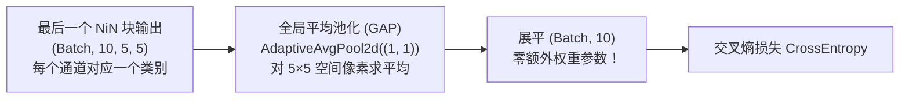

> 导航：[[7.2 使用块的网络（VGG）| 上一节: 7.2 使用块的网络（VGG）]] | [[7.4 含并行连结的网络（GoogLeNet）| 下一节: 7.4 含并行连结的网络（GoogLeNet）]]

---

# 网络中的网络（Network in Network, NiN）

在 AlexNet 和 VGG 时代，经典卷积神经网络确立了“**前端卷积提取空间特征 + 后端全连接执行分类决策**”的两段式架构范式。

然而，在上一节对 VGG-11 的参数统计中，我们遭遇了一个触目惊心的事实：
**前 8 个卷积层仅仅占了全网 7.16% 的参数，后 3 个全连接层却霸占了整整 92.84%（近 1.2 亿）的参数！**

![[slide_223_dense_layer_parameter_problem.png]]

传统全连接层的致命缺陷：
1. **参数黑洞与过拟合灾难**：
   - LeNet 首个全连接层：$16 \times 5 \times 5 \times 120 = 4.8$ 万参数；
   - AlexNet 首个全连接层：$256 \times 5 \times 5 \times 4096 = 2621$ 万参数；
   - VGG 首个全连接层：$512 \times 7 \times 7 \times 4096 = 10276$ 万参数（**破亿！**）。
   巨额参数不仅耗尽 GPU 显存与内存带宽，更极易引发严重的过拟合。
2. **破坏二维空间拓扑结构**：
   `Flatten()` 强行将 3D 特征张量（$C \times H \times W$）拉成一维长向量，彻底割裂了图像固有的局部空间邻域关联。
3. **传统卷积窗口通道交互能力孱弱**：
   传统卷积核在滑动窗口内执行的是线性点积求和，通道维度的特征混合仅仅是简单的线性加权叠加。

针对上述两大瓶颈，新加坡国立大学的 Min Lin、Qiang Chen 和 Shuicheng Yan 于 2013 年发表了里程碑级论文 *Network In Network*，提出了 **NiN**。NiN 带来了现代深度卷积网络中最具颠覆性的两大创新：
- **$1\times1$ 卷积（逐像素多层感知机 MLPconv）**：开创通道维度的非线性重组与自由升降维；
- **全局平均池化（Global Average Pooling, GAP）**：彻底消灭全连接层，以“0 参数”完成类别打分！

---

## 1. 核心创新一：NiN 块与 $1\times1$ 卷积（微型 MLP）

![[slide_223_mlpconv_concept.png]]

### 1.1 MLPconv 的哲学理念：在局部感受野内嵌入微型网络
传统卷积网络可以被视为“线性卷积单元 + 非线性激活”的浅层组合。对于复杂的抽象概念，线性组合的表达能力有限。
NiN 的设计哲学是：**在每一个局部感受野内部，嵌入一个微型的多层感知机（MLP），在特征图的通道维度上对每个像素点进行深度的非线性特征抽象！**

```
【传统卷积窗口】:  [局部感受野] ──(线性加权)──> [ReLU] ──> [单个特征值]

【NiN MLPconv】: [局部感受野] ──(常规卷积)──> [像素向量] ──(微型MLP: 2层1×1卷积)──> [高度抽象特征]
```

![[slide_223_nin_block_definition.png]]

---

### 1.2 $1\times1$ 卷积的数学本质：跨通道逐像素全连接

当卷积核尺寸设定为 $1\times1$ 时，感受野内只包含单个像素 $(i, j)$。对于输入特征图 $X \in \mathbb{R}^{C_{in} \times H \times W}$，输出特征图 $Y \in \mathbb{R}^{C_{out} \times H \times W}$ 的计算公式为：
$$
Y_{c_{out}, i, j} = \sum_{c_{in}=1}^{C_{in}} X_{c_{in}, i, j} \cdot W_{c_{out}, c_{in}} + b_{c_{out}}
$$

> 💡 **数学等价性证明**：
> 固定任意空间坐标 $(i, j)$，该位置跨所有通道的特征值构成一个一维向量 $\mathbf{x} \in \mathbb{R}^{C_{in}}$。
> $1\times1$ 卷积在这一位置执行的运算为：
> $$
> \mathbf{y} = \mathbf{W} \mathbf{x} + \mathbf{b} \quad (\mathbf{W} \in \mathbb{R}^{C_{out} \times C_{in}})
> $$
> 这在数学上**严格等价于一个作用在每个像素通道向量上的标准全连接层（Dense Layer）**！

#### $1\times1$ 卷积的三大超能力：
1. **跨通道非线性融合（Cross-Channel Feature Interaction）**：在空间位置完全锁定的前提下，让不同通道的特征自由混合并施加 ReLU，增强特征抽象能力；
2. **灵活升降通道维度（Channel Dimensionality Control）**：通过设定 $C_{out}$，能够像水龙头阀门一样任意压缩或扩充通道数（这成为了后续 GoogLeNet Inception 瓶颈层与 ResNet 瓶颈块的绝对核心）；
3. **保持空间长宽严格不变**：步幅 $s=1$、填充 $p=0$ 的 $1\times1$ 卷积绝对不改变 $H \times W$。

---

### 1.3 `nin_block` 代码实现规范

一个标准的 NiN 块包含：
- **1 个常规卷积层**：负责提取局部空间几何特征（如 $11\times11, 5\times5, 3\times3$），后接 ReLU；
- **2 个连续的 $1\times1$ 卷积层**：充当两层跨通道的逐像素 MLP（全连接隐藏层 + 输出层），每个 $1\times1$ 卷积后紧跟 ReLU。

```python
import torch
from torch import nn

def nin_block(in_channels, out_channels, kernel_size, strides, padding):
    """
    构建标准 NiN 块:
    包含 1 个常规卷积 (空间几何建模) + 2 个 1x1 卷积 (通道级 MLP 深度融合)
    """
    return nn.Sequential(
        nn.Conv2d(in_channels, out_channels, kernel_size, strides, padding),
        nn.ReLU(),
        nn.Conv2d(out_channels, out_channels, kernel_size=1),
        nn.ReLU(),
        nn.Conv2d(out_channels, out_channels, kernel_size=1),
        nn.ReLU()
    )
```

---

## 2. 核心创新二：全局平均池化（GAP）——彻底敲碎全连接枷锁

全连接层的致命原罪在于：它要求把深层特征图的所有像素和通道硬生生拉平，与巨型全连接矩阵全互连。

![[slide_223_gap_3d_spatial_averaging.png]]

### 2.1 GAP 的运作机制（极简与零参数）

NiN 提出了极其优雅的解决方案——**全局平均池化（Global Average Pooling, GAP）**：
1. **最后一层的通道数直接设定为分类类别数 $K$**（如 Fashion-MNIST 为 10 类，ImageNet 为 1000 类）。
   输出特征图尺寸为 $(B, K, H, W)$；
2. 此时，**第 $k$ 个通道的整个 $H \times W$ 二维特征图，就代表了网络对“第 $k$ 个类别”的空间置信度热力图（Category Activation Map）**；
3. **空间全局均值求和**：对每个通道的所有空间像素求算术平均值：
   $$
   \hat{y}_{b, k} = \frac{1}{H \times W} \sum_{i=1}^H \sum_{j=1}^W X_{b, k, i, j}
   $$
   将 $(B, K, H, W)$ 直接压缩为 $(B, K, 1, 1)$，展平后即为最终的分类对数几率（Logits）！



---

### 2.2 GAP 相比传统全连接层的四大压倒性优势

| 比较维度 | 传统全连接层（Dense / FC） | 全局平均池化（GAP） |
| :--- | :--- | :--- |
| **权重参数量** | 动辄数千万至上亿（如 VGG FC1 独占 1.02 亿） | **严格等于 0！无任何权重参数** |
| **过拟合倾向** | 极高（参数黑洞，必须依赖 50% Dropout 续命） | **天然结构正则化（Structural Regularizer），极难过拟合** |
| **空间拓扑保留** | 暴力展平，彻底摧毁局部空间拓扑关联 | 允许特征图在空间上自由响应，最后取平均，保持空间不变性 |
| **输入尺寸灵活性** | 固定死输入尺寸（$224\times224$），高宽变动矩阵即报错 | **尺寸完全自适应**（无论输入图像多大，平均后恒为 $1\times1$） |
| **可解释性** | 权重黑盒，无法溯源各神经元物理意义 | **直观可解释**：每个通道直连一个类别，天然催生 CAM 热力图 |

---

## 3. NiN 宏观网络架构与 VGG 对比

![[slide_223_nin_macro_architecture.png]]

![[slide_223_vgg_vs_nin_comparison.png]]

### 3.1 架构宏观对照
- **AlexNet / VGG 范式**：卷积层 $\to$ 池化层 $\to$ 卷积层 $\to$ 池化层 $\dots \to$ **巨型 Flatten** $\to$ **FC 4096** $\to$ **FC 4096** $\to$ **FC 10**
- **NiN 范式**：NiN 块 $\to$ 池化 $\to$ NiN 块 $\to$ 池化 $\dots \to$ **最终类别 NiN 块 (10通道)** $\to$ **GAP** $\to$ **输出 10**

### 3.2 NiN 网络完整拓扑结构
NiN 整体由 **4 个 NiN 块** 和 **最大池化层** 交替级联组成，卷积核尺寸继承自 AlexNet（$11\times11, 5\times5, 3\times3$）：
1. **NiN 块 1**：$11\times11$ 卷积（步幅 4，无填充，96 通道）+ 2 个 $1\times1$ 卷积；后接 $3\times3$ 最大池化（步幅 2）；
2. **NiN 块 2**：$5\times5$ 卷积（填充 2，256 通道）+ 2 个 $1\times1$ 卷积；后接 $3\times3$ 最大池化（步幅 2）；
3. **NiN 块 3**：$3\times3$ 卷积（填充 1，384 通道）+ 2 个 $1\times1$ 卷积；后接 $3\times3$ 最大池化（步幅 2）；后接 Dropout(0.5)；
4. **NiN 块 4**：$3\times3$ 卷积（填充 1，输出通道为**类别数 10**）+ 2 个 $1\times1$ 卷积；
5. **全局平均池化（GAP）**：`nn.AdaptiveAvgPool2d((1, 1))` 将高宽压缩为 $1\times1$；
6. **展平（Flatten）**：输出 $(B, 10)$。

---

## 4. 四维元认知模型总结

| 思考维度 | NiN 的核心诠释 |
| :--- | :--- |
| **是什么 (What)** | 现代深度 CNN 参数瘦身的革命性架构。核心由两部分构成：**包含 $1\times1$ 卷积的 NiN 块** + **替代全连接层的全局平均池化（GAP）**。 |
| **为什么 (Why)** | 彻底打破全连接层霸占 90%+ 参数与引发过拟合的困局；利用 $1\times1$ 卷积在每个像素通道维度上实现高阶非线性交互与维度变换。 |
| **怎么做 (How)** | 1. 定义 `nin_block(in_c, out_c, k, s, p)`，用 1 个常规卷积接 2 个 $1\times1$ 卷积；<br>2. 最后一个 NiN 块输出通道设为类别数 $K$；<br>3. 接 `nn.AdaptiveAvgPool2d((1, 1))` 进行全图空间平均并 `Flatten`。 |
| **核心性质与守恒定律 (Properties & Invariants)** | 1. **等价仿射性**：$1\times1$ 卷积在单像素上与全连接层完全等价，是“共享权重的逐像素点全连接”；<br>2. **零参数分类定律**：GAP 是完全无参的固定统计操作，分类头参数量恒等于 0；<br>3. **参数剧减定律**：相比 AlexNet/VGG，NiN 在保持同等表征能力下，**全网参数暴跌 95% ~ 98%**！ |

---

## 5. PyTorch 完整代码实操与 GPU 验证

本地验证脚本位于 `C:\Users\32802\PycharmProjects\pytorch_test\7.3.py`，经 NVIDIA GeForce RTX 4050 Laptop GPU 实测验证通过。

### 5.1 完整网络架构定义

```python
import torch
from torch import nn

def nin_block(in_channels, out_channels, kernel_size, strides, padding):
    return nn.Sequential(
        nn.Conv2d(in_channels, out_channels, kernel_size, strides, padding),
        nn.ReLU(),
        nn.Conv2d(out_channels, out_channels, kernel_size=1),
        nn.ReLU(),
        nn.Conv2d(out_channels, out_channels, kernel_size=1),
        nn.ReLU()
    )

def get_nin_net(num_classes=10, in_channels=1):
    return nn.Sequential(
        nin_block(in_channels, 96, kernel_size=11, strides=4, padding=0),
        nn.MaxPool2d(kernel_size=3, stride=2),
        nin_block(96, 256, kernel_size=5, strides=1, padding=2),
        nn.MaxPool2d(kernel_size=3, stride=2),
        nin_block(256, 384, kernel_size=3, strides=1, padding=1),
        nn.MaxPool2d(kernel_size=3, stride=2),
        nn.Dropout(0.5),
        # 标签类别数是 10
        nin_block(384, num_classes, kernel_size=3, strides=1, padding=1),
        nn.AdaptiveAvgPool2d((1, 1)),
        nn.Flatten()
    )
```

---

### 5.2 逐层张量形状检查（Shape Inspection）

传入单通道样本 `(1, 1, 224, 224)`：

```text
======================================================================
一、NiN 网络逐层张量形状检查 (Shape Inspection)
======================================================================
层  1 [Sequential        ] 输出形状:	[1, 96, 54, 54]
层  2 [MaxPool2d         ] 输出形状:	[1, 96, 26, 26]
层  3 [Sequential        ] 输出形状:	[1, 256, 26, 26]
层  4 [MaxPool2d         ] 输出形状:	[1, 256, 12, 12]
层  5 [Sequential        ] 输出形状:	[1, 384, 12, 12]
层  6 [MaxPool2d         ] 输出形状:	[1, 384, 5, 5]
层  7 [Dropout           ] 输出形状:	[1, 384, 5, 5]
层  8 [Sequential        ] 输出形状:	[1, 10, 5, 5]
层  9 [AdaptiveAvgPool2d ] 输出形状:	[1, 10, 1, 1]
层 10 [Flatten           ] 输出形状:	[1, 10]
```

---

### 5.3 震撼的参数量对比：彻底打破全连接黑洞

```text
======================================================================
二、参数量对比：NiN  vs AlexNet vs VGG-11 (彻底粉碎全连接黑洞)
======================================================================
NiN 全网总参数量:            1,992,166 (~1.99 M)
AlexNet 全网参数量:         46,765,482 (~46.8 M, 全连接占 92%)
VGG-11  全网参数量:        128,806,154 (~128.8 M, 全连接占 93%)
----------------------------------------------------------------------
💡 参数削减结论: NiN 相比 AlexNet 参数削减了 95.7%！
💡 参数削减结论: NiN 相比 VGG-11  参数削减了 98.5%！
```

**GPU 本机前向推理实测**：
```text
当前计算设备: cuda (NVIDIA GeForce RTX 4050 Laptop GPU)
NiN 在 GPU 上前向推理成功! 批量大小: 32, 输出形状: [32, 10]
```

---

## 6. 深入思考与高频疑难解析（Q&A 认知结晶）

### Q1: 既然 $1\times1$ 卷积感受野永远是 1，不能捕获空间几何信息，为什么它在深度学习中被称为“万能神药”？
* **解答**：
  必须深刻认识到空间特征与通道特征的职能分工：
  - 常规卷积（$3\times3, 5\times5$）擅长在**空间平面**上提取边缘、角点、纹理几何模式；
  - 但多通道之间如何有效配合？传统卷积只有简单的线性累加。
  - **$1\times1$ 卷积是通道维度的“超级调酒师”**：它像穿羊肉串一样，沿着深度方向把所有通道的特征穿起来做全连接融合，并注入非线性 ReLU；
  - 更关键的是：它可以**任意升降通道数**！后续 GoogLeNet 和 ResNet 正是依靠 $1\times1$ 卷积先将 256 通道压缩到 64 通道，做完昂贵的 $3\times3$ 卷积后再用 $1\times1$ 卷积还原，从而节约了数倍的计算量！

---

### Q2: 为什么 NiN 块中要用两个连续的 $1\times1$ 卷积，而不是一个？
* **解答**：
  - 单个 $1\times1$ 卷积：相当于单层线性感知机加一次激活函数；
  - 两个连续的 $1\times1$ 卷积：第一层 $1\times1$ 充当**隐藏层**，第二层 $1\times1$ 充当**输出层**。
  - 根据多层感知机（MLP）理论，单层感知机只能拟合简单的超平面；而**包含一个隐藏层的两层 MLP 具备通用函数拟合能力**，能够学习任意极其复杂的跨通道非线性关系。因此，NiN 块本质上是在每一个像素位置植入了一个微型的双层 MLP！

---

### Q3: GAP 把 $5\times5$ 的二维特征图粗暴地压缩为一个平均数，难道不会把精细的空间位置信息全部丢掉吗？
* **解答**：
  - **分类任务的根本诉求**：图像分类的核心目标是回答“**是什么（What）**”，而不是“**在哪里（Where）**”。一只猫无论出现在图片的左上角还是右下角，整张图片的标签都是“猫”；
  - **位置平移不变性（Translation Invariance）**：GAP 通过在空间所有位置求平均，把特征激活强度与具体的坐标彻底解耦，天然获得了完美的空间平移不变性；
  - **抑制局部过拟合**：全连接层会死记“第 (3,4) 像素有眼睛、第 (5,6) 像素有鼻子”，换张姿势就认不出了；而 GAP 关注的是“整张特征图上到底有没有眼睛的特征响应”，因而泛化性能极强。

---

### Q4: 为什么 GAP 比 Dropout 拥有更强的抗过拟合能力？
* **解答**：
  - Dropout 是一种**后验修剪启发式正则化**：全连接层依然拥有上亿个冗余参数，只是在训练时随机屏蔽 50% 的神经元，模型容量依然庞大；
  - GAP 是一种**先验结构级正则化（Structural Regularizer）**：它直接从网络结构上把上亿个自由度抹杀为 0！模型根本不存在可以用来死记硬背训练样本细节的权重矩阵，从物理上断绝了过拟合的土壤。

---

### Q5: 既然 GAP 这么完美，为什么后续的 GoogLeNet 和 ResNet 没有完全照搬 NiN，而是采用了“GAP + 1 个 Linear(512, 1000)”？
* **解答**：
  这是工程实践探索出的最佳折衷：
  - NiN 的做法极其纯粹：强制要求最后一个 NiN 块的通道数等于类别数（如 1000），然后直接 GAP。这会导致第 4 块必须把通道数从 384 剧烈跃迁到 1000（或压缩到 10），**网络最后一层的优化负担极其沉重**；
  - ResNet / GoogLeNet 的现代标准方案：保持最后一个卷积块输出为较通用的丰富特征（如 512 或 2048 通道），先通过 GAP 压缩为 $(B, 2048, 1, 1) \to (B, 2048)$，最后**仅接一个单层的 `nn.Linear(2048, num_classes)`**；
  - 这种设计既保留了 GAP 消除高维空间展平的全部优点，又通过一个小矩阵提供了灵活分类映射空间，参数量仅增加几十万，兼得两家之长。

---

## 7. 课后习题完整参考解答

### 练习 1：调整 NiN 的超参数，以提高分类准确性。
* **参考思路**：
  1. **调整卷积核与步幅**：NiN 第一层原版采用 $11\times11$ 卷积（步幅 4），源自 AlexNet。在 Fashion-MNIST 等较小图片上，将其替换为现代化的 $3\times3$ 或 $5\times5$（步幅 1 或 2），大幅保留高分辨率空间几何细节；
  2. **增加通道平滑度**：将通道梯度由 $(96, 256, 384, 10)$ 调整为更平缓的 $(64, 128, 256, 512, 10)$；
  3. **优化学习率调度**：引入余弦退火（Cosine Annealing）学习率调度，初始 lr 设为 0.1。

---

### 练习 2：为什么 NiN 块中有两个 $1\times1$ 卷积层？删除其中一个，观察和分析实验现象。
* **参考答案**：
  - **理论分析**：
    如 Q2 所述，两个 $1\times1$ 卷积构成了一个具备完整隐藏层的“微型两层多层感知机（MLP）”。第一层做通道特征映射与降维/升维，第二层做高阶特征非线性提炼；
  - **实验现象**：
    若删除一个 $1\times1$ 卷积，NiN 块内部退化为一个单层通道线性变换。由于缺乏足够的非线性深度，通道交互的特征拟合容量显著下降，在相同训练轮数下，训练集损失下降变慢，测试集准确率出现约 1%~2% 的可察觉下滑。

---

### 练习 3：计算 NiN 的资源使用：参数数量、计算量（FLOPs）、显存占用。
* **参考答案**：
  1. **参数数量**：全网总参数量仅为 **$1,992,166$（约 1.99 M）**，主要集中在 Block 2 和 Block 3 的卷积核中；
  2. **计算量（FLOPs）**：NiN 并没有全连接层的矩阵相乘，但由于前几个块包含 $11\times11$ 和 $5\times5$ 卷积以及密集的 $1\times1$ 卷积，单张图像的前向计算量约为 **0.78 GFLOPs**；
  3. **显存占用（Memory Footprint）**：
     - **训练期间**：由于前向传播需要缓存每一层卷积和激活后的特征图用于反向求导，Batch Size=128 时大约需要 1.5GB ~ 2GB 显存；
     - **预测期间**：无需保存中间梯度与激活，仅需前向单向推进，显存占用低于 200MB。

---

### 练习 4：一次性将 $384 \times 5 \times 5$ 的表示减少到 $10 \times 5 \times 5$ 的表示，会产生什么问题？
* **参考答案**：
  - **信息颈缩效应（Information Bottleneck）**：
    从 384 个通道骤降至 10 个通道，通道数缩减了整整 97.4%！如果直接暴力压缩，强行逼迫网络用极少的 10 个通道来概括所有丰富的语义空间，会造成严重的特征信息损耗；
  - **梯度反向传播阻滞**：
    维度急剧剧变会导致反向传播回流的梯度方差增大，浅层特征提取器难以接收到细腻的误差反馈；
  - **现代化解决方案**：
    后序架构（如 GoogLeNet / ResNet）均采用渐进式收缩，或者在最后一层保持较高通道数（如 512 维），在 GAP 之后再投影到 10 类，避免过早陷入通道信息窒息。

---

## 8. 章节小结与认知升华

![[slide_223_summary.png]]

* **$1\times1$ 卷积的深远遗产**：NiN 赋予了 $1\times1$ 卷积“跨通道全连接”的现代定义，它是深度学习从“空间几何探索”走向“通道特征维度工程”的转折点，直接孕育了 GoogLeNet Inception 和 ResNet Bottleneck。
* **全连接层的终结者**：全局平均池化（GAP）用最极简的“零参数空间求均值”，彻底粉碎了统治视觉领域十余年的巨型全连接层，使参数量暴降 95% 以上，成为现代 CNN 的工业标配。
* **下一站预告**：NiN 证明了 $1\times1$ 卷积控制通道的魔力，但网络依然是单路串联的。**下一节《7.4 含并行连结的网络（GoogLeNet）》将把 $1\times1$ 卷积与多尺度并行分支融为一体，发明惊艳学术界的 Inception 架构！**
