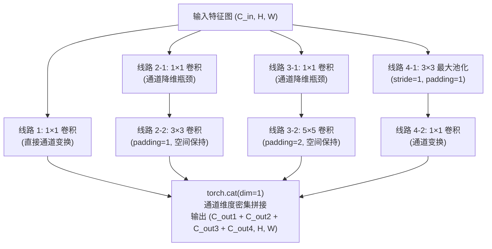
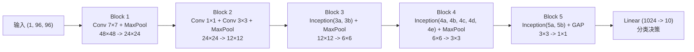

> 导航：[[7.3 网络中的网络（NiN）| 上一节: 7.3 网络中的网络（NiN）]] | [[7.5 批量规范化（Batch Normalization）| 下一节: 7.5 批量规范化（Batch Normalization）]]

---

# 含并行连结的网络（GoogLeNet）

在 2014 年的 ImageNet 挑战赛（ILSVRC-2014）中，由 Christian Szegedy 等人设计的 **GoogLeNet** 斩获冠军。GoogLeNet 借鉴了 NiN 中微型网络（$1\times1$ 卷积）与全局平均池化的思想，并从根本上重塑了卷积层拓扑结构。

在以往的网络设计中，工程师必须面对一个两难抉择：**针对特定任务，究竟多大尺寸的卷积核最合适？**
* $1\times1$ 卷积核善于提取通道信息并保持微小空间局部性；
* $3\times3$ 和 $5\times5$ 卷积核善于覆盖更广阔的上下文空间感受野；
* 池化层善于保留主导显著性并降低空间分辨率。

GoogLeNet 提出了极具启发性的思路：**不再主观二选一，而是将多种不同尺寸的卷积核并行组合在同一个模块内，由网络自主决定如何融合不同尺度的特征信息**。这一模块被命名为 **Inception 块**。

---

## 1. Inception 块：多尺度并行感知与瓶颈降维



### 1.1 四条并行线路的设计分工
1. **线路 1（$1\times1$ 卷积）**：抽取最基础的逐像素跨通道特征，保持空间分辨率；
2. **线路 2（$1\times1$ 降维 $\to 3\times3$ 卷积）**：捕捉中等尺度的局部纹理与结构；
3. **线路 3（$1\times1$ 降维 $\to 5\times5$ 卷积）**：覆盖更大范围的上下文语境；
4. **线路 4（$3\times3$ 最大池化 $\to 1\times1$ 卷积）**：保留局部的极值显著性特征，且池化后步幅设为 1、填充设为 1，确保空间高宽不发生下采样。

所有的分支均精确配置了填充参数（$3\times3$ 设 $P=1$，$5\times5$ 设 $P=2$），因此四条线路输出的特征图具有**严格完全相同的高度和宽度**。最终在通道维度（`dim=1`）执行 `torch.cat` 拼接。

---

### 1.2 核心数学证明：$1\times1$ 卷积“瓶颈降维”的计算量缩减

如果不引入 $1\times1$ 卷积，直接让高通道特征图输入 $5\times5$ 卷积，计算开销将不堪设想。

* **场景假设**：输入张量为 $H \times W = 28 \times 28$，输入通道数 $C_{in} = 192$，目标输出通道数 $C_{out} = 32$。

#### 方案 A：直接执行 $5\times5$ 卷积（无瓶颈层）
* 权重参数量：$5 \times 5 \times 192 \times 32 = 153,600$
* 浮点乘加运算量（FLOPs）：
  $$\text{FLOPs}_A = 28 \times 28 \times 153,600 \approx \mathbf{120.4 \times 10^6 \ (120.4\text{ MFLOPs})}$$

#### 方案 B：先经 $1\times1$ 降维至 16 通道，再执行 $5\times5$ 卷积（Inception 瓶颈设计）
1. **第一步：$1\times1$ 卷积降维（$192 \to 16$）**：
   * 参数量：$1 \times 1 \times 192 \times 16 = 3,072$
   * 运算量：$28 \times 28 \times 3,072 \approx 2.41\text{ MFLOPs}$
2. **第二步：$5\times5$ 卷积提特征（$16 \to 32$）**：
   * 参数量：$5 \times 5 \times 16 \times 32 = 12,800$
   * 运算量：$28 \times 28 \times 12,800 \approx 10.04\text{ MFLOPs}$
3. **合计总运算量**：
   $$\text{FLOPs}_B = 2.41\text{ MFLOPs} + 10.04\text{ MFLOPs} = \mathbf{12.45 \times 10^6 \ (12.45\text{ MFLOPs})}$$

* **优化结论**：
  $$\frac{\text{FLOPs}_B}{\text{FLOPs}_A} = \frac{12.45}{120.4} \approx 10.3\%$$
  **计算量直接暴跌近 90%！** 同时，在 $1\times1$ 卷积之后还多引入了一次非线性激活函数（ReLU），在大幅降低算力消耗的同时，显著增强了网络的非线性表达容量。

---

### 1.3 `Inception` 模块 PyTorch 实现

```python
import torch
from torch import nn
from torch.nn import functional as F

class Inception(nn.Module):
    # c1--c4 分别为四条路径的输出通道数，c2 和 c3 为包含降维与卷积通道数的元组
    def __init__(self, in_channels, c1, c2, c3, c4, **kwargs):
        super(Inception, self).__init__(**kwargs)
        # 线路 1: 单 1x1 卷积层
        self.p1_1 = nn.Conv2d(in_channels, c1, kernel_size=1)
        # 线路 2: 1x1 卷积层后接 3x3 卷积层
        self.p2_1 = nn.Conv2d(in_channels, c2[0], kernel_size=1)
        self.p2_2 = nn.Conv2d(c2[0], c2[1], kernel_size=3, padding=1)
        # 线路 3: 1x1 卷积层后接 5x5 卷积层
        self.p3_1 = nn.Conv2d(in_channels, c3[0], kernel_size=1)
        self.p3_2 = nn.Conv2d(c3[0], c3[1], kernel_size=5, padding=2)
        # 线路 4: 3x3 最大汇聚层后接 1x1 卷积层
        self.p4_1 = nn.MaxPool2d(kernel_size=3, stride=1, padding=1)
        self.p4_2 = nn.Conv2d(in_channels, c4, kernel_size=1)

    def forward(self, x):
        p1 = F.relu(self.p1_1(x))
        p2 = F.relu(self.p2_2(F.relu(self.p2_1(x))))
        p3 = F.relu(self.p3_2(F.relu(self.p3_1(x))))
        p4 = F.relu(self.p4_2(self.p4_1(x)))
        # 在通道维度上密集连结输出
        return torch.cat((p1, p2, p3, p4), dim=1)
```

---

## 2. GoogLeNet 整体架构：五阶递进设计

GoogLeNet 整体由 5 个模块（Block）串联组成，包含 **9 个 Inception 块**与全局平均池化（GAP）：



### 2.1 模块分级详析（输入 $1 \times 96 \times 96$）

1. **模块 1 (`b1`)**：
   * `Conv2d(1, 64, kernel_size=7, stride=2, padding=3)`：快速下采样至 $48\times48$；
   * `MaxPool2d(kernel_size=3, stride=2, padding=1)`：下采样至 $24\times24$。
2. **模块 2 (`b2`)**：
   * `Conv2d(64, 64, kernel_size=1)` 升维准备；
   * `Conv2d(64, 192, kernel_size=3, padding=1)`：输出通道扩充为 192；
   * `MaxPool2d(kernel_size=3, stride=2, padding=1)`：下采样至 $12\times12$。
3. **模块 3 (`b3`)：包含 2 个 Inception 块**：
   * `Inception(192, 64, (96, 128), (16, 32), 32)` $\to$ 输出通道 $64+128+32+32 = 256$；
   * `Inception(256, 128, (128, 192), (32, 96), 64)` $\to$ 输出通道 $128+192+96+64 = 480$；
   * `MaxPool2d` 下采样至 $6\times6$。
4. **模块 4 (`b4`)：包含 5 个 Inception 块**：
   * 依次堆叠 Inception 4a 到 4e，通道数演进为：$512 \to 512 \to 512 \to 528 \to 832$；
   * `MaxPool2d` 下采样至 $3\times3$。
5. **模块 5 (`b5`)：包含 2 个 Inception 块与输出头**：
   * Inception 5a（832 通道）与 Inception 5b（1024 通道）；
   * `AdaptiveAvgPool2d((1, 1))`：将 $3\times3$ 压缩为标量 $1\times1$；
   * `nn.Flatten()` + `nn.Linear(1024, 10)`。

---

## 3. 全景参数量与算力指标横向演进对比

在深度达到 **22 层**的极深结构下，GoogLeNet 通过模块化瓶颈降维与 GAP，展现出了难以置信的参数利用率：

| 模型架构 | 深度 (层数) | 核心特征提取范式 | 参数总量 (Params) | 相较 AlexNet 压缩比 |
| :--- | :---: | :--- | :---: | :---: |
| **LeNet-5 (1998)** | 5 | 小核卷积 + 平均池化 + Sigmoid | 0.06 M (60K) | - |
| **AlexNet (2012)** | 8 | 异构卷积 + 重复下采样 + 密集全连接 | 46.76 M | 基线 (1x) |
| **VGG-11 (2014)** | 11 | $3\times3$ 模块化堆叠 + 密集全连接 | 128.81 M | +175% (更重) |
| **NiN (2013)** | - | $1\times1$ 逐像素 MLP + 废除全连接 (GAP) | 1.99 M | **-95.7%** |
| **GoogLeNet (2014)** | **22** | **Inception 多尺度并行分支 + 瓶颈降维 + GAP** | **5.98 M** | **-87.2%** |

> [!important] 架构启示
> GoogLeNet 在层数比 AlexNet 增加近 3 倍、分类精度断崖式领先的情况下，**参数量仅为 AlexNet 的约 12%，仅为 VGG-11 的不足 5%**！
> 这宣告了深度学习正式从“依靠暴力堆砌参数”转向“依靠高维数学架构优化提升算力效率”的新阶段。

---

## 4. 课后练习与工程深度思考

### 1. GoogLeNet 支持的最小输入图像分辨率是多少？
* **解答**：
  * 在网络完整流水线中，空间分辨率经历如下 5 次步幅为 2 的最大池化下采样：
    $$H_{in} \xrightarrow{\div 2} H_1 \xrightarrow{\div 2} H_2 \xrightarrow{\div 2} H_3 \xrightarrow{\div 2} H_4 \xrightarrow{\div 2} H_5$$
  * 累计下采样因子为 $2^5 = 32$ 倍。
  * 若输入尺寸小于 $32\times32$（例如 $28\times28$），在经过第 5 次池化前特征图空间高宽将跌破 1，导致卷积核无法合法滑动并报错。
  * 因此，**GoogLeNet 支持的最小输入高宽为 $32\times32$**。在教材实验中，将 Fashion-MNIST 由 $28\times28$ 双三次插值调整为 $96\times96$，确保在进入 GAP 前特征图保留为 $3\times3$，避免过早空间退化。

### 2. 原版 GoogLeNet 论文中的辅助分类器（Auxiliary Classifiers）起到了什么作用？为什么教材实现中可以省略？
* **解答**：
  * **作用机理**：2014 年在 22 层极深网络中，反向传播经过数十层连续链式求导后，底层极易发生梯度衰减。原版论文在 Inception 4a 和 4d 之后引出两条辅助分类分支，计算交叉熵损失并以 0.3 的权重叠加到总损失中（$\mathcal{L}_{\text{total}} = \mathcal{L}_{\text{main}} + 0.3 \mathcal{L}_{\text{aux1}} + 0.3 \mathcal{L}_{\text{aux2}}$），将监督信号直接注入网络中部，强化中浅层梯度回传。
  * **省略原因**：在随后的研究中，**批量规范化（Batch Normalization）**技术以及更稳定的权重初始化方法（如 Kaiming 初始化）被提出，彻底从根本上稳定了深层梯度流动，辅助分类器的历史使命随之终结。

### 3. Inception 家族的后续演进脉络是什么？
* **Inception-v2 / v3**：
  * 引入批量规范化（BatchNorm）；
  * **卷积核非对称分解**：将 $5\times5$ 分解为两个连续的 $3\times3$；进一步将 $n\times n$ 卷积分解为 $1\times n$ 后接 $n\times 1$（如 $1\times7 + 7\times1$），将计算复杂度从 $O(n^2)$ 削减至 $O(2n)$。
* **Inception-v4 / Inception-ResNet**：
  * 将何恺明提出的**残差短路连结（Residual Connections）**融入 Inception 块内部，极大加快了超深 Inception 网络的训练收敛速度。
