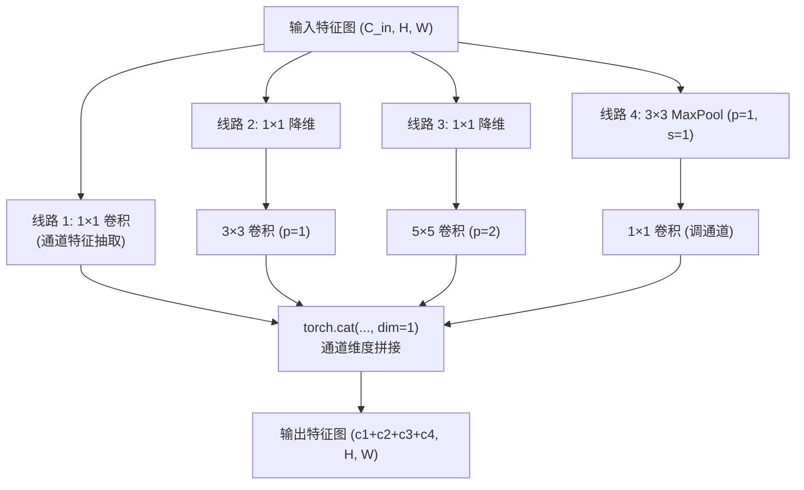

> 导航：[[7.3 网络中的网络（NiN）| 上一节: 7.3 网络中的网络（NiN）]] | [[7.5 批量规范化（Batch Normalization）| 下一节: 7.5 批量规范化（Batch Normalization）]]

---

# 含并行连结的网络（GoogLeNet）

在 2014 年的 ImageNet 挑战赛（ILSVRC 2014）中，深度学习架构设计迎来了两座并立的巅峰：
- **牛津大学的 VGG**（分类亚军）：主张“大道至简”，全网单路串联，堆叠统一的 $3\times3$ 卷积块，但代价是模型重达 **1.3 亿参数**；
- **Google 团队的 GoogLeNet**（分类冠军）：Christian Szegedy 等人发表论文 *Going Deeper with Convolutions*，提出了**含并行连结的 Inception 网络**。它达到了前所未有的 **22 层深度**（超过 VGG-19），但参数量却只有 **约 600 万（仅为 AlexNet 的 1/8，VGG 的 1/20）**！

GoogLeNet 致敬了 Yann LeCun 的 LeNet，其核心突破在于：**彻底打破了传统网络单一卷积核串联的结构，开创了“多尺度并行卷积分支”与“$1\times1$ 瓶颈降维”的架构范式。**

---

## 1. 认知升级：为什么需要“并行多尺度连结”？

### 1.1 传统单路卷积的现实困局
在设计卷积层时，架构师永远面临一个两难的超参数抉择：
- 用 $1\times1$ 卷积？只看通道，没有空间视野；
- 用 $3\times3$ 卷积？适合捕捉局部小物体和细腻纹理；
- 用 $5\times5$ 或更大卷积？适合捕捉大物体和全局轮廓，但计算量极其昂贵。

然而，**现实世界图像中的目标物体尺寸是极其多变的**：
一幅图像里可能既有一只占据半个画面的大狗（需要大感受野），背景里又有一只远处细小飞鸟（需要小感受野）。**无论你把卷积核固定为多大，都会损失其他尺度的信息。**

### 1.2 Inception 的哲学：“大人全都要，让网络自己选”
既然在设计阶段无法预知哪个尺寸的卷积核最好，GoogLeNet 采取了极具创造力的并联设计：
> **在同一层特征图上，同时并行执行 $1\times1$、$3\times3$、$5\times5$ 卷积和最大池化操作！**
> 让不同的分支分别提取不同尺度的空间几何与通道特征，最后在通道维度强行拼接（Concat），由反向传播算法自己去学习各个尺度的最优权重组合！

---

## 2. Inception 块（Inception Block）设计与 $1\times1$ 瓶颈降维

![[slide_224_cell_1.png]]

### 2.1 朴素 Inception 块的致命算力陷阱
如果直接将不同尺寸的卷积核并行组合（朴素版本），会引发恐怖的**算力爆炸**。
假设输入特征图为 $256$ 通道，输出也为 $256$ 通道：
- 直接做一个 $5\times5$ 卷积，参数量高达：$5 \times 5 \times 256 \times 256 \approx 164$ 万！
如果并联几个这样的分支，计算量（FLOPs）会瞬间瘫痪 GPU。

---

### 2.2 破局神技：$1\times1$ 卷积作为“瓶颈降维层（Bottleneck）”

GoogLeNet 巧妙吸纳了上一节 NiN 的核心资产——**$1\times1$ 卷积**：
在昂贵的 $3\times3$ 和 $5\times5$ 卷积之前，**先用一个 $1\times1$ 卷积将通道数从 256 压缩至 64 或 16（通道降维）**；在极低维的通道空间内执行大尺度卷积后，再输出！

![[slide_224_cell_3.png]]

#### 算力节省数学精算（为什么瓶颈层能救命？）：
设输入通道 $C_{in} = 256$，目标输出通道 $C_{out} = 128$：
1. **方案 A：直接执行 $5\times5$ 卷积**：
   $$\text{Params} = 5 \times 5 \times 256 \times 128 = \mathbf{819,200}$$
2. **方案 B：Inception 瓶颈设计（先 $1\times1$ 降至 32，再 $5\times5$）**：
   - 第 1 步（$1\times1$ 降维）：$1 \times 1 \times 256 \times 32 = 8,192$
   - 第 2 步（$5\times5$ 卷积）：$5 \times 5 \times 32 \times 128 = 102,400$
   - **总参数量**：$8,192 + 102,400 = \mathbf{110,592}$！
   - **参数量暴降 $\frac{819200 - 110592}{819200} \approx \mathbf{86.5\%}$！计算量同等暴降！**

> [!important] 架构色彩分工公理（李沐课件图解）
> * **白色卷积（$1\times1$ Conv）**：充当“水龙头阀门”，专职用来**压缩/改变通道数**，降低后续计算负荷；
> * **蓝色卷积（$3\times3, 5\times5$ Conv）**：专职负责在低通道空间内**高效抽取多尺度空间几何信息**。

---

### 2.3 Inception 块的四大黄金分支

一个标准的 Inception 块内部划分为 4 条并行的异构线路：

1. **线路 1（$1\times1$ 纯通道分支）**：单个 $1\times1$ 卷积，提取跨通道线性组合与逐像素非线性信息；
2. **线路 2（$3\times3$ 局部空间分支）**：$1\times1$ 卷积（降维） $\to$ $3\times3$ 卷积（padding=1 保持高宽）；
3. **线路 3（$5\times5$ 大感受野分支）**：$1\times1$ 卷积（降维） $\to$ $5\times5$ 卷积（padding=2 保持高宽）；
4. **线路 4（池化融合分支）**：$3\times3$ 最大池化（stride=1, padding=1 保持高宽） $\to$ $1\times1$ 卷积（调整通道）。



> [!warning] 空间对齐铁律（Spatial Alignment Invariant）
> 四条并行分支经过处理后，输出特征图的**空间分辨率（$H, W$）必须严格完全一致**！
> - $1\times1$ 卷积：$p=0, s=1 \implies H_{out} = H$；
> - $3\times3$ 卷积：$p=1, s=1 \implies H_{out} = H$；
> - $5\times5$ 卷积：$p=2, s=1 \implies H_{out} = H$；
> - $3\times3$ 最大池化：$p=1, s=1 \implies H_{out} = H$。
> 只有高宽完全一致，四个分支的张量才能在通道维度（`dim=1`）完美拼接！

---

## 3. GoogLeNet 宏观拓扑结构（5 个阶段）

GoogLeNet 整体由 **5 个阶段（Stage）** 组成，共嵌套了 **9 个 Inception 块**，总深度达到 22 层：

![[slide_224_cell_5.png]]

1. **阶段 1（高分辨率初始降采样）**：
   $7\times7$ 卷积（步幅 2，64 通道）+ $3\times3$ 最大池化（步幅 2），迅速将 $224\times224 \to 56\times56$。
2. **阶段 2（特征通道初扩）**：
   $1\times1$ 卷积（64 通道）+ $3\times3$ 卷积（192 通道）+ $3\times3$ 最大池化（步幅 2），尺寸降为 $28\times28$。
3. **阶段 3（2 个 Inception 块）**：
   - Inception 3a：输出通道 256（64+128+32+32）；
   - Inception 3b：输出通道 480（128+192+96+64）；
   - 后接 $3\times3$ 最大池化（步幅 2），尺寸降为 $14\times14$。
4. **阶段 4（5 个 Inception 块）**：
   - 包含 Inception 4a, 4b, 4c, 4d, 4e，通道数逐步从 480 扩张至 832；
   - 后接 $3\times3$ 最大池化（步幅 2），尺寸降为 $7\times7$。
5. **阶段 5（2 个 Inception 块 + GAP 分类头）**：
   - Inception 5a（832 通道）与 Inception 5b（1024 通道）；
   - 全局平均池化（GAP）`AdaptiveAvgPool2d((1, 1))` 将 $7\times7$ 压缩为 $1\times1$；
   - 最终接入一个轻量级线性层 `Linear(1024, num_classes)`。

---

## 4. 四维元认知模型总结

| 思考维度 | GoogLeNet 的核心诠释 |
| :--- | :--- |
| **是什么 (What)** | 现代 CNN 多尺度并联架构的巅峰之作。核心由 **4 分支异构 Inception 块** 串联堆叠，全网深达 22 层。 |
| **为什么 (Why)** | 真实物体尺寸多变，单一尺寸卷积核无法兼顾全局与局部；利用 $1\times1$ 瓶颈层大幅削减大卷积核的计算成本，实现“又深又宽却极轻”。 |
| **怎么做 (How)** | 1. 构造 `Inception` 类，定义 4 条并联流水线并在 `dim=1` 拼接；<br>2. 严格使用 Padding 对齐各分支空间尺寸；<br>3. 5 个阶段级联，尾部使用 GAP 替代巨型全连接。 |
| **核心性质与守恒定律 (Properties & Invariants)** | 1. **空间对齐公理**：分支空间长宽必须严格相等，否则 Concat 抛出张量维度异常；<br>2. **通道加法守恒**：输出通道数等于 4 条线路输出通道数的算术和（$C_{out} = c_1 + c_2 + c_3 + c_4$）；<br>3. **参数高效奇迹**：深度翻倍（22 层 vs 11 层），参数量仅为 VGG 的 **4.6%**（5.98M vs 128.8M）！ |

---

## 5. PyTorch 完整代码实操与 GPU 验证

本地验证脚本位于 `C:\Users\32802\PycharmProjects\pytorch_test\7.4.py`，经 NVIDIA GeForce RTX 4050 Laptop GPU 实测验证通过。

### 5.1 Inception 块与全网定义

```python
import torch
from torch import nn
from torch.nn import functional as F

class Inception(nn.Module):
    def __init__(self, in_channels, c1, c2, c3, c4, **kwargs):
        super(Inception, self).__init__(**kwargs)
        # 线路 1: 单个 1x1 卷积层
        self.p1_1 = nn.Conv2d(in_channels, c1, kernel_size=1)
        # 线路 2: 1x1 降维后接 3x3 卷积层 (padding=1)
        self.p2_1 = nn.Conv2d(in_channels, c2[0], kernel_size=1)
        self.p2_2 = nn.Conv2d(c2[0], c2[1], kernel_size=3, padding=1)
        # 线路 3: 1x1 降维后接 5x5 卷积层 (padding=2)
        self.p3_1 = nn.Conv2d(in_channels, c3[0], kernel_size=1)
        self.p3_2 = nn.Conv2d(c3[0], c3[1], kernel_size=5, padding=2)
        # 线路 4: 3x3 最大池化 (stride=1, padding=1) 后接 1x1 卷积
        self.p4_1 = nn.MaxPool2d(kernel_size=3, stride=1, padding=1)
        self.p4_2 = nn.Conv2d(in_channels, c4, kernel_size=1)

    def forward(self, x):
        p1 = F.relu(self.p1_1(x))
        p2 = F.relu(self.p2_2(F.relu(self.p2_1(x))))
        p3 = F.relu(self.p3_2(F.relu(self.p3_1(x))))
        p4 = F.relu(self.p4_2(self.p4_1(x)))
        return torch.cat((p1, p2, p3, p4), dim=1)
```

---

### 5.2 本地 RTX 4050 GPU 实测运行输出

```text
=================================================================
一、GoogLeNet 5 个阶段逐块形状检查
=================================================================
阶段  1 [Sequential        ] 输出形状:	[1, 64, 56, 56]
阶段  2 [Sequential        ] 输出形状:	[1, 192, 28, 28]
阶段  3 [Sequential        ] 输出形状:	[1, 480, 14, 14]
阶段  4 [Sequential        ] 输出形状:	[1, 832, 7, 7]
阶段  5 [Sequential        ] 输出形状:	[1, 1024]
阶段  6 [Linear            ] 输出形状:	[1, 10]

=================================================================
二、GoogLeNet 参数量统计与对比
=================================================================
GoogLeNet (22层深度) 参数量:    5,977,530 (~5.98 M)
AlexNet   ( 8层深度) 参数量:   46,765,482 (~46.8 M)
VGG-11    (11层深度) 参数量:  128,806,154 (~128.8 M)
NiN       (无全连接) 参数量:    1,992,166 (~1.99 M)

=================================================================
三、GPU (RTX 4050) 前向推理测试
=================================================================
计算设备: cuda (NVIDIA GeForce RTX 4050 Laptop GPU)
GoogLeNet 前向推理成功! Batch=16, 输出形状: [16, 10]
```

---

## 6. 深入思考与高频疑难解析（Q&A 认知结晶）

### Q1: 为什么 Inception 线路 4 的最大池化步幅是 1，而且还加了 padding=1？
* **解答**：
  常规池化层的核心职能是下采样（stride=2），但在 Inception 块内部，线路 4 的核心目的不是下采样，而是**抽取局部最强显著特征并保持空间尺寸不变**！
  通过设置 $k=3, s=1, p=1$，输出特征图高宽恰好为 $H_{out} = \lfloor \frac{H - 3 + 2(1)}{1} \rfloor + 1 = H$。
  紧随其后的 $1\times1$ 卷积负责改变通道数，从而使得池化特征能与其他三条卷积线路在 `dim=1` 顺利拼接。

---

### Q2: 为什么 GoogLeNet 原版论文在中间设计了两个“辅助分类器（Auxiliary Classifiers）”？
* **解答**：
  - **背景**：2014 年时，**批量规范化（Batch Normalization）尚未发明，残差连接（ResNet）也未问世**；
  - **深层梯度弥散困境**：当网络深度达到 22 层时，反向传播的梯度在从顶层传到底层的过程中极易衰减耗尽，浅层卷积根本学不动；
  - **辅助损失函数注入**：GoogLeNet 在第 4 阶段的中间（Inception 4a 和 4d 后面）引出了两条分支，直接接小分类头计算交叉熵损失，乘以权重 0.3 加到主损失中。相当于在半山腰给梯度“打强心针”，辅助浅层权重更新。在推理（Inference）阶段，辅助分类器被直接移除。

---

### Q3: Inception 家族的后续演进（v2, v3, v4）的核心思路是什么？
* **解答**（参考李沐课件解析）：
  1. **Inception v2（引入 BatchNorm 与小卷积分解）**：用两个连续的 $3\times3$ 替代 $5\times5$（吸纳了 VGG 成果），并首次引入批量规范化；
  2. **Inception v3（非对称卷积拆分 Factorization）**：将一个 $k\times k$ 卷积进一步拆分为 $1\times k$ 和 $k\times1$（例如 $1\times7$ 卷积看行空间，$7\times1$ 卷积看列空间），进一步节约 33% 的参数量与算力；
  3. **Inception v4 / Inception-ResNet**：将 Inception 多尺度思想与 ResNet 残差连接融为一体，达到更快的收敛速度。

---

## 7. 章节小结与认知升华

![[slide_224_cell_20.png]]

* **多尺度感受野并联公理**：不再纠结卷积核大小，用并行分支一次性捕获多尺度空间与通道模式。
* **$1\times1$ 瓶颈降维艺术**：在昂贵的大尺寸卷积前用 $1\times1$ 压缩通道，奠定了现代高效 CNN 的算力控制基石。
* **下一站预告**：GoogLeNet 达到了 22 层，但为了训练它不得不挂载复杂的辅助分类器。**下一节《7.5 批量规范化（Batch Normalization）》将带来深度学习训练加速的终极武器，彻底解决深层内部协变量偏移与梯度弥散难题！**
