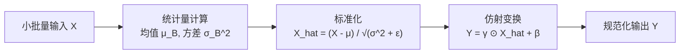

> 导航：[[7.4 含并行连结的网络（GoogLeNet）| 上一节: 7.4 含并行连结的网络（GoogLeNet）]] | [[7.6 残差网络（ResNet）| 下一节: 7.6 残差网络（ResNet）]]

---

# 批量规范化（Batch Normalization）

在深层神经网络的优化过程中，随着网络深度的急剧增加，训练难度呈现指数级上升。即使采用了合理的参数初始化（如 Xavier 或 He 初始化）和 ReLU 激活函数，网络依然极难采用较大的学习率进行稳定训练。

2015 年，Sergey Ioffe 与 Christian Szegedy 提出了 **批量规范化（Batch Normalization, BN）**。作为深度学习历史上最具影响力的工程突破之一，批量规范化与后续的残差连接（ResNet）相结合，彻底打破了深度神经网络难以训练的技术瓶颈，使得训练成百上千层的超深网络成为可能。

---

## 1. 核心动机：为什么深层网络需要规范化？

### 1.1 输入层预处理的经验启示
在浅层机器学习与回归任务中，标准的预处理流程是对输入特征执行 Z-Score 标准化：
$$
x_j \leftarrow \frac{x_j - \mu_j}{\sigma_j}
$$
使每个维度的均值为 0、方差为 1。几何上，这消除了特征量纲悬殊导致的狭长椭球形损失地形，使损失函数的等高线趋于正球形，从而允许随机梯度下降沿着指向全局极小值的方向快速收敛。

### 1.2 中间层的分布漂移困境
然而，对于深层网络：
* 浅层权重的微小扰动，经过数十层的连续矩阵连乘与非线性映射，会被指数级放大；
* 这导致每一层的输入分布在训练过程中不断剧烈晃动，后续网络层必须持续适应前序层输出分布的变化；
* 原论文将这一现象称为**内部协变量偏移（Internal Covariate Shift, ICS）**。

### 1.3 现代优化理论的真实机制：损失地形平滑（Loss Landscape Smoothing）
Santurkar 等人在 NeurIPS 2018 发表的经典论文 *How Does Batch Normalization Help Optimization?* 中通过严格的理论与实证推翻了 ICS 假说，揭示了 BN 成功的真正数学机理：
1. **重塑损失地形的 Lipschitz 连续性**：BN 使得损失函数的梯度变化更加平缓（$\|\nabla \mathcal{L}(\mathbf{w}_1) - \nabla \mathcal{L}(\mathbf{w}_2)\| \le L \|\mathbf{w}_1 - \mathbf{w}_2\|$ 中的 Lipschitz 常数 $L$ 大幅减小）；
2. **极小化二阶梯度的剧烈波动**：消除了损失曲面上的病态尖峰与深坑，使梯度方向更具可靠的方向预测性；
3. **允许超大学习率**：学习率通常可放大 **5 ~ 10 倍**（如 LeNet 学习率从 0.1 提升到 1.0 仍平稳收敛），大幅加速训练收敛进程。

---

## 2. 批量规范化的数学定义与可学习变换

设输入小批量样本集合为 $\mathcal{B} = \{\mathbf{x}_1, \dots, \mathbf{x}_m\}$，$\mathrm{BN}$ 变换由四步标准数学公式构成：

### 2.1 运算四步法

$$
\begin{aligned}
\text{1. 小批量均值：} \quad & \hat{\boldsymbol{\mu}}_\mathcal{B} = \frac{1}{m} \sum_{i=1}^m \mathbf{x}_i \\
\text{2. 小批量方差：} \quad & \hat{\boldsymbol{\sigma}}_\mathcal{B}^2 = \frac{1}{m} \sum_{i=1}^m (\mathbf{x}_i - \hat{\boldsymbol{\mu}}_\mathcal{B})^2 + \epsilon \\
\text{3. 零均值单位方差标准化：} \quad & \hat{\mathbf{x}}_i = \frac{\mathbf{x}_i - \hat{\boldsymbol{\mu}}_\mathcal{B}}{\sqrt{\hat{\boldsymbol{\sigma}}_\mathcal{B}^2 + \epsilon}} \\
\text{4. 仿射重缩放与平移：} \quad & \mathbf{y}_i = \boldsymbol{\gamma} \odot \hat{\mathbf{x}}_i + \boldsymbol{\beta} \equiv \mathrm{BN}_{\boldsymbol{\gamma}, \boldsymbol{\beta}}(\mathbf{x}_i)
\end{aligned}
$$

* 常数 $\epsilon > 0$（通常取 $10^{-5}$）用于防止除以零的数值溢出；
* 向量 $\boldsymbol{\gamma}$（拉伸参数，scale）与 $\boldsymbol{\beta}$（偏移参数，shift）为**可学习参数（Learnable Parameters）**，在反向传播中通过梯度下降联合更新。



### 2.2 为什么必须引入可学习参数 $\boldsymbol{\gamma}$ 和 $\boldsymbol{\beta}$？
如果仅仅强行将中间激活限制为零均值与单位方差：
* 假设后接 Sigmoid 激活函数，其在 0 附近的一阶导数近似为线性区间（$\sigma(x) \approx 0.5 + 0.25x$），这将直接剥夺非线性激活函数的非线性弯曲能力，导致多层深网退化为线性网络；
* 引入可学习的 $\boldsymbol{\gamma}$ 和 $\boldsymbol{\beta}$，赋予了网络自适应调节分布的能力——**在极端情况下，若网络发现不规范化更有利于拟合，模型可以通过学习令 $\boldsymbol{\gamma} = \boldsymbol{\sigma}, \boldsymbol{\beta} = \boldsymbol{\mu}$，从而无损恒等恢复出原始输入分布！**

---

## 3. 全连接层 vs 卷积层的规范化维度差异

由于数据空间拓扑结构不同，批量规范化在全连接层与卷积层中的应用存在本质差异：

### 3.1 全连接层（2D 张量: `BatchSize × NumFeatures`）
* **规范化维度**：对特征维度（列）中的**每一个神经元独立进行规范化**；
* **样本统计**：均值与方差在整个小批量维度（行，大小为 $B$）上统计；
* **参数形状**：$\boldsymbol{\gamma}, \boldsymbol{\beta}$ 的形状为 $(1, D)$。

### 3.2 卷积层（4D 张量: `BatchSize × Channels × Height × Width`）
* **通道独立性与空间平移不变性**：卷积核在整个空间平面上滑动共享，因此规范化必须尊重这一物理特性；
* **样本统计**：针对每一个输出通道 $c \in [1, C]$，将小批量内所有样本（$B$ 个）以及该特征图上的全部空间坐标点（$H \times W$ 个）汇总，共同组成样本池：
  $$\text{单通道统计样本数} = B \times H \times W$$
* **参数形状**：每个通道仅拥有一组标量拉伸与偏移参数，张量形状为 $(1, C, 1, 1)$。

```
全连接层 (B, D):
       特征 1     特征 2    ...    特征 D
样本 1  [ x11       x12     ...     x1D  ]
样本 2  [ x21       x22     ...     x2D  ]   <-- 沿竖直列方向分别求 μ_d, σ_d
...    [ ...       ...     ...     ...  ]
样本 B  [ xB1       xB2     ...     xBD  ]

卷积层 (B, C, H, W):
对固定的通道 c，将 B 个样本中所有 H×W 个像素点全部拉平为一个标量集合，
计算出单个标量标量 μ_c 与 σ_c，对该通道所有空间位置执行同等标准化。
```

---

## 4. 训练模式 vs 预测模式的严格行为分歧

与暂退法（Dropout）类似，批量规范化层在训练和测试阶段的行为截然不同：

| 模式 | 均值与方差来源 | 计算方式 | 确定性 |
| :--- | :--- | :--- | :--- |
| **训练模式 (`model.train()`)** | 当前 mini-batch 的实时样本统计量 | $\hat{\boldsymbol{\mu}}_\mathcal{B}, \hat{\boldsymbol{\sigma}}_\mathcal{B}^2$ 随当前 batch 动态计算；同时通过指数移动平均（EMA）在后台维护全局估计 | 随机性（受 batch 内其他样本扰动） |
| **预测模式 (`model.eval()`)** | 训练期间沉淀下来的全局移动平均值 | 直接使用 $\mathbf{moving\_mean}$ 和 $\mathbf{moving\_var}$，**禁止重新计算 batch 均值方差** | 严格确定（对单个输入样本即可独立推理） |

### 4.1 指数移动平均（EMA）更新规则
在训练前向传播的每一步，层内部以动量系数 $\alpha$（PyTorch 默认为 0.1，教材从零实现使用 `momentum=0.9` 作为保留系数）在无需反向求导的张量上平滑追踪全局统计：
$$
\begin{aligned}
\mathbf{moving\_mean} &\leftarrow \alpha \cdot \mathbf{moving\_mean} + (1 - \alpha) \cdot \hat{\boldsymbol{\mu}}_\mathcal{B} \\
\mathbf{moving\_var} &\leftarrow \alpha \cdot \mathbf{moving\_var} + (1 - \alpha) \cdot \hat{\boldsymbol{\sigma}}_\mathcal{B}^2
\end{aligned}
$$

---

## 5. 偏置吸收（Bias Absorption）与参数消除定理

> [!important] 深度学习工程最佳实践
> **在任何紧跟 BatchNorm 层的全连接层或卷积层中，必须显式设置 `bias=False`！**

### 数学证明：
设卷积或全连接层的原始仿射变换为 $\mathbf{z} = \mathbf{W}\mathbf{x} + \mathbf{b}$。将其输入至 BN 层：
$$
\hat{\boldsymbol{\mu}}_\mathcal{B} = \frac{1}{m} \sum_{i=1}^m (\mathbf{W}\mathbf{x}_i + \mathbf{b}) = \left(\frac{1}{m} \sum_{i=1}^m \mathbf{W}\mathbf{x}_i\right) + \mathbf{b}
$$
带入分子执行去均值中心化：
$$
\mathbf{z}_i - \hat{\boldsymbol{\mu}}_\mathcal{B} = (\mathbf{W}\mathbf{x}_i + \mathbf{b}) - \left(\frac{1}{m} \sum_{j=1}^m \mathbf{W}\mathbf{x}_j + \mathbf{b}\right) = \mathbf{W}\mathbf{x}_i - \frac{1}{m} \sum_{j=1}^m \mathbf{W}\mathbf{x}_j
$$
**偏置向量 $\mathbf{b}$ 在求差时被数学上恒等对消！** 
偏置的作用完全被后续 BN 层的平移参数 $\boldsymbol{\beta}$ 取代。如果在前置层保留偏置，该偏置不仅对输出毫无影响，而且其梯度反向传播会白白浪费显存与算力。

---

## 6. 从零实现与 PyTorch 原生 API

### 6.1 底层核心数学算子：`batch_norm` 函数

```python
import torch
from torch import nn

def batch_norm(X, gamma, beta, moving_mean, moving_var, eps, momentum):
    # 通过 is_grad_enabled 识别训练模式还是预测模式
    if not torch.is_grad_enabled():
        # 预测模式：直接使用训练累积的移动平均统计量
        X_hat = (X - moving_mean) / torch.sqrt(moving_var + eps)
    else:
        assert len(X.shape) in (2, 4)
        if len(X.shape) == 2:
            # 全连接层：在样本维度 dim=0 上求统计量
            mean = X.mean(dim=0)
            var = ((X - mean) ** 2).mean(dim=0)
        else:
            # 二维卷积层：在 (B, H, W) 维度上共同求统计量，保留通道维 (1, C, 1, 1)
            mean = X.mean(dim=(0, 2, 3), keepdim=True)
            var = ((X - mean) ** 2).mean(dim=(0, 2, 3), keepdim=True)
        # 当前批次标准化
        X_hat = (X - mean) / torch.sqrt(var + eps)
        # 动量更新移动平均（无梯度追踪）
        moving_mean = momentum * moving_mean + (1.0 - momentum) * mean
        moving_var = momentum * moving_var + (1.0 - momentum) * var
    
    Y = gamma * X_hat + beta  # 缩放与平移
    return Y, moving_mean.data, moving_var.data
```

### 6.2 简洁实现：PyTorch 原生 API 对比
在生产环境中，通常直接调用经过底层 CUDA C++ 极致优化的标准算子：
* **全连接层**：`nn.BatchNorm1d(num_features)`
* **卷积层**：`nn.BatchNorm2d(num_features)`

```python
# 应用于 LeNet 的现代规范化架构示例
net = nn.Sequential(
    nn.Conv2d(1, 6, kernel_size=5, bias=False),  # 卷积层显式关闭 bias
    nn.BatchNorm2d(6),
    nn.Sigmoid(),
    nn.AvgPool2d(kernel_size=2, stride=2),
    
    nn.Conv2d(6, 16, kernel_size=5, bias=False), # 卷积层显式关闭 bias
    nn.BatchNorm2d(16),
    nn.Sigmoid(),
    nn.AvgPool2d(kernel_size=2, stride=2),
    nn.Flatten(),
    
    nn.Linear(16 * 4 * 4, 120, bias=False),       # 全连接层显式关闭 bias
    nn.BatchNorm1d(120),
    nn.Sigmoid(),
    
    nn.Linear(120, 84, bias=False),
    nn.BatchNorm1d(84),
    nn.Sigmoid(),
    
    nn.Linear(84, 10)                             # 最终分类头保留 bias
)
```

---

## 7. 深入思考与课后练习解答

### 1. 为什么批量规范化具有天然的正则化（Regularization）副作用？它能完全替代 Dropout 吗？
* **解答**：
  * **正则化成因**：在训练阶段，每个小批量的样本统计量 $\hat{\boldsymbol{\mu}}_\mathcal{B}$ 和 $\hat{\boldsymbol{\sigma}}_\mathcal{B}^2$ 是基于当前 batch 随机抽样估计的，带有客观的随机抽样噪声。当某个样本输入网络时，它的标准化值取决于它与当前 batch 内其他样本的相对差异。这种持续注入的有界噪声阻止了神经元对固定输入的过度拟合，起到了隐式正则化效果。
  * **与 Dropout 的关系**：在多数现代卷积网络中，引入 BatchNorm 后通常可以完全移除全连接层的 Dropout，且泛化性能更优；但在极端大模型或小批次场景下，两者仍可组合使用（需注意 Dropout 置零会改变方差的尺度冲突）。

### 2. 当批大小（Batch Size）退化为 1 时，批量规范化会出现什么问题？如何应对？
* **解答**：
  * **退化灾难**：当 $m=1$ 时，$\hat{\mu}_\mathcal{B} = x_1$，此时 $x_1 - \hat{\mu}_\mathcal{B} \equiv 0$。分子恒为 0，方差估计失效，网络无法学习到任何有效信息。
  * **小 Batch 替代方案**：在目标检测、高分辨率分割或序列模型中，由于显存限制常采用极小 batch size（1~4）。此时业界提出了无需依赖 Batch 维度的规范化变体：
    - **层规范化（Layer Normalization, LN）**：在单个样本内部对全部通道和特征求统计量，成为 Transformer 的标准规范化层；
    - **组规范化（Group Normalization, GN）**：将通道分组独立统计，对小 Batch 极其稳健；
    - **实例规范化（Instance Normalization, IN）**：对单样本单通道独立统计，广泛应用于图像风格迁移。
