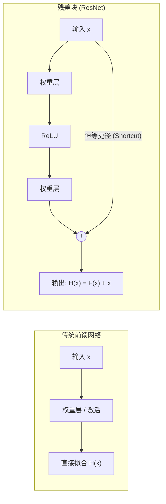
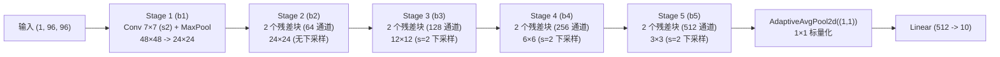

> 导航：[[7.5 批量规范化（Batch Normalization）| 上一节: 7.5 批量规范化（Batch Normalization）]] | [[7.7 稠密连接网络（DenseNet）| 下一节: 7.7 稠密连接网络（DenseNet）]]

---

# 残差网络（ResNet）

在深度学习的探索早期，存在一个直觉假设：**神经网络越深，其能够学习的特征层次就越丰富，模型的表达能力与泛化性能理应更强**。

然而，在 2015 年前，研究人员在尝试堆叠更深的网络（如 56 层 vs 20 层普通卷积网络）时遭遇了一个致命现象——**网络退化（Degradation Problem）**：随着层数增加，网络的训练误差和测试误差**同时显著上升**！

何恺明（Kaiming He）、张祥雨、任少卿与孙剑在 2015 年发表的论文 *Deep Residual Learning for Image Recognition* 中，不仅从数学函数类理论上阐明了退化的本质，更创造性地提出了 **残差网络（ResNet）**。ResNet 斩获了 ILSVRC-2015 分类、检测与定位全项冠军，并推动深度网络首次突破了 100 层乃至 1000 层的物理壁垒，成为现代深度学习（包括视觉骨干网络与 Transformer 残差短路）最不可动摇的基石架构。

---

## 1. 理论根源：非嵌套函数类与网络退化

### 1.1 函数类包含性与嵌套函数类（Nested Function Classes）
设 $\mathcal{F}$ 为某一网络架构对应的所有可实现函数的集合。
对于训练目标“真实函数” $f^*$，我们在架构 $\mathcal{F}$ 中能找到的最佳拟合函数为：
$$
f^*_\mathcal{F} := \arg\min_{f \in \mathcal{F}} L(\mathbf{X}, \mathbf{y}, f)
$$

```
非嵌套函数类 (Non-nested):                 嵌套函数类 (Nested):
       F1                                      F1 ⊆ F2 ⊆ F3 ⊆ ...
     ┌────┐                                   ┌────────────────┐
     │ F2 │                                   │      F3        │
     │ ┌──┴─┐                                 │   ┌────────┐   │
     │ │ F3 │      f* (真实函数)               │   │   F2   │   │   f*
     │ └──┬─┘      *                          │   │ ┌────┐ │   │   *
     └────┘                                   │   │ │ F1 │ │   │
  F3 并不包含 F1,                              │   │ └────┘ │   │
  更复杂的 F3 可能反而距离 f* 更远!            └────────────────┘
                                            F 越大，与 f* 的下界必然单调不增
```

* **非嵌套函数类的失效**：若网络盲目加深所扩展出的新函数类 $\mathcal{F}'$ 并不包含原函数类（$\mathcal{F} \not\subseteq \mathcal{F}'$），则无法保证新模型性能不劣于旧模型。随着深度增加，优化算法在非凸高维空间中极易陷入病态局部极小点。
* **嵌套函数类的保证**：只有当 $\mathcal{F}_1 \subseteq \mathcal{F}_2 \subseteq \dots \subseteq \mathcal{F}_d$ 时，我们才能严格确保更深的模型至少能够无损退化为较浅模型——**这要求新添加的层至少能够轻易学出恒等映射（Identity Mapping）：$f(\mathbf{x}) = \mathbf{x}$**。

### 1.2 网络退化与过拟合的区别
* **过拟合**：训练误差极低，但测试误差极高（模型容量过度，泛化差距过大）；
* **网络退化**：**训练误差自身就高于浅层网络**！这表明问题出在优化过程受阻，深层网络的参数优化轨迹无法有效收敛。

---

## 2. 残差学习的核心数学原理

传统前馈层试图直接让权重层拟合目标底层映射 $\mathcal{H}(\mathbf{x})$：



### 2.1 残差映射（Residual Mapping）
ResNet 显式地将目标映射重构为：
$$
\mathcal{H}(\mathbf{x}) = \mathcal{F}(\mathbf{x}) + \mathbf{x} \iff \mathcal{F}(\mathbf{x}) = \mathcal{H}(\mathbf{x}) - \mathbf{x}
$$
* 网络的参数权重层只需要去逼近**残差映射 $\mathcal{F}(\mathbf{x})$**。
* **极易退化为恒等映射**：在反向传播初期或对于冗余层，优化器只需将权重矩阵 $\mathbf{W}$ 与偏置 $\mathbf{b}$ 驱动收缩至 0（由于权重衰减 $L_2$ 正则化的存在，参数天然具有趋向于 0 的倾向），则 $\mathcal{F}(\mathbf{x}) \to 0$，此时整块网络立刻无损退化为完美的恒等映射 $\mathcal{H}(\mathbf{x}) = \mathbf{x}$。

---

### 2.2 核心数学证明：反向传播“梯度高速公路”（Gradient Highway）

考虑深度网络中从浅层输入 $\mathbf{x}_l$ 到深层输出 $\mathbf{x}_L$ 的跨层递推：
$$
\mathbf{x}_{l+1} = \mathbf{x}_l + \mathcal{F}(\mathbf{x}_l, \mathcal{W}_l) \implies \mathbf{x}_L = \mathbf{x}_l + \sum_{i=l}^{L-1} \mathcal{F}(\mathbf{x}_i, \mathcal{W}_i)
$$
根据多元微积分链式求导法则，损失函数 $\mathcal{L}$ 关于浅层激活值 $\mathbf{x}_l$ 的梯度为：
$$
\frac{\partial \mathcal{L}}{\partial \mathbf{x}_l} = \frac{\partial \mathcal{L}}{\partial \mathbf{x}_L} \frac{\partial \mathbf{x}_L}{\partial \mathbf{x}_l} = \frac{\partial \mathcal{L}}{\partial \mathbf{x}_L} \left( \mathbf{I} + \frac{\partial}{\partial \mathbf{x}_l} \sum_{i=l}^{L-1} \mathcal{F}(\mathbf{x}_i, \mathcal{W}_i) \right)
$$
展开求和式：
$$
\mathbf{\frac{\partial \mathcal{L}}{\partial \mathbf{x}_l} = \frac{\partial \mathcal{L}}{\partial \mathbf{x}_L} + \frac{\partial \mathcal{L}}{\partial \mathbf{x}_L} \left( \sum_{i=l}^{L-1} \frac{\partial \mathcal{F}(\mathbf{x}_i, \mathcal{W}_i)}{\partial \mathbf{x}_l} \right)}
$$

* **梯度直通项（$\mathbf{I}$ 矩阵）的决定性意义**：
  上式第一项 $\frac{\partial \mathcal{L}}{\partial \mathbf{x}_L}$ **不经过任何中间权重矩阵的连乘衰减，直接无损从顶层贯穿传递到浅层！**
  即使第二项由于深层权重极小导致梯度趋近于 0，总梯度依然保持非零常数项 $\frac{\partial \mathcal{L}}{\partial \mathbf{x}_L}$。残差连接彻底根除了深层网络的反向传播梯度弥散现象。

---

## 3. 残差块分类与通道/空间尺寸匹配

残差块要求残差路径的输出 $\mathcal{F}(\mathbf{x})$ 与恒等捷径路径 $\mathbf{x}$ 具有完全相同的高、宽与通道数，才能执行按元素加法（$\oplus$）。

### 3.1 恒等残差块（Identity Block, `use_1x1conv=False`）
* **条件**：输入通道数等于输出通道数（$C_{in} = C_{out}$），且步幅 $S=1$；
* **操作**：输入 $\mathbf{x}$ 通过跳跃连接直接与主路径输出相加：$\mathbf{y} = \text{ReLU}(\mathcal{F}(\mathbf{x}) + \mathbf{x})$。

### 3.2 投影残差块（Projection Block, `use_1x1conv=True`）
* **条件**：需要将输出通道翻倍（$C_{out} = 2 C_{in}$）或将空间高宽减半（$S=2$）；
* **操作**：恒等捷径分支必须插入一个步幅为 $S$ 的 $1\times1$ 卷积层与 BatchNorm，将输入张量从 $(B, C_{in}, H, W)$ 线性投影变换为 $(B, C_{out}, H/S, W/S)$ 后再执行相加：
  $$\mathbf{y} = \text{ReLU}\left(\mathcal{F}(\mathbf{x}) + \text{BN}(\text{Conv}_{1\times1}(\mathbf{x}))\right)$$

```python
class Residual(nn.Module):
    def __init__(self, input_channels, num_channels, use_1x1conv=False, strides=1):
        super().__init__()
        # 卷积层显式设置 bias=False，由 BatchNorm 接管
        self.conv1 = nn.Conv2d(input_channels, num_channels, kernel_size=3,
                               padding=1, stride=strides, bias=False)
        self.bn1 = nn.BatchNorm2d(num_channels)
        self.conv2 = nn.Conv2d(num_channels, num_channels, kernel_size=3,
                               padding=1, bias=False)
        self.bn2 = nn.BatchNorm2d(num_channels)
        
        if use_1x1conv:
            self.conv3 = nn.Conv2d(input_channels, num_channels,
                                   kernel_size=1, stride=strides, bias=False)
            self.bn3 = nn.BatchNorm2d(num_channels)
        else:
            self.conv3 = None

    def forward(self, X):
        Y = F.relu(self.bn1(self.conv1(X)))
        Y = self.bn2(self.conv2(Y))
        if self.conv3 is not None:
            X = self.bn3(self.conv3(X))
        Y += X  # 残差相加
        return F.relu(Y)
```

---

## 4. ResNet-18 架构拓扑与前向传播演进

ResNet-18 的整体架构划分为 5 个阶段（Stage）：



### 4.1 层数精确拆解（为什么叫 ResNet-18？）
* **Stage 1 (`b1`)**：1 个 $7\times7$ 卷积层；
* **Stage 2 (`b2`)**：2 个残差块，每块 2 个 $3\times3$ 卷积 $\to 4$ 个卷积层；
* **Stage 3 (`b3`)**：2 个残差块，每块 2 个 $3\times3$ 卷积 $\to 4$ 个卷积层；
* **Stage 4 (`b4`)**：2 个残差块，每块 2 个 $3\times3$ 卷积 $\to 4$ 个卷积层；
* **Stage 5 (`b5`)**：2 个残差块，每块 2 个 $3\times3$ 卷积 $\to 4$ 个卷积层；
* **分类输出头**：1 个全连接层；
* **权重层总数**：$1 + 4 + 4 + 4 + 4 + 1 = \mathbf{18}$ 层（不计入快捷路径上的 $1\times1$ 卷积）。
* **参数量**：全网仅 **11.18 M** 浮点参数。

---

## 5. 进阶变体：深层瓶颈结构（Bottleneck）与预激活（Pre-activation）

### 5.1 瓶颈块结构（Bottleneck Block, 用于 ResNet-50 / 101 / 152）
当网络层数拓展至 50 层以上时，连续堆叠 $3\times3$ 卷积的计算量依然偏大。ResNet 借鉴 Inception 设计了“三明治”三层瓶颈块：
$$
\text{Conv}_{1\times1} \ (\text{降维 4 倍}) \longrightarrow \text{Conv}_{3\times3} \ (\text{核心特征提取}) \longrightarrow \text{Conv}_{1\times1} \ (\text{升维 4 倍})
$$
例如：$256 \to 64 \to 64 \to 256$。这使得更深网络以相近的 FLOPs 容纳了多达 3 倍的非线性深度。

### 5.2 ResNet-v2：预激活机制（Pre-activation）
何恺明等人在后续研究中发现，将原始残差块中的结构 `Conv -> BN -> ReLU` 调整为 **预激活结构 `BN -> ReLU -> Conv`**：
* 使得恒等捷径路径（Shortcut）成为**完全纯净的直通通道**，不经过任何非线性激活截断（如 ReLU 对负值的置零截断）；
* 进一步提升了超深网络（如 1000 层）的信号前向传播保真度与反向梯度通畅性。

---

## 6. 深入思考与课后习题解答

### 1. Inception 块与残差块的核心区别是什么？
* **解答**：
  * **Inception 块**：采用**特征拼接（Channel Concatenation, `torch.cat`）**。不同分支提取不同感受野的特征，在通道维度扩充张量宽度，属于宽维度的多尺度并行设计；
  * **残差块**：采用**元素按位相加（Element-wise Addition, `+`）**。特征图通道数和空间尺度在相加后保持不变，其核心目标是提供无阻碍的恒等短路路径以解决超深优化的退化问题。

### 2. 为什么即使函数类是严格嵌套的（$\mathcal{F}_1 \subseteq \mathcal{F}_2$），在工程实践中依然要对增加网络复杂度施加约束（如正则化）？
* **解答**：
  * 函数类的嵌套性仅在**理论数学空间**中保证了最优解的下界单调不降（$\min_{f \in \mathcal{F}_2} L \le \min_{f \in \mathcal{F}_1} L$）；
  * 但在**经验优化空间**中，更大的函数类意味着极其高维、非凸的参数流形，存在海量的鞍点、局部不良极值和更强的高频拟合噪声能力；
  * 若缺乏容量约束与正则化惩罚，模型在有限的经验样本上极易发生经验风险最小化（ERM）导致的严重过拟合，损害在独立测试分布上的泛化性能。
