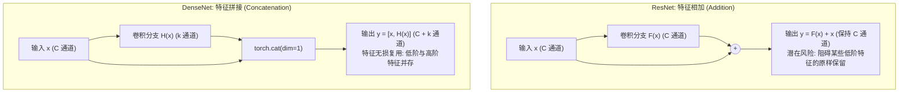
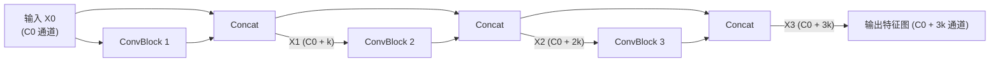

> 导航：[[7.6 残差网络（ResNet）| 上一节: 7.6 残差网络（ResNet）]] | [[7.0 章节全景与导读| 现代卷积神经网络全景]]

---

# 稠密连接网络（DenseNet）

ResNet 通过残差连接彻底革新了极深神经网络的训练范式。沿着跨层跳跃连接这一核心思想，Gao Huang、Zhuang Liu、Laurens van der Maaten 与 Kilian Q. Weinberger 在 2017 年 CVPR 会议上发表了最佳论文 *Densely Connected Convolutional Networks*，提出了 **稠密连接网络（DenseNet）**。

如果说 ResNet 是通过**按位相加（Element-wise Addition）**保留恒等信息，那么 DenseNet 则是将跨层连接推向了极致逻辑终点——**跨层通道级联拼接（Channel Concatenation）**。每一层都与后续所有层实现全密集的无阻碍连接，实现了极致的特征复用（Feature Reuse）与近乎极限的参数利用率。

---

## 1. 数学思想跃迁：从泰勒展开到密集级联

### 1.1 泰勒级数展开的启发
对于任意光滑函数 $f(x)$，在 $x=0$ 邻域内的泰勒级数展开为：
$$
f(x) = f(0) + f'(0) x + \frac{f''(0)}{2!} x^2 + \frac{f'''(0)}{3!} x^3 + \dots
$$
* **ResNet 的视角（一阶修正）**：
  $$f(\mathbf{x}) = \mathbf{x} + g(\mathbf{x})$$
  将目标映射分解为一个直接的线性项（恒等捷径 $\mathbf{x}$）与一个非线性残差项 $g(\mathbf{x})$。
* **DenseNet 的视角（全阶级联）**：
  若要进一步拓展函数的分解能力，使其容纳不同层级、不同复杂度的信息流动，DenseNet 将单线加和拓展为全状态级联映射：
  $$
  \mathbf{x} \longrightarrow \left[ \mathbf{x}, f_1(\mathbf{x}), f_2([\mathbf{x}, f_1(\mathbf{x})]), f_3([\mathbf{x}, f_1(\mathbf{x}), f_2([\mathbf{x}, f_1(\mathbf{x})])]), \dots \right]
  $$
  每一层的输出不是被“覆盖”或“相加叠加”，而是作为独立通道完整保留，并直接馈送给之后的所有后续层。

---

### 1.2 相加（Addition） vs 拼接（Concatenation）的代数与几何本质对比



| 维度 | ResNet 残差连接 ($\oplus$) | DenseNet 稠密连接 ($\operatorname{concat}$) |
| :--- | :--- | :--- |
| **操作符** | 元素级按位相加 `Y = F(X) + X` | 通道维度张量拼接 `X = torch.cat((X, Y), dim=1)` |
| **通道维度** | 严格保持通道数不变 | 通道数随层数线性增加 |
| **信息交互** | 特征信息混合融为一体，无法单独提取浅层原始特征 | **保留原始特征图**，后续层可自由选择复用任意层级的表征 |
| **梯度流动** | 梯度通过加法捷径 $\mathbf{I}$ 分布回传 | 每一层均有直接连接至输入端与输出端的高速梯度通道 |

---

## 2. 稠密块（DenseBlock）与增长率（Growth Rate）

稠密网络由两大核心结构交替构建：**稠密块（DenseBlock）** 与 **过渡层（Transition Layer）**。

### 2.1 基础卷积单元与预激活
DenseNet 沿用了 ResNet-v2 的预激活范式：
$$\text{Input} \longrightarrow \mathbf{BN} \longrightarrow \mathbf{ReLU} \longrightarrow \mathbf{Conv}_{3\times3} \longrightarrow \text{Output}$$

```python
def conv_block(input_channels, num_channels):
    return nn.Sequential(
        nn.BatchNorm2d(input_channels),
        nn.ReLU(),
        nn.Conv2d(input_channels, num_channels, kernel_size=3, padding=1, bias=False)
    )
```

### 2.2 增长率（Growth Rate, $k$）与通道演进推导
在稠密块内部，每个卷积层输出的通道数是固定的，该数值被称为**增长率（Growth Rate）**，记作 $k$（通常取较小的值，如 $k=32$ 或 $k=12$）。

* 设稠密块的初始输入通道数为 $C_0$；
* 第 1 个卷积层的输入为 $C_0$，输出为 $k$ 个通道；经拼接后通道数为 $C_0 + k$；
* 第 2 个卷积层的输入为 $C_0 + k$，输出仍为 $k$ 个通道；拼接后通道数为 $C_0 + 2k$；
* **递推通项公式**：包含 $m$ 个卷积层的稠密块，其第 $l$ 层卷积的输入通道数为：
  $$C_{in}^{(l)} = C_0 + (l - 1) \cdot k$$
  最终稠密块输出的总通道数为：
  $$C_{out} = C_0 + m \cdot k$$



---

## 3. 过渡层（Transition Layer）：控制通道膨胀与降维

由于每个稠密块都会使通道数急剧线性累积，若任由其无限制扩展，会导致后续卷积核参数与显存占用爆炸。
**过渡层**被置于两个相邻的稠密块之间，起到**控制模型复杂度、收缩通道维度与下采样空间分辨率**的双重作用。

### 3.1 过渡层结构组成
1. **$1\times1$ 卷积层（通道压缩）**：将输入通道数按压缩因子 $\theta \in (0, 1]$ 压缩（PyTorch 与教材中通常取 $\theta = 0.5$，即通道数减半：$C_{out} = \lfloor \theta C_{in} \rfloor$）；
2. **$2\times2$ 平均池化层（步幅为 2）**：将空间高度与宽度精确减半（$H \to H/2, W \to W/2$）。

```python
def transition_block(input_channels, num_channels):
    """过渡层：1x1 卷积压缩通道 + 2x2 平均池化空间减半"""
    return nn.Sequential(
        nn.BatchNorm2d(input_channels),
        nn.ReLU(),
        nn.Conv2d(input_channels, num_channels, kernel_size=1, bias=False),
        nn.AvgPool2d(kernel_size=2, stride=2)
    )
```

---

## 4. 全景架构与代码实现（基于 Fashion-MNIST $96\times96$）

```python
import torch
from torch import nn

# 1. 初始前置骨干（与 ResNet 相同）
b1 = nn.Sequential(
    nn.Conv2d(1, 64, kernel_size=7, stride=2, padding=3, bias=False),
    nn.BatchNorm2d(64), nn.ReLU(),
    nn.MaxPool2d(kernel_size=3, stride=2, padding=1)
)

# 2. 堆叠 4 个稠密块与 3 个过渡层
num_channels, growth_rate = 64, 32
num_convs_in_dense_blocks = [4, 4, 4, 4]  # 与 ResNet-18 保持相同卷积层深度
blks = []

for i, num_convs in enumerate(num_convs_in_dense_blocks):
    # 添加稠密块
    blks.append(DenseBlock(num_convs, num_channels, growth_rate))
    num_channels += num_convs * growth_rate
    # 在稠密块之间插入过渡层（最后一个稠密块后无需过渡层）
    if i != len(num_convs_in_dense_blocks) - 1:
        blks.append(transition_block(num_channels, num_channels // 2))
        num_channels = num_channels // 2

# 3. 后置全局池化与分类头
net = nn.Sequential(
    b1, *blks,
    nn.BatchNorm2d(num_channels), nn.ReLU(),
    nn.AdaptiveAvgPool2d((1, 1)),
    nn.Flatten(),
    nn.Linear(num_channels, 10)
)
```

### 4.1 各阶段张量形状演进表

| 模块阶段 | 包含组件 | 输入形状 | 输出形状 | 关键操作说明 |
| :---: | :--- | :---: | :---: | :--- |
| **Stage 1 (b1)** | Conv $7\times7$ (s2) + MaxPool (s2) | $(B, 1, 96, 96)$ | $(B, 64, 24, 24)$ | 连续两次空间减半 |
| **DenseBlock 1** | 4 层卷积 ($k=32$) | $(B, 64, 24, 24)$ | $(B, 192, 24, 24)$ | 通道：$64 + 4 \times 32 = 192$ |
| **Transition 1** | Conv $1\times1$ ($\theta=0.5$) + AvgPool (s2) | $(B, 192, 24, 24)$ | $(B, 96, 12, 12)$ | 通道减半至 96，空间减半 |
| **DenseBlock 2** | 4 层卷积 ($k=32$) | $(B, 96, 12, 12)$ | $(B, 224, 12, 12)$ | 通道：$96 + 4 \times 32 = 224$ |
| **Transition 2** | Conv $1\times1$ ($\theta=0.5$) + AvgPool (s2) | $(B, 224, 12, 12)$ | $(B, 112, 6, 6)$ | 通道减半至 112，空间减半 |
| **DenseBlock 3** | 4 层卷积 ($k=32$) | $(B, 112, 6, 6)$ | $(B, 240, 6, 6)$ | 通道：$112 + 4 \times 32 = 240$ |
| **Transition 3** | Conv $1\times1$ ($\theta=0.5$) + AvgPool (s2) | $(B, 240, 6, 6)$ | $(B, 120, 3, 3)$ | 通道减半至 120，空间减半 |
| **DenseBlock 4** | 4 层卷积 ($k=32$) | $(B, 120, 3, 3)$ | $(B, 248, 3, 3)$ | 通道：$120 + 4 \times 32 = 248$ |
| **Head** | GAP + Flatten + Linear | $(B, 248, 3, 3)$ | $(B, 10)$ | 10 维最终分类得分 |

---

## 5. 核心工程矛盾：极低参数量 vs 显存开销瓶颈

在本地 GPU 上的实测参数量呈现出震撼的对比：
* **DenseNet 总参数量：仅 0.76 M（75.8 万）**！
* 相比之下，ResNet-18 拥有 **11.18 M** 参数，GoogLeNet 拥有 **5.98 M** 参数，AlexNet 拥有 **46.76 M** 参数。DenseNet 的参数量不足 ResNet-18 的 **1/14**。

### 为什么参数量如此之小？
DenseNet 每一层卷积核的输出通道极小（增长率 $k$ 仅为 32）。网络不需要像传统网络那样在深层每一层独立重新学习低阶线条、颜色和纹理特征，而是通过通道拼接直接调用前面已经生成的低阶特征，每一层只需专注于学习对整体流形的极少更新增量。

### 为什么训练时的显存消耗却非常高？
* `torch.cat` 会在内存/显存中分配全新的连续张量空间；
* 在反向传播中，为了计算梯度，计算图必须在显存中持久保留**前面所有层拼接后的巨型激活张量**；
* **工业解决方案**：Pleiss 等人在 2017 年提出了 *Memory-Efficient DenseNet*，利用 **梯度检查点（Gradient Checkpointing）** 技术，在反向传播时实时按需重新计算 `cat` 拼接操作，从而将显存占用降低至线性阶数。

---

## 6. 深入思考与课后练习解答

### 1. 为什么我们在过渡层中使用平均汇聚层（Average Pooling）而不是最大汇聚层（Max Pooling）？
* **解答**：
  * **全局平滑与通道保留**：DenseNet 的核心优势是累积了大量通道的多层特征图（既包含早期底层的轮廓，也包含高层的局部响应）。最大池化会抛弃绝大多数非极大值响应，倾向于只保留局部最显著的极值点，这会破坏密集通道中分布式细粒度信息的完整性；
  * 平均池化相当于对空间网格进行平滑面积分，能够无偏地保留每个通道的平均能量分布，更适合稠密特征库的降采样。

### 2. 能否应用 DenseNet 的密集连接思想设计多层感知机（MLP）？
* **解答**：
  * 完全可行！在处理表格数据（如加州/爱荷华房价预测）时，标准 MLP 随着层数加深极易出现梯度弥散与特征丢失；
  * 若构建 **Dense-MLP**：
    $$\mathbf{h}_1 = \text{ReLU}(\mathbf{W}_1 \mathbf{x} + \mathbf{b}_1)$$
    $$\mathbf{h}_2 = \text{ReLU}(\mathbf{W}_2 [\mathbf{x}, \mathbf{h}_1] + \mathbf{b}_2)$$
    $$\mathbf{h}_3 = \text{ReLU}(\mathbf{W}_3 [\mathbf{x}, \mathbf{h}_1, \mathbf{h}_2] + \mathbf{b}_3)$$
  * 使得最终的房价回归层能够同时直接利用**原始房屋基础特征（面积、年份）**与**高阶抽象复合特征**，大幅改善深层 MLP 在复杂表格特征工程上的表征能力与收敛稳定性。
