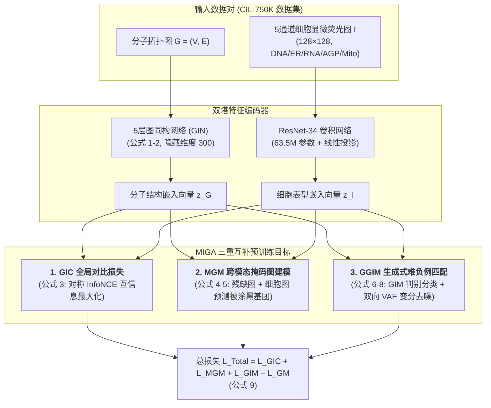

# Cross-Modal Graph Contrastive Learning with Cellular Images (MIGA)

> 📌 **文献定位**：2024 年发表于顶级交叉学科期刊《Advanced Science》（Wiley 旗下顶刊，IF $\approx$ 15+）。由上海交通大学郑双佳、中山大学杨跃东及星药科技（Galixir）团队联合打造。这是全球首个将**高内涵细胞显微荧光成像（Cell Painting）**与**分子图拓扑结构（GNN）**深度对齐的多模态自监督预训练模型，开辟了“基于宏观表型的药物发现与药敏预测”全新范式。

---

## 🌟 核心结论速览（Executive Summary）

* **破局分子自监督硬伤**：传统的纯分子图预训练（如 GraphCL、AttrMasking）缺乏生命体内反应的先验知识，且随机切键容易引发**负迁移（Negative Transfer）**。MIGA 创新性地引入“细胞显微荧光图”作为第二模态，将活体生理表型知识通过知识蒸馏注入分子 GNN。
* **双模态互检索断崖式领先**：在 75 万对数据的 CIL-750K 权威基准上，MIGA 的图-像互检索 MRR 相比 OpenAI CLIP **绝对提升 15.2%**，Hit@5 命中率**暴增 18.6%**（达到 62.3%）。
* **杀手级功能（逆向表型找药）**：无需已知靶点蛋白的三维晶体结构，仅凭致病基因（如癌基因 *JUN*, *TP53*）过表达引起的异常细胞显微图，即可零样本（Zero-shot）在分子库中准确捞出对应的小分子激动剂（召回率达基准的 3 倍）。
* **跨越微观到宏观临床成败**：在 MoleculeNet 的 6 个经典性质预测数据集上 5 项夺魁；并在极其严苛的 **三期临床试验成败预测（TOP Benchmark）** 上，以 AUC 0.654 全面超越了引入临床文本监督的强基线 HINT。

---

## 🔬 一、 核心痛点与生物物理背景

### 1. 为什么纯化学分子图 GNN 不足以做真实制药？
* **拓扑结构的局限**：分子图仅描述了原子通过共价键连接的微观几何拓扑。然而，药物在活体内的生物反应极其复杂（穿透细胞膜、诱发蛋白质折叠、级联信号通路调控、产生毒副代谢物）。
* **纯结构自监督的负迁移**：在分子图上随机做节点掩码（Node Masking），经常会生硬破坏芳香环等稳定官能团，导致网络学到违反化学规律的假先验。

### 2. 微观分子结构与宏观细胞表型的互补性（Figure 1a）
* **高内涵细胞成像（High-Content Imaging, HCI / Cell Painting）**：向培养皿中滴加小分子，经过 48 小时培养与 5 色荧光染色后，显微镜能够直接记录下细胞核、细胞骨架、线粒体等亚细胞结构的显微形态形变。
* **天然对偶关系**：
  * **分子拓扑图（Micro 微观）**：精确记录了化学式，但缺乏活体药效感知；
  * **细胞显微图（Macro 宏观）**：直接呈现了最终的综合生理反应（药敏表型），但无法倒推具体化学键。
  * **核心假说**：将两者在低维隐空间对齐，即可让 GNN 获得强大的“生物视觉感知”。

### 3. 生物跨模态的两大技术死穴
1. **无细粒度的直接视觉对应**：不像图文匹配（文本“狗”对应画面里的狗），显微镜照片里找不到任何一个像“苯环”或“羟基”的像素块。
2. **严重的生物实验批次效应（Batch Effect）**：受制于温度、试剂批次、细胞代数，同一种药物在不同时间拍摄的显微图底色和亮度差异巨大，常规对比学习（如 CLIP）极易过拟合于背景噪点。

---

## 🏗️ 二、 MIGA 整体架构与数据流（Figure 1b）

---

## 📐 三、 核心数学引擎与公式推导（公式 1 至 公式 9）

### 1. 结构与图像特征编码（公式 1 ~ 2）
* **分子图节点更新（消息传递）**：
  $$
  h_v^{(l)} = g_U^{(l)}\Big(h_v^{(l-1)}, \; g_{\text{AGG}}^{(l)}\big(\{(h_v^{(l-1)}, h_u^{(l-1)}, X_{uv}): u \in \mathcal{N}(v)\}\big)\Big) \tag{1}
  $$
  *解释*：第 $l$ 层的原子 $v$ 聚合邻居节点集合 $\mathcal{N}(v)$ 的特征与化学键属性 $X_{uv}$，经过 5 层 GNN 聚合，捕获高阶化学微环境。
* **全图全局池化（READOUT）**：
  $$
  z_G = \sum_{v \in \mathcal{V}} \text{READOUT}(h_v^{(L)}) \tag{2}
  $$
  *解释*：将全部分子原子的向量做求和汇聚，输出代表整颗分子的 300 维全局嵌入 $z_G$。图像端则通过 ResNet-34 提取出 1D 向量 $z_I$。

---

### 2. 损失函数一：GIC 全局图-像对比学习（公式 3）
通过**双向对称的 InfoNCE 损失**，最大化两者的互信息 $MI(G; I)$：
$$
\mathcal{L}_{\text{GIC}} = -\frac{1}{2} \mathbb{E}_{p(G, I)} \left[ \log \frac{\exp(s\langle z_G, z_I \rangle / \tau)}{\sum_{k \neq i}^K \exp(s\langle z_G, z_I^k \rangle / \tau)} + \log \frac{\exp(s\langle z_I, z_G \rangle / \tau)}{\sum_{k \neq i}^K \exp(s\langle z_I, z_G^k \rangle / \tau)} \right] \tag{3}
$$
* **参数解析**：$s\langle z_G, z_I \rangle$ 为经过投影层后的余弦相似度；$\tau$ 为温度系数；分母包含了批次内 $K$ 个未配对的负样本。左半项为“分子搜图像”，右半项为“图像搜分子”。

---

### 3. 损失函数二：MGM 跨模态掩码图建模（公式 4 ~ 5）
**全篇理论灵魂**：强迫 GNN 结合细胞照片进行化学基团“填空题”，实现知识蒸馏。
* 将分子图划分为被掩码遮盖的基团 $G^{\text{msk}}$ 与保留的可见图 $G^{\text{obs}}$：
  $$
  \mathcal{L}_{\text{MGM}} = \mathbb{E}_{(G^{\text{msk}}, G^{\text{obs}}, I) \sim \mathcal{D}} \big[\log P(G^{\text{msk}} \mid (G^{\text{obs}}, I))\big] \tag{4}
  $$
* 具体通过化学基团词表上的交叉熵损失实现：
  $$
  \mathcal{L}_{\text{MGM}} = -\frac{1}{|\mathcal{D}|} \sum_{(g_k^{\text{msk}}, g_k^{\text{obs}}, I_k) \in \mathcal{D}} \log \Big[ p\big(\hat{g}_k^{\text{msk}} \mid f_m(g_k^{\text{obs}}, z_{I_k})\big) \Big] \tag{5}
  $$
  *机制*：模型必须理解“这种细胞形变（如细胞核溶解）必然是由某种特定化学基团（如特定氮杂环）引起的”，从而把生物先验深深烙印进图编码器中。

---

### 4. 损失函数三：GGIM 生成式难负例匹配（公式 6 ~ 9）
针对生物图像严重的批次效应和假负例，构造**判别 + 生成**双重保障：
* **判别式图-像匹配 $\mathcal{L}_{\text{GIM}}$（二分类交叉熵）**：
  $$
  \mathcal{L}_{\text{GIM}} = -\frac{1}{P + N} \sum_{k}^{P+N} \Big[ y_k^m \cdot \log(p_k^m) + (1 - y_k^m) \cdot \log(1 - p_k^m) \Big] \tag{7}
  $$
  *策略*：正负样本比设定为 $1:1$，专门挑选批次内相似度最高但实际不配对的“难负例（Hard Negatives）”施加惩罚。
* **生成式重构 $\mathcal{L}_{\text{GM}}$（双向 VAE 变分自编码器）**：
  $$
  \begin{aligned}
  \mathcal{L}_{\text{GM}} = &-\frac{\lambda_{\text{kl}}}{2} \Big( \mathcal{D}_{\text{KL}}\big(q_\phi(z_I \mid z_G) \,\|\, p(z_I)\big) + \mathcal{D}_{\text{KL}}\big(q_\phi(z_G \mid z_I) \,\|\, p(z_G)\big) \Big) \\
  &+ \frac{1}{2} \Big( \mathbb{E}_{q_\phi(z_I \mid z_G)}[\log p_\theta(z_G \mid z_I)] + \mathbb{E}_{q_\phi(z_G \mid z_I)}[\log p_\theta(z_I \mid z_G)] \Big)
  \end{aligned} \tag{8}
  $$
  *机制*：通过 KL 散度将两模态隐特征向高斯先验对齐，并让分子与图像互相重建对方的隐特征，彻底过滤掉批次实验底色等非因果噪声。
* **最终全模型联合目标**：
  $$
  \mathcal{L} = \mathcal{L}_{\text{GIC}} + \mathcal{L}_{\text{MGM}} + \mathcal{L}_{\text{GIM}} + \mathcal{L}_{\text{GM}} \tag{9}
  $$

---

## 📊 四、 核心实验验证与证据链剖析

### 1. 跨模态双向互检索性能（Table 1 & Figure 2）
在全新的 3,000 个未见分子（50,000 张测试图像）的严格独立集上评估：

| 算法框架 | 分子搜图像 (MRR) | 分子搜图像 (Hit@5) | 图像搜分子 (MRR) | 图像搜分子 (Hit@5) |
| :--- | :--- | :--- | :--- | :--- |
| **传统指纹 (ECFP+CellProf)** | 0.052 (近乎瞎猜) | 4.9% | 0.053 | 5.0% |
| **纯图自监督 (GraphCL)** | 0.247 | 39.1% | 0.279 | 43.3% |
| **OpenAI CLIP (多模态基线)** | 0.265 | 43.7% | 0.327 | 51.5% |
| **MIGA (GIC 单模块消融)** | 0.288 | 43.4% | 0.280 | 44.7% |
| **MIGA (GIC + MGM 消融)** | **0.409** 🚀 | **61.2%** 🚀 | **0.405** 🚀 | **59.8%** 🚀 |
| **MIGA (Full 完全体)** | **0.417** 🏆 | **62.3%** 🏆 | **0.413** 🏆 | **61.4%** 🏆 |

> **关键证据解读**：
> - 传统手工特征几乎等同于随机投掷，彻底失效；
> - 引入 MGM 掩码图基团填空后，MRR 实现了从 0.288 到 0.409 的断崖式暴涨，证明跨模态局部交互是整个系统最强劲的推进器。

### 2. 隐空间特异性验证与“打乱测试”（Figure 3）
* **t-SNE 降维投影（Fig 3a）**：3000 个分子和图像在二维空间紧密团聚，完全对齐。
* **打乱测试（Shuffle Test, Fig 3b vs 3c）**：
  * **CLIP 发生特征坍塌**：原配对与随机打乱对的相似度均聚集在 0.8 附近，无法区分真假关系；
  * **MIGA 展现真实特异性**：原配对余弦相似度高耸在 0.85，一旦打乱，相似度瞬间崩塌至 0 附近。

### 3. 表型虚拟筛选：cDNA 遗传扰动逆向找药（Figure 4）
* **实验设计**：针对 *JUN, HIF1A, STAT3, BRCA1, HSPA5, TP53* 六大关键致病基因，仅输入其过表达（cDNA）后的细胞显微变异图，要求模型在 120 个分子候选池（20 个真药 + 100 个干扰分子）中把真药排在最前；
* **战果**：在 *JUN* 基因上，MIGA 的 `Recall@10` 达到 **0.24**（传统化学指纹仅 0.08，CLIP 为 0.21）。证明其完全摆脱了对蛋白质晶体三维结构的依赖，为“不可成药靶点”提供了颠覆性的表型找药路径。

### 4. 分子性质迁移泛化（Table 2, MoleculeNet）
在 OGB 标准协议下进行骨架严格切分（Scaffold Split 8:1:1）：
* **分类任务均分**：MIGA 达到 **71.37% ROC-AUC**，在 HIV、Tox21、ToxCast、BBBP 上斩获第一（较非预训练模型提升近 6%）；
* **ESOL 水溶性反思**：在纯水溶性任务上优势不明显，因其属于纯小分子物化固有属性，不经体内复杂代谢通路，反向确证了 MIGA 专精于复杂系统生物学表型建模。

### 5. 临床试验结局预测（Table 3, TOP Benchmark）
预测药物在人体临床一、二、三期的最终命运：
* **三期临床（Phase III）**：MIGA 的 ROC-AUC 飙升至 **0.654**（纯图基线 JOAO 仅 0.563）；
* **击溃作弊基线 HINT**：模型 HINT 显式依赖了医生填写的临床文本与病历，而 MIGA **纯靠预训练阶段看细胞显微图汲取的高维生物直觉**，在没有人工临床病历辅助下全面胜出。

---

## ⚙️ 五、 工业复现核心配置指南（Implementation Details）

| 维度 | 官方论文实现参数 | 个人轻量复现 / 学习建议 |
| :--- | :--- | :--- |
| **图编码器 (GNN)** | 5 层 GIN，隐藏层 300 维 | 保持官方结构不变（轻量高效） |
| **图像编码器 (CNN)** | ResNet-34（63.5M 参数，预训练权重初始化） | 可使用官方提供的预训练权重直接推理 |
| **硬件与训练开销** | **8 × NVIDIA RTX 3090Ti (24GB)** 并行 | ❌ 不建议个人从头重训 75 万对数据 |
| **训练轮次与耗时** | 100 Epochs, 全局 Batch Size 1024，**耗时 8 小时** | 推荐跑官方提供的零样本推理 Demo |
| **优化器与学习率** | Adam, lr = 3e-4, Weight Decay = 0.02 | 微调时可降低至 lr = 1e-4 |
| **图像输入规格** | 裁剪缩放至 **$128 \times 128$ 分辨率**，5 通道 | 保持 $128 \times 128 \times 5$ 输入张量格式 |

---

## 🔮 六、 审稿人视角批判与药敏（AIDD）前沿启示

### 1. 本文的软肋与局限（Limitations）
1. **图像特征提取器较为初级**：采用了通用 CV 的 ResNet-34，没有引入针对多通道荧光生物特性的专用视觉 Backbone（如针对 Cell Painting 定制的 Vision Transformer 或形态学特征注意力机制）；
2. **细胞系泛化跨度未测**：主要在骨肉瘤细胞系（U2OS）等有限细胞系中开展，尚未验证跨组织（如肝脏、神经细胞系）的表型自适应能力。

### 2. 对药物敏感性预测（Cancer Drug Response, CDR）的降维启发
* **传统药敏死穴**：过度依赖高成本的单细胞 RNA-seq 表达谱测序；
* **未来航向**：结合高内涵 Cell Painting 图像，**将细胞受药前后的形态变异图像，作为显式药物敏感/耐药终点表型进行端到端预测**。
* **数据演进追踪**：重点跟踪全球最大表型联盟 **JUMP-CP（14 万种化学与基因扰动数据集）**，这是未来发表顶刊 AIDD 论文的全新数据金矿。

---

## 🔗 关联知识节点与双向索引

* **多模态图卷积基础**：[从全连接层到卷积](../../动手学深度学习/多层感知机/4.1%20多层感知机.md)
* **过拟合与骨架泛化差距**：[模型选择、欠拟合和过拟合](../../动手学深度学习/多层感知机/4.4%20模型选择、欠拟合和过拟合.md)
* **自监督与掩码正则化**：[暂退法（丢弃法）](../../动手学深度学习/多层感知机/4.6%20暂退法（丢弃法）.md)
* **临床循证医疗对比**：[2026 npj 大模型临床医学 Meta 分析](2026-npj-Human-LLM协作在临床医学中的Meta分析.md)
