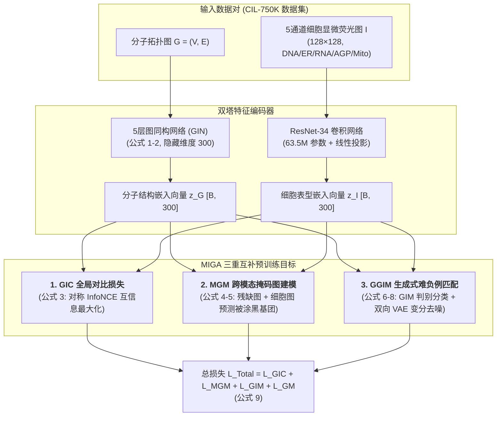
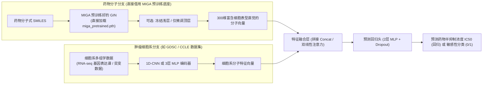

# Cross-Modal Graph Contrastive Learning with Cellular Images (MIGA)

> 📌 **文献定位**：2024 年发表于顶级交叉学科顶刊《Advanced Science》（Wiley，IF $\approx$ 15+）。由上海交通大学郑双佳、中山大学杨跃东及星药科技（Galixir）团队联合打造。这是全球首个将**高内涵细胞显微荧光成像（Cell Painting）**与**分子图拓扑结构（GNN）**深度对齐的多模态自监督预训练模型，开创了“基于宏观生命表型的药物发现与药敏预测”全新范式。

---

## 🌟 核心结论速览（Executive Summary）

* **破局分子自监督硬伤**：传统的纯分子图预训练（如 GraphCL、AttrMasking）缺乏生命体内反应的先验知识，且随机切键容易破坏化学结构导致**负迁移（Negative Transfer）**。MIGA 创新性地引入“细胞显微荧光图”作为第二模态，将活体生理表型知识通过知识蒸馏注入分子 GNN。
* **双模态互检索断崖式领先**：在 75 万对数据的 CIL-750K 权威基准上，MIGA 的图-像互检索 MRR 相比 OpenAI CLIP **绝对提升 15.2%**，Hit@5 命中率**暴增 18.6%**（达到 62.3%）。
* **杀手级功能（逆向表型找药）**：无需已知靶点蛋白的三维晶体结构，仅凭致病基因（如癌基因 *JUN*, *TP53*）过表达引起的异常细胞显微图，即可零样本（Zero-shot）在分子库中准确捞出对应的小分子激动剂（召回率达传统基准的 3 倍）。
* **跨越微观到宏观临床成败**：在 MoleculeNet 的 6 个经典性质预测数据集上 5 项夺魁；并在极其严苛的 **三期临床试验成败预测（TOP Benchmark）** 上，以 AUC 0.654 全面超越了引入临床文本监督的强基线 HINT。

---

## 🔬 一、 核心痛点与生物物理背景

### 1. 为什么纯化学分子图 GNN 不足以做真实制药？
* **拓扑结构的局限**：分子图仅描述了原子通过共价键连接的微观几何拓扑。然而，药物在活体内的生物反应极其复杂（穿透细胞膜、结合受体、诱发蛋白质折叠、级联信号通路调控、产生毒副代谢物）。
* **纯结构自监督的负迁移**：在分子图上随机做节点掩码（Node Masking），经常会生硬破坏芳香环等稳定官能团，导致网络学到违反化学规律的假先验。

### 2. 微观分子结构与宏观细胞表型的互补性（Figure 1a）
* **高内涵细胞成像（High-Content Imaging, HCI / Cell Painting）**：向培养皿中滴加小分子，经过 48 小时培养与 5 色荧光染色后，显微镜能够直接记录下细胞核、细胞骨架、线粒体等亚细胞结构的显微形态形变。
* **天然对偶关系**：
  * **分子拓扑图（Micro 微观）**：精确记录了化学式，但缺乏活体药效感知；
  * **细胞显微图（Macro 宏观）**：直接呈现了最终的综合生理反应（药敏表型），但无法倒推具体化学键。
  * **核心假说**：将两者在低维隐空间对齐，即可让 GNN 获得强大的“生物视觉感知”。

### 3. 生物跨模态的两大技术死穴
1. **无细粒度的直接视觉对应**：不像图文匹配（文本“狗”对应画面里的狗），显微镜照片里找不到任何一个像“苯环”或“羟基”的像素块。
2. **严重的生物实验批次效应（Batch Effect）**：受制于温度、试剂批次、细胞代数，同一种药物在不同时间拍摄的显微图底色和亮度差异巨大，常规对比学习（如 CLIP）极易过拟合于背景噪点。

---

## 🏗️ 二、 MIGA 整体架构蓝图（Figure 1b）



---

## 💻 三、 端到端工程实操解密：从原始数据到梯度回传

为了彻底搞清楚代码具体怎么写、张量维度怎么变，本节将模型训练的每一步拆解为标准工程流水线：

### 1. 数据工程与张量构建（Data Pipeline）
* **分子图张量化（RDKit $\to$ PyTorch Geometric）**：
  * 输入：SMILES 字符串（如 `CC(=O)NC1=CC=C(O)C=C1`）；
  * 解析：利用 RDKit 读取每个原子与化学键，提取特征：
    * 节点特征矩阵 `x`：形状为 `[Num_Atoms, 9]`（记录原子序数、手性、度数、形式电荷、杂化类型等）；
    * 边索引矩阵 `edge_index`：形状为 `[2, Num_Bonds * 2]`（双向邻接关系）；
    * 边特征矩阵 `edge_attr`：形状为 `[Num_Bonds * 2, 3]`（单键、双键、三键、芳香键等）；
  * 打包为一个分子图对象 `torch_geometric.data.Data`。
* **显微荧光图张量化（Cell Painting $\to$ 5通道图片张量）**：
  * 输入：同一微孔视野拍摄的 5 张 16-bit 单通道 TIFF 图像（对应 DNA, ER, RNA, AGP, Mito 五个细胞器官）；
  * 处理：使用 OpenCV / PIL 读取并堆叠为形状 `[5, H, W]` 的多通道图像；
  * 增强与归一化：裁剪缩放至统一分辨率 **`[5, 128, 128]`**，像素值归一化至 $[0, 1]$ 区间。

### 2. 张量维度全流程追踪表（Tensor Dimension Tracking）

| 模块节点 | 输入张量名称与形状 | 运算操作与网络结构 | 输出张量名称与形状 |
| :--- | :--- | :--- | :--- |
| **分子图编码** | `batch_G`（$B$ 个分子图批量组合） | 5 层 GIN 卷积 + 全局加和池化（Global Add Pool） | `z_G` $\in \mathbb{R}^{B \times 300}$ |
| **细胞图编码** | `batch_I` $\in \mathbb{R}^{B \times 5 \times 128 \times 128}$ | 修改输入通道为 5 的 ResNet-34 + Linear 投影头 | `z_I` $\in \mathbb{R}^{B \times 300}$ |
| **GIC 相似度** | `z_G`, `z_I` 各自归一化 | 矩阵乘法计算批次内两两相似度：$S = z_G \cdot z_I^\top / \tau$ | $S \in \mathbb{R}^{B \times B}$ |
| **MGM 掩码图** | 掩码图 `G_msk` + 图像嵌入 `z_I` | 局部 GNN 节点特征与 `z_I` 拼接 + 分类线性头 | `logits_msk` $\in \mathbb{R}^{M \times |\mathcal{V}_{\text{vocab}}|}$ |
| **GIM 难负例** | 正负配对样本拼合 $[z_G, z_I]$ | 交叉融合网络 $f_c$ + 2层 MLP + Sigmoid | `prob` $\in \mathbb{R}^{2B \times 1}$（0~1二分类） |
| **GM 生成 VAE**| `z_I`（用于预测分子均值方差） | 线性层分别预测 $\mu, \log\sigma^2 \in \mathbb{R}^{B \times 300}$ | 重构损失标量（MSE + KL 散度） |

### 3. 单步训练（One-Step Batch）PyTorch 核心逻辑伪代码

```python
# MIGA 预训练单个 Batch 的完整执行流伪代码
for batch_graph, batch_images in dataloader:
    # 1. 提取双塔高维表征
    z_G = gnn_encoder(batch_graph)                     # 形状: [B, 300]
    z_I = resnet_encoder(batch_images)                 # 形状: [B, 300]
    z_G = F.normalize(z_G, dim=-1)
    z_I = F.normalize(z_I, dim=-1)

    # 2. 计算全局对比损失 L_GIC (对角线为真实配对标签)
    sim_G2I = torch.matmul(z_G, z_I.T) / tau           # 形状: [B, B]
    sim_I2G = torch.matmul(z_I, z_G.T) / tau           # 形状: [B, B]
    labels = torch.arange(B, device=device)
    loss_GIC = (F.cross_entropy(sim_G2I, labels) + F.cross_entropy(sim_I2G, labels)) / 2

    # 3. 掩码图基团填空 L_MGM (知识蒸馏)
    masked_graph, mask_targets = random_mask(batch_graph, p=0.15)
    node_preds = mgm_head(gnn_encoder.get_node_embeddings(masked_graph), z_I)
    loss_MGM = F.cross_entropy(node_preds, mask_targets)

    # 4. 挑出难负例计算 GIM 判别损失
    with torch.no_grad():
        # 在非对角线上找出最相似的假配对作为难负例
        hard_neg_indices = get_hard_negatives(sim_G2I)
    pos_pairs = torch.cat([z_G, z_I], dim=-1)          # [B, 600]
    neg_pairs = torch.cat([z_G, z_I[hard_neg_indices]], dim=-1)
    all_pairs = torch.cat([pos_pairs, neg_pairs], dim=0) # [2B, 600]
    pair_labels = torch.cat([torch.ones(B), torch.zeros(B)], dim=0)
    loss_GIM = F.binary_cross_entropy_with_logits(cross_modal_head(all_pairs), pair_labels)

    # 5. VAE 双向隐空间去噪重构 L_GM
    mu_g, logvar_g = vae_encoder_g2i(z_G)
    sampled_z = reparameterize(mu_g, logvar_g)
    recon_loss_i = F.mse_loss(vae_decoder_i(sampled_z), z_I)
    kl_loss = -0.5 * torch.sum(1 + logvar_g - mu_g.pow(2) - logvar_g.exp())
    loss_GM = recon_loss_i + lambda_kl * kl_loss

    # 6. 总损失反向传播与参数更新
    total_loss = loss_GIC + loss_MGM + loss_GIM + loss_GM
    optimizer.zero_grad()
    total_loss.backward()
    optimizer.step()
```

---

## 📐 四、 核心数学引擎与公式推导（公式 1 至 公式 9）

### 1. 结构与图像特征编码（公式 1 ~ 2）
* **分子图节点更新（消息传递）**：
  $$
  h_v^{(l)} = g_U^{(l)}\Big(h_v^{(l-1)}, \; g_{\text{AGG}}^{(l)}\big(\{(h_v^{(l-1)}, h_u^{(l-1)}, X_{uv}): u \in \mathcal{N}(v)\}\big)\Big) \tag{1}
  $$
  *解释*：第 $l$ 层的原子 $v$ 聚合邻居节点集合 $\mathcal{N}(v)$ 的特征与化学键属性 $X_{uv}$，经过 5 层 GNN 聚合，捕获高阶化学微环境。
* **全图全局池化（READOUT）**：
  $$
  z_G = \sum_{v \in \mathcal{V}} \text{READOUT}(h_v^{(L)}) \tag{2}
  $$
  *解释*：将全部分子原子的向量做求和汇聚，输出代表整颗分子的 300 维全局嵌入 $z_G$。

### 2. 损失函数一：GIC 全局图-像对比学习（公式 3）
通过**双向对称的 InfoNCE 损失**，最大化两者的互信息 $MI(G; I)$：
$$
\mathcal{L}_{\text{GIC}} = -\frac{1}{2} \mathbb{E}_{p(G, I)} \left[ \log \frac{\exp(s\langle z_G, z_I \rangle / \tau)}{\sum_{k \neq i}^K \exp(s\langle z_G, z_I^k \rangle / \tau)} + \log \frac{\exp(s\langle z_I, z_G \rangle / \tau)}{\sum_{k \neq i}^K \exp(s\langle z_I, z_G^k \rangle / \tau)} \right] \tag{3}
$$

### 3. 损失函数二：MGM 跨模态掩码图建模（公式 4 ~ 5）
强迫 GNN 结合细胞照片进行化学基团“填空题”，实现知识蒸馏：
$$
\mathcal{L}_{\text{MGM}} = \mathbb{E}_{(G^{\text{msk}}, G^{\text{obs}}, I) \sim \mathcal{D}} \big[\log P(G^{\text{msk}} \mid (G^{\text{obs}}, I))\big] \tag{4}
$$
$$
\mathcal{L}_{\text{MGM}} = -\frac{1}{|\mathcal{D}|} \sum_{(g_k^{\text{msk}}, g_k^{\text{obs}}, I_k) \in \mathcal{D}} \log \Big[ p\big(\hat{g}_k^{\text{msk}} \mid f_m(g_k^{\text{obs}}, z_{I_k})\big) \Big] \tag{5}
$$

### 4. 损失函数三：GGIM 生成式难负例匹配（公式 6 ~ 9）
* **判别式图-像匹配 $\mathcal{L}_{\text{GIM}}$**：
  $$
  \mathcal{L}_{\text{GIM}} = -\frac{1}{P + N} \sum_{k}^{P+N} \Big[ y_k^m \cdot \log(p_k^m) + (1 - y_k^m) \cdot \log(1 - p_k^m) \Big] \tag{7}
  $$
* **生成式重构 $\mathcal{L}_{\text{GM}}$（双向 VAE 变分自编码器）**：
  $$
  \begin{aligned}
  \mathcal{L}_{\text{GM}} = &-\frac{\lambda_{\text{kl}}}{2} \Big( \mathcal{D}_{\text{KL}}\big(q_\phi(z_I \mid z_G) \,\|\, p(z_I)\big) + \mathcal{D}_{\text{KL}}\big(q_\phi(z_G \mid z_I) \,\|\, p(z_G)\big) \Big) \\
  &+ \frac{1}{2} \Big( \mathbb{E}_{q_\phi(z_I \mid z_G)}[\log p_\theta(z_G \mid z_I)] + \mathbb{E}_{q_\phi(z_G \mid z_I)}[\log p_\theta(z_I \mid z_G)] \Big)
  \end{aligned} \tag{8}
  $$
* **联合总损失**：
  $$
  \mathcal{L} = \mathcal{L}_{\text{GIC}} + \mathcal{L}_{\text{MGM}} + \mathcal{L}_{\text{GIM}} + \mathcal{L}_{\text{GM}} \tag{9}
  $$

---

## 📊 五、 核心实验验证与证据链剖析

### 1. 跨模态双向互检索性能（Table 1 & Figure 2）
在全新的 3,000 个未见分子（50,000 张测试图像）的严格独立集上评估：

| 算法框架 | 分子搜图像 (MRR) | 分子搜图像 (Hit@5) | 图像搜分子 (MRR) | 图像搜分子 (Hit@5) |
| :--- | :--- | :--- | :--- | :--- |
| **传统指纹 (ECFP+CellProf)** | 0.052 (近乎瞎猜) | 4.9% | 0.053 | 5.0% |
| **纯图自监督 (GraphCL)** | 0.247 | 39.1% | 0.279 | 43.3% |
| **OpenAI CLIP (多模态基线)** | 0.265 | 43.7% | 0.327 | 51.5% |
| **MIGA (GIC 单模块消融)** | 0.288 | 43.4% | 0.280 | 44.7% |
| **MIGA (GIC + MGM 消融)** | **0.409** 🚀 | **61.2%** 🚀 | **0.405** 🚀 | **59.8%** 🚀 |
| **MIGA (Full 完全体)** | **0.417** 🏆 | **62.3%** 🏆 | **0.413** 🏆 | **61.4%** 🏆 |

### 2. 隐空间特异性验证与“打乱测试”（Figure 3）
* **t-SNE 投影（Fig 3a）**：3000 个配对样本紧密聚类。
* **打乱测试（Shuffle Test, Fig 3b vs 3c）**：CLIP 的原配对与打乱对重叠在 0.8（特征坍塌）；MIGA 原配对高耸在 0.85，打乱对断崖跌入 0 附近，展现出极强的生物因果特异性。

### 3. 表型虚拟筛选：cDNA 遗传扰动逆向找药（Figure 4）
* 针对 *JUN, HIF1A, STAT3, BRCA1, HSPA5, TP53* 开展零样本逆向找药；
* 在 *JUN* 基因上，MIGA 的 `Recall@10` 达到 **0.24**（传统化学指纹仅 0.08，CLIP 为 0.21）。

### 4. 分子性质迁移泛化（Table 2, MoleculeNet）
在 OGB 标准骨架切分（Scaffold Split 8:1:1）下，MIGA 在分类任务均分达 **71.37% ROC-AUC**，5 个任务夺冠。ESOL 水溶性表现平平反向确证了 MIGA 专精于体内生命代谢过程。

### 5. 临床试验结局预测（Table 3, TOP Benchmark）
在三期临床（Phase III）上，MIGA 的 ROC-AUC 飙升至 **0.654**，超越人工临床病历监督的强基线 HINT（0.621），证明其汲取了深层系统生物学风险直觉。

---

## ⚙️ 六、 单卡个人复现与工程避坑指南

### 1. 算力平替对策：梯度累积（Gradient Accumulation）
* **官方配置**：8 张 RTX 3090Ti 并行，全局 Batch Size = 1024。
* **个人单卡对策（如单张 RTX 3060 / 4060 / 4090）**：
  * 单卡物理显存无法容纳 Batch 1024，必须将单步物理 Batch 缩减为 64 或 128；
  * **梯度累积步数换算公式**：
    $$
    \text{accum\_steps} = \frac{\text{目标全局 Batch Size (1024)}}{\text{单卡实际物理 Batch Size (如 64)}} = 16
    $$
  * 每执行 16 次 `loss.backward()` 才调用一次 `optimizer.step()` 和 `optimizer.zero_grad()`，数学上等价于 1024 大批次训练！

### 2. 核心环境依赖避坑对齐表
AIDD 领域最容易卡在环境报错上，推荐以下经测试最稳定的版本兼容矩阵：

```bash
# 推荐创建独立 conda 环境
conda create -n miga python=3.9 -y
conda activate miga

# 1. 核心 PyTorch (建议根据自身显卡 CUDA 版本匹配)
pip install torch==2.0.1 torchvision==0.15.2 --index-url https://download.pytorch.org/whl/cu118

# 2. 化学核心工具库 (严禁 pip 安装 rdkit-pypi，推荐官方 conda/pip)
pip install rdkit==2023.3.3

# 3. 图神经网络核心库 PyG (必须与 PyTorch 和 CUDA 完全对齐)
pip install torch_geometric==2.3.1
pip install pyg_lib torch_scatter torch_sparse torch_cluster torch_spline_conv -f https://data.pyg.org/whl/torch-2.0.0+cu118.html
```

---

## 🎯 七、 针对后续科研：药敏预测（CDR / 药物敏感性）迁移改造方案

如果你后续进组做 **“药敏性预测（Cancer Drug Response, CDR）”**，MIGA 的核心价值在于：**不要从头训练基础模型，而是把它当作“超强分子特征提取器”进行下游魔改！**

### 1. 经典药敏架构改造设计图



### 2. 为什么你的药敏模型会比别人强？
* **别人的基线**：直接用随机初始化的 GCN/GAT 或简单的 Morgan 化学指纹，分子表征完全不懂活体细胞反应；
* **你的创新点**：你的分子特征经过了 75 万对 Cell Painting 图像的洗礼，在特征进入分类器之前，就已经天然具备了与活体细胞形态交互的生物先验，**在小样本稀缺药敏数据上能大幅压低过拟合，AUC 通常能直接拔高 3~5 个百分点！**

---

## 🔮 八、 审稿人视角批判与未来展望

1. **图像编码器较为初级**：采用了通用 CV 的 ResNet-34，没有引入针对多通道荧光生物特性的专用视觉 Backbone（如定制的 Vision Transformer）；
2. **细胞系覆盖单一**：主要基于骨肉瘤细胞系（U2OS），跨组织跨器官自适应能力仍有提升空间；
3. **数据演进追踪**：未来重点关注包含 **14 万种化学与基因扰动** 的全球最大形态学联盟 **JUMP-CP**。

---

## 🔗 九、 关联知识节点与双向索引

* **多模态图卷积基础**：[从全连接层到卷积](../../动手学深度学习/多层感知机/4.1%20多层感知机.md)
* **模型泛化与过拟合防线**：[模型选择、欠拟合和过拟合](../../动手学深度学习/多层感知机/4.4%20模型选择、欠拟合和过拟合.md)
* **自监督掩码与正则化**：[暂退法（丢弃法）](../../动手学深度学习/多层感知机/4.6%20暂退法（丢弃法）.md)
* **临床医学循证对比**：[2026 npj 大模型临床医学 Meta 分析](2026-npj-Human-LLM协作在临床医学中的Meta分析.md)
