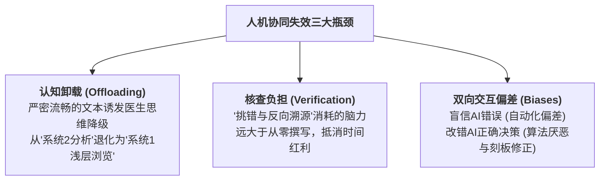

# Human–large language model collaboration in clinical medicine: a systematic review and meta-analysis

> 📌 **文献定位**：2026 年 1 月发表于《npj Digital Medicine》（Nature 旗下数字医学顶级子刊）。这是全球首篇通过严格 Meta 分析量化评估**“人类医生 + 大模型（H + AI）”临床协同效能**的循证医学研究，直接打破了“AI + 医生必然产生颠覆性增效”的行业神话。

---

## 🌟 核心结论速览（Executive Summary）

* **诊断提升微弱且不显著**：人机协同组相比纯医生组，诊断准确率虽有上升趋势（RR 1.59），但在统计学上**未达到显著性（95% CI: 0.08 ~ 32.74）**；
* **完全没有节省临床时间**：总耗时平均仅相差 **+0.4 分钟（95% CI: –4.18 ~ +4.97 分钟）**，“生成草稿省下的时间”被“排查幻觉所消耗的精力”完全吞噬；
* **事实性错误率高达 26% ~ 36%**：尽管大模型生成的病历在词藻、格式等主观指标上得分更高，但**关键医学事实错误率超 1/3**，构成潜在医疗安全隐患；
* **人机协同并不必然优于“纯 AI”**：在三臂试验中，由于人类认知偏差（盲目相信或错误改动），“医生 + AI”的表现有时甚至落后于独立运行的 AI。

---

## 🎯 一、 PICO 循证医学研究框架

| 维度 | 定义与范围 |
| :--- | :--- |
| **P（Population / 场景）** | 在真实或模拟场景中执行临床任务的医务人员（专科医生、住院医师、医学生）。任务涵盖：**临床推理、诊断检验判读、病历文书撰写**。 |
| **I（Intervention / 干预组）** | **人机协作（H + AI）**：医生使用通用大语言模型（如 GPT-4、Claude 等）辅助完成任务。 |
| **C（Comparison / 对照组）** | **主要对照**：纯人类组（H-only，医生独立完成）。<br>**次要对照（三臂比较）**：纯 AI 组（AI-only，模型无干预生成）。 |
| **O（Outcomes / 结局指标）** | 1. 诊断/判读准确率（RR）<br>2. 综合诊疗表现得分（MD, 百分制）<br>3. 任务总耗时（MD, 分钟）<br>4. 文书质量与事实错误率（Factual Error Rate） |

---

## 🔬 二、 PRISMA 检索漏斗与行业透视

* **注册号**：PROSPERO 预注册编号 `CRD420251068272`，严格遵循 PRISMA 2020 报告指南。
* **检索范围**：MEDLINE、Embase、Web of Science、Cochrane 四大数据库，截止日期为 2025 年 6 月 28 日。

```
[原始检出] 1,235 篇记录
    │
    ▼ (剔除 182 篇重复)
[题录/摘要初筛] 1,053 篇记录
    │
    ▼ (剔除 958 篇未设立有效人机协同对照的研究)
[全文精读审查] 95 篇全文
    │
    ▼ (剔除数据缺失、未对照任务细节的文献)
[最终纳入] 10 篇同行评议研究（主分析） + 3 篇预印本（仅用于敏感性分析）
```

> 💡 **审稿人洞察（行业虚火）**：  
> 初筛 1,200 多篇，最终仅有 **10 篇** 合格。这揭露了医疗 AI 领域的一个严峻现实——绝大多数论文只是让大模型“单独做考试卷（如 USMLE）”或由医生事后打分，**真正将医生与 AI 结合并开展严格人机对照的临床试验极度匮乏**。

---

## 📊 三、 核心结局指标与 Meta 分析数据精读

### 1. 诊断与判读准确率（Diagnostic Accuracy）
* **纳入文献**：$k = 2$ 项合格试验
* **指标**：风险比（Risk Ratio, RR）
* **定量结果**：
  * **合并 RR = 1.59**
  * **95% CI：0.08 ～ 32.74**（跨越无效线 1.0）
  * **95% 预测区间（PI）**：严重跨越无效线
* **深度解读**：虽然点估计提升了 59%，但极宽的置信区间表明当前数据极不精确，**现有循证证据无法得出“大模型能显著提升医生诊断正确率”的定论**。

### 2. 综合诊疗表现得分（Composite Scores）
* **纳入文献**：$k = 2$ 项合格试验
* **指标**：均数差（Mean Difference, MD，以百分制换算）
* **定量结果**：
  * **合并 MD = +4.88 个百分点**（95% CI: +0.65 ～ +9.12，$p < 0.05$）
  * **95% 预测区间（PI）：–31.65 ～ +41.42**
* **深度解读（CI 与 PI 的撕裂）**：
  * 平均而言，大模型带来了 4.88 分的微弱提升；
  * 但 **95% 预测区间（PI）暴跌至 –31.65 到 +41.42**。这警示我们：在下一个未知的真实医院落地时，大模型可能让某些医生的表现大幅提高 41 分，也可能因为误导而**使表现暴跌 31 分**。真实世界的波动性与不确定性巨大。

### 3. 工作耗时与效率（Time Efficiency）
* **纳入文献**：$k = 3$ 项合格试验
* **指标**：均数差（MD，单位：分钟）
* **定量结果**：
  * **合并 MD = +0.4 分钟**（95% CI: –4.18 ～ +4.97 分钟）
  * **异质性检验**：$I^2 = 70.1\%$（高异质性）
* **深度解读**：人机协同组与纯医生组的平均耗时毫无统计学差异。大模型生成初稿固然迅速，但医生核验错漏的认知损耗完全抵消了生成收益。

### 4. 文书质量与事实错误率（Quality vs. Factual Errors）
* **主观质量**：排版条理性、医学术语规范度上，协同组评分显著优于人类组；
* **核心安全性**：文书中包含的**事实性错误率高达 26% ～ 36%**（存在三分之一的虚假捏造或关键遗漏）。
* **核心启示**：大模型呈现出“形式优美、事实残缺”的危险假象，在临床法律责任面前构成了重大的核查负担。

---

## 🧠 四、 临床人机协同失效的三大认知心理机制



1. **认知卸载与深度审阅降级**：大模型生成的语言具有欺骗性的流畅感（Fluent Inaccuracy）。人类面对语法严整的文字会天然放松警惕，忽视对关键药物剂量和检查指标的核查。
2. **核验摩擦（Verification Friction）**：医生检查 AI 生成的病历，需要对照多份化验单和系统记录进行“逆向工程”，大脑负荷沉重。
3. **三臂试验中的双向失真**：
   * *自动化偏差（Automation Bias）*：低年资医生倾向于全盘接受 AI 建议，放大了 AI 的偏见；
   * *算法厌恶与误矫正（Mis-correction）*：在罕见病例中，医生凭借个人经验盲目推翻了 AI 正确的前沿诊断。

---

## ⚖️ 五、 方法学局限性批判（审稿人视角）

1. **样本量极小**：核心指标仅合并了 2~3 项研究，统计学功效有限；
2. **缺乏法律责任环境（Simulated vs. Real-world）**：纳入试验绝大部分为离线纸面病例（Vignettes）测试，医生在无实际诉讼压力下的行为，与身处真实高压门诊、急诊科的行为具有本质差距；
3. **提示词与模型异质性**：GPT-3.5 与 GPT-4 混杂，提示词工程未经标准化规范。

---

## 🚀 六、 对未来医疗 AI 研发与落地的三大约束

1. **试验范式转移**：从“孤立刷题测试”转向**嵌入真实医院 HIS/EMR 系统的多中心实用性随机对照试验（Pragmatic RCTs）**；
2. **核心评价标准重构**：严禁只看“满意度”与“可读性”，主终点必须与**事实错误率、漏诊率、医疗不良事件**直接挂钩；
3. **UI/UX 交互革命（彻底淘汰纯 Chat 窗口）**：
   * **显性化呈现不确定性（Surfacing Uncertainty）**：对置信度低的信息用视觉色彩警示；
   * **可溯源高亮（Traceability）**：AI 结论必须能直接反查高亮原始病历片段，从源头降低医生的验证成本。

---

## 🔗 关联知识节点与双向索引

* **模型能力与过拟合边界**：[模型容量与泛化差距](../动手学深度学习/多层感知机/4.4%20模型选择、欠拟合和过拟合.md)
* **不确定性建模与随机丢弃**：[Dropout 与贝叶斯不确定性](../动手学深度学习/多层感知机/4.6%20暂退法（丢弃法）.md)
* **基础分类与置信度校准**：[Softmax 概率与真实置信度](../动手学深度学习/线性神经网络/3.4%20softmax回归.md)
